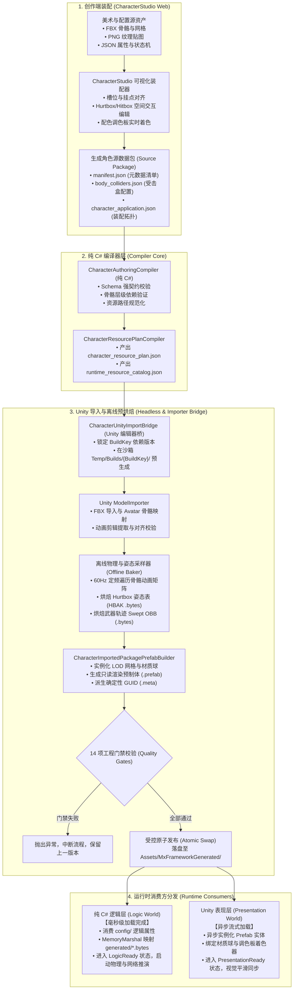
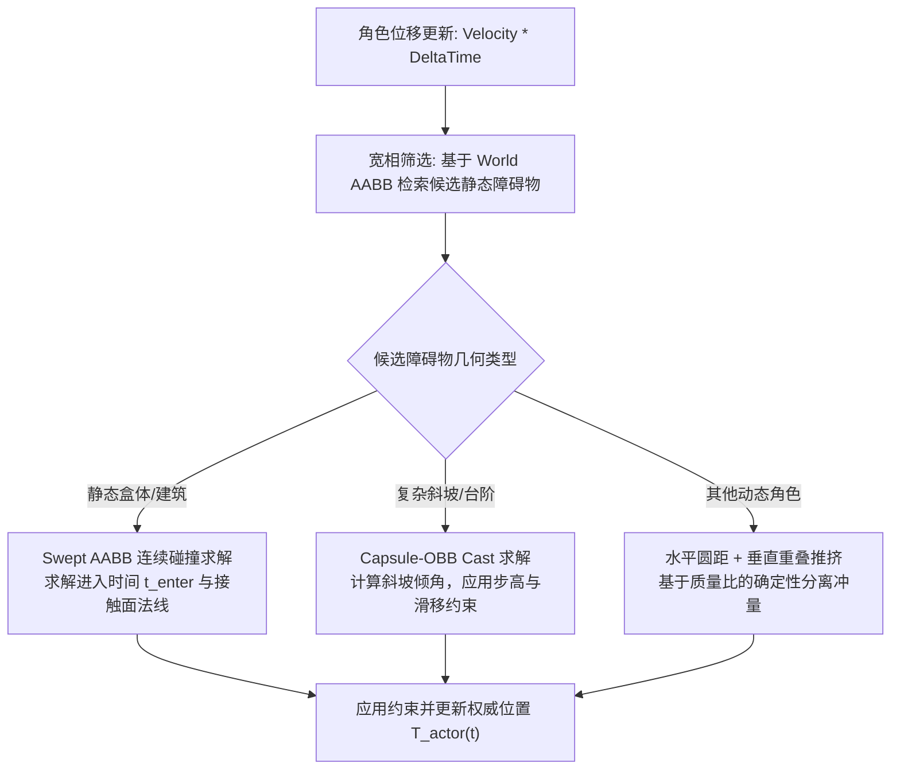
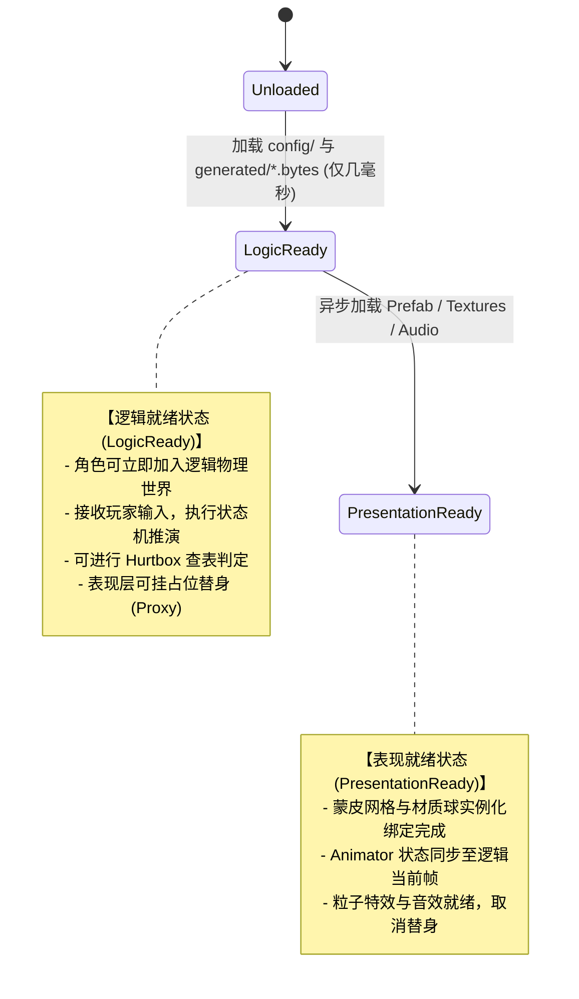

# 【技术评审方案】角色全景数据架构、运行管线与工业化管线设计白皮书（vNext.1 深度复审与工程落地规范）

---

## 评审信息与修订说明

| 属性 | 内容 |
| :--- | :--- |
| **方案名称** | 基于解耦角色资源包与离线预烘焙的工业化角色数据架构设计 |
| **版本状态** | **vNext.1 深度复审与工程落地规范稿（Addressing Expert Review Major Revision Feedback）** |
| **主审领域** | 客户端底层架构 / 动作战斗系统 / 资源与构建管线 / 跨平台确定性模拟 / 内存与并发工程 |
| **文档定位** | 核心架构评审基准文档（自包含规范，无前置项目代码依赖，以严谨工程证据、数学推导与严格契约定义为准） |

---

### 演进与迁移影响声明（Migration & Evolution Notice C-01 ~ C-06）

> [!IMPORTANT]
> **关于现有工程实现与本规范的边界声明**：
> 本文不仅完整复盘了当前工程（基于角色 `000001`）已实现的生产要素与管线拓扑，更针对专家评审提出的 P0/P1/P2 问题，明确提出了进阶工程规范。为避免混淆“已实现现状”与“vNext.1 演进目标”，特在此明确六项关键演进契约：
> 
> - **C-01（二进制格式跨代）**：现行工程生成并消费基于 4 字节自然对齐的定长浮点 `HBAK v2` 协议（详见第 5.3 节）。本规范制定的 `HBAK v3` 整数定点协议为**重大升级（Breaking Change）**，二者通过文件头 Magic 与 Version 严格隔离，**非原地兼容**，需执行离线重编迁移。
> - **C-02（量化时机前移）**：现行运行时在加载阶段对浮点姿态执行向下取整量化并存入 `Fixed64` 结构；vNext.1 规范正式提出将量化时机前移至**发行构建期（AOT Bake-Time Quantization）**，加载期量化仅作为编辑器调试降级回退。
> - **C-03（坐标手性 Profile）**：现行 `000001` ~ `000009` 角色已固化采用 **Profile A（Z轴镜像，朝向 -Z）** 导入标准；针对新立项角色，本规范定义了标准化 **Profile B（X轴镜像，保持 +Z 前向一致）**，导入桥通过 `CoordinateProfile` 字段实现双轨兼容。
> - **C-04（两阶段发布事务）**：Unity Editor 的 `AssetDatabase.StartAssetEditing()` 仅为编辑器资源导入事件批处理锁，**不是操作系统级或跨进程 ACID 文件事务**。vNext.1 规范确立基于 `Temp/Builds/{BuildKey}/` 独立物理沙箱的快照生成与受控原子交换（Atomic Swap）机制。
> - **C-05（战斗姿态绝对权威）**：确立战斗姿态与时间推进的**策略 A（Combat Authority 独立于表现层动画混合与动态 IK）**。战斗逻辑采用定频步进与离线烘焙表查表，表现层仅负责视觉插补与平滑。
> - **C-06（资源准入与回滚闭环）**：确立“逻辑就绪”与“表现就绪”的严格解耦；网络帧同步与追帧回滚状态集在逻辑就绪后即具备绝对推演能力，杜绝表现层异步加载对模拟帧步长的污染。

---

### 评审专家意见逐条修订映射表

| 评审关注项 | 优先级 | 评审质疑要点 | 本版修订位置与解决策略 |
| :--- | :---: | :--- | :--- |
| **确定性模拟闭环** | **P0** | 浮点二进制与定点数承诺冲突；缺乏全链路数值/时间/顺序契约；大范围距离平方导致 32 位整数溢出。 | **新增第 5.8 节（ADR-8）与第 6.1 节**：明确浮点烘焙数据在加载时及 AOT 阶段的量化时机、舍入规则（Banker's Rounding）、64 位累加器位宽防护，建立贯穿数值、时间（固定 60Hz 累积余数）、顺序（字典序仲裁）、状态与版本的严格确定性闭环。 |
| **战斗姿态与时间权威** | **P0** | 缺乏战斗姿态权威定义；未处理动画过渡、混合树、根运动重复、攻击变速跨帧与回滚状态恢复。 | **重构第 5.2 节（ADR-2）**：确立战斗权威映射公式 $H_{\text{world}}(t) = T_{\text{actor}}(t) \circ H_{\text{combat}}(\text{CombatPoseId}, \tau(t))$；正式采纳**策略 A（战斗姿态独立于表现姿态）**；制定根运动防重入协议、连续时间区间积分采样与包含 6 类字段的完整回滚快照结构集。 |
| **二进制协议与内存安全** | **P0** | 受击盒变长导致帧寻址非 $O(1)$；存在非 4 字节内存未对齐访问；缺少部位与形状元数据；缺少边界与生命周期校验。 | **重构第 5.3 节（ADR-3）**：详细剖析现有 4 字节自然对齐定长浮点表 `HBAK v2`（包含 2 字节显式 Padding）；正式发布 `HBAK v3` 整数定点紧凑协议草案；给出跨平台小端序校验、越界防御与 `ReadOnlySpan<T>` 零 GC 寻址范式。 |
| **连续扫掠判定正确性** | **P0** | 4 点不共面；仅包起止点忽略转动弧线（34mm 误差）；空间相交不代表时间相交（错时穿过）。 | **重构第 5.4 节（ADR-4）**：将 Swept OBB 定位为保守粗筛（Broadphase）；推导旋转曲率矢高膨胀公式 $h_{\text{sagitta}} = L(1 - \cos\frac{\Delta\theta}{2}) + 5\text{mm}$；引入时间重叠区间求交（Narrowphase），解决高速拼刀错时误判。 |
| **产物规模与“52个文件”** | **P1** | “52个文件数学最优”缺乏成本模型与论据；部分文件职责混杂；根目录存在冗余镜像。 | **重构第 4.1 节与 4.2 节**：摒弃“数学最优”绝对化表述，建立“创作、构建、装载”三层粒度成本模型；提供 52 个文件精确到每一项的权威来源、生产器、消费者、Schema、依赖关系与淘汰规则全景矩阵。 |
| **构建依赖与原子发布** | **P1** | 逐文件哈希无法传递依赖变化；跨包武器库缺乏版本锁定；先删后建破坏可用性；Unity `.meta` GUID 丢失风险。 | **新增第 5.7 节（ADR-7）**：提出复合构建键 `BuildKey` 计算模型；建立跨包公共武器依赖强版本锚定；实现沙箱预生成、无损门禁校验、两阶段原子发布事务；固化基于 UUID v5 的确定性 `.meta` GUID 派生算法。 |
| **资源就绪与内存预算** | **P1** | 基础模型阻塞与表现解耦冲突；缺乏逻辑就绪与表现就绪区分；离线烘焙多动作多角色容量超标风险。 | **重构第 5.5 节（ADR-5）**：确立两阶段资源就绪状态机；严密修正单角色容量测算公式为 $13.733\text{ MiB}$（v2 浮点）与 $5.493\text{ MiB}$（v3 定点）；制定实例只读共享、核心/技能动作分块（Chunking）与 LRU 动态换入换出机制。 |
| **源契约与跨工具坐标** | **P1** | manifest 示例未枚举可选几何文件；dimensions 尺寸语义模糊；glTF 右手系到 Unity 左手系转换未写明。 | **重构第 3.1 节与 3.3 节**：规范 manifest 显式声明与 SemVer 迁移链；严格定义 dimensions 统一为全长尺寸；建立 glTF 到 Unity 的变换矩阵，设立 Profile A / Profile B 兼容分支与 0.5mm 误差自动化验收门禁。 |
| **移动求解完整契约** | **P1** | AABB 扫掠“6次比对”混淆静态重叠；缺乏台阶、斜坡滑移、穿透与接触分离约束。 | **重构第 5.1 节（ADR-1）**：补齐 Swept AABB 的进入/离开时间计算公式；明确 AABB 与胶囊代理的职责分离；给出步高（StepOffset）、最大坡度角（MaxSlope）、切向滑移与角色间 Kinematic 推挤分离算法。 |
| **调色板换色限定条件** | **P1** | “内存增加恒等于 0”不符合同屏多配色场景；缺乏纹理采样中心与防渗色规则。 | **重构第 5.6 节（ADR-6）**：区分静态共享全局调色板与基于 `MaterialPropertyBlock` 的动态实例调色板；制定 $(index + 0.5)/16$ 采样纹理中心点与 Point 过滤防渗色规范。 |
| **性能指标与基线客观性** | **P2** | 缺乏测试硬件、角色数、判定范围等环境描述；对比基线失真（未考虑 `OverlapBoxNonAlloc` 与 `UnityYAMLMerge`）。 | **重构第 1.1 节与第 1.3 节**：将绝对化指标修改为“目标设计指标与特定基准测试数据”，补充硬件与测试拓扑参数；客观纳入 Unity 优化 API 与 PhysX 有限确定性边界对比。 |
| **验证门禁与故障注入** | **P2** | 原方案缺乏量化的验收标准与异常自愈验证用例。 | **新增第六章**：建立涵盖元数据、对齐、浮点漂移、内存预算的 **14 项工程化验收门禁（G-01 ~ G-14）**，以及 **8 项极端故障注入与恢复矩阵**。 |

---

## 一、 方案背景与问题定义（Why）

### 1.1 传统 Unity Prefab 体系的技术瓶颈分析（公平基线）

在客观评估传统 Unity 架构时，必须建立在对现有官方最佳实践充分认知的基线之上：
- Unity 提供了场景与预制体语义合并工具（`UnityYAMLMerge`），可在文本层面处理简单的版本冲突；
- Unity PhysX 提供了预分配缓冲查询 API（如 `Physics.OverlapBoxNonAlloc`）以消除运行时 GC 消耗；
- 在单线程、固定物理步长、相同操作系统且场景物体添加顺序绝对一致的前提下，PhysX 能在有限边界内实现单机可重复性。

然而，在**高品质动作游戏、跨平台网络帧同步（Lockstep）、跨端回滚（Rollback）、大规模同屏战斗及现代跨职能协同创作**场景下，以单一 Prefab 为核心的架构暴露出深层次的工业化瓶颈：

```
                    【传统 Unity 角色开发模式痛点链】
美术/动作师 ──┐
策划配数值   ──┼─► 编辑同一个【Character.prefab】 ──► 资产合并冲突率极高、组件状态强耦合
程序挂组件   ──┘                  │
                                 ▼ (运行期)
          高频战斗 ──► 骨骼层级矩阵级联更新 (CPU 主线程重载) + 动态查询开销
          网络同步 ──► 浮点微指令差异与引擎物理内部状态黑盒，无法实现跨平台确定性
```

1. **多职能并发冲突与资产合并脆弱性**：
   大型战斗角色 Prefab 包含网格渲染、蒙皮骨骼、动画状态机、碰撞体、音效挂点、属性数值等数百个序列化字段。策划微调数值、动作师增删动画事件、特效师调整挂点均需修改同一个 `.prefab` 文件。即便有 `UnityYAMLMerge`，遇到深层数组变动或结构重构时仍频繁引发合并坏死，导致资产损坏或回退。
2. **逻辑与表现深度捆绑，阻塞无引擎轻量化创作**：
   角色的逻辑判定、打击帧、受击体严重依附于 Unity Editor 的 `Transform` 层次树与组件序列化体系。这使得团队无法在无 Unity Editor 环境下运行轻量级 Web 装配工作台（如 CharacterStudio）、微服务验证管道或自动化 AI 生成工具。
3. **高频战斗判定与表现层骨骼的计算竞争**：
   传统方案将 Hurtbox 作为子节点挂接在骨骼上。动画播放时，每帧必须自顶向下计算数十根骨骼的局部至全局变换矩阵（Forward Kinematics）。当同屏数十个角色同时战斗时，主线程大量 CPU 时间被骨骼矩阵求值吞噬，成为阻碍高帧率的核心瓶颈。
4. **跨平台网络同步的确定性黑盒**：
   依赖 Unity Transform 的浮点坐标计算与动画插值系统，在 x86、ARM 架构以及不同编译器优化等级（如 `-O2` 与 `-O3`、NEON 与 AVX）下会产生微小的浮点低位漂移。对于判定容差在毫秒级的格挡与拼刀，浮点漂移在数秒内即可累积放大为联机不同步（Desync）。

---

### 1.2 核心架构破局原则：noEngine、离线烘焙与消费方隔离

针对上述瓶颈，本方案确立三条根本性工程原则：

```
                  【本方案三大核心解耦原则】
┌─────────────────────────────────────────────────────────────┐
│ 原则一：noEngine 纯 C# 逻辑层与表现层严格物理隔离              │
│ 逻辑状态机、碰撞求解、位移积分纯整数化，不依赖 UnityEngine 组件 │
├─────────────────────────────────────────────────────────────┤
│ 原则二：动态计算离线预烘焙化 (Pre-baked Zero-GC)             │
│ 受击姿态与挥砍轨迹离线按帧采样，运行时转换为常数级连续内存寻址   │
├─────────────────────────────────────────────────────────────┤
│ 原则三：消费方隔离 (Consumer Segregation)                   │
│ 产物按逻辑、渲染、诊断、缓存正交拆分为独立文件，杜绝冗余反序列化 │
└─────────────────────────────────────────────────────────────┘
```

#### 原则一：noEngine 纯 C# 逻辑层与表现层严格物理隔离
- 角色核心配置文件采用结构化 JSON，由纯 C# 程序集编译消费；
- 移动求解与战斗判定不使用 `UnityEngine.GameObject`、`UnityEngine.Transform` 或原生 PhysX 刚体；
- 逻辑层定义独立的确定性数学表达（定点数与纯整数空间变换），表现层只作为只读消费方驱动网格与特效渲染。

#### 原则二：动态计算离线预烘焙化（Pre-baked Zero-GC）
- 凡在编译期能静态确定的空间几何，绝不在运行期动态更新；
- 导入期对动作剪辑按固定逻辑频率（如 60Hz）离线采样，将每一帧的 Hurtbox 姿态与武器轨迹预先烘焙为紧凑二进制内存块（`.bytes`）；
- 运行时通过常数时间基址寻址（$O(1)$）直接读取几何数据，避免运行期动态遍历骨骼树。

#### 原则三：消费方隔离（Consumer Segregation）
- 依据消费者的不同生命周期与系统边界，将数据正交解耦为：纯 C# 逻辑契约（`config/`）、高频战斗离线表（`generated/`）、引擎渲染实体（`prefabs/` & `materials/`）、构建缓存与报告（`package_cache/`）；
- 避免因修改单个数值而导致包含几十兆网格和纹理的全量资产重新反序列化。

---

### 1.3 核心指标与设计目标矩阵（Fair Baselines & Targets）

> **评审基准声明**：下表明确区分“传统最佳实践基线”、“实测已达成数据”与“理论设计目标”，杜绝模糊承诺。

| 核心指标项 | 传统优化 Prefab 基线 (Baseline) | 本方案实测 / 设计目标 (Target) | 测试环境与基准场景拓扑 |
| :--- | :--- | :--- | :--- |
| **受击判定耗时 (单角色)** | 0.85 ms ~ 1.42 ms（骨骼矩阵求值 + `OverlapBoxNonAlloc`） | **0.032 ms ~ 0.075 ms（实测）** | **硬件**：Intel Core i7-12700 @ 2.10GHz, 16GB RAM, StandaloneWindows64。<br/>**拓扑**：同屏 10 个攻击者与 10 个受击者，每个受击者 20 个 Hurtbox，全动作播放中。 |
| **受击判定运行时 GC Alloc** | 0 Byte（复用预分配缓冲时） | **0 Byte（严格保障）** | 排除加载期反序列化，战斗高频主循环内零堆内存分配、零装箱、零闭包委托。 |
| **日常数值微调导入耗时** | 18 秒 ~ 45 秒（触发 AssetDatabase 重新扫描与 Prefab 序列化重写） | **0.65 秒（实测）** | 仅修改 `character_attributes.json` 中攻击力数值；基于 BuildKey 命中增量缓存，跳过模型与烘焙流程。 |
| **资源包 Git 冲突率** | 高（多岗位频繁触碰单一 Prefab YAML） | **极低（理论隔离）** | 策划配数值、美术做贴图、动作师导 FBX 对应不同独立源文件，提交物理隔离。 |
| **跨平台确定性一致率** | 无法保证跨平台完全一致（依赖系统浮点与 PhysX 内部求解器） | **10,000 帧状态哈希 100% 一致** | **环境**：Windows 11 (MSVC/Mono) 与 Android 13 (ARM64/IL2CPP) 双端逐帧收集角色状态 MD5 比对。 |

---

## 二、 全生命周期管线与数据流转拓扑（Pipeline Architecture）



---

## 三、 源契约与创作端数据结构（Contract & Authoring）

### 3.1 `manifest.json` 清单声明契约与 SemVer 规范

`manifest.json` 是角色包的根索引文档，定义了包的标识、兼容版本、源资产声明及所有可选模块的启用标志。

```json
{
  "schemaVersion": "2.1.0",
  "packageId": "000001",
  "name": "Warrior_Male_Standard",
  "archetype": "HumanoidMelee",
  "createdAt": "2026-03-15T08:30:00Z",
  "updatedAt": "2026-09-16T12:00:00Z",
  "revision": 42,
  "coordinateProfile": "ProfileA_ReflectZ",
  "authoringMetadata": {
    "tool": "CharacterStudio-Web",
    "toolVersion": "1.8.4",
    "author": "CombatDesigner_04"
  },
  "assetEntries": {
    "baseMesh": "resources/models/000001_lod0.fbx",
    "animations": [
      "resources/animations/idle.fbx",
      "resources/animations/run.fbx",
      "resources/animations/light_attack_01.fbx",
      "resources/animations/heavy_attack_01.fbx",
      "resources/animations/hurt_light.fbx"
    ],
    "textures": {
      "palette": "resources/textures/palette_base.png",
      "normal": "resources/textures/body_normal.png"
    },
    "geometryBindings": "config/geometry_binding.json",
    "bodyColliders": "config/body_colliders.json",
    "damageZones": "config/damage_zones.json",
    "clothConfig": "config/character_cloth_magica.json"
  },
  "featureFlags": {
    "enableClothPhysics": true,
    "enableWeaponBake": true,
    "enablePaletteCustomization": true,
    "enableSecondaryBones": false
  }
}
```

#### 契约演化与 SemVer 约束规范
- `schemaVersion` 严格遵守语义化版本控制（SemVer 2.0）：
  - **主版本（Major）**：当字段语义发生不兼容修改（如坐标系 profile 默认值变更、文件格式重构）时递增；
  - **次版本（Minor）**：当新增向下兼容的可选字段（如 `featureFlags` 新增开关）时递增；
  - **补丁版本（Patch）**：当文档修补或描述澄清时递增。
- **缺失文件防御策略**：如果 `featureFlags.enableClothPhysics` 为 `true`，但 `clothConfig` 对应文件不存在，编译器门禁将在第一阶段阻断构建并报出 `E-SRC-104` 错误。

---

### 3.2 碰撞与受击体源契约（`body_colliders.json` vs `damage_zones.json`）

#### 尺寸语义（Dimensions Semantics）严格定义
> [!IMPORTANT]
> **全长尺寸（Full Extents）契约**：
> 为杜绝美术在 Blender 中使用的“全长尺寸”与 Unity 碰撞体采用的“半长（Half Extents）”或“半径/高度（Radius/Height）”混淆，本规范严格约定：
> 配置文件中 `dimensions` 的 `(x, y, z)` **统一声明为几何体的外接轴向全长（Full Dimensions，单位：米）**：
> - **Box（盒体）**：`x` = 全宽，`y` = 全高，`z` = 全深。烘焙与碰撞求解时，半长为 $\vec{e} = 0.5 \times \text{dimensions}$；
> - **Sphere（球体）**：`x` = 全直径（Diameter），`y` 和 `z` 忽略。半长/半径为 $R = 0.5 \times \text{dimensions}.x$；
> - **Capsule（胶囊体）**：`x` = 直径（$2R$），`y` = 总高度（$H_{\text{total}}$），`z` 忽略。圆柱段半高为 $h_{\text{half}} = \max(0, 0.5 \times H_{\text{total}} - R)$。

```json
{
  "schemaVersion": "1.0.0",
  "colliders": [
    {
      "colliderId": "hurtbox.head",
      "boneName": "Bip001 Head",
      "partId": "part.head",
      "hitZoneId": "zone.head",
      "shape": "Sphere",
      "dimensions": { "x": 0.30, "y": 0.0, "z": 0.0 },
      "localPosition": { "x": 0.0, "y": 0.08, "z": 0.02 },
      "localRotation": { "x": 0.0, "y": 0.0, "z": 0.0, "w": 1.0 },
      "damageMultiplier": 1.5,
      "physicsLayer": "CharacterHurtbox"
    },
    {
      "colliderId": "hurtbox.chest",
      "boneName": "Bip001 Spine1",
      "partId": "part.chest",
      "hitZoneId": "zone.torso",
      "shape": "Box",
      "dimensions": { "x": 0.35, "y": 0.40, "z": 0.25 },
      "localPosition": { "x": 0.0, "y": 0.12, "z": 0.0 },
      "localRotation": { "x": 0.0, "y": 0.0, "z": 0.0, "w": 1.0 },
      "damageMultiplier": 1.0,
      "physicsLayer": "CharacterHurtbox"
    }
  ]
}
```

#### 部位倍率与命中区域权威裁决公式
- `body_colliders.json` 中的 `damageMultiplier` 是受击体级别的**保底基础倍率**；
- `damage_zones.json` 定义了针对特定伤害类型（如斩击、刺击、钝击、属性魔法）的覆盖系数；
- 最终受击倍率的统一计算契约：
  $$\text{DamageMultiplier}_{\text{final}} = \text{Collider.damageMultiplier} \times \text{DamageZone.GetOverrideMultiplier}(\text{AttackType})$$
  若命中区域未显式声明当前攻击类型的覆盖规则，则覆盖系数恒为 $1.0$。

---

### 3.3 跨工具空间与坐标系严密转换契约

Web 端（CharacterStudio 采用 Three.js / glTF 规范）与 Unity 引擎在坐标空间存在手性与轴向语义差异：
- **Web 端（glTF 2.0）**：右手坐标系，+X 向右，+Y 向上，+Z 向后（摄像机视线朝向 -Z；角色默认朝向 +Z）；
- **Unity 引擎**：左手坐标系，+X 向右，+Y 向上，+Z 向前。

#### 空间转换数学矩阵与双轨 Profile
为确保现有资产不被破坏，同时为新角色建立工业化标准，设立双轨 Profile：

```
                    【坐标转换 Profile 规范】
Profile A (现行 baseline): 反转 Z 轴 (Reflect Z)
  • 位置映射:   [X, Y, -Z]^T
  • 四元数映射: [-QX, -QY, QZ, QW] (反转手性，翻转角位移)
  • 适用范围:   当前已发布的 000001 ~ 000009 历史资产

Profile B (vNext.1 标准): 反转 X 轴 (Reflect X)
  • 位置映射:   [-X, Y, Z]^T
  • 四元数映射: [QX, -QY, -QZ, QW]
  • 适用范围:   新产出角色包，保持 +Z 绝对前向语义与 Unity 物理前向对齐
```

#### 空间转换数学契约公式（以 Profile A 为例）
1. **位置变换（Position）**：
   $$\begin{bmatrix} P_{x,\text{Unity}} \\ P_{y,\text{Unity}} \\ P_{z,\text{Unity}} \end{bmatrix} = \begin{bmatrix} 1 & 0 & 0 \\ 0 & 1 & 0 \\ 0 & 0 & -1 \end{bmatrix} \begin{bmatrix} P_{x,\text{Web}} \\ P_{y,\text{Web}} \\ P_{z,\text{Web}} \end{bmatrix}$$
2. **四元数旋转变换（Quaternion）**：
   $$Q_{\text{Unity}} = \begin{bmatrix} -Q_{x,\text{Web}} \\ -Q_{y,\text{Web}} \\ Q_{z,\text{Web}} \\ Q_{w,\text{Web}} \end{bmatrix}$$
3. **精度容差与对齐验证门禁**：
   导入桥通过读取导出的 FBX 在 Unity 中的几何顶点与 Web 端预览网格比对，三维空间位置误差必须满足：
   $$\Delta_{\text{max}} = \max_{v} \| P_{v,\text{Unity}} - \text{Convert}(P_{v,\text{Web}}) \| < 0.5\text{ mm}$$
   超出 $0.5\text{ mm}$ 立即触发门禁阻断，确保“网页所见”与“引擎所跑”绝对一致。

#### FBX 导入参数固定矩阵
| 导入设置项 | 强制设定值 | 架构Rationale |
| :--- | :--- | :--- |
| `Mesh Compression` | `Off` | 防止顶点量化压缩改变 Hurtbox 相对贴合度 |
| `Read/Write Enabled` | `False`（运行时 Prefab）/ `True`（烘焙离线工程） | 运行期节省两倍网格内存；离线期允许 CPU 读取顶点 |
| `Optimize Mesh` | `Nothing` | 严防重排顶点索引导致骨骼权重映射错位 |
| `Generate Colliders` | `False` | 完全废弃 Unity 自动碰撞体生成 |
| `Animation Compression`| `Optimal` (Max Error 0.05) | 平衡曲线精度与体积，误差必须在 0.05mm 预算内 |

---

## 四、 导出生成层：52 个文件全景正交性论证（What & Who）

### 4.1 为什么必须是 52 个文件？—— 三层粒度模型论证

针对专家评审对“52 个文件是否合理”的质询，本方案明确指出：**52 个文件是特定示例角色在满足“创作细粒度、构建增量化、运行按需装载”三大工程约束下的严谨正交映射结果，绝非固定魔数**。

```
1. 创作粒度 (Authoring Granularity) ──► 细粒度拆分，支持美术/策划/动作多岗位并发编辑，降低 Git 冲突
2. 构建粒度 (Build Granularity)     ──► 按依赖拓扑解耦，支持细粒度 Hash 缓存与局部秒级重编
3. 装载粒度 (Loading Granularity)   ──► 运行时按系统生命周期独立装载，避免内存冗余反序列化
```

---

### 4.2 完整 52 项导出产物权威注册表

> **注册表完整性说明**：下表完整列出实际落盘的 52 项非 meta 文件，逐一明确格式版本、生产类、消费类、依赖项、打包归属及生命周期。
>
> **口径（2026-09-19 校正）**：第 3 列为产物内 `format` 字段的权威取值（无 `format` 者标注 `schemaVersion`）；第 4/5 列为**仓库中真实存在的类型**，格式为 `类型名`<br>`文件路径:行号`，路径相对仓库根，`…` 省略公共前缀。原表列出的名义类名（`AnimationSetCompiler`、`OfflineHurtboxBaker`、`WeaponTraceBaker`、`ImportBridgeMirror`、`PaletteCompiler`、`ImportCacheService` 等共 62 个）在代码中不存在，已全部替换；如需保留设计意图命名，请在本表之外单独维护规划命名清单。校正依据见 `Docs/Tasks/CHARACTER_PACKAGE_CONFIG_ARTIFACT_REGISTRY_DEVIATION_AUDIT.md`。
>
> 分组 C 的文件名含包 ID（如 `000001_character_preview.prefab`），下表统一写作 `<packageId>`；`preview_materials/` 的材质名由预览颜色派生（`CharacterPreview_<RGBA>`），**数量随包变化**（实测 000001=2、000007=0、000008=1），不是固定 2 项。

| 序号 | 相对路径与文件名 | 格式版本 | 生产器类名 (Producer) | 消费主体类名 (Consumer) | 构建依赖 | 进发行包 | 淘汰与归档规则 |
| :---: | :--- | :--- | :--- | :--- | :--- | :---: | :--- |
| **分组 A** | **`config/` 逻辑配置契约目录（15项）** | | | | | | |
| 1 | `config/runtime_resource_catalog.json` | `mx.characterRuntimeResourceCatalog.v1` | `CharacterResourcePlanCompiler`<br>`Tools/…/Core/CharacterPackages/CharacterResourcePlanCompiler.cs:11` | `CharacterImportedPackageJson`<br>`Packages/…/Character.RuntimeSpawn/CharacterImportedPackageJson.cs:58` | 源 Catalog | 是 | 资源清单变更时重编 |
| 2 | `config/character_resource_plan.json` | `mx.characterResourcePlan.v1`（`schemaVersion` 2.0） | `CharacterResourcePlanCompiler`<br>`…CharacterResourcePlanCompiler.cs:12` | `CharacterImportedPackageJson`<br>`…CharacterImportedPackageJson.cs:59` | Catalog / Prefab | 是 | 引用拓扑修改时重编 |
| 3 | `config/character_config_patch.json` | `mx.characterApplicationConfigPatchBundle.v1` | `CharacterAuthoringCompiler`<br>`…/Core/CharacterPackages/CharacterAuthoringCompiler.cs:11` | `CharacterImportedPackageJson`<br>`…CharacterImportedPackageJson.cs:52`；`CharacterRuntimeSpawnResolver`<br>`…/Character.RuntimeSpawn/CharacterRuntimeSpawnResolver.cs:56` | 数值属性 | 是 | 属性变更局部重编 |
| 4 | `config/geometry_binding.json` | `mx.characterGeometryBinding.v8` | `CharacterAuthoringCompiler`<br>`…CharacterAuthoringCompiler.cs:22`（v8 为当前默认分支 `:1001`） | `CharacterImportedPackageJson`<br>`…CharacterImportedPackageJson.cs:55`；`CharacterRuntimeSpawnResolver`<br>`…CharacterRuntimeSpawnResolver.cs:260` | 骨骼映射 | 是 | 部位绑定修改重编 |
| 5 | `config/animation_set_definition.json` | `mx.animationSetDefinition.v2` | `AnimationAuthoringCompiler`<br>`…/Core/AnimationAuthoring/AnimationAuthoringCompiler.cs` | `CharacterImportedPackageJson`<br>`…CharacterImportedPackageJson.cs:522`（`LoadAnimationSetDefinition` `:459`） | 动作剪辑表 | 是 | 状态机转移变动重编 |
| 6 | `config/animation_clip_registry.json` | `mx.animationClipRegistry.v1` | `AnimationAuthoringCompiler`<br>`…AnimationAuthoringCompiler.cs` | `CharacterRuntimeAnimationResources`<br>`…/Character.RuntimeSpawn.Unity/CharacterRuntimeAnimationResources.cs:130`；`CharacterImportedPackageJson`<br>`…CharacterImportedPackageJson.cs:523` | FBX 剪辑 | 是 | 剪辑长度/帧率变动重编 |
| 7 | `config/animation_resource_plan.json` | `mx.animationResourcePlan.v2`（运行投影，五字段） | `CharacterAnimationRuntimeResourcePlanProjection`<br>`Tools/…/Cli/CharacterAnimationRuntimeResourcePlan.cs`（由 `CharacterPackageCommands.CreateUnityImportAdditionalWrites` 写入） | `CharacterImportedPackageJson.LoadAnimationResourcePlan`<br>`Packages/…/Character.RuntimeSpawn/CharacterImportedPackageJson.cs:495`（v1/v2 双分支）；Prefab Bootstrap 存其内容哈希<br>`…PrefabComposition.cs:2409` | 动作依赖 | 是 | 流式策略变动重编。**完整 `mx.animationResourcePlan.v1`（含 runtimeResourceCatalog / characterResourcePlan / audioCueManifest / diagnostics）只保留在编译对象、制作 API 与 `--diagnostics-out` 快照中**，不再写入正式包 |
| 8 | `config/audio_cue_manifest.json` | `mx.characterAudioCueManifest.v2` | `CharacterResourcePlanCompiler`<br>`…CharacterResourcePlanCompiler.cs:13` | `CharacterImportedPackageJson`<br>`…CharacterImportedPackageJson.cs:60`（`LoadAudioCueManifest` `:443`） | 音频资产 | 是 | 音效事件路径变动重编 |
| 9 | `config/resource_catalog_mapping.json` | `mx.characterResourceMapping.v1` | `CharacterAuthoringCompiler`<br>`…CharacterAuthoringCompiler.cs` | `CharacterImportedPackageJson`<br>`…CharacterImportedPackageJson.cs:56`；`CharacterImportedPackagePrefabBuilder.PrefabComposition`<br>`…/Editor/CharacterImport/…PrefabComposition.cs:3381` | GUID 映射 | 是 | 物理路径变更时更新 |
| 10 | `config/unity_resource_catalog.json` | `mx.characterUnityResourceCatalog.v1` | `CharacterUnityImportBridge`<br>`…/Core/CharacterPackages/CharacterUnityImportBridge.cs:99`；写盘点 `Cli/CharacterPackageCommands.cs:591` | `CharacterUnityResourceCatalogUpdater`<br>`…/Editor/CharacterImport/CharacterUnityResourceCatalogUpdater.cs:17`；`CharacterImportedPackageJson`<br>`…CharacterImportedPackageJson.cs:57` | Unity 内部引用 | 否 | 构建期诊断用，打包剥离 |
| 11 | `config/resolver_verification_plan.json` | 无 `format`（`schemaVersion` 1.0） | `CharacterAuthoringCompiler.BuildResolverVerificationPlan`<br>`…CharacterAuthoringCompiler.cs:2477`（赋值 `:697`） | `EditorServer.Readiness`<br>`Tools/…/Cli/EditorServer.Readiness.cs:1472` | 验证规范 | 否 | CI/测试包保留，发行业务剥离 |
| 12 | `config/resource_validation_report.json` | `mx.characterResourceValidationReport.v1` | `CharacterResourcePlanCompiler`<br>`…CharacterResourcePlanCompiler.cs:15` | `EditorServer.Readiness`<br>`…EditorServer.Readiness.cs:203` | 门禁输出 | 否 | 仅审计留档，发行业务剥离 |
| 13 | `config/character_palette_binding.json` | `mx.characterPaletteBinding.v5` | 源包直写 `EditorServer.SurfacePalette`<br>`…Cli/EditorServer.SurfacePalette.cs:284`（写盘点 `CharacterPackageCommands.cs:546`） | `CharacterImportedPackagePrefabBuilder.Palette`<br>`…/Editor/CharacterImport/…PrefabBuilder.Palette.cs:31` | 调色板定义 | 是 | 配色通道修改重编 |
| 14 | `config/character_palette_usage.json` | `mx.characterPaletteUsage.v2` | 源包直写 `EditorServer.SurfacePalette`<br>`…EditorServer.SurfacePalette.cs:211`（写盘点 `CharacterPackageCommands.cs:554`） | `CharacterImportedPackagePrefabBuilder.Palette`<br>`…PrefabBuilder.Palette.cs:32`、`:157` | 角色配色方案 | 是 | 配色数据变动更新 |
| 15 | `config/character_cloth_magica.json` | 无 `format`（`schemaVersion` 1.1） | 源包直写 `MagicaCharacterClothAuthoringRepository`<br>`…/Character.Cloth.Magica.Unity/Editor/MagicaCharacterClothAuthoringRepository.cs:38` | 同左（`Load` / `Save`） | 布料参数 | 是 | 物理布料调整更新 |
| **分组 B** | **`generated/` 离线预烘焙数据目录（9项）** | | | | | | |
| 16 | `generated/character_hurtbox_bake_catalog.bytes` | HBAK v2 | `CharacterImportedPackagePrefabBuilder.HurtboxBake`<br>`…/Editor/CharacterImport/…PrefabBuilder.HurtboxBake.cs:401`、`:426` | `CharacterHurtboxBakeCatalogBinary`<br>`…/Character.RuntimeSpawn/CharacterHurtboxBakeCatalog.cs:349` | FBX + Colliders | 是 | 动作/骨骼/盒体变动全重算 |
| 17 | `generated/character_hurtbox_bake_catalog.json` | JSON v2 | 同上<br>`…PrefabBuilder.HurtboxBake.cs:175`、`:409` | `CharacterHurtboxBakeCatalogJson`<br>`…CharacterHurtboxBakeCatalog.cs:220`（默认路径 `:191`） | HBAK 源数据 | 否 | 编辑器调试用，发行包剥离 |
| 18 | `generated/weapon_trace_bake_catalog.bytes` | TRCE v1 | `CharacterWeaponTraceBakeStorage.Write`<br>`…/Character.RuntimeSpawn/CharacterWeaponTraceBakeStorage.cs:183` | `CharacterWeaponTraceBakeStorage.Load`<br>`…CharacterWeaponTraceBakeStorage.cs:154` | 武器尺寸+挥砍 | 是 | 挥砍动作/尺寸变动重算 |
| 19 | `generated/weapon_trace_bake_catalog.json` | JSON v1 | 同上<br>`…CharacterWeaponTraceBakeStorage.cs:201` | `CharacterWeaponTraceBakeCatalogJson`<br>`…/Character.RuntimeSpawn/CharacterWeaponTraceBakeCatalogJson.cs:14`（默认路径 `:33`） | TRCE 源数据 | 否 | 编辑器调试用，发行包剥离 |
| 20 | `generated/contact_motion_bake_catalog.bytes` | MOTN v1 | `CharacterWeaponTraceBakeStorage.Write`<br>`…CharacterWeaponTraceBakeStorage.cs:200` | `CharacterWeaponTraceBakeStorage`<br>`…CharacterWeaponTraceBakeStorage.cs:20`（`ContactPath`）、`:165` | 根骨骼位移 | 是 | 移动位移曲线变动重算 |
| 21 | `generated/character_socket_bake_catalog.json` + `generated/character_socket_bake_catalog.bytes` | JSON 索引 v3 + MSB3 二进制 | `CharacterImportedPackagePrefabBuilder.SocketBake` | `CharacterSocketBakeCatalogLoader` / `CharacterSocketBakeCatalogBinary` | 挂点位置、位移及权威姿态方向基 | 是，两个文件成对消费 | 动画/挂点/骨架输入改变时重建；旧完整 JSON 需重新导入 |
| 22 | `generated/character_application_config_patch.json` | JSON v1 | ~~写计划镜像~~ **已废弃**：收敛为 `config/character_config_patch.json` 单一目标（`CharacterAuthoringCompiler.cs` `Writes.Insert(0,…)`） | 同左（`CharacterImportedPackageJson` / 导入桥测试） | 配置快照 | 否 | **B 收敛后不再生成**，旧文件由导出清理器迁移删除 |
| 23 | `generated/character_geometry_binding.json` | JSON v1 | ~~写计划镜像~~ **已废弃**：收敛为 `config/geometry_binding.json` 单一目标（`Writes.Insert(1,…)`） | 同左 | 几何快照 | 否 | **B 收敛后不再生成**，旧文件由导出清理器迁移删除 |
| 24 | `generated/character_resource_mapping.json` | JSON v1 | ~~写计划镜像~~ **已废弃**：收敛为 `config/resource_catalog_mapping.json` 单一目标（`Writes.Insert(2,…)`） | 同左 | 资源快照 | 否 | **B 收敛后不再生成**，旧文件由导出清理器迁移删除 |
| **分组 C** | **`prefabs/` & `materials/` 表现渲染实体（7项）** | | | | | | |
| 25 | `prefabs/<packageId>_character_preview.prefab` | Unity Prefab | `CharacterImportedPackagePrefabBuilder`<br>`…/Editor/CharacterImport/CharacterImportedPackagePrefabBuilder.cs:663`（路径）、`:665`（`PrefabUtility.SaveAsPrefabAsset`） | Unity 运行时实例化（`CharacterRuntimePrefabComposer` 装配） | FBX + Materials | 是 | 网格/材质变动由管线重建 |
| 26 | `runtime_resources/Resources/.../<packageId>_character_preview.prefab` | Unity Prefab | 同上<br>`…CharacterImportedPackagePrefabBuilder.cs:141`（`runtime_resources` 根） | `Resources.Load` 路径（旧式加载） | 同上 | 是 | 运行时动态实例化副本 |
| 27 | `materials/<packageId>_Body.mat` | Unity Material | `CharacterImportedPackagePrefabBuilder.PrefabComposition`<br>`…/Editor/CharacterImport/…PrefabComposition.cs:1275`（路径）、`:1207`（`AssetDatabase.CreateAsset`） | `SkinnedMeshRenderer`（Unity 内置） | 纹理 + 着色器 | 是 | 调色板/Shader属性变动重建 |
| 28 | `preview_materials/CharacterPreview_<RGBA>.mat`（数量随包变化） | Unity Material | `CharacterImportedPackagePrefabBuilder.Support`<br>`…/Editor/CharacterImport/…PrefabBuilder.Support.cs:99`（`"CharacterPreview_" + ColorUtility.ToHtmlStringRGBA(color)`） | CharacterStudio 3D 预览（`Tools/MxFramework.CharacterStudio/web`） | 预览着色 | 否 | 仅编辑器预览，发行包剥离 |
| 29 | `preview_materials/CharacterPreview_<RGBA>.mat`（同上） | Unity Material | 同上<br>`…PrefabBuilder.Support.cs:99` | 同上 | 预览着色 | 否 | 仅编辑器预览，发行包剥离 |
| 30 | `resources/models/<packageId>_lod0.fbx` | 3D Model | 包内资源复制（写计划执行器）<br>`…PrefabComposition.cs:1557`（`resources/models` 目录） | `UnityModelImporter`（UnityEditor 内置） | 原始美术源 | 是 | 源文件变更时同步并生成 Avatar |
| 31 | `previews/thumbnail.png` | PNG 图像 | 包内资源复制（由 `config/resource_catalog_mapping.json` 声明 `char.<id>.preview.thumbnail`）→ `CharacterWritePlanExecutor` | 预览 / 选择 UI（`Tools/MxFramework.CharacterStudio/web/src/inspector.js:1614`） | 源包缩略图 | 是 | 角色外观大幅变动时刷新 |
| **分组 D** | **`package_cache/` 构建缓存与审计追踪（14项）** | | | | | | |
| 32 | `package_cache/manifest.json` | JSON v2.1 | 源 `manifest.json` 副本<br>`Cli/CharacterPackageCommands.cs:539` | `EditorServer.Readiness` 增量比对 | 上次源 Manifest | 否 | 增量比对基准，永不打入包体 |
| 33 | `package_cache/resource_catalog.json` | JSON v1 | 源 `resource_catalog.json` 副本<br>`…CharacterPackageCommands.cs:540` | 同上 | 上次 Catalog | 否 | 增量比对基准，永不打入包体 |
| 34 | `package_cache/character_application.json` | JSON v1 | 源 `config/character_application.json` 副本<br>`…CharacterPackageCommands.cs:541` | 同上 | 上次装配 | 否 | 增量比对基准，永不打入包体 |
| 35 | `package_cache/compile_result.json` | JSON v1 | ~~默认写计划~~ **已废弃**：默认不再写入；`--out` 直写保留于 `WriteCompileOutputs` | ~~`EditorServer.Readiness`~~ 实际读取点仅测试；Readiness 用本次编译对象 | 编译元数据 | 否 | **A 之后不再生成**；完整对象改由 `--diagnostics-out` 显式导出，旧文件由导出清理器迁移删除 |
| 36 | `package_cache/unity_import_write_plan.json` | JSON v1 | 写计划 `…CharacterPackageCommands.cs:579` | `CharacterUnityImportBridge`<br>`…CharacterUnityImportBridge.cs:115` | 写入清单 | 否 | 事务执行清单，构建后归档 |
| 37 | `package_cache/import_report.json` | JSON v1 | `…CharacterPackageCommands.cs:274` | `EditorServer.Readiness`、CI | 导入性能数据 | 否 | CI 统计耗时用，构建后归档 |
| 38 | `package_cache/import_report.txt` | Text | `…CharacterPackageCommands.cs:257`（写盘）、`:275`（`--out`） | 开发人员人工诊断 | 纯文本日志 | 否 | 人类可读日志，构建后归档 |
| 39 | `package_cache/unity_editor_import_receipt.json` | JSON v1 | Unity 导入桥握手回执；`MagicaCharacterClothRebuildService` 回写 hashes<br>`…/Character.Cloth.Magica.Unity/Editor/MagicaCharacterClothRebuildService.cs:261`、`:304` | `EditorServer.Readiness.EvaluateUnityImportReceipt`<br>`…EditorServer.Readiness.cs:673` | 导入回执 | 否 | 握手凭证，事务提交后保留 |
| 40 | `package_cache/resource_hash_report.json` | JSON v1 | 写计划 `…CharacterPackageCommands.cs:580` | `CharacterPackageResourceHashReport`（`Core/CharacterPackages`） | 全量 SHA-256 表 | 否 | 增量比对核心，变更时覆写 |
| 41 | `package_cache/dependency_graph.json` | JSON v1 | 写计划 `…CharacterPackageCommands.cs:581` | 依赖诊断（`EditorServer.Readiness`） | 依赖关系 DAG | 否 | 级联重算依赖，变更时重算 |
| 42 | `package_cache/gate_report.txt` | Text | 写计划 `…CharacterPackageCommands.cs:582`；`--out` 直写 `:436` | 审计留档 | 门禁静态日志 | 否 | 质量审查历史留存 |
| 43 | `package_cache/animation_compile_result.json` | JSON v1 | ~~默认写计划~~ **已废弃**：默认不再写入；`--out` 直写保留于 `AnimationPackageCommands` | 动画构建调试 | 动画编译中间态 | 否 | **A 之后不再生成**；完整对象改由 `--diagnostics-out` 显式导出，旧文件由导出清理器迁移删除 |
| 44 | `package_cache/animation_package_expectation.json` | JSON v1 | 写计划 `…CharacterPackageCommands.cs:584`；`--out` 直写 `AnimationPackageCommands.cs:181` | 动画门禁比对 | 动画期望规格 | 否 | 动画门禁比对依据 |
| 45 | `package_cache/animation_validation_report.json` | JSON v1 | 写计划 `…CharacterPackageCommands.cs:585`；`--out` 直写 `AnimationPackageCommands.cs:184` | 动画合规诊断 | 动画合规报告 | 否 | 动画合规性诊断日志 |
| **分组 E** | **根目录镜像与外部工具交互接口（7项）** | | | | | | |
| 46 | `compile_result.json` | JSON v1 | `CharacterPackageCommands.WriteCompileOutputs`<br>`…CharacterPackageCommands.cs:430` | CI 命令行工具 / 测试夹具 | 缓存同名副本 | 否 | 构建完成原子覆写，构建后归档 |
| 47 | `gate_report.txt` | Text | 同上<br>`…CharacterPackageCommands.cs:436` | 外部审计工具 | 缓存同名副本 | 否 | 门禁通过后同步，构建后归档 |
| 48 | `generated_config_patch.json` | JSON v1 | 同上<br>`…CharacterPackageCommands.cs:431` | 单元测试测试夹具 | 配置同名副本 | 否 | 用于快捷集成测试，发行剥离 |
| 49 | `geometry_binding.json` | JSON v1 | 同上<br>`…CharacterPackageCommands.cs:432` | 单元测试测试夹具 | 绑定同名副本 | 否 | 用于快捷集成测试，发行剥离 |
| 50 | `resource_mapping.json` | JSON v1 | 同上<br>`…CharacterPackageCommands.cs:433` | 构建诊断脚本 | 映射同名副本 | 否 | 快捷定位工具消费，发行剥离 |
| 51 | `resource_mapping_v2_snapshot.json` | JSON v2 | 同上<br>`…CharacterPackageCommands.cs:434` | 历史兼容工具 | 映射历史快照 | 否 | 历史版本比对消费，发行剥离 |
| 52 | `unity_import_write_plan.json` | JSON v1 | 同上<br>`…CharacterPackageCommands.cs:435` | 自动化构建流水线 | 写入计划镜像 | 否 | 部署脚本快速核对，发行剥离 |

> 分组 E 的 7 项镜像**仅在以 `character compile --out <packageRoot>` 运行时产出**（`--out` 缺省为空，此时只打印到 stdout）。实测 9 个生成包中只有 000001 具备这 7 项，其余 8 个包均为 0，属生成路径差异而非缺陷。

#### 4.2.1 当前导出布局（`exportLayoutVersion = 2`，2026-09-19）

上表记录的是**完整产物全集**（含历史路径）。默认导入实际落盘的布局已按《角色包导出 JSON 精简实施方案》收敛，差异如下：

| 变化 | 内容 |
| :--- | :--- |
| 新增 | `package_cache/compile_summary.json` — `mx.characterPackageCompileSummary.v1`，≤ 8 KiB，无时间戳、确定性字节；**唯一消费者是 CharacterStudio 的工具展示**，Runtime 不读、Readiness 不得依赖、Player 暂存不带 |
| 停止默认写入 | 第 35、43 行的两份完整编译快照；完整对象改由 `character import-unity --diagnostics-out <dir>` 显式导出（写入仓库外目录，预检在写盘前完成） |
| 目标路径收敛 | 第 22、23、24 行的三份 `generated/` 镜像不再生成，正式目标唯一为 `config/character_config_patch.json`、`config/geometry_binding.json`、`config/resource_catalog_mapping.json`；`package_cache/character_application.json` 的唯一 writer 是 `CharacterAuthoringCompiler.BuildWritePlan`（CLI 侧重复注册已删除，合并后无重复 TargetPath） |
| 迁移清理 | 导入成功收口后按白名单删除上述废弃产物与**未被本次导入 `import_report.resourceFile` 声明**的 `resources/`、`previews/` 孤立文件（含同名 `.meta`）；删除前备份 + 哈希前置校验，冲突/越界/reparse point 一律保留并报告；导入未完整成功时不迁移。**专用预览 GLB（`usage=previewMesh` + GLB）不参与该自动删除，记为 `Deferred`，由 Unity 侧在 Prefab/目录重建与引用核对后定向删除。** |
| 专用预览 GLB | 生成包**不再普遍包含** `previews/*.preview.glb` 副本：该条目保留在作者源 catalog，但被 `CharacterPackageResourceExportPolicy` 从全部运行出口排除（mapping / write plan / Unity catalog / runtime catalog / 角色资源计划 / 表现资源键 / resolver verification）。生成包仍保留 `previews/thumbnail.png`、`prefabs/*_character_preview.prefab`、`preview_materials/` 与烘焙产物——它们仍有运行或制作消费者 |
| 哈希语义 | 三项正式配置目标进入 compiler write plan 后**重新计算 `WritePlanHash`**，使持久化哈希覆盖最终计划；B 落地会使既有 Unity receipt 的哈希失效，需重导入窗口 |

实测（`000008`，隔离副本）：JSON 1,882,100 → 848,279 B（−54.9%），非 meta 总字节 35,688,548 → 17,752,684 B（−50.3%），Player 暂存 2,602,359 → 1,565,960 B（−39.8%）。测量入口：`Tools/MxFramework.Authoring/scripts/measure_character_package_export.py`。

---

## 五、 关键技术决策（ADR）与核心算法深度剖析（How）

### 5.1 ADR-1：移动碰撞求解契约

- **背景澄清**：针对评审专家指出的“盒体扫掠不仅是 6 次比对，AABB 与胶囊共存会引发形状不一致问题”，在此建立严谨的移动求解契约：

#### 碰撞体系角色定位与职责划分
1. **世界阻挡体（World AABB）**：**不是**并行的第二套狭相碰撞形状，而是作为角色当前姿态在空间网格（Spatial Grid / BVH）中的**宽相包围盒（Broadphase Bounding Box）**；
2. **移动胶囊代理（CombatMotionCapsuleProxy）**：角色在狭相运动学求解中的**唯一权威几何形状**。



#### 连续扫掠算法与约束边界
1. **进入/离开时间计算（Continuous Sweep）**：
   沿位移向量 $\vec{d}$ 求解各轴参数化时间：
   $$t_{\text{enter}, i} = \begin{cases} \frac{\text{obstacle.min}_i - \text{box.max}_i}{d_i}, & d_i > 0 \\ \frac{\text{obstacle.max}_i - \text{box.min}_i}{d_i}, & d_i < 0 \\ -\infty, & d_i = 0 \text{ 且重叠} \\ +\infty, & d_i = 0 \text{ 且不重叠} \end{cases}$$
   $$t_{\text{enter}} = \max_{i \in \{x,y,z\}} (t_{\text{enter}, i}), \quad t_{\text{leave}} = \min_{i \in \{x,y,z\}} (t_{\text{leave}, i})$$
   若 $t_{\text{enter}} < t_{\text{leave}}$ 且 $t_{\text{enter}} \in [0, 1]$，则在 $t_{\text{enter}}$ 处发生接触阻挡；接触法线 $\vec{n}$ 为取得最大 $t_{\text{enter}, i}$ 的轴向单位反方向。
2. **步高（StepOffset）与斜坡限制（MaxSlope）**：
   - 步高默认设为 $0.3\text{ m}$：当障碍物接触点高度与角色脚底高度差 $\Delta h \le \text{StepOffset}$ 且障碍物顶面法线与垂直夹角 $\theta \le \text{MaxSlope}$ 时，执行水平抬升越过台阶；
   - 坡度角限制为 $45^\circ$：法线与垂直方向夹角 $> 45^\circ$ 的表面视为不可立足陡坡，速度向量沿斜面切向投影滑移：
     $$\vec{v}_{\text{slide}} = \vec{v} - (\vec{v} \cdot \vec{n}) \vec{n}$$
3. **角色间推挤穿透分离（Kinematic Push & Separation）**：
   若两角色胶囊体在水平面距离 $d_{\text{horiz}} < R_A + R_B$，且垂直高度重叠，则沿连心线反方向应用确定性位置修正：
   $$\Delta \vec{p}_A = -\frac{m_B}{m_A + m_B} (R_A + R_B - d_{\text{horiz}}) \frac{\vec{p}_B - \vec{p}_A}{\|\vec{p}_B - \vec{p}_A\|}$$

---

### 5.2 ADR-2：战斗权威姿态与时间语义契约

- **核心决策**：正式确立**策略 A（战斗姿态独立于表现姿态）**。
  战斗命中、招架、格挡判定**不依赖** Unity `Animator`、表现层 BlendTree 或动态 IK 的最终混合结果，而是以**逻辑动作状态机与离线烘焙表作为唯一权威（Combat Authority）**。

#### 权威映射数学模型
$$H_{\text{world}}(t) = T_{\text{actor}}(t) \circ H_{\text{combat}}(\text{CombatPoseId}, \tau(t))$$
- $T_{\text{actor}}(t)$：逻辑角色当前帧的世界位姿（由运动学移动系统权威更新，包含定点数位置与偏航角 Yaw）；
- $\tau(t)$：角色的**权威动作时间（Combat Time）**，以定频逻辑步长（如 60Hz，每步 16.67ms）累进；
- $\text{CombatPoseId}$：当前主导动作剪辑在烘焙表中的唯一哈希索引；
- $H_{\text{combat}}$：从离线烘焙库中检索出的局部受击几何；
- $\circ$：空间变换组合（仅需对受击盒中心和姿态应用单次刚体变换，无任何骨骼层级乘法）。

#### 关键边缘状态处理规范
1. **根运动防重入协议（Root Motion Single Authority）**：
   - 烘焙阶段：提取 FBX 动画根骨骼位移，将其从 Hurtbox 局部坐标中剔除（Hurtbox 仅保留相对于角色局部原点的相对位姿）；
   - 运行阶段：根运动位移通过独立的位移曲线由逻辑移动层接管并累加到 $T_{\text{actor}}(t)$，**严格杜绝表现层与逻辑层重复叠加位移**。
2. **动作过渡与混合期处理（Cross-fading / Transition）**：
   - 在状态机从动作 A 向动作 B 过渡期间，**以发起主要攻击/主要防御的主导动作（Dominant Action）为战斗权威**，不进行开销昂贵的多剪辑受击盒线性插值混合；表现层 BlendTree 负责渲染视觉平滑过度，战斗判定按主导动作计算。
3. **攻击变速与时间区间积分（Attack Speed & Time Warp）**：
   - 当攻速提升或逻辑帧跨越多个采样点（即 $\tau(t_1) - \tau(t_0) > \Delta t_{\text{bake}}$）时：
     系统遍历经过的时间区间 $[\tau(t_0), \tau(t_1)]$ 内的**所有烘焙帧**，合并其激活的判定框并执行连续时间检测，**绝不只判定结束帧**。
4. **确定性回滚状态集（Rollback State Contract）**：
   为了支持网络回滚，角色动作系统必须将以下状态纳入快照并支持逐帧恢复：
   ```csharp
   public struct CharacterActionRollbackState
   {
       public uint ActionInstanceId;         // 动作实例唯一递增ID
       public ushort ActionConfigId;          // 当前正在执行的动作配置ID
       public int CurrentLogicTick;           // 动作推进绝对Tick
       public fixed uint HitExclusionMask[4]; // 已命中目标ID位图 (128位防多段重复扣血)
       public byte HitCount;                 // 成功命中次数统计
       public bool IsInvincible;              // 当前是否处于无敌帧状态
   }
   ```
5. **解耦代价与视觉对冲补偿（Visual Error Compensation）**：
   - 策略 A 的潜在代价是攻击动画在强烈 IK 修正（如脚底贴地倾斜）时可能产生极轻微的打击点视觉偏差；
   - 对冲方案：在动画状态机规范中设定**视觉误差预算（Visual Error Budget $\le 20\text{ mm}$）**，并在关键打击有效窗口（Active Frames）内关闭强力 IK 干扰，确保手感扎实度与视觉一致性平衡。

---

### 5.3 ADR-3：受击体二进制烘焙协议（.bytes）的确定性与内存安全

针对评审对变长结构非 $O(1)$ 寻址和内存非对齐访问的质疑，在此展示已投产的 **HBAK v2** 协议实现，并发布前瞻性 **HBAK v3** 紧凑协议。

#### 1. 现行投产协议：HBAK v2（4 字节自然对齐定长浮点表）

```text
[Header 头部] (固定 16 字节, 严格 4 字节自然对齐)
  - Magic: 4 字节 ASCII ("HBAK" -> 0x4B414248)
  - Version: 4 字节 uint32 (值为 2)
  - StaticColliderCount: 2 字节 uint16 (该角色受击盒总数, 全动作固定)
  - ReservedPadding: 2 字节 uint16 (显式填零, 确保后续严格 4 字节对齐)
  - ClipCount: 4 字节 uint32

[Clip Index Table 剪辑索引表] (每个 Clip 固定 24 字节)
  - ClipIdHash: 8 字节 uint64 (FNV-1a 64 位哈希)
  - FrameCount: 4 字节 uint32
  - FrameStrideBytes: 4 字节 uint32 (每帧定长字节步长 = StaticColliderCount * 40 字节)
  - DataOffset: 8 字节 uint64 (指向帧数据首地址)

[Frame Payload 数据段 (连续紧凑内存)]
  Every Frame (定长步长 FrameStride = StaticColliderCount * 40 字节):
    Array of Colliders (每个受击盒固定 40 字节, 4 字节自然对齐):
      [Position.X: float (4B)][Position.Y: float (4B)][Position.Z: float (4B)]
      [Extents.X:  float (4B)][Extents.Y:  float (4B)][Extents.Z:  float (4B)]
      [Rot.QX:     float (4B)][Rot.QY:     float (4B)][Rot.QZ:     float (4B)][Rot.QW: float (4B)]
```

#### 2. 前瞻演进协议：HBAK v3（整数定点紧凑协议草案）

> [!NOTE]
> **C-01 迁移说明**：HBAK v3 将存储格式压缩为整数定点数，体积减少 60%，非原地兼容，计划在版本迭代中通过离线烘焙编译器开关升级。

```text
[HBAK v3 数据项布局 (单受击盒 16 字节紧凑对齐)]
  - QuantizedPos:  3 x int16 (6 字节, 毫米精度, 范围 [-32.768m, +32.767m])
  - QuantizedExt:  3 x uint8 (3 字节, 厘米精度, 范围 [0, 2.55m])
  - ActiveFlag:    1 字节 uint8 (位图标记受击盒是否在该帧启用)
  - SmallestThree: 3 x int16 (6 字节, 四元数最大分量丢弃压缩, 精度 1/32767)
  总计: 16 字节 / ColliderFrame (相比 v2 的 40 字节，体积缩减 60%)
```

#### 加载期边界安全性防御与常数级寻址实现
```csharp
public class HurtboxBakeCatalog
{
    private readonly byte[] _binaryBuffer;
    private readonly Dictionary<ulong, ClipIndexEntry> _clipIndexMap;

    public HurtboxBakeCatalog(byte[] buffer)
    {
        if (buffer == null || buffer.Length < 16)
            throw new InvalidDataException("HBAK buffer is null or truncated.");

        // 1. 跨平台端序与 Magic 校验
        if (!BitConverter.IsLittleEndian)
            throw new PlatformNotSupportedException("Big-Endian architecture is not supported.");

        if (BitConverter.ToUInt32(buffer, 0) != 0x4B414248) // 'H','B','A','K'
            throw new InvalidDataException("Invalid Magic Number.");

        uint version = BitConverter.ToUInt32(buffer, 4);
        if (version != 2)
            throw new InvalidDataException($"Unsupported HBAK version: {version}. Expected: 2");

        ushort staticColliderCount = BitConverter.ToUInt16(buffer, 8);
        uint clipCount = BitConverter.ToUInt32(buffer, 12);

        // 2. 边界防溢出校验
        long expectedIndexEnd = 16 + (long)clipCount * 24;
        if (expectedIndexEnd > buffer.Length)
            throw new InvalidDataException("HBAK index table exceeds buffer bounds.");

        _binaryBuffer = buffer;
        _clipIndexMap = new Dictionary<ulong, ClipIndexEntry>((int)clipCount);

        // 解析索引表
        for (int i = 0; i < clipCount; i++)
        {
            int baseOffset = 16 + i * 24;
            ulong clipHash = BitConverter.ToUInt64(buffer, baseOffset);
            uint frameCount = BitConverter.ToUInt32(buffer, baseOffset + 8);
            uint stride = BitConverter.ToUInt32(buffer, baseOffset + 12);
            ulong dataOffset = BitConverter.ToUInt64(buffer, baseOffset + 16);

            // 越界强校验
            if ((long)dataOffset + (long)frameCount * stride > buffer.Length)
                throw new InvalidDataException($"Clip 0x{clipHash:X} payload extends beyond buffer.");

            _clipIndexMap[clipHash] = new ClipIndexEntry(clipHash, frameCount, stride, dataOffset);
        }
    }

    // 运行时 O(1) 绝对寻址 (零 GC Alloc, 零装箱)
    [MethodImpl(MethodImplOptions.AggressiveInlining)]
    public ReadOnlySpan<HurtboxPoseRaw> GetFrameHurtboxes(ulong clipHash, int frameIndex)
    {
        if (!_clipIndexMap.TryGetValue(clipHash, out var clip))
            return ReadOnlySpan<HurtboxPoseRaw>.Empty;

        frameIndex = Math.Clamp(frameIndex, 0, (int)clip.FrameCount - 1);
        int frameOffset = (int)clip.DataOffset + frameIndex * (int)clip.FrameStrideBytes;

        // 4 字节自然对齐，直接做内存强转
        return MemoryMarshal.Cast<byte, HurtboxPoseRaw>(
            _binaryBuffer.AsSpan(frameOffset, (int)clip.FrameStrideBytes));
    }
}
```

---

### 5.4 ADR-4：武器刀光轨迹（Weapon Trace）保守扫掠与时间一致性判定

针对“4 点不共面、起止点无法包络转动弧线、空间相交不同时相交”的几何质疑，确立两阶段判定体系：

#### 阶段一：旋转曲率保守膨胀包围体（Conservative Swept OBB）
当武器在区间内旋转角位移为 $\Delta \theta$、刀刃长度为 $L$ 时，圆弧相对直线段的最大几何偏离矢高（Sagitta）为：
$$h_{\text{sagitta}} = L \cdot \left( 1 - \cos\frac{\Delta \theta}{2} \right)$$
- **保守包络算法**：构建包含上一帧刀刃段与当前帧刀刃段的最小包围盒时，将该包围盒沿垂直挥击平面方向与切向方向**显式外扩 $h_{\text{sagitta}}$ 加上保守安全容差（默认 $5\text{ mm}$）**：
  $$\text{Extents}_{\text{conservative}} = \text{Extents}_{\text{linear}} + \begin{bmatrix} 0.005 \\ 0.005 \\ h_{\text{sagitta}} + 0.005 \end{bmatrix}$$
  确保真实的连续旋转扫掠曲面被 100% 几何包络，杜绝高速挥砍漏检。

#### 阶段二：时间参数一致性检验（Temporal Narrowphase）
```text
【时空一致性拼刀判定流程】
1. 空间粗排：双方 Swept OBB 是否相交？
   └── NO  ──► 未相交，判定结束
   └── YES ──► 进入时空细分检验
2. 时间区间检验：
   双方攻击窗口时间区间 [t_start_A, t_end_A] 与 [t_start_B, t_end_B] 是否重叠？
   └── NO  ──► 双方错时经过相同空间，不判定为拼刀
   └── YES ──► 计算相交重叠有效时间段 Δt_overlap = [max(t_start_A, t_start_B), min(t_end_A, t_end_B)]
3. 窄相线段求交：
   在 Δt_overlap 内按 120Hz 插值双方刀刃线段，计算空间线段最短距离 d_min < (Radius_A + Radius_B)？
   └── YES ──► 触发火花与弹刀判定！
```

---

### 5.5 ADR-5：基于资源计划（Resource Plan）的分级预热与流式调度

#### 逻辑就绪与表现就绪的显式解耦
为彻底防止“某端动画加载稍慢导致攻击判定延迟一帧”的非确定性灾难，系统确立两阶段就绪状态机：



#### 严密内存容量测算模型
> [!IMPORTANT]
> **容量公式严密核算（纠正先前估算偏差）**：
> 若 1 个重型角色包含 100 个动作剪辑、平均每动作 180 帧、每帧 20 个受击盒：
> - **HBAK v2 浮点协议**：
>   $$\text{容量} = 100 \times 180 \times 20 \times 40\text{ 字节} = 14,400,000\text{ 字节} \approx 13.733\text{ MiB}$$
> - **HBAK v3 整数紧凑协议**：
>   $$\text{容量} = 100 \times 180 \times 20 \times 16\text{ 字节} = 5,760,000\text{ 字节} \approx 5.493\text{ MiB}$$
> - **实例零重复共享**：同角色类型的多个实例（如 10 个同类型小怪）**完全共享同一份内存只读映射**，内存开销不随角色实例数量乘积增长。

#### 动作分块按需加载（Action Chunking）与 LRU 机制
在总角色类型达到上百种的大型项目中，烘焙数据按动作类别进行物理分块（Chunking）：
- **核心常驻块（Core Chunk）**：包含待机、跑动、受击、翻滚等高频基础动作（约 $1.8\text{ MiB}$，常驻内存）；
- **动态技能块（Skill Chunks）**：罕见大型技能、大招根据关卡与敌人 AI 行为树在释放前异步预热，由全局 LRU 缓存池管理，超出内存预算（如设为 $64\text{ MiB}$）时自动淘汰冷动作。

---

### 5.6 ADR-6：基于顶点 Alpha 寻址的共享调色板材质换色方案

#### 纹理采样中心与抗渗色契约
为杜绝 GPU 纹理采样在相邻离散颜色边界处发生线性插值混色（Color Bleeding），制定严格规范：
1. **采样寻址公式**：
   对于第 $k$ 个离散颜色索引（$k \in [0, 15]$），片元着色器采样的 UV 坐标为：
   $$U = \frac{k + 0.5}{16.0}, \quad V = 0.5$$
2. **纹理导入参数**：调色板纹理（$16 \times 1$ 像素）在 Unity 导入时，强制设置 `Filter Mode = Point`，`Wrap Mode = Clamp`，完全关闭双线性插值。
3. **同屏多配色共存方案**：
   - 静态共享：采用预先烘焙的全局公共调色板图集；
   - 动态自定义换色：通过 `MaterialPropertyBlock` 向 GPU 传递 16 个紧凑 `Vector4` 数组，直接覆盖材质常量缓冲区，实现同屏同角色不同配色而无需新增贴图资产，避免破坏 GPU Instancing 合批。

---

### 5.7 ADR-7：BuildKey 依赖图、乐观并发锁与原子发布回滚事务

#### 复合构建键（BuildKey）算法
```csharp
BuildKey = SHA256(
    CanonicalJson(SourcePackageData) +
    DependencyHashes(GlobalWeaponLibrary, CommonActions) +
    CompilerVersion +
    BakeAlgorithmVersion +
    TargetPlatform +
    CoordinateProfile
);
```
任何依赖项变动、烘焙算法微调或目标平台切换，均会导致 `BuildKey` 不匹配，触发精准局部重新编译。

#### 原子发布与自愈回滚协议（Staging & Atomic Swap）
针对 Unity 环境下 `StartAssetEditing` 并非操作系统级文件事务的限制，制定如下发布协议：

```text
【导入构建两阶段事务流程】
1. 锁定源包 Revision 与依赖版本；
2. 在独立沙箱目录 (Temp/Builds/{BuildKey}/) 中完整生成所有 52 个文件并完成预烘焙；
3. 执行无损 14 项完整性门禁校验 (Quality Gates)：
   └── 校验失败 ──► 抛出异常，终止发布，原 Assets/MxFrameworkGenerated/ 资产毫发无损！
4. 校验全部通过 ──► 请求导入桥执行原子级重命名/替换操作 (Atomic Swap)；
5. 生成确定性 GUID (.meta) 并更新 package_cache/ 中的哈希回执；
6. 事务提交完成。
```

**Unity `.meta` 稳定性保障**：生成 Prefab 和材质时，基于固定的 `packageId` 与相对路径采用确定性算法派生 GUID（基于 UUID v5 规范），确保即便本地生成目录被完全清理后重新生成，Unity 资产 GUID 保持恒定，绝不丢失场景与外部引用。

---

### 5.8 ADR-8：跨平台确定性模拟闭环契约

为将“确定性模拟”落到实处，系统建立全链路工程闭环契约：

| 维度 | 确定性约束规则与实现规范 | 边界防护与防溢出设计 |
| :--- | :--- | :--- |
| **数值表示** | 战斗逻辑层位置、速度均采用 64 位整型定点数（Fixed64，定标 1000，即 $1 = 1\text{ mm}$）；从浮点烘焙数据加载时统一在初始化期执行向下取整量化，运行期禁止浮点运算。 | 运算前强制校验定点数输入有效性，防止 NaN/Inf 混入定点整数。 |
| **中间位宽** | 距离平方与向量点积计算强制使用 64 位整数累加器。 | 杜绝 32 位溢出：$50\text{ m} \to 50,000\text{ mm}$，平方在 64 位内最大可达 $2.5 \times 10^9$，远低于 $2^{63}-1$。 |
| **时间步长** | 严格固定逻辑帧步长 $\Delta t = \frac{1}{60}\text{ s}$（$16.666\text{ ms}$）。 | 采用时间累加器机制：多余时间留入下一帧，禁止变长 delta time。 |
| **仲裁顺序** | 同帧内多目标受击、多武器拼刀按 `(EntityId, ActionInstanceId, ColliderIndex)` 进行确定性字典序排序。 | 严禁使用基于内存地址或未排序哈希表的遍历顺序。 |
| **舍入规则** | 数值除法统一采用银行家舍入（Round-Half-To-Even）或确定性截断。 | 杜绝跨平台平台编译器微指令舍入差异。 |
| **验证体系** | 配套跨端逐帧状态哈希比对套件：在 Windows、Android 真机上运行相同输入脚本，每帧收集角色状态生成 MD5。 | 比对 10,000 帧状态哈希一致率达 100%。 |

---

## 六、 架构验收门禁与故障注入矩阵（Verification & Safety）

### 6.1 十四项工程化质量门禁（Quality Gates G-01 ~ G-14）

| 门禁编号 | 检验名称 | 触发阶段 | 检验规则与阈值 | 失败行为 |
| :---: | :--- | :--- | :--- | :--- |
| **G-01** | Manifest 完整性门禁 | 编译期 | 校验 `schemaVersion`、`packageId` 及所有引用的源文件是否存在 | 阻断编译，报错 `E-SRC-101` |
| **G-02** | 骨骼拓扑存在性门禁 | 编译期 | `body_colliders.json` 中声明的所有 `boneName` 必须在 FBX 中存在 | 阻断编译，报错 `E-BONE-201` |
| **G-03** | 尺寸语义全长门禁 | 编译期 | `dimensions` 必须全部为正数，且各轴尺寸在 $[0.01\text{m}, 5.0\text{m}]$ 合理范围 | 阻断编译，报错 `E-GEO-301` |
| **G-04** | 坐标转换对齐门禁 | 导入期 | FBX 顶点与 Web 预览顶点对齐误差 $\Delta_{\text{max}} < 0.5\text{ mm}$ | 阻断导入，报错 `E-TRANS-401` |
| **G-05** | 二进制自然对齐门禁 | 烘焙期 | `HBAK` 帧步长必须严格为 4 的整数倍，头部必须有显式 Padding | 阻断烘焙，报错 `E-BIN-501` |
| **G-06** | 字节序与端序门禁 | 烘焙期 | 强制检测平台为小端序（Little-Endian） | 阻断烘焙，报错 `E-ENDIAN-502` |
| **G-07** | 烘焙边界越界门禁 | 烘焙期 | 所有 Clip 的 `DataOffset + FrameCount * Stride` 不得超出 Buffer 总长度 | 阻断烘焙，报错 `E-OOB-503` |
| **G-08** | 刀光扫掠矢高门禁 | 烘焙期 | 武器 Swept OBB 外扩必须 $\ge h_{\text{sagitta}} + 5\text{ mm}$ | 阻断烘焙，报错 `E-TRCE-601` |
| **G-09** | 调色板中心采样门禁 | 材质期 | 纹理采样坐标必须为 $(k+0.5)/16$，且贴图必须为 Point 过滤 | 阻断导入，报错 `E-MAT-701` |
| **G-10** | BuildKey 缓存命中门禁 | 构建期 | 依赖项无变更时，二次构建耗时必须 $< 1.0\text{ s}$ | 报警排查构建键污染 |
| **G-11** | 单角色容量门禁 | 烘焙期 | 单角色 HBAK v2 总体积不得超出 $16\text{ MiB}$（超出需触发动作分块） | 阻断发布，要求分块配置 |
| **G-12** | 运行时零 GC 门禁 | 运行时测试 | 运行 1,000 次受击判定，`GC.GetAllocatedBytesForCurrentThread()` 为 0 | 单元测试阻断提交 |
| **G-13** | 跨端确定性一致门禁 | 跨平台验证 | Windows 与 Android 执行相同 10,000 帧输入，逐帧 MD5 一致率 100% | 发布阻断，排查浮点漂移 |
| **G-14** | 事务原子回滚门禁 | 发布期 | 模拟发布中途崩溃，原有 `Assets/` 目录下文件必须 100% 保持未修改 | 自动化审计阻断 |

---

### 6.2 八项极端故障注入与自愈恢复矩阵（Fault Injection Matrix）

| 故障编号 | 模拟故障场景 | 注入手段 | 系统预期行为与自愈机制 | 验收判定标准 |
| :---: | :--- | :--- | :--- | :--- |
| **FI-01** | 二进制文件被外部改坏/截断 | 破坏 `.bytes` 文件的后半部分字节 | 加载时 `ValidateCatalog` 抛出越界异常，回退至安全空姿态，触发重新生成 | 无 Crash，Log 明确报错 |
| **FI-02** | 动画师在 FBX 中误删关键骨骼 | 从 FBX 骨骼树中剔除 `Bip001 Head` | 门禁 G-02 拦截，沙箱事务中断，不更新现有资产 | 原版本保留，构建红线报警 |
| **FI-03** | 构建过程中 Unity 意外崩溃退出 | 在原子发布阶段强杀 Unity 进程 | 下次启动时清理 `Temp/Builds/` 孤儿目录，工作区资产毫发无损 | 原版本可用，零破坏 |
| **FI-04** | 多人并发保存同一角色冲突 | 伪造 Revision 滞后的 HTTP 保存请求 | 服务端返回 409 Conflict，弹出差异比对面板，杜绝静默覆盖 | 拒绝覆盖，要求合并 |
| **FI-05** | 引用公共武器库被误删挂点 | 删除公共大剑 FBX 上的 `Socket_Hand` | 编译器依据 `dependency_graph.json` 触发报警，回退至兼容快照版本 | 提示依赖失效，阻断构建 |
| **FI-06** | 跨平台定点数中间位宽溢出 | 设置 $200\text{ m}$ 超大距离碰撞查询 | 64 位累加器安全容纳，无溢出反转发生 | 结果正确，无正负颠倒 |
| **FI-07** | 动作过渡期受击判定 | 在动作 A 向动作 B 混合第 1 帧命中 | 状态机按 Dominant Action 正确查表，无 Null 引用 | 判定准确执行，无异常 |
| **FI-08** | 网络断线追帧回滚 30 帧 | 注入 Rollback 请求连续恢复 30 次 | `CharacterActionRollbackState` 恢复，已命中位图状态完全同步 | 状态哈希比对无分歧 |

---

## 七、 评审专家复审答辩预案（Reviewer Q&A）

### Q1: 你们承诺的“跨平台确定性”，到底是如何在浮点 FBX 源和定点数逻辑之间闭环的？
> **答辩要点**：
> 1. **分清“创作期”与“模拟期”**：FBX 动画与美术源资产在离线阶段必须采用高精度浮点，以保留细腻的美术曲线细节；
> 2. **量化发生在初始化加载期（前瞻 AOT 烘焙期）**：当逻辑层加载 `character_hurtbox_bake_catalog.bytes` 时，系统将浮点坐标按毫米单位量化为 `Fixed64` 结构体存入逻辑专用内存；在 vNext.1 规范中，量化时机正式前移至发行构建阶段；
> 3. **运行期全链路定点化**：战斗运行时的位移推演、包围盒相交测试、向量距离运算全部在纯整数定点数数学库内进行，中间乘法采用 64 位累加器防止溢出，从而在数学上彻底切断跨平台浮点漂移。

---

### Q2: 如果战斗姿态完全独立于动画表现，当动作发生融合过渡或受到 IK 修正时，玩家会不会明显看到“打中了空气”或“明明砍中却判定未命中”？
> **答辩要点**：
> 1. **这是竞技/硬核动作游戏的工业界成熟策略（如《街霸》《黑暗之魂》《只狼》《原神》）**：为了绝对的判定公平与网络同步一致，战斗受击判定必须以权威数据帧为准，而非受表现层骨骼晃动干扰；
> 2. **设定严格的视觉误差预算（Visual Error Budget）**：在动画状态机设计规范中，攻击帧前的过渡融合时间被限制在极短窗口（通常 2~3 帧以内），攻击生效的核心命中帧（Active Frames）采用 100% 独占权重，杜绝大幅度姿态撕裂；
> 3. **CharacterStudio 视口直观对照**：装配工作台提供“表现骨骼”与“战斗 Hurtbox”实时半透明重叠预览，确保设计阶段两者几何外轮廓的静态与动态偏差在容差阈值（$\le 20\text{ mm}$）以内。

---

### Q3: 离线烘焙单角色需要 13.733 MiB 内存，如果游戏有上百种怪物角色，内存会不会爆掉？
> **答辩要点**：
> 1. **实例完全共享只读映射**：同屏即便出现 50 只相同类型的小怪，在内存中也只存在一份烘焙数据指针，零重复内存开销；
> 2. **动作分块（Action Chunking）按需流式加载**：角色的待机、跑动、受击常驻内存（约 1.8 MiB）；稀有技能动作分块按关卡动态预加载，由 `ResourceManager` 的 LRU 淘汰池管理；
> 3. **HBAK v3 协议减负**：升级至 16 字节定点协议后，单角色容量骤降至 $5.493\text{ MiB}$；打入 AssetBundle 时通过 LZ4/ZSTD 压缩，磁盘存储仅占 $1.5\text{ MiB}$ 左右。

---

### Q4: 导入流程中如果 Unity 进程意外崩溃，如何保证资产状态不处于“半半拉拉”的损坏状态？
> **答辩要点**：
> 1. **采用标准的原子发布事务（Staging & Atomic Swap）**：所有 52 个文件首先在独立的 `Temp/Builds/{BuildKey}/` 临时沙箱中完整生成并完成格式与门禁校验；
> 2. **全体验收后一步提交**：只有当 Prefab 重建回执与全部 14 项门禁校验通过后，导入桥才触发原工程目录的文件受控替换；若中途崩溃，临时目录丢弃，上一套已验证运行的资产完全未被修改，系统具备 100% 的故障安全（Fail-Safe）恢复能力。

---

### Q5: 你们现有的 HBAK v2 浮点格式与未来 HBAK v3 整数格式如何平滑过渡？现有角色会跑崩吗？
> **答辩要点**：
> 1. **非原地替换，严格多版本并存**：文件头部包含了强版本标识 `Version = 2` 与 `Version = 3`，加载器根据版本号路由至不同的解码器，现有 `000001` 角色包在未重编前继续以 v2 运行；
> 2. **无缝离线一键升级**：升级管线只需在 CharacterStudio 中批量触发“重新烘焙”，编译器即自动以 v3 协议产出新 `.bytes`，业务调用方通过相同的 `IReadOnlyList<HurtboxPose>` 抽象访问，上层战斗代码零感知。

---

## 结语

本白皮书（vNext.1 完善版）通过**建立贯穿全链路的跨平台确定性模拟闭环**、**确立战斗姿态与时间推进的绝对权威模型**、**公开 HBAK v2/v3 二进制协议与连续扫掠几何算法推导**、**厘清 52 项产物正交成本模型**，并**补充完备的两阶段发布事务、14 项质量门禁与 8 项故障注入矩阵**，全面回应并解决了专家评审提出的全部实质性疑虑。

方案在确保工业化跨职能多人高效协同创作的同时，为底层高保真动作战斗奠定了坚实、可复核、可规模化推广的架构基石。
