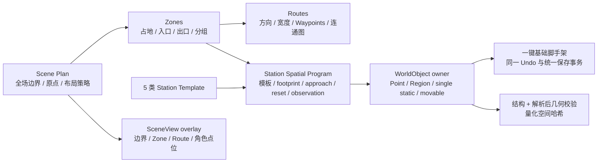
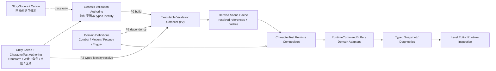

# CharacterTest 创世验证场框架设计与第一版开发计划

> Status: Current
>
> Current phase: P1 Authoring + 基础场景设计框架
>
> Design version: v0.4
>
> Implementation status: P1 Authoring、Scene Plan、模板、owner-owned 场景脚手架、布局校验与 SceneView overlay 已实现；P2 executable compiler、Scene Cache、runner、observer 与 Runtime Inspection 尚未实现
>
> Review status: v0.1 / v0.2 = Request changes；v0.3 收口评审合同；v0.4 补齐此前缺失的基础场景设计层并完成本地实现，等待人类复审
>
> Last reviewed: 2026-07-31
>
> Scope: 框架级场景设计、现有 Mx Level Editor 接入、数据权威、编译与运行时观察闭环；不包含美术布景和正式 Playable 交付

本文是 CharacterTest 创世验证场的第一版目标设计入口。创世规则与阶段状态仍以
[`genesis_stage_overview.md`](../StorySource/Projects/WGame/genesis_stage_overview.md) 和
[`Canon/`](../StorySource/Projects/WGame/Canon/) 为准；关卡编辑器当前能力仍以
[`LEVEL_EDITOR_CAPABILITY_REUSE_MATRIX.md`](LEVEL_EDITOR_CAPABILITY_REUSE_MATRIX.md)、
[`Interfaces/Editor.md`](Interfaces/Editor.md)、源码和测试为准。

本文中的 P1 类名、模块 ID 和文件名对应当前源码；P2 及以后仍是 Target。没有源码和测试证据的能力不得提前写入 `CAPABILITIES.md` 或 Current 接口文档。

## 0. 当前交付结论

v0.4 后，场景部分不再只是“给已有对象挂验证站元数据”，而是具备一套 CharacterTest 项目私有的基础场景设计框架：



当前可在现有 Mx Level Editor 的“创世验证”模块中执行“创建基础场景框架”，生成 3 个可编辑 Zone、2 条 Route、3 个模板 Station，以及 owner 正式登记的 Region、Marker、Checkpoint、single static 和 movable fixture。生成结果只是未保存 draft，不会自动改写官方 Scene；设计者可检查、移动、撤销，再通过现有统一保存流程提交。

这层框架拥有的是空间编排与设计约束，不拥有领域事实。物体、点位、区域和 Transform 仍由 CharacterTest world-object owner 管理；摩擦、弹性、碰撞、角色运动和三势仍由原领域模块管理；P2 Runtime 执行能力仍未交付。

## 1. 决策摘要

第一版固定以下决策：

1. 创世验证场复用现有 Mx Level Editor，不新增独立“Genesis Editor”窗口。
2. 新增 CharacterTest 项目专属的“创世验证”模块；它负责组织“为什么验证、验证什么、观察什么”，不拥有物理、角色运动、三势、Trigger 或世界对象规则。
3. Unity Scene 和现有 CharacterTest 世界对象、角色、点位、区域继续拥有空间创作；验证站只保存 owner 已定义的 typed identity，不复制 Transform、碰撞形状、材质或三势数值。
4. 现有领域模块继续拥有 Definition、Authoring、Compiler 和 Runtime。验证模块只调用正式能力，并从 typed snapshot / diagnostics 读取结果。
5. 验证站 Authoring 进入现有 `mx.level.authoring.v3` 模块化文档，建议 payload ID 为 `characterTest.genesisValidation`；P1 保存只处理 Authoring，不编译或应用 Runtime cache。
6. 第一版只在 CharacterTest 内实现，不新增 MxFramework 公共 Genesis API。至少出现第二个真实消费者并形成重复契约后，才评估提炼公共能力。
7. 首批验证采用“身体体感 + typed 读数 + 人工结论”；自动 Pass/Fail、报告导出和可重复基准属于后续阶段。
8. 当前 `stateModel=harness-only` 的创世切片不得伪装成场景 Runtime Authority。Authority、Scene execution readiness 和 cache health 必须作为三个正交维度显示；本阶段不使用 `PlayableReady`。
9. 第一版采用“一个 CharacterTest Scene，多个验证站”，不设计跨游戏通用 Level Package，也不拆成大量独立 Unity Scene。
10. 不把 `EffectVolume`、任意施势体积或通用力场作为第一步。先把已有表面、边界、可动物体和受控调试命令组织成闭环，再选择一个真实缺口进入领域模块设计。
11. 首批静态样本使用正式 typed `StaticColliderRef(SingleStatic, BodyId, ColliderId, ExpectedDefinitionId)`；v1 只允许绑定 `singleStaticColliders`，不开放 batch child picker。当前单体静态对象的空 `instanceStableId` 不作为 v1 身份，也不把 Transform path 写进验证文档。
12. `SessionRebuild` 由 GameManager composition scope 中、位于 Slice 外的 validation session coordinator 拥有；Slice 内 runner 不得发起并跨越自身销毁继续运行。
13. P1 必需注册的是 Authoring scenario descriptor；P2 compiler、runner 和 observer 属于可选 executable adapter。没有 executable adapter 的合法 scenario 仍可注册、编辑和保存。
14. P2 的角色启动覆盖在 Scene Stable ID 尚未丢失的 tagged startup entry 上完成，并通过显式 correlation 建立 `StableId -> RuntimeEntityId`；禁止用 `CharacterId` 或数组位置反查。
15. 根级 `ScenePlan` 拥有全场边界、原点、布局策略、`Zones[]` 与 `Routes[]`；每个 station 通过 `SpatialProgram` 声明模板、所属 Zone、占地、入口、观察点、出口、最短接近距离和净空，不把这些关系留在 GameObject 命名惯例中。
16. P1 冻结 5 个项目私有 Station Template；模板只声明空间形态、scenario 类型和最低约束，不生成领域规则。当前一键脚手架实例化其中 3 个，另外 2 个可手工应用并在内容就绪后扩展生成器。
17. 跨 Genesis / world-object 文档与 Scene 对象的脚手架创建必须属于一个 Unity Undo group；任一步异常回滚整组，不允许产生半份 validation 文档或无 owner 登记的 GameObject。
18. Authoring 保存同时经过结构校验和解析后几何校验；Zone 越界/重叠、角色点位越出 footprint、接近距离不足、样本净空不足、Route 无 junction 交叉均 fail closed。量化后的 resolved spatial input hash 用于 P1 诊断与 P2 dependency 合同，不冒充 Runtime cache hash。

## 2. 当前基线

### 2.1 创世侧边界

当前 StorySource 已明确：

- CharacterTest 是创世阶段的第一验证场，当前角色是测试受体。
- 玩家应先通过滑、停、弹、承托、冲击、返力和推挤理解自然规则。
- Runtime Slice 只证明规则可被受控实现或 harness 表达，不等于 Unity 场景体感、Playable、公共 API 或产品化完成。
- 当前工程重点是角色身体受势投影及已有自然物状态，不是先产品化 `EffectVolume`。

因此，本设计解决的是 Runtime Slice 与可组织场景验证之间缺失的工程层，不修改 Canon，也不为尚未完成的 Runtime 能力背书。

### 2.2 当前 CharacterTest 场景资产

截至 2026-07-31，`character_test_scene.world_objects.json` 已有可复用内容：

| 内容 | 当前数量 / 形态 | 本设计用法 |
| --- | --- | --- |
| 可动物体 | 7 个 | 作为推动、碰撞和自然物状态观察目标 |
| 单体静态对象 | 9 个 | 作为表面、边界和固定几何样本 |
| 批次对象 | 3 组 | 继续由现有世界对象模块管理；v1 不允许把 batch child 作为 validation static binding |
| 点位实例 | 6 个 | 官方 Scene 当前仍均为 `spawn.*`、`PointKind=Unknown` 且位于 `TestCourse_00_Start`；基础脚手架可通过 owner 正式创建 station-local Marker / Checkpoint，但不会自动修改官方 Scene |
| 区域 | 1 个 | 只在其现有语义适合时引用，不擅自改造成新 Runtime |
| 场景角色 | 3 个 | 作为测试受体或对照对象；当前三者 `CharacterId` 都为 `1001`，运行绑定必须保留 Scene Stable ID correlation |
| Gameplay Trigger | 1 个 | 继续由 Gameplay.Triggers 链路管理 |
| 世界对象定义 | 22 个 | 复用现有材料、形状、质量和三势 Authoring；新增 `Validation Checkpoint` / `Validation Marker` 只表达空间语义，不携带角色、队伍或控制权 |

当前场景层级已经按 `Start`、`SurfaceMaterials`、`MovableNaturalObjects`、`MotionGeometry`、`ColliderShapes`、`VisualAndLabels` 等测试区组织。第一版在这些内容上建立稳定验证站，不先推倒或重做现有测试场。

### 2.3 可直接复用的工程能力

| 能力 | 当前所有者 | 本设计复用方式 |
| --- | --- | --- |
| 模块切换、结构化编辑、选择同步、SceneView、放置 | Mx Level Editor Shell | 注册 CharacterTest 项目模块和只读 / 薄适配 UI |
| 多模块统一校验、文档文件快照、写入与 Scene 保存 | `MxLevelEditorSaveCoordinator` | 验证模块实现同一 managed scene 下的 save participant；pre-commit 才恢复文档快照，post-commit tail failure 不恢复文件，且均不承诺 Scene cache 自动回滚 |
| 模块化关卡文档 | `MxLevelAuthoringDocument` / `mx.level.authoring.v3` | 新增独立 payload，不建立第二个场景 JSON 总入口 |
| 世界对象、角色、点位、区域身份 | CharacterTest Scene Authoring | 角色 / 可动物体 / 点位 / 区域使用 Stable ID；v1 静态 collider 使用 single-only typed `(BodyId, ColliderId)` |
| 表面材料、碰撞与运动 | Combat / CharacterControl / CharacterTest | 场景运行时调用现有权威，不在验证模块重算 |
| Gameplay Trigger | Gameplay.Triggers + CharacterTest bridge | 只有正式 Source / Condition / Action 已存在时才投影 |
| 三势与自然物状态 | CharacterTest Runtime | 通过现有 command、state 和 snapshot 观察 |
| Runtime 调试抽屉 | 现有关卡 Trigger typed inspection 模式 | 复用低频只读查询模式，不让 Editor 直接改 Runtime |

### 2.4 已确认缺口

1. P1 已补齐“验证意图 → Scene Plan / typed 场景引用”的项目专属 Authoring 层；“executable cache → Runtime 观察”仍是 P2 缺口。
2. 创世 probe 中仍有多项明确返回 `stateModel=harness-only`，不能直接成为场景运行能力。
3. 世界对象 Definition schema 已包含摩擦、弹性、形状尺寸、三势、免疫和阈值等字段，但当前 Level Editor Definition 面板只暴露对象种类、材料种类、形状种类和质量等小部分字段。
4. 当前 `CombatLevelDefinition` v1 只持久化 AABB，不能为了“统一”而丢失 CharacterTest 已有 Sphere / Capsule 信息。
5. 当前没有通用的美术几何到 Combat 数据 Bake、跨游戏 Level Package 或 Runtime 热重载合同。
6. Canon Markdown 当前没有可作为 Runtime 身份的稳定 fact ID；只能保存追溯信息，不能把标题或路径变成玩法权威。
7. HardSlick、Rough、Elastic、Wall_X 等首批单体静态样本的 `instanceStableId` 当前为空，Runtime `StaticColliderInstance` 也不携带该字段；现有可解析身份是 Authoring 与 Runtime 均保留的 `(BodyId, ColliderId)`。
8. `MxLevelEditorSaveCoordinator` 只在 success notification 前的失败恢复文档文件快照；`CompleteCoordinatedSave(true)` 后的 tail Scene save 失败不恢复文件，并形成 `true -> false` 通知。两阶段都不能宣称自动恢复应用过的内存 cache。
9. `CharacterTestRuntimeSessionBuilder.RebuildRuntimeSession()` 会先 `DisposeSlice()`；任何跨 rebuild 的 station 选择、运行请求和出生点覆盖都必须由 Slice 外对象持有。
10. batch static 的 Body ID 当前由 `BodyIdStart + child.GetSiblingIndex()` 生成；插入或重排 child 会改变身份，而同一 batch 的 Definition ID 又无法识别静默改绑，因此不能进入 v1 picker。
11. `CharacterTestSceneCharacterAuthoring` 在生成 `CharacterTestCharacterSpawnSpec` 时丢弃 Scene Stable ID；现有 spawn flow 只返回 `bool`，实体 ID 在后续 Tick 分配，P2 必须增加 project-internal tagged startup correlation。
12. 官方 Scene 当前六个 Point 都在 Start 区，没有已保存的验证区本地 Marker / Checkpoint；P1 已提供 owner 定义和脚手架创建流程，但只有设计者生成、检查并保存对应内容后，相关 station 才可能通过这项 P2 readiness 门禁。
13. 当前 world-object `AuthoringContentHash` 基于 JSON envelope；只移动 Scene Transform 不会改变该 hash。P1 Editor 已提供量化 resolved spatial diagnostics hash，P2 仍必须按 executable projection 独立实现正式 dependency hash。

### 2.5 创世探针与材料扩展的工程边界（2026-10-05）

- `CharacterTestCharacterMotionSystem` 继续拥有移动、接触、碰撞同步与确定性位置／速度更新；`CombatPhysicsWorld` 提供物理事实。Canon 判断、固定验证场景表、材料意义映射与 summary 格式化不进入高频运动循环，也不在其中新增每帧字符串、LINQ 或临时集合。
- Genesis 固定样本与 `stateModel=harness-only` 结果由项目私有 harness／probe 层拥有，命令层负责校验和路由，诊断只读取结果。probe 的样例状态、最后一次结果与文本 summary 不是正式世界状态，不因可调用或有测试就成为公共 API、稳定 Debug UI schema、Playable 或场景执行权威。
- 活物自然属性或自然物三势已经进入正式 CharacterTest 实体状态的部分，与同名 harness 探针分别判断；前者按既有 runtime state、hash 与 snapshot 合同处理，不继续引用旧评审中的“全部只是探针”或“活物状态尚待首次实现”。具体权威模型统一见下文[实体状态与恢复合同](#实体状态与恢复合同)。这仍是项目私有能力，不升级为框架公共创世模块。
- 扩展探针时，场景分派、验证结果与 summary 存储应留在 CharacterTest 专用薄适配层；只有实际新增共享职责才提取 adapter，不为旧评审新增一套管理系统。正式行为若影响持久状态，必须显式确定 owner，并覆盖 full／owned hash、snapshot restore、replay／rollback 与存档边界；稳定对外诊断字段须另有明确契约，不能解析临时 summary 作为 API。
- 材料转变继续沿当前三势、免疫和阈值边界小步验证：外物输入 → 势变免疫 → 当前三势阈值 → 转变结果 → 下一次接触差异。每个新转变分别证明输入、状态变化、接触结果及可读表现；现有燃烧／凝结 harness 或 debug 映射不证明正式持续燃烧、传播、美术效果或完整材料生态已交付。
- 原热／介质／接触负荷、结构残留与主导表层方案已被三势机制基准取代，未恢复为当前派工或公共字段。若后续确实需要残留／持续变化，先明确现有三势模型无法覆盖的具体缺口，再评审最小扩展；腐蚀与溶解仍只按 Canon 后续候选理解。

#### 固定输入与探针合同

2026-10-08 只读核对源码与现有测试定义后，以下内容作为 CharacterTest 当前工程合同维护。原完成任务的提交、测试计数与逐阶段日志从 Git 历史恢复；本次没有执行 Unity、编译或测试。Canon 正式／草案状态以 StorySource 为准，不复制旧任务中的相反状态，也不以源码存在推定本轮验收通过。

| 范围 | 当前实现入口与复用 | 后续变更须保留的合同 |
| --- | --- | --- |
| 硬滑／粗糙／弹性材料 | `CharacterTestGenesisSurfaceMaterialHarness.RunSample`、`RunAccelerationSample`、`RunTurnSample`、`RunBounceSequence`，复用 `CharacterTestCharacterMotionSystem`、motion request、`CombatKinematicMotor`／`CombatPhysicsWorld` 与权威材料参数 | 固定相同 tick／质量／输入，读摩擦、接触速度／位移、冲量滑移与落地回弹；保留硬滑面低牵引加速／反向时惯性、粗糙面高牵引及弹性面权威返力的比较。不能用动画或 Unity Rigidbody 替代接触事实，也不承诺生产材料 schema、完整 SaveState UI 或新技能。 |
| 地面／墙面／低台阶／边缘 | `CharacterTestGenesisBoundaryFormsHarness`，复用 `CombatKinematicMotor`、`CombatPhysicsWorld`、`CombatMotionCollisionFlags`、碰撞法线、grounded 与 `MaxStepHeight` | 分别观察承托、水平阻挡、允许高度下的 StepUp、失去承托后的离地／下落；硬滑／粗糙／弹性材料继续作用于接触。不能用 Trigger 名字、颜色、Transform 或 Unity Rigidbody 替代权威运动事实；不从这个固定样例推定斜坡、曲面、可动／破坏边界已验收。 |
| 自重／主动发力／持续外力／瞬时冲量 | 当前为独立 `CharacterTestGenesisForceOriginHarness` 的四类 `Run*ForceOriginSample`；角色身体作用通过 `CharacterTestCharacterMotionRequest` facade 接入 `CharacterMotionRequest`／accumulator，再由运动／碰撞处理 | 自重观察下落、落地与承托，主动发力观察输入／跳跃，持续外力比较多帧累计，瞬时冲量比较速度突变。现有 `ExternalForce` 是加速度输入，不以一次位移代替持续作用。诊断保留速度、位移、grounded、质量、接触及来源／累计帧读法；动画、VelocityOverride 或镜头反馈不能替代力源验证。 |
| 可动自然物固定样例 | `CharacterTestGenesisMovableNaturalObjectHarness` 及 `.Physics`，`GenesisMovableObjectProbe` 经既有 command buffer／registry／drain 路由 | 比较同输入下的推移、质量与压抵差异、弹性返力、物体间速度／位移传递及接触对；这是 `harness-only`，不是完整刚体、可破坏物、拾取／库存或正式可动物体行为系统。 |
| 三势固定样例 | `CharacterTestGenesisPotencyMechanicsHarness` 及 `.Physics`，`GenesisPotencyMechanicsProbe` | 外物输入先经势变免疫，再更新三势、检查阈值并读结果。干草燃烧／压碎、石头散变免疫／开裂属于受控样例；sample 数值不是正式角色平衡或默认卡费用。 |
| 受势与破聚语义样例 | `CharacterTestGenesisCombatPotencyReceptionHarness` | `ScatterImpact`／request delta 表达散势输入，`ScatterPressure`／`ScatterDebt` 表达承压积累，`CohesionLimit` 与 support window 表达聚限／支撑；保留 pressure-band、break、recovery 与击退摘要的区别。固定重锤、轻刃、盾／蓄力、火焰例不构成当前普通防御、伤害平衡、火焰 DOT 或公共字段改名的合同；此 harness 没有因此新增独立 command probe。 |
| 活物属性固定样例 | `CharacterTestGenesisLivingNaturalAttributesHarness`，`GenesisLivingNaturalAttributesProbe` | 读能成身、自维持、恢复、失活退回材料四类样例，`stateModel=harness-only`；last validation／summary 是诊断，不与下面的实体权威状态混写。 |

探针的固定样例状态不进入持久实体 state、full／owned hash 或 snapshot authority。现有 movable、potency、living probe 的命令边界测试定义仍比较执行前后的 `ComputeStateHash` 不变；这说明应保留的隔离合同，不代表本次重新运行测试。样例对象／接触输入与稳定输出由 harness 管理，核心逻辑不直接读 Unity 输入，也不建立第二个 gameplay loop。

材料物理旧需求正文已记录后续实现承接与 #617 owner 场景体感验收，不再作为待首次实现任务。2026-10-08 核对到 surface harness 的固定冲量／无输入滑移与落地样例，以及 `CharacterTestGenesisSurfaceMaterialTests` 中材料摘要、牵引加速、反向惯性、弹性落地和反复回弹的断言定义；本轮未运行它们。原“释放输入刹车距离”和“同冲量滑行距离”是历史验收口径，不能只凭当前测试名称宣称本轮已重新证明所有距离不等式；后续涉及摩擦／击退变更时应复核对应输入、距离和速度衰减证据。#617 的历史 owner 记录不代替当前场景回归或新的 Playable 验收。

力源的交互场适配中，`RadialImpulse` 进入角色 Impulse 路径，`AttractionAcceleration` 进入 ExternalForce 路径；可动物体继续按自身 owner 的运动累积处理。这是 CharacterTest 局部适配，不是全项目统一 force accumulator 或新的公共 Force API。

#### 材料转变与后续接触

材料小步继续复用现有材料与三势 profile。先证明输入／免疫／阈值，再证明同一下一次接触输入发生可测变化；设计、美术可读性和程序支撑分别判断，不一次派工燃烧、腐蚀、凝结、溶解完整生态。

- **燃烧**：`CharacterTestGenesisPotencyMechanicsHarness` 的火焰／干草样例在阈值成立后降低聚势，下一次承托／结构读法变弱；石头的散变免疫使同类火焰输入不产生燃烧结果。这不代表角色 Burning DOT、传播、燃料生态、Buff 或正式 VFX 已实现。
- **凝结**：`CharacterTestGenesisCondensationHarness` 在同一个 `hard_slick` 基础表面上读取 `CondensedLayer` 层摩擦，要求 `materialReplacement=false` 与 `sameContactInput=true`，比较前后的滑移距离／速度衰减；不是简单替换 `CombatSurfaceMaterial`、贴花或天气／冰冻系统。
- **固定测试值**：三势 fixture 的干草 `(0,20,0)`、石头 `(0,90,0)`、火焰 delta `(18,0,22)`、重锤 delta `(70,-50,6)` 以及凝结 `(4,18,2)+(-2,24,0)=(2,42,2)`、阈值 `P>=40 && D<=4`、摩擦读数 `3→42` 只标识现有确定性样例。改变这些 fixture 时须同步样例／测试／summary，不将其转成玩法默认数值。
- **后续范围**：腐蚀／溶解仍是 Canon 候选，旧宽范围需求与热／介质／接触负荷方案不恢复为当前派工。正式材料变化需要可读表现和独立场景体验证据；只读 debug mapping 不替代美术输入或交付。开裂读法也不证明碎裂 mesh、掉落或破坏系统完成。

#### 实体状态与恢复合同

| 项目私有 owner | 当前状态／入口 | 持久性与诊断边界 |
| --- | --- | --- |
| CharacterTest 可动自然物 state | `BasePotency`、`CurrentPotency`、`PendingPotency`、`PendingPotencyInfluence`、`PotencyProfile`、`LatestPotencyApplication` | 数值、profile、pending 输入与 application record 进入现有 CharacterTest snapshot／state hash；不能把同名 movable／potency probe 的临时结果当成这个 state。 |
| `CharacterTestCharacterEntity.LivingNaturalAttributes` | `CharacterTestLivingNaturalAttributesRuntimeState`；`stateModel=character-test-runtime-authority`；命令 `GenesisLivingNaturalAttributesRuntimeState` | command 的 target 是 entity ID，payload0 为 operation、payload1 为 magnitude（默认0）、payload2 为命令 schema 1。操作为 Embody、ApplyExternalPressure、ReleaseAndRecover、OverlimitDeactivate、Reset。状态通过实体 owner 更新，diagnostics 只读。 |

活物操作分别表达整体身体成立、聚限内承压、释放后散势恢复、超限后的 inactive-material 读法与重置稳定样例；runtime state 的 lifecycle、operation、身体边界／尺度／质量／接触、自维持／聚限、压力／散势、恢复、材料读法及帧信息进入 hash 与 snapshot restore／rollback-replay。`LivingNaturalAttributesSchemaVersionValue=6` 是该功能引入时的 snapshot 版本常量，不能把6写成当前网络根 schema；本次读到根 schema 为38，后续以 snapshot owner 为准。

上述状态仍是 CharacterTest 局部实现，不承诺跨项目 SaveState、Character Resource Package、正式角色配置或框架公共属性 API。Canon 的动／聚／散（历史速记 D/P/S）与工程 `Motion/Cohesion/Scatter` 是对应读法，不从字段命名或局部样例推导公共 API／玩家平衡数值。现行战术资源、HP死亡与破聚规则仍以[角色与卡组底层数据设计](../StorySource/玩法基石/角色与卡组底层数据设计.md)为准；这里的活物样例不建立第二份死亡判据。

#### 项目配置与可读反馈

当前配置入口是项目私有 `CharacterTestGenesisConfigDocument`：`CharacterTestGenesisConfigJson.TryLoad/ToJson`、`CharacterTestGenesisConfigValidator` 的结构化 report、`CharacterTestGenesisConfigDefaults` 与 `CharacterTestGenesisConfigRuntimeAdapter` 在同一工程边界内。可编辑样例是[character_test_genesis_profiles.json](../Tools/MxFramework.Authoring/samples/genesis/character_test_genesis_profiles.json)；它不是框架公共 Config／Resources schema 或正式角色包。

- potency profile 保存 stableId、`basePotency.d/p/s`、`immunity.immuneD/immuneP/immuneS`、启用的 burning／crushedOrBroken／cracked／condensedLayer resultKinds 及 burningMinD／burningMinS／burningMaxP／condensedLayerMinP／condensedLayerMaxD 阈值。当前默认 profile 为 `genesis.profile.grass_burning_crush`、`genesis.profile.stone_crack`、`genesis.profile.condensed_layer`、`genesis.profile.clamp_burning_crush`；数值按现有0..1000校验，不在此分配正式内容身份。
- `genesis.living.default` 保存身体边界／尺度／质量／接触、自维持／聚限及压力、恢复、超限操作默认 magnitude；adapter 生成同一个实体 runtime state。`CharacterTestWorldObjectDefinitionCatalog` 从默认配置取得三势 profile，不另写平行材料配置表。
- feedback mapping 是 `ResultKind -> debugLabel/stage/nextContactModifier/readableFields/placeholderChannel`，校验强制 `debugOnly=true`。Burning 对应 `support-and-structure-weakened`，CondensedLayer 对应 `friction-readable-layer`，Cracked 对应 `structure-weakened`；这些是可读诊断映射，不是已交付的伤害、Shader、正式 HUD、VFX 或美术效果。对外稳定消费者需另有明确接口，不能解析 summary 字符串当产品契约。
- 配置变更须保持 JSON round-trip、schema／重复 profile／数值与属性边界的结构化拒绝，以及 adapter 对默认样例和状态操作的对应关系；源码中的 loader／测试定义存在不等于本轮导入或 Playable 验收完成。

##### 材料反馈读取边界

#653 原任务交付的是设计基线，不要求新增 C#、场景或正式美术；#651 已有的配置 mapping 承接该边界。runtime-readable 结果／三势／阈值、debug/HUD 占位、正式表现和 ArtSource 输入分别判断，不能因 mapping 存在就标记正式 HUD、Playable 或材料美术交付完成。

- 通用只读口径包括 `resultKind`、`stage`、`beforeDPS/afterDPS`、`rawDelta/appliedDelta/ignoredDelta`、`thresholds`、`lastInfluence`、`resultSource` 和 `nextContactModifier`。它们是诊断组织口径，不保证当前默认 mapping 全部列出或所有消费者全部展示；`threshold-met`、`next-contact-active`、`settled`、`none` 是 mapping 标签，不是 Canon 状态。
- Burning 以输入、免疫后变化、燃烧阈值与 `support/structure/blockResistance/contactDisplacement` 前后差异解释结果；CondensedLayer 以 `layerSource`、`materialReplacement=false`、`sameContactInput=true`、`frictionBefore/layerFriction/frictionAfter`、`slideDistanceDelta/velocityDecayDelta` 解释同输入的层摩擦变化。对应读数来自各自 harness／state，mapping 字符串不能生成不存在的接触事实。
- Cracked 当前可追溯的是三势阈值、结果名和 debug-only `structure-weakened` 映射；正式开裂 next-contact 行为、碎裂 mesh、物理破片、掉落与破坏系统不能据此标记完成。将某个 modifier 用于真实接触规则前，须由现有 runtime owner 实现并验证，不能在配置层绕过 runtime authority。
- 文本 summary、测试 marker、debug gizmo、只读数值条和标明 debug-only 的纯色／线性值属于允许的诊断占位；不是玩家可依赖视觉、美术风格、正式材质／Shader／VFX／SFX／粒子／动画，也不授权 Buff、伤害、采集或关卡谜题。外部工具或正式 HUD 需要明确结构化字段及分配契约。
- 旧 #652 在 2026-07-07 关闭，不能作为当前实现入口。后续新入口须明确 debug-only Showcase 或正式表现目标；玩家靠画面理解材料变化时另需有效 ArtSource／表现策略输入。Canon 的效果体积迁移方向仍以 StorySource 为准，当前固定 delta／阈值样例及 mapping 不证明效果体积迁移完成。


公共化时才另行定义 owner、稳定名称／ID、command/event schema 与失败、NoAlloc／LowFreqAlloc／AllocByDesign、hash／SaveState／restore／迁移及结构化 diagnostics。当前不新增公共三势模块，不改 HP／Attack／Defense 名称，不复活已关闭的旧 Playable validation scene 任务。P2 executable cache、runner、observer、Runtime inspection 和场景体验仍按本文后续门禁推进；新卡基石的已确认规则与未实施范围以[行动卡与交互效果卡设计基石](../StorySource/玩法基石/行动卡与交互效果卡设计基石.md)为准，不能从这些自然物固定样例推出替身、体型或 AI Lab UI 已交付。

## 3. 目标与非目标

### 3.1 第一版目标

- 让设计者在现有 Level Editor 中创建、排序、分组和检查创世验证站。
- 让设计者以根级 Scene Plan、Zone、Route 和 Station Spatial Program 组织整体验证场，而不是依赖 Hierarchy 名称和散落 Transform 猜测空间关系。
- 提供可撤销的一键基础脚手架与 5 类模板，让首批内容从可检查的规范骨架起步，同时保持所有具体场景对象由既有 owner 创建和登记。
- 在保存前对结构和解析后的实际几何进行门禁，并在 SceneView 中直接显示边界、Zone、Route 与 station 角色点。
- 每个验证站能说明设计意图、关联 Canon 来源、引用场景对象并选择一个受支持的 typed scenario。
- Authoring 保存前能发现 schema、引用和 typed payload 错误；运行时能力不足只形成 capability 诊断，不阻断保存。
- P2 的 executable cache 构建独立判断 station 是否可运行、cache 是否新鲜以及跨模块 hash 是否一致。
- 编译结果能在 CharacterTest session 中解析到正式 Runtime command / observer adapter。
- 运行时页能显示能力状态、当前步骤和 typed 观察读数，不反向覆盖 Authoring。
- 首批验证站可在现有表面、边界和可动物体内容上工作，不要求先新增玩法系统。
- 后续新增力场、效果体积或材料变化来源时，有明确的领域归属和接入门禁。

### 3.2 非目标

- 不定义正式 WGame 关卡、剧情关卡或产品化地图格式。
- 不重新制作 Terrain、Mesh、灯光、材质、标签或美术布景工具。
- 不把 Genesis / Canon 概念提升为 MxFramework 公共 Runtime 模块。
- 不复制 Combat Physics、Character Motion、Potency、Gameplay Trigger 或 SaveState。
- 不把 Unity PhysX、Collider 回调或 `MonoBehaviour.Update` 变成新的玩法权威。
- 不在首版实现通用节点图、任意字典脚本、表达式语言或用户代码执行。
- 不承诺 Runtime hot reload、多人协作、网络一致性、Replay 报告或 durable 存档。
- 不以 debug command 证明真实世界来源已经实现。
- 不让自动指标替代身体手感评审。

## 4. 术语与权威分层

### 4.1 术语

| 术语 | 定义 |
| --- | --- |
| 创世验证场 | CharacterTest Scene 中用于承接创世规则体验与证据的整体空间和工程入口 |
| 验证区 | 面向人的场景分组，例如表面材料区、边界区、可动物体区；不是 Runtime 状态机 |
| 验证站 `ValidationStation` | 一条有稳定身份的验证意图，引用已有空间内容和一个 typed scenario |
| 场景绑定 `SpatialBinding` | 对 owner-defined identity 的语义化 typed 引用；静态 collider 使用 Body / Collider key |
| Authoring scenario | 由 P1 descriptor 拥有的 typed 输入、绑定槽、编辑和保存校验合同 |
| Executable adapter | 与同一 Type ID 配对的可选 P2 compiler / runner / observer 合同 |
| 观察项 `Observation` | 从正式 typed snapshot / diagnostics 读取的信号，以及给人工评审的体感提示 |
| 判据 `Criterion` | 对观察项的可选确定性判断；v1 不要求所有验证站具备 |
| 派生缓存 | Authoring 经校验和编译得到的 Scene Runtime 输入，不是新的事实源 |
| 能力诊断 | 三个正交字段：`AuthorityStatus`、`SceneReadiness`、`CacheHealth` |

### 4.2 权威关系



权威规则如下：

| 层 | 拥有什么 | 不拥有什么 |
| --- | --- | --- |
| StorySource / Canon | 世界设定、设计推导、阶段状态 | Runtime ID、场景 Transform、运行时阈值 |
| Unity Scene / CharacterTest Scene Authoring | 空间位置、场景对象实例、角色、点位、区域 | 验证意图、确定性物理规则 |
| Domain Authoring | 材料、形状、质量、运动、三势、Trigger 等领域定义 | 验证站流程和编辑器窗口布局 |
| Genesis Validation Authoring | 验证意图、owner-defined typed identity、scenario 选择、观察要求 | 领域规则、Transform 副本、Runtime 状态 |
| Compiler / Scene Cache | 解析后的引用、排序、依赖 hash、运行时所需最小输入 | 可人工编辑的第二份配置 |
| Runtime Authority | 正式 session 状态、command、fixed-frame 行为 | Editor draft、Canon Markdown |
| Diagnostics / Presentation | typed 快照、Gizmo、标签、人工记录 | 反向写入 Runtime 或 Authoring 权威 |

## 5. 模块架构

### 5.1 新增项目专属模块

当前 P1 命名：

- Editor module：`CharacterTestGenesisValidationLevelEditorModule`
- Module ID：`characterTest.genesisValidation`
- Authoring document：`CharacterTestGenesisValidationAuthoringDocument`
- Scene design contracts：`CharacterTestGenesisValidationScenePlan`、`CharacterTestGenesisValidationZone`、`CharacterTestGenesisValidationRoute`、`CharacterTestGenesisValidationStationSpatialProgram`
- Station template registry：`CharacterTestGenesisValidationStationTemplateRegistry`
- Authoring validator：`CharacterTestGenesisValidationAuthoringValidator`
- Capability resolver：`CharacterTestGenesisValidationCapabilityResolver`
- Authoring descriptor registry：`CharacterTestGenesisValidationAuthoringScenarioRegistry`

P2 目标命名：

- Executable compiler：`CharacterTestGenesisValidationCompiler`
- Derived cache：`CharacterTestGenesisValidationSceneCache`
- Executable adapter registry：`CharacterTestGenesisValidationExecutableScenarioRegistry`
- Cross-session coordinator：`CharacterTestGenesisValidationSessionCoordinator`

这些类型首先留在 `Assets/Scripts/WGameFrameworkProject/CharacterTest*` 范围内。Level Editor Core 只看到已有 `IMxLevelEditorModule`、结构化编辑、选择同步、SceneView 和保存契约。

模块本身拥有独立 draft、dirty state 和 Authoring 校验，因此应注册为顶层“创世验证”模块，而不是挂在世界对象模块下的无主 workspace。P2 再增加派生 cache 与运行入口。它可以引用和定位世界对象，但不得借用世界对象模块的保存权威。

### 5.2 模块职责

| 组件 | 职责 | 禁止事项 |
| --- | --- | --- |
| Level Editor module | Scene Plan、Zone / Route、验证站、Spatial Program、引用选择、诊断和保存参与 | 计算物理结果、直接修改 Runtime |
| Station template registry | 声明空间形态、scenario 配对、默认 group 与最低几何约束 | 创建领域规则、隐藏生成 GameObject 或声称 Runtime readiness |
| World-object scaffold composer | 通过既有 owner 定义、placement 和 authoring model 创建 Point / Region / fixture，并返回 typed refs | 让 Genesis 直接写 world-object JSON、手写 Scene YAML 或留下无 owner 对象 |
| Editor layout validator | 解析 owner Transform，执行边界/净空/距离/Route lint，并产生量化诊断 hash | 充当 Runtime physics / navigation authority 或 P2 cache compiler |
| Authoring scenario descriptor（P1 必需） | 声明 Type ID / schema、typed payload、绑定槽、normalize、Authoring 校验和 Editor 元数据 | 依赖 compiler、runner、observer 或 Runtime assembly 才能注册 |
| Executable scenario adapter（P2 可选） | 为同一 Type ID 声明 capability requirements、compiler、runner factory、observer 和可选 evaluator | 反向改变 Authoring schema，或让缺少 adapter 阻止合法保存 |
| Authoring validator | schema、group、typed payload 和 owner identity 引用校验；决定能否保存 | 要求 Runtime command / snapshot 已完成 |
| Capability resolver | 独立推导 authority、scene readiness 和 cache health | 阻止合法但当前不可运行的 Authoring 保存 |
| Executable compiler | 只对可运行 station 建立 canonical projection、依赖 hash 和 cache | 修改 Authoring、Scene 空间或领域 Definition |
| Scene cache | 保存 Runtime 所需的最小解析结果和依赖 hash | 保存 Canon 文本、Editor 折叠状态或重复 Transform |
| Session coordinator | 位于 GameManager composition scope，跨 Slice 持有 immutable run request、rebuild generation 和启动覆盖 | 进入 Runtime hash 或由 Slice 内 runner 反向拥有 |
| Slice runner | 在新 Slice 建立后执行当前 station，把步骤路由到现有 command / domain adapter | 发起并跨越 `SessionRebuild`，或绕过 `RuntimeCommandBuffer` |
| Observer | 从 typed snapshot / diagnostics 生成只读读数 | 从 Scene Transform 反推正式 authority |
| Evaluator | 后续可选；对稳定读数做确定性判定 | 用主观手感阈值伪装成通用规则 |

### 5.3 依赖方向

允许：

```text
CharacterTest.Editor
  -> MxFramework.Editor.Levels contracts
  -> CharacterTest Genesis Validation Authoring
  -> Authoring scenario descriptors

CharacterTest Genesis Validation Compiler
  -> CharacterTest Scene authoring readers
  -> CharacterTest / Combat / Trigger public or project-internal typed contracts
  -> optional executable scenario adapters

CharacterTest Composition
  -> cross-session validation coordinator
  -> compiled validation cache
  -> registered executable scenario adapters
  -> installs one Slice-scoped runner after rebuild
```

禁止：

```text
MxFramework.Editor.Levels Core -> CharacterTest Genesis types
Combat / Gameplay / Runtime Core -> CharacterTest validation station
StorySource Markdown -> Runtime parser
Validation module -> arbitrary Unity component mutation
```

## 6. Authoring 数据合同 v1

### 6.1 文档根

目标 payload 结构：

```text
CharacterTestGenesisValidationAuthoringDocument
  SchemaVersion
  ScenePlan
  Groups[]
  Stations[]
```

根合同要求：

- `SchemaVersion` 首版为 `1`。
- `ScenePlan` 是整体场景编排根，包含 `SceneBounds`、`OriginPoint`、布局策略、`Zones[]` 和 `Routes[]`。
- `Groups` 按 `SortOrder`、`StableId` 规范排序；Group Stable ID 必须唯一。
- `Stations` 先按所引用 Group 的规范顺序，再按 `SortOrder`、`StableId` 排序。
- 每个 station 的 `GroupId` 必须解析到恰好一个根级 group，不允许隐式创建、孤儿 group 或 station 自带 GroupOrder。
- 未知 schema、未知 scenario type 或无法解析的 typed payload 必须 fail closed。
- Editor-only 展开状态、选中项和过滤器不进入 Authoring 文档。
- 反序列化后必须 preserve 未理解但受支持版本中的扩展字段，或明确拒绝写回；不得静默丢字段。

### 6.2 ScenePlan、Zone 与 Route

`ScenePlan` 只保存 owner-defined typed identity 和布局合同：

| 字段 | 类型 | 含义 |
| --- | --- | --- |
| `SceneBounds` | `RegionRef` | 整体创世验证场允许使用的空间边界 |
| `OriginPoint` | `PointRef` | 设计坐标与脚手架定位参考，不是 Runtime 世界原点权威 |
| `LayoutPolicy.MinimumZoneClearanceMillimeters` | int | Zone footprint 之间的最小水平净距；默认 1000 |
| `LayoutPolicy.DefaultRouteWidthMillimeters` | int | 新 Route 默认宽度；默认 1800 |
| `LayoutPolicy.RequireConnectedZones` | bool | 是否要求所有 Zone 位于同一无向连通图；默认 true |
| `LayoutPolicy.RequireSpatialRolesInsideFootprint` | bool | station 角色点是否必须落在自身 footprint 内；默认 true |
| `Zones[]` | ordered typed list | 验证区及其空间边界 |
| `Routes[]` | ordered typed list | Zone 之间的规范通行关系 |

每个 `Zone` 包含：

| 字段 | 含义 |
| --- | --- |
| `StableId / DisplayName / GroupId / SortOrder` | 稳定身份、显示名、逻辑分组和规范顺序 |
| `LayoutPattern` | `ComparisonLanes / LinearApproach / StepAndEdgeCourse / Sandbox / DebugBay` |
| `FootprintRegion` | owner Region；几何 lint 的占地来源 |
| `EntryPoint / ExitPoint` | owner Point；Route 折线的两端与场景导航语义 |

每个 `Route` 包含稳定身份、起止 Zone、单向/双向、宽度和 ordered `PointRef[] Waypoints`。Route 必须连接两个不同且存在的 Zone；同一 Zone 对只允许一条 canonical Route；开启 connected policy 时全图必须连通。Waypoint 可在 Level Editor 中增删和选择，参与 SceneView 折线、无 junction 交叉检查及量化空间哈希。

P1 几何校验使用当前 Scene 中 owner Transform 的解析结果。它是编辑门禁，不是导航网格、寻路、碰撞或 Runtime movement authority；旋转 footprint 当前采用保守包围盒判断，不能据此宣称正式可走区域已经 Bake。

### 6.3 Station Spatial Program 与模板

每个 station 必须携带 `SpatialProgram`：

| 字段 | 含义 |
| --- | --- |
| `TemplateId` | 引用项目私有模板注册表 |
| `ZoneId` | station 所属 Scene Plan Zone；其 group 必须与 station group 一致 |
| `FootprintRegion` | station 解析后几何校验的 owner Region |
| `EntryPoint` | 进入验证站的空间角色点 |
| `ObservationPoint` | 人工观察和 SceneView 提示点 |
| `ExitPoint` | 离开验证站的空间角色点 |
| `MinimumApproachLengthMillimeters` | `Bindings.StartPoint` 到主要 target 的最低水平距离 |
| `MinimumClearanceMillimeters` | fixture / sample lane 之间的最低水平净空 |

模板注册表 v1 固定为：

| Template ID | 布局模式 | 对应 Scenario | 最低接近 / 净空 | 首批一键生成 |
| --- | --- | --- | ---: | --- |
| `SurfaceComparisonLane` | ComparisonLanes | SurfaceContactResponse | 5000 / 1500 mm | 是；3 条 single-static 样本跑道 |
| `BoundaryApproachBay` | LinearApproach | BoundaryBodyResponse | 5000 / 1500 mm | 是；1 个 single-static 边界 |
| `StepAndEdgeCourse` | StepAndEdgeCourse | BoundaryBodyResponse | 6000 / 1200 mm | 否；等待稳定 single-static 内容 |
| `MovableObjectSandbox` | Sandbox | MovableNaturalObjectResponse | 4000 / 2000 mm | 是；1 个可动物目标 |
| `PotencyDebugBay` | DebugBay | PotencyReceptionDebug | 0 / 1500 mm | 否；等待 P2 debug adapter |

模板是约束包，不是 Prefab 或运行脚本：选择模板会设置 scenario、默认 group、最低距离/净空和 observation vocabulary；具体对象仍由 world-object owner 管理。`CourseLabel` 是 SceneView / Hierarchy 的组织提示，不是必须复制进 Scene 的玩法组件。

“创建基础场景框架”当前生成 1 个 SceneBounds Region、1 个 Origin Marker、3 个 Zone footprint、每个 Zone 的 Entry / ApproachStart / Reset / Observation / Exit 点、3 个表面样本、1 个边界样本和 1 个可动物目标，并据此写入 3 个 Zone、2 条 Route、3 个 Station Spatial Program。world-object 文档、Genesis 文档与新 GameObject 共享一个 Undo group；失败或一次 Undo 会整体恢复。

### 6.4 ValidationGroup

| 字段 | 类型 | 含义 |
| --- | --- | --- |
| `StableId` | string | group 稳定身份，例如 `surface-materials` |
| `DisplayName` | string | 面向设计者的分组名称 |
| `SortOrder` | int | group 之间的规范顺序 |

同一 group 的顺序只在根级定义一次。首批建议 group 为 `surface-materials`、`boundary-forms`、`movable-natural-objects` 和 `later-candidates`。

### 6.5 ValidationStation

| 字段 | 类型 | 含义 |
| --- | --- | --- |
| `StableId` | string | 项目内稳定身份；重命名显示名不改变引用 |
| `DisplayName` | string | 面向设计者的名称 |
| `Enabled` | bool | 是否参与 capability 评估；是否进入 executable cache 仍由运行条件推导 |
| `GroupId` | string | 引用根级 `ValidationGroup.StableId` |
| `SortOrder` | int | group 内的稳定展示和运行顺序 |
| `Intent` | string | 简短说明要验证的身体事实；不作为 Runtime 输入 |
| `CanonTrace` | object | 来源路径、章节标题和备注；仅追溯 |
| `Bindings` | typed object | 角色、可动物体、静态 collider、点位和区域的 owner-defined identity 槽 |
| `SpatialProgram` | typed object | 模板、所属 Zone、空间角色和距离 / 净空合同 |
| `Scenario` | discriminated typed object | `TypeId + SchemaVersion + adapter-owned payload` |
| `Observation` | typed object | 必需读数、人工提示和可选 criterion |
| `ResetPolicy` | enum | v1 固定支持 `SessionRebuild` |
| `Notes` | string | Editor 备注，不进入 Runtime hash |

### 6.6 CanonTrace

v1 允许保存：

- `SourcePath`
- `SectionTitle`
- `DesignNote`

这些字段只帮助评审者回到 StorySource。它们：

- 不作为 station 稳定身份；
- 不进入 Runtime 内容 hash；
- 不由运行时加载；
- 标题改名时只产生追溯诊断，不使玩法 session 失效。

若未来 StorySource 建立正式 fact ID，可另行设计迁移；本阶段不发明 Canon Runtime Catalog。

### 6.7 场景绑定与身份合同

绑定必须是具名 typed slot，不使用一组无语义的 Object ID：

| 引用类型 | v1 identity | 示例用途 |
| --- | --- | --- |
| `CharacterRef` | `StableId` | 测试受体 |
| `MovableObjectRef` | `InstanceStableId` | 可动自然物 |
| `StaticColliderRef` | `SourceKind=SingleStatic + BodyId + ColliderId + ExpectedDefinitionId` | 硬滑 / 粗糙 / 弹性样本、墙面等单体固定边界 |
| `PointRef` | `StableId` | 开始点、reset point |
| `RegionRef` | `StableId` | 只在 adapter 声明需要时使用 |

scenario 的绑定字段示例：

| 槽 | 类型 |
| --- | --- |
| `SubjectCharacter` | `CharacterRef` |
| `TargetMovableObject` | `MovableObjectRef` |
| `TargetStaticCollider` | `StaticColliderRef` |
| `SampleStaticColliders` | ordered `StaticColliderRef[]` |
| `StartPoint` / `ResetPoint` | `PointRef` |
| `ObservationRegion` | `RegionRef` |

当前单体静态对象 Authoring 虽有 `instanceStableId` 字段，但 HardSlick、Rough、Elastic、Wall_X 等首批样本均为空，且 Runtime `StaticColliderInstance` 不携带它。v1 因此正式采用 single-only typed `StaticColliderRef`，规则如下：

1. `SourceKind` 在 schema v1 固定为 `SingleStatic`；未知值或 batch child 引用 fail closed。
2. `BodyId` 必须大于 0；`ColliderId <= 0` 在 owner 边界按当前规则规范为 `1`，验证文档写入规范值。
3. P1 picker 和 Authoring resolver 只从 enabled `singleStaticColliders` 建立索引，并要求 `(BodyId, ColliderId)` 在该集合中恰好命中一个目标。
4. 为避免运行时歧义，validator 仍要检查该 key 在 owner 最终 expanded runtime collider 集合中没有碰撞；这个全局冲突检查不代表 batch child 可以被选择。
5. `ExpectedDefinitionId` 不是第二份 Definition 权威，只是防止 Body / Collider key 被重分配到另一类对象的引用完整性 guard；不一致时产生 binding error，并阻止 Authoring 保存和 cache 构建，直到重新选择目标。
6. P1 picker 从世界对象 owner 的解析索引产生该引用，不要求用户手填整数。
7. Runtime 通过当前 `CharacterTestWorldObjectStaticColliderSpec.BodyId / ColliderId` 解析同一目标，不依赖 Transform。
8. batch child 的 Body ID 当前由 `BodyIdStart + child.GetSiblingIndex()` 生成；重排会静默改绑，同 batch 的 `ExpectedDefinitionId` 也无法发现。因此 P1 不提供 batch picker，已有 batch child 不能写入 schema v1。
9. 只有 world-object owner 先提供与 sibling index 无关的 batch child Stable ID 后，才能通过新的 discriminant 和显式 schema migration 开放 batch；不得悄悄改变 v1 字段语义。

`CharacterRef`、`MovableObjectRef`、`PointRef` 和 `RegionRef` 均由当前 owner 的 Stable ID 解析器验证。验证文档不得保存：

- `Transform` path、`GlobalObjectId` 或 Unity Instance ID；
- position / rotation / scale 副本；
- collider shape 副本；
- material、friction、elasticity、mass 或 potency 副本；
- Prefab 或资源的任意文件路径。

### 6.8 Scenario 合同

P1 与 P2 使用两个按 `TypeId + SchemaVersion` 配对、但可独立注册的合同。

每个可编辑 scenario 必须有 P1 `AuthoringScenarioDescriptor`：

1. Type ID、schema version 和 typed payload DTO / codec；
2. 所需绑定槽及目标类型；
3. normalize、Authoring 校验和无损 round-trip；
4. Editor inspector / picker 元数据；
5. observation 的人工提示和 signal request Authoring 结构。

只有要进入 executable cache 的 scenario 才需要 P2 `ExecutableScenarioAdapter`：

1. 对应的 Type ID、schema version 和 adapter contract version；
2. Runtime authority、composition、command、snapshot 与空间内容要求；
3. executable compiler；
4. runner factory；
5. typed observer；
6. 可选 evaluator。

Authoring registry 不引用 compiler、runner、observer 或 Runtime assembly。Executable registry 可以引用 Authoring descriptor，但反向依赖禁止。缺少 Authoring descriptor、descriptor 版本未知或 typed payload 无法解析会阻止保存；缺少 executable adapter 只推导 `HarnessOnly` 或 `Unsupported`、`NotRunnable`、`NotBuilt`，允许注册、编辑和保存，并从 executable projection 排除。

JSON 内可以有 scenario payload 对象，但它必须由已注册 Authoring descriptor 反序列化成 typed DTO。Executable adapter 只消费该 typed DTO 或其编译投影。禁止使用 `Dictionary<string, object>`、任意表达式或反射调用作为执行协议。

首批类型建议：

| Type ID | 必需绑定 | typed 输入 | 当前目标 |
| --- | --- | --- | --- |
| `SurfaceContactResponse` | `CharacterRef`、两个 `PointRef`、ordered `StaticColliderRef[]` | 固定 movement request、持续帧数、比较顺序 | 对照滑、停、弹 |
| `BoundaryBodyResponse` | `CharacterRef`、两个 `PointRef`、`StaticColliderRef` | 固定 approach request、持续帧数、观察窗口 | 对照地面、墙、低台阶、边缘 |
| `MovableNaturalObjectResponse` | `CharacterRef`、两个 `PointRef`、`MovableObjectRef` | 受控移动 / 推动 request 和观察窗口 | 观察推动、碰撞、返力、位移 |
| `PotencyReceptionDebug` | `MovableObjectRef`，可选 `CharacterRef` | 现有白名单 debug command profile | 观察真实自然物 potency state；不代表真实施势来源 |

固定输入必须使用整数帧、量化值或已有稳定 profile，不保存自由浮点动画曲线。若 adapter 依赖的正式 command / snapshot 不存在，该 station 的能力状态必须降级，不得在 Editor 中补模拟结果。

### 6.9 Observation 合同

每个验证站至少包含：

- 一条 `BodyPrompt`：告诉评审者应注意什么体感；
- 一组由 Authoring descriptor 定义 schema 的 `RequiredSignalIds` 请求；
- 可选 `Criteria`；
- 可选 `EvidenceNote`，只属于人工记录。

P1 只校验 signal request 是否属于该 Authoring descriptor 的 typed vocabulary，不要求 observer 已存在。P2 executable adapter 必须把每个请求映射到当前真实 typed snapshot / diagnostics catalog；adapter、observer 或某个 signal mapping 缺失时降级为 `NotRunnable`，不反向阻止合法 Authoring 保存。P2 实现前仍须按源码确认首批信号，不在本设计中预造通用指标名。

首版 UI 的最终状态只允许：

- `NotRun`
- `Running`
- `Observed`
- `Blocked`
- `FailedToExecute`

`Passed` / `FailedCriterion` 只有在 evaluator 具备稳定输入、固定窗口和确定性测试后才能开放。人工觉得“手感正确”可以记录为评审结论，但不能伪装成自动化事实。

### 6.10 三类 hash 与 canonical runtime projection

Authoring、resolved spatial dependency 与最终 Runtime 内容必须分离：

| Hash | 包含 | 排除 | 用途 |
| --- | --- | --- | --- |
| `AuthoringSourceHash` | 规范化后的完整 validation payload，且自身 hash 字段置空 | Editor 临时 UI 状态 | 检测文档保存和外部变更 |
| `ResolvedSpatialDependencyHash` | executable station 实际引用并消费的 owner identity 与量化后 resolved spatial inputs | Transform path、Unity Instance ID、未引用对象、未被 adapter 消费的空间字段 | 发现只移动 Scene Transform 而 JSON envelope 未变化的空间漂移 |
| `RuntimeContentHash` | `CharacterTestGenesisValidationRuntimeProjectionV1` 的 canonical bytes，其中包含 dependency source hashes 与 `ResolvedSpatialDependencyHash` | `RuntimeContentHash` 自身、cache envelope 中重复的 hash 字段、CanonTrace、Intent、DisplayName、Notes、人工 Evidence、构建时间和 diagnostics | session 组合、缓存一致性和 replay-compatible 诊断 |

`ResolvedSpatialDependencyHash` 由 P2 compiler 在 typed identity 已解析后，从当前 Scene / owner cache 建立专用 canonical projection：

- static collider：`SourceKind`、Body / Collider / Definition identity，以及 adapter 实际消费的量化 world pose、shape dimensions；
- point / region：Stable ID、kind，以及实际消费的量化 world position、orientation、extent；
- character：Scene Stable ID，以及 startup entry 实际消费的量化初始位置或 point override；
- movable object：Instance Stable ID，以及 scenario 实际消费的量化 spawn pose / shape inputs。

position 与 extent 使用现有确定性毫米整数；rotation 仅在 adapter 消费时进入，并使用该 adapter 冻结的规范化定点表示，不写原始 `float`。同一 typed identity、同一量化空间输入必须产生相同 bytes；未消费字段不得为 hash 制造无关抖动。

当前 world-object `AuthoringContentHash` 只证明 JSON envelope 内容，不能替代 `ResolvedSpatialDependencyHash`。相关 Scene Transform 改动时，即使该 source hash 不变，也必须把 cache 标为 `Stale`。P2 若尚无精确 Scene change feed，可在受管 Scene 发生层级 / Transform 变化时保守降级为 `Stale`，重新 build 时再按 resolved projection 复算。

`CharacterTestGenesisValidationRuntimeProjectionV1` 只包含：

- projection schema version；
- executable adapter registry contract version；
- world object、character、Trigger 等实际依赖的 source content hash；
- `ResolvedSpatialDependencyHash`；
- 按 root `Groups[]` 规范顺序投影的 executable group identity / order；
- 每个 executable station 的 Stable ID、effective order、typed bindings、typed scenario payload、observation signal IDs 和 reset policy；
- adapter 编译出的量化 Runtime 输入。

不允许把“编译结果”作为含糊的任意对象直接交给通用 JSON serializer。v1 canonical byte 规则固定为：

1. 使用专用 `CharacterTestGenesisValidationCanonicalWriterV1`，显式按合同字段顺序写入；禁止 reflection-based property enumeration。
2. 整数使用 fixed-width little-endian；布尔使用单字节 `0 / 1`；字符串使用长度前缀的 UTF-8、无 BOM；数组先规范排序再写 count 与元素。
3. Runtime projection 不允许浮点；输入必须先量化。可选值必须有显式 presence byte，不能依赖 serializer 的 null policy。
4. `RuntimeContentHash` 使用当前项目一致的 SHA-256 lowercase hex 表达，对 canonical payload bytes 计算。
5. cache envelope 在 hash 计算完成后再写入 `RuntimeContentHash`、`AuthoringSourceHash`、`ResolvedSpatialDependencyHash` 的冗余索引值、构建时间和 diagnostics；`RuntimeContentHash` 自身及 envelope 字段永不回灌 canonical projection。projection 内只保留作为内容依赖的 source hashes 与 resolved spatial hash，避免自引用。
6. Runtime load 从 cache 重建同一 projection bytes 并复算 hash；serializer、字段顺序或 culture 变化不得改变结果。
7. 建立一份 golden canonical bytes / hash 测试，schema 或 writer 改动必须显式升级 projection version。

世界对象、角色、Trigger、resolved spatial inputs 或 executable adapter registry 依赖改变时，旧 cache 必须被判定为 stale。编译器不得靠“字段看起来没变”跳过依赖校验，也不得只比较 JSON envelope hash。

## 7. 保存、编译与运行时闭环

### 7.1 三个独立门禁

| 门禁 | 首次交付 | 决定什么 | 不决定什么 |
| --- | --- | --- | --- |
| Authoring validation | P1 | 当前 validation payload 能否保存 | station 当前能否运行、cache 是否存在 |
| Capability diagnostics | P1 | Authority、Scene readiness 和缺口原因 | 不阻止合法 Authoring 保存 |
| Executable cache compile / apply | P2 | 哪些 station 可进入 Runtime cache，以及 cache 能否运行 | 不反向决定 Authoring 是否允许保存 |

`HarnessOnly`、缺 command 或缺 snapshot 的 station 只要 schema、group、typed payload 和场景引用合法，就允许保存。它们在 capability diagnostics 中保持不可运行，并从 executable projection 排除。

### 7.2 P1 Authoring 保存

```text
Edit station draft
  -> normalize
  -> validate schema / Groups / station identity
  -> deserialize and validate typed scenario payload
  -> resolve owner-defined typed references
  -> calculate non-blocking capability diagnostics
  -> MxLevelEditorSaveCoordinator snapshot
  -> upsert characterTest.genesisValidation payload
  -> write participating documents
  -> validation participant performs no Scene mutation
  -> coordinator retains its existing managed-Scene save behavior
  -> commit clean baseline
```

P1 validation participant 不创建、编译或应用 Scene cache，因此不承担 Scene cache rollback。Authoring 保存阻断项仅包括：

1. schema / root group / station Stable ID 错误；
2. unknown scenario type 或 typed payload 无法解析；
3. 必需 binding 缺失、类型错误或不能唯一解析；
4. `StaticColliderRef` 的 key 不唯一，或 `ExpectedDefinitionId` 不匹配；
5. normalize / round-trip 会丢失字段；
6. managed scene / document target 不合法。

Runtime command、snapshot、composition 或 cache 缺失不能阻断 P1 保存。

验证模块必须：

- 实现现有 save participant，而不是私自写盘；
- 使用 `MxLevelAuthoringDocument.UpsertModulePayload`；
- 与世界对象、场景角色和 Trigger 模块声明同一个 managed scene；
- 在切换场景、外部文件变化和 Undo/Redo 后重建只读索引；
- 不因读取、搜索、选择或打开 runtime drawer 而把文档标脏。

### 7.3 P2 executable cache 编译与应用

P2 使用显式的“构建并应用运行缓存”操作，不把 cache 编译偷偷并入普通 Authoring 保存：

```text
require all participating Authoring documents clean
  -> load last-saved validation payload and owner dependencies
  -> Authoring validation
  -> capability resolution
  -> select Enabled + RuntimeAuthority + SceneRunnable stations
  -> build canonical runtime projection in memory
  -> calculate dependency hashes and RuntimeContentHash
  -> verify deterministic compile / round-trip
  -> only then enter coordinated cache apply
  -> apply cache to Scene
  -> save managed Scene
  -> mark CacheHealth=Fresh
```

capability resolver 先排除 `HarnessOnly` / `Unsupported` / `NotRunnable` station；它们保留在 Authoring 并产生明确排除诊断，不导致其他合法 station 失败。对剩余 executable candidate 和最终 artifact，编译器按以下顺序 fail closed：

1. Authoring 与 owner dependency 必须为已保存、非 dirty 状态；
2. Authoring validator 通过；
3. 对应 executable adapter 及其 contract version 可用；
4. station 已启用，且 capability resolver 推导 `RuntimeAuthority + SceneRunnable`；
5. static `(BodyId, ColliderId)`、Stable ID 与 expected definition 在 owner cache 中解析一致；
6. command、snapshot 和 Runtime composition adapter 完整；
7. canonical projection、source dependency hashes 与 `ResolvedSpatialDependencyHash` 可重复；
8. cache envelope round-trip 后复算 hash 一致。

#### 7.3.1 现有保存事务的真实失败边界

当前 `MxLevelEditorSaveCoordinator` 存在两个不同失败阶段，不能用“任一步失败都恢复文件”概括：

| 阶段 | coordinator 事实 | participant 合同 |
| --- | --- | --- |
| `PreCommitFailure` | 成功通知前，participant 写入或第一次 managed Scene 保存失败；恢复已捕获的文档文件快照，然后通知 `CompleteCoordinatedSave(false)` | 丢弃本次 prepared / applied 状态；P1 draft 回到保存前 dirty baseline；P2 若已做 Scene cache mutation，则标记 `Inconsistent`，不得声称内存 cache 已自动恢复 |
| `PostCommitTailFailure` | 已通知 `CompleteCoordinatedSave(true)`；participant 的 success completion 可能再次使 Scene dirty，收尾 Scene 保存失败；不会恢复文档快照，随后再通知 `CompleteCoordinatedSave(false)` | 必须处理同一事务的 `true -> false`；保留已提交的文档 clean baseline，不回滚文件、不把已提交 Authoring 伪装成未保存，仅把本次事务转为 `TailFailed`，Scene 保持 dirty，P2 cache 为 `Inconsistent` 并禁止运行 |

每个 participant 按 save operation generation 维护幂等状态机：

```text
Prepared
  -> Applied
  -> Committed             on first Complete(true)

Prepared / Applied
  -> AbortedPreCommit      on Complete(false) before true

Committed
  -> TailFailed            on Complete(false) after true
```

重复通知不得重复写盘、重复恢复或重复改变 clean baseline。`Complete(false)` 必须先检查该 generation 是否已经收到 `true`，不能把 post-commit tail failure 当成 pre-commit rollback。

共同保证：

- canonical compile 在任何 Scene mutation 前完成；compile 失败时 Scene 和旧 cache 都不变；
- `PreCommitFailure` 只承诺协调器恢复已捕获的文档文件，不承诺恢复 participant 的内存 Scene cache；
- `PostCommitTailFailure` 明确不恢复文件；Scene 保持 dirty，diagnostics 保留 committed-but-tail-failed 事实；
- P2 在任一 Scene cache apply / Scene save failure 后都令 `CacheHealth=Inconsistent`，所有 validation run fail closed；
- 只有重新成功执行“构建并应用运行缓存”，或重新加载已保存 Scene 并重新验证 cache 后，才允许恢复运行。

未来若要提供强内存回滚，cache participant 必须另行捕获完整保存前 cache，并分别证明 pre-commit restore 与 post-commit compensating action；该能力完成前不能写成 P2 保证。

### 7.4 Runtime composition

Runtime builder 只消费派生 cache 和现有领域产物：

```text
Load CharacterTest scene caches
  -> verify world / character / trigger hashes
  -> load Genesis validation cache
  -> verify RuntimeContentHash and executable adapter registry version
  -> resolve station runtime handles
  -> expose read-only station catalog
  -> enqueue controlled commands through RuntimeCommandBuffer
  -> sample typed snapshots at bounded frequency
```

首版不创建第二个 gameplay loop。GameManager composition scope 中新增 `CharacterTestGenesisValidationSessionCoordinator`；它与 `CharacterTestRuntimeSessionBuilder` 同生命周期，位于 `_context.Slice` 外。Slice 内只安装当前 run 的 runner。

`GameManager.InitializeRuntime()` 在创建 session builder 的同一 composition 阶段创建 coordinator，并把它保存在 `CharacterTestRuntimeContext` 的 Slice 外字段；session builder 通过显式依赖或注册回调与其交互。coordinator 不注册进 `GameSlice.Services.Modules`，因此 `DisposeSlice()` 不会销毁 pending request。

Slice runner 只负责：

- 在固定帧提交 adapter 已声明的命令；
- 记录观察窗口；
- 从 observer 获取只读结果；
- 把结果回报给 Slice 外 coordinator；
- 把只读结果投影给 Debug UI / Level Editor inspection。

Slice runner 不得调用 `RebuildRuntimeSession()`，也不得持有 rebuild 后仍需继续使用的状态。

### 7.5 SessionRebuild 与 Reset 所有权

v1 只承诺 `SessionRebuild`，完整顺序固定为：

```text
Editor / Debug UI requests station run
  -> SessionCoordinator verifies CacheHealth=Fresh
  -> store immutable PendingRunRequest
     (StationId, RuntimeContentHash, RunGeneration, Start/Reset binding)
  -> coordinator invokes CharacterTestRuntimeSessionBuilder
     with validation startup options
  -> builder DisposeSlice()
  -> builder collects CharacterInstance as tagged startup entries
     (SceneCharacterStableId, StartupCorrelationId, SpawnSpec)
  -> apply validation point override to the matching tagged entry
     before StableId is stripped from any generic SpawnSpec path
  -> builder creates the new Slice
  -> coordinator receives OnSliceBuilt(new Slice, RunGeneration)
     and binds the Slice-scoped startup correlation sink
  -> tagged startup entry remains correlated through spawn queue
  -> spawn completion reports (StartupCorrelationId, RuntimeEntityId)
  -> coordinator establishes SceneCharacterStableId -> RuntimeEntityId
  -> coordinator installs one Slice-scoped runner only after all required
     CharacterRef mappings resolve
  -> runner schedules commands and observations
  -> runner reports completion / failure to coordinator
```

约束：

- `PendingRunRequest` 和 run progress 由 coordinator 持有，不属于被销毁的 Slice。
- Scene character cache / builder 必须先产生 project-internal `CharacterTestSceneCharacterStartupEntry`，至少包含 `SceneCharacterStableId`、不可复用的 `StartupCorrelationId` 和 `CharacterTestCharacterSpawnSpec`；不得在 `CollectCharacterSpawnSpecs()` 返回裸 spec 后再反查。
- spawn override 在 tagged entry 层匹配 `CharacterRef.StableId`，只替换本次 entry 内的 spec 副本，不修改 Scene、角色 Authoring 或 cache。
- `StartupCorrelationId` 必须显式穿过 project-internal startup spawn request，并在实体真正创建成功后返回 typed completion；现有只返回 `bool` 的 `RequestSpawn(spec)` 不足以建立身份映射。
- 映射不得以 `CharacterId`、Team、position 或数组 / spawn queue 顺序推断。当前三个 Scene character 都使用 `CharacterId=1001`，这些字段不能充当 binding key。
- tagged entry / correlation 至少保留到 `SceneCharacterStableId -> RuntimeEntityId` 建立或明确失败；任一必需 `CharacterRef` 未解析时，本次 run 为 `FailedToExecute`，runner 不得启动。
- builder 必须在新 Slice 完整安装后显式通知 coordinator；runner 不靠轮询猜测 rebuild 完成。
- 新请求增加 `RunGeneration`；旧 Slice / 旧 runner 的迟到回报按 generation 丢弃。
- Reset 由 coordinator 结束当前 run 并发起新 generation 的 rebuild；不是 runner 自己“重建后继续”。
- coordinator 在 `GameManager.ReleaseAll()` 时释放，不建立 static singleton 或 durable save slot。
- 局部 checkpoint、对象级回滚和跨站连续状态必须在 P4 另行设计。

### 7.6 运行时检查

运行时页采用现有 Trigger inspection 的低频只读模式，默认刷新不高于 5 Hz。显示：

- station Stable ID、名称和三个 capability 维度；
- 当前 phase、frame window、最后执行结果；
- 已解析 character、movable object、static body/collider、point / region；
- typed snapshot 摘要；
- cache / registry / domain dependency hash；
- blocked / stale / unsupported 原因。

它不得：

- 每帧分配大对象或反序列化 JSON；
- 通过 `SerializedObject` 修改 Runtime；
- 把 Scene Transform 当成正式运动状态；
- 在 diagnostics 层补算领域结论。

## 8. Level Editor 交互设计

### 8.1 信息架构

顶层模块名称：`创世验证`

```text
创世验证
├─ 工具栏：创建基础场景框架 / 新建 Station / 复制 / 保存
├─ 根 Inspector：Scene Plan
│  ├─ SceneBounds / Origin / LayoutPolicy
│  ├─ Zones：footprint / entry / exit / pattern
│  └─ Routes：方向 / 宽度 / Waypoints
├─ 左栏：验证分组 / 验证站
│  ├─ 表面材料
│  ├─ 边界形态
│  ├─ 可动自然物
│  └─ 后续候选
├─ 中栏：验证站属性
│  ├─ 意图与 Canon 追溯
│  ├─ Station Spatial Program
│  ├─ 场景绑定
│  ├─ Scenario
│  ├─ 观察项
│  └─ Reset
├─ 右栏：诊断
│  ├─ 引用
│  ├─ Authority
│  ├─ Scene readiness
│  ├─ Cache health
│  ├─ 编译 / hash
│  └─ Runtime inspection
└─ SceneView：Scene bounds、Zone footprint、Route 折线、空间角色和观察提示
```

### 8.2 核心操作

- 在空 validation 文档中点击“创建基础场景框架”，通过 world-object owner 创建并登记 3 个首批 Zone 的空间内容；Genesis 文档、world-object 文档和 Scene GameObject 属于一个 Undo 操作。选中 world-object root 内对象时以选中位置为 anchor，否则在现有层级最右侧预留 12 m 后生成，减少与已有测试区重叠；工具检测已有 Zone / Station 或 `GenesisValidationLayout` 时拒绝重复生成。
- 在 Scene Plan 根 Inspector 中维护 Zone、Route、布局策略和 Route Waypoint；这些编辑与 station CRUD 共用现有文档 Undo。
- 从 5 个模板选择 station 空间程序；模板同步最低接近距离、净空、默认 group、typed scenario 和 observation vocabulary，不修改任何领域 Definition。
- 从当前选中角色、世界对象、点位或区域填入兼容 binding；静态对象只允许 owner 的 single static，picker 生成 typed `(SingleStatic, BodyId, ColliderId, ExpectedDefinitionId)`，不让用户手填。
- 点击绑定可定位到现有模块和 Scene object。
- 缺失或类型错误引用显示在字段旁，同时进入统一诊断汇总。
- 修改材料、形状、质量、三势时，深链接到世界对象 Definition owner；验证站只显示只读摘要。
- SceneView 只绘制 Scene bounds、Zone footprint、Route / Waypoint、station 空间角色、目标和观察窗口，不创建重复 Collider。
- 保存前除 schema / typed identity 外，还校验实际 Scene Transform：整体边界包含、Zone 重叠与净距、角色点局部性、主要目标局部性、接近距离、表面样本净空和无 junction Route 交叉。
- 复制 station 时生成新 Stable ID，保留引用和 typed payload，清除人工 Evidence。
- 删除 station 只删除验证意图，不删除任何场景对象或领域 Definition。

### 8.3 三个正交诊断维度

Authority 只回答证据属于哪一层：

| `AuthorityStatus` | 含义 |
| --- | --- |
| `RuntimeAuthority` | command、state 和 snapshot 使用当前真实 Runtime authority |
| `HarnessOnly` | 只有隔离 probe / test evidence |
| `Unsupported` | 当前没有可声明的 authority 证据 |

Scene readiness 只回答当前场景入口能否承接：

| `SceneReadiness` | 含义 |
| --- | --- |
| `SceneRunnable` | binding、composition adapter、runner 和 observer 已完整 |
| `NotRunnable` | 至少一项场景运行依赖缺失；必须附 reason code |

Cache health 只回答当前派生产物状态：

| `CacheHealth` | 含义 |
| --- | --- |
| `NotBuilt` | 尚未构建 |
| `Fresh` | Authoring、executable adapter registry、owner source dependency 和 resolved spatial dependency hash 一致 |
| `Stale` | 输入或依赖已变化 |
| `Inconsistent` | apply / Scene save 失败后无法证明内存 cache 与文件一致 |

只有 station 已启用，且 `RuntimeAuthority + SceneRunnable + Fresh` 同时成立时才能运行。三个维度都由 adapter、resolver 和 hash 检查推导，不能由用户手工选择。`Playable` 保留为产品级状态词；本设计只使用 `SceneRunnable`，不提前宣称正式 Playable。

## 9. 首批验证站范围

### 9.1 P1 / P2 目标

| 验证站类型 | 当前基础 | 第一版交付 | 明确不声称 |
| --- | --- | --- | --- |
| 表面接触响应 | 现有硬滑、粗糙、弹性 Definition 和场景对象；角色运动已存在 | 以 ordered `StaticColliderRef[]` 绑定三个样本，按相同输入观察滑移、停止和返力差异 | 不声称通用材料系统已完整 Authoring |
| 边界身体响应 | 现有地面、墙、低台阶、边缘几何与运动碰撞 | v1 只绑定 owner 确认为 single static 的固定边界和起点，观察承托、阻挡、抬升和离地 | 不把 batch child 的 sibling-index Body ID 当稳定身份，也不声称所有形状均已进入 Combat Level v1 |
| 可动自然物响应 | 现有可动物体场景缓存、质量、碰撞和 runtime state | 绑定目标，观察推动、碰撞、位移和返力 | 不声称已实现通用刚体或生产玩法 |
| 三势受势调试 | 现有自然物 potency state 与白名单 runtime command | 受控触发并读取 typed state / result | debug 来源不等于场景内真实施势体积 |

当前首批单体静态 fixture 的可解析基线为：

| Fixture | BodyId | ColliderId | ExpectedDefinitionId |
| --- | ---: | ---: | ---: |
| HardSlick | 61710 | 1 | 1011 |
| Rough | 61711 | 1 | 1012 |
| Elastic | 61712 | 1 | 1013 |
| Wall_X | 10001 | 1 | 1001 |

这些数值由 world-object owner picker 读取并写入 typed reference，不进入代码常量。owner 数据变化会先使 cache stale；若 key 已丢失、重复、指向不同 Definition 或目标不再属于 `singleStaticColliders`，Authoring binding 同时变为 error，不会静默改绑。

建议第一批实际落地 6～8 个 station：

- 硬滑、粗糙、弹性各 1 个，另设 1 个三表面对照 station；
- Wall_X 等 single static 边界先选择 1 个代表 station；低台阶 / 边缘若来自 batch child，v1 不建立 binding；
- 可动物体 1 个；
- 三势受势调试 1 个，若 typed command 与 snapshot 复核通过。

数量不是验收目标。优先保证每个 station 有清楚的意图、真实绑定、可解释能力状态和可重复运行路径；不得为了凑数量绕过 single-only 身份合同。

### 9.2 P2 内容与空间依赖门禁

以下两项不阻塞纯 P1 Authoring 开发，但阻止相关 station 获得 `SceneRunnable`：

1. **station-local start / reset points**
   - 官方 Scene 当前六个 Point 的 Stable ID 都是 `spawn.*`、`PointKind=Unknown`，并且全部位于 `TestCourse_00_Start`；不能直接满足各验证区的 executable capability。
   - P1 已在 world-object owner 中增加 `Validation Checkpoint(2010)` 与 `Validation Marker(2011)`，并由基础脚手架通过现有 placement / authoring 流程创建 station-local Entry、ApproachStart、Reset、Observation 与 Exit。二者是纯空间点，`CharacterId=0 / TeamId=0 / ControlOwner=None`。
   - 脚手架不会自动修改官方 Scene。Surface / Boundary / Movable executable adapter 仍必须声明接受的 point kind，并确认这些 owner 点已由设计者检查、保存且位于对应 footprint 内；否则 station 保持 `NotRunnable`。
   - validation 文档始终只保存 `PointRef.StableId`，不手写 Scene YAML 或复制 Transform。当前 generic Start 区点可以作为合法 owner identity 保存，但不能伪装成 station-local readiness。
2. **quantized resolved spatial dependency**
   - P1 Editor lint 已用毫米位置、毫度旋转和毫米 scale 的 canonical 文本计算诊断 hash，用于证明 Scene Transform 移动能改变 resolved spatial 输入。
   - P2 compiler 必须按 6.10 建立正式 `ResolvedSpatialDependencyHash`，覆盖 executable adapter 实际消费的量化 resolved pose / extent / shape inputs；不能直接把 P1 诊断 hash 当 Runtime cache hash。
   - 仅比较 world-object `AuthoringContentHash` 不合格；Scene 中相关 Transform 移动而 JSON envelope 不变时，旧 cache 仍必须变为 `Stale`。
   - 在 resolved spatial projection、canonical bytes 和 Transform-change stale 测试完成前，相关 station 不得标为 `Fresh + SceneRunnable`。

角色 tagged startup correlation 是另一项 P2 实现门禁：它不阻塞 P1 schema / Editor，但在 `CharacterRef.StableId -> RuntimeEntityId` 显式映射完成前，任何绑定角色的 station 都不得启动 runner。

### 9.3 暂不进入第一版

| 内容 | 原因 | 进入条件 |
| --- | --- | --- |
| 持续外力区域 | 当前验证主要来自固定 harness，缺场景内正式来源 | 在正确 Runtime owner 中实现 source、command、snapshot 和测试 |
| 瞬时冲量发射器 | 不能只用 Editor 按钮冒充世界来源 | 明确 Gameplay / Combat / CharacterControl 归属 |
| 通用 `EffectVolume` | 当前不是创世下一焦点，且会混合 Trigger、Potency 和材料变化权威 | 单独领域设计并证明真实产品需求 |
| 活物行为站 | 多项状态仍是 `harness-only` | 真实 CharacterTest session entity、command 和 snapshot 完整 |
| 燃烧 / 凝结体验站 | 当前主要是 runtime-readable feedback，没有正式场景来源与表现验收 | source、state、next-contact effect 和表现边界分别完成 |
| 自动评分与报告 | 稳定观察信号和窗口尚未冻结 | P2 形成重复数据后再定义 evaluator |
| 多 Scene / Level Package | 没有第二消费者，现有场景足够承载首批验证 | 内容规模或发布流程出现真实压力 |

## 10. 分阶段开发计划

### P0：框架合同

交付：

- 本设计文档；
- 权威分层、首批范围和非目标；
- single-static typed identity、P1 Authoring descriptor、可选 P2 executable adapter、capability、compiler、cache 和 cross-session coordinator 合同；
- Level Editor 复用记录；
- 分阶段门禁。

完成条件：

- 设计评审确认“验证模块不拥有领域规则”；
- 确认一个 Scene 多 station；
- 确认首批 scenario 和明确排除项；
- 接受 `StaticColliderRef(SingleStatic, BodyId, ColliderId, ExpectedDefinitionId)`，且 v1 不开放 batch child；
- 接受 P1 Authoring descriptor 与 P2 executable adapter 分离；
- 接受 P1 Authoring save 与 P2 executable cache 的分层；
- 接受 pre-commit / post-commit tail failure 与 `true -> false` participant 状态机；
- 接受 `SessionRebuild` 由 Slice 外 coordinator 拥有；
- 不把 Target 写成 Current。

v0.3 已完成合同收口；v0.4 以对应源码、测试和 Current 文档落实 P0，后续合同变更必须通过版本记录与评审。

### P1：Authoring 与 Level Editor 接入

交付：

- `characterTest.genesisValidation` schema v1；
- load / normalize / validate / round-trip；
- 根级 `ScenePlan`、`Zones[]`、`Routes[]`、Route Waypoint 与布局策略；
- station `SpatialProgram` 与 5 个项目私有模板；
- Authoring scenario descriptor / registry，且不引用 compiler、runner、observer；
- 顶层“创世验证”模块；
- root `Groups[]`、station CRUD、分组、排序、typed scenario inspector；
- CharacterTest 角色 / 可动物体 / 点位 / 区域 Stable ID picker；
- single-only typed `StaticColliderRef` picker / resolver；batch child 明确显示 unsupported，不可写入 binding；
- SceneView 选中和定位；
- world-object owner 内的 Marker / Checkpoint 定义，以及跨模块一键基础场景脚手架；
- Zone / Route / station 实际几何校验和量化 resolved spatial diagnostics hash；
- SceneView 的 Scene bounds、Zone、Route、Waypoint 与空间角色 overlay；
- 只保存 Authoring 的统一事务接入；
- Authority / Scene readiness / Cache health 三维诊断；P1 cache 固定为 `NotBuilt`。

门禁：

- 无运行时执行也能完整保存和恢复 Authoring；
- Runtime command / snapshot / composition 缺失不会阻止合法 Authoring 保存；
- 缺少 executable adapter 不会阻止 scenario 注册、编辑和保存；
- P1 save path 不调用 executable compiler，不创建或应用 Scene cache；
- 选择、搜索、展开和运行时页不会制造 dirty state；
- 删除 station 不影响被引用对象；
- root group、缺引用、错类型、重复 ID 和未知 scenario 均 fail closed；
- 首批 HardSlick / Rough / Elastic / Wall_X 可通过 typed static key 唯一解析；
- batch child 不出现在 picker，手工注入或未知 `SourceKind` fail closed；
- single static key 在 owner expanded runtime collider 集合中的全局冲突能被 validation module 检出；
- save participant 对 pre-commit `false` 与 post-commit `true -> false` 维护幂等、不同的 clean-baseline 状态；
- 未编辑字段 round-trip 无损；
- 无新公共 API。

v0.4 的上述 P1 项已在本地实现。生成器只建立未保存 draft，未自动改动官方 CharacterTest Scene；P1 是否进入主线仍由代码评审和仓库交付流程决定。

### P1a：领域 Definition 编辑完整性

这是世界对象 owner 的独立增量，不塞进验证站：

- 补齐首批验证需要的摩擦、弹性、形状尺寸和三势字段 UI；
- 免疫、阈值和高级状态只在真实 scenario 需要时开放；
- 保存继续走世界对象 Definition Authoring / Compiler；
- 验证站只读展示并深链接。

在 P1a 完成前，现有 Definition 可以被引用和验证，但不能声称设计者已能在 Level Editor 中完整创作材料 / 三势参数。

### P2：派生缓存与 Runtime Inspection

交付：

- 独立的 executable compiler、canonical writer v1 和 `RuntimeContentHash`；
- 可选 executable scenario adapter / registry；
- `ResolvedSpatialDependencyHash` 与 Scene Transform stale 检测；
- 显式“构建并应用运行缓存”操作；
- scene cache、cache health 和真实失败边界；
- session load / hash 验证；
- GameManager composition scope 的 `CharacterTestGenesisValidationSessionCoordinator`；
- validation startup options、tagged character startup entry、显式 spawn correlation、spawn override、run generation 与 `OnSliceBuilt` handoff；
- 首批表面、边界和可动物体 runner / observer；
- 不高于 5 Hz 的 typed runtime inspection；
- 至少一个 station 的 EditMode + PlayMode / Unity 可打开验证。

门禁：

- 相同 Authoring 与依赖产生完全相同 canonical bytes / cache / hash；
- 相同 typed identity 与量化 spatial inputs 产生相同 `ResolvedSpatialDependencyHash`；只移动被消费的 Scene Transform 会使 cache stale；
- cache envelope 的 hash、时间和 diagnostics 不参与自身 hash；
- `Stale`、`Inconsistent`、registry 不匹配或缺 snapshot 时拒绝执行；
- cache apply 的 pre-commit file restore 与 post-commit no-restore、`true -> false`、Scene dirty 和 run fail-closed 分别有测试；
- Slice 内 runner 不调用 rebuild；旧 generation 的回报被丢弃；
- spawn override 在 `StableId + CorrelationId + SpawnSpec` tagged entry 层完成，只修改本次 spec 副本；
- `StableId -> RuntimeEntityId` 由 typed spawn completion 建立，不使用 `CharacterId` 或顺序推断；
- runner 只通过正式 command / adapter；
- observer 不反向修改 authority；
- 表面、边界和可动物体至少各有一条可重复证据；
- `HarnessOnly` / `NotRunnable` 项不会进入 executable cache。
- 对应验证区没有已保存且通过几何门禁的 station-local Marker / Checkpoint 时，相关 station 保持 `NotRunnable`。

### P2b：三势受势调试站

交付：

- 仅接入源码已存在的白名单 CharacterTest potency command；
- 读取真实自然物 runtime state / snapshot；
- UI 明示 `Debug Source`；
- 不把固定 debug 输入命名为环境、技能或 EffectVolume。

门禁：

- command 经过 `RuntimeCommandBuffer`；
- 数值与状态来自 Runtime snapshot；
- station 关闭或 session rebuild 后无残留；
- 文档和 UI 不声称世界来源已产品化。

### P3：只选择一个真实缺口

在 P1 / P2 使用反馈后，从以下候选中只选一个：

- 持续外力区域；
- 瞬时冲量来源；
- 一个材料变化 source；
- 一个活物场景 entity 适配。

该增量先在正确领域模块完成 Definition、Compiler、Runtime、SaveState / Replay / Hash 影响分析和测试，再由验证模块补 adapter。不得先画 Editor 面板再倒逼 Runtime 归属。

### P4：可重复评估与证据

候选：

- station 级固定帧 observation window；
- deterministic criterion；
- session 内 checkpoint / reset；
- 基准差异报告；
- 批量运行；
- 可追溯 evidence export。

只有稳定指标已由真实 typed snapshot 提供时才进入本阶段。体感项继续保留人工评审，不强行数值化。

### P5：公共化评估

只有满足以下条件才讨论从 CharacterTest 提炼：

- 出现第二个真实游戏 / demo 消费者；
- 两个消费者重复了 station、binding、runner 或 observer 合同；
- 公共部分不含 Genesis / Canon 术语；
- API 标准、分配行为、SaveState / Replay / Hash 和 UPM 边界均已审查；
- CharacterTest 特定 scenario 仍留在项目 adapter。

## 11. 验证矩阵

### 11.1 noEngine / EditMode

- schema v1 normalize、round-trip 和未知版本拒绝；
- ScenePlan / Zone / Route / Waypoint normalize、规范排序、重复身份、自环、重复边和连通图校验；
- Station Spatial Program 的 template / scenario / group / zone 一致性与最低距离 / 净空合同；
- 5 个模板注册表和首批 3 个脚手架 station 的 typed 绑定；
- root group Stable ID、引用、规范排序和 duplicate 检查；
- station group 内排序，以及 group 顺序变化的 deterministic projection；
- typed scenario payload 反序列化与版本检查；
- 只有 Authoring descriptor、没有 executable adapter 时仍可注册、校验、round-trip 和保存；
- executable registry 缺项只降级 capability，不进入 Authoring validation errors；
- Stable ID 引用存在性和目标类型校验；
- single-only picker / resolver；batch child 与未知 `SourceKind` 拒绝；
- single static key 在 expanded runtime collider 集合中的全局冲突检查；
- `ExpectedDefinitionId` mismatch 诊断；
- Runtime capability 缺失不阻断 Authoring validation；
- CanonTrace 不进入 Runtime hash；
- Notes / Evidence 不改变 Runtime hash；
- source dependency 或量化 resolved spatial input 变化导致 cache stale；
- Scene Transform 改变但 owner JSON envelope hash 不变时，`ResolvedSpatialDependencyHash` 仍改变；
- Zone 越界 / 重叠、空间角色越界、接近距离、样本净空和无 junction Route 交叉校验；
- canonical writer golden bytes / hash；
- compiler 多次运行得到一致 projection bytes / hash；
- cache envelope hash 字段、时间和 diagnostics 不参与 hash；
- disabled station 的结构校验和运行时排除；
- `HarnessOnly` 不进入 executable catalog；
- P1 save 不调用 compiler / cache apply；
- 未编辑字段无损保存。

### 11.2 Unity Editor

- 模块注册和场景切换；
- 一键脚手架通过 world-object owner 创建 Point / Region / fixture，并与 Genesis 文档折叠为一个 Undo；失败不得留下半成品；
- Scene Plan、Zone、Route、Waypoint 和 Station Spatial Program Inspector CRUD；
- 角色 / 对象 / 点位 / 区域选择与定位；
- Undo / Redo；
- 外部文档变化刷新；
- 只读操作不标脏；
- 多模块统一保存成功；
- P1 pre-commit failure 恢复文档文件并保留保存前 draft baseline，validation module 不改变 Scene cache；
- P1 post-commit tail failure 按 `true -> false` 保留已提交 clean baseline，不声称文件恢复；
- P2 pre-commit cache apply failure 与 post-commit tail failure 分别验证文件边界、Scene dirty、CacheHealth=`Inconsistent` 和运行拒绝；
- 同一 save generation 的重复 completion 通知保持幂等；
- SceneView 正确绘制 Scene bounds、Zone footprint、Route 折线/方向、空间角色和 station label，不创建或修改玩法组件。

### 11.3 Runtime

- cache / registry / domain hash 校验；
- offline session 构建；
- Slice 外 coordinator 持有 pending request / run generation；
- rebuild 后 `OnSliceBuilt` 绑定 startup correlation sink；必需角色映射完成后才安装 runner；
- 旧 generation 回报被丢弃；
- start / reset point 在 tagged startup entry 层只覆盖本次 spawn spec 副本；
- 三个相同 `CharacterId=1001` 的 Scene character 仍能以 Stable ID 建立不同 Runtime entity mapping；
- spawn 拒绝或 view 创建失败时 correlation 明确失败，不错配下一实体；
- station-local point 缺失时 runner 不启动；
- command buffer 路由；
- observation window；
- typed snapshot 读取；
- bounded diagnostics 更新；
- session rebuild 后初始状态一致；
- runner 不拥有或发起 rebuild；
- 无 editor assembly 依赖；
- 异常 station 不影响其他 runtime module 生命周期。

### 11.4 人工场景验收

- 能从“创世验证”列表定位每个首批 station；
- 同一输入下三类表面有可感知差异；
- 边界反馈能由身体理解，而不是只靠标签解释；
- 可动物体的推动 / 碰撞反馈与 typed 读数方向一致；
- runtime capability 和实际入口一致；
- 没有把 debug input 误称为真实世界 source；
- session reset 后可以重复观察。

## 12. 预计文件归属

后续实现优先放置在现有项目边界：

```text
Assets/Scripts/WGameFrameworkProject/CharacterTest/
  Scene/GenesisValidation/          # P1 Authoring / scene design contracts；P2 compiler/cache 后续进入
  Composition/                      # Slice 外 session coordinator、startup options、composition adapter
  Runtime/...                       # 仅在真实 Runtime owner 需要时扩展

Assets/Scripts/WGameFrameworkProject/CharacterTest/Editor/
  GenesisValidation/                # Level Editor module、inspectors、SceneView、diagnostics UI

Assets/Scripts/WGameFrameworkProject/CharacterTest/Tests/EditMode/Game/CharacterTest/
  GenesisValidation/                # noEngine / EditMode contract tests

Assets/Scripts/WGameFrameworkProject/CharacterTest/Tests/PlayMode/
  GenesisValidation/                # 最小 Unity runtime / scene verification
```

场景和派生 cache 必须通过 Unity Editor / 正式 authoring 流程修改；禁止手写 `.unity`、`.prefab` 或 `.asset` YAML。新增 asmdef 或公共接口不是 P1 默认工作。

## 13. 风险与防护

| 风险 | 后果 | 防护 |
| --- | --- | --- |
| 验证站复制领域字段 | 材料、三势或形状形成双重权威 | 只保存 owner-defined typed identity 和 typed scenario 输入；领域字段深链接 owner |
| 静态样本空 Stable ID | Surface / Boundary station 无法解析 | v1 使用 single-only typed `(BodyId, ColliderId, ExpectedDefinitionId)`；picker 不暴露 batch child，最终 runtime key 仍做全局冲突检查 |
| batch child 依赖 sibling index | 层级重排导致静默改绑 | v1 明确 unsupported；owner 提供 child Stable ID 后以新 discriminant / migration 开放 |
| 把 Canon 标题当 Runtime ID | 标题调整导致 session 内容变化 | CanonTrace 仅追溯且排除 Runtime hash |
| 把 harness 结果标成可玩 | 状态失真，后续验收失去基线 | Authority / Scene readiness 分离；HarnessOnly 禁止执行且不使用 PlayableReady |
| 为统一 Combat v1 丢失形状 | Sphere / Capsule 场景信息损坏 | 不做有损回写；先在 Combat owner 补合同 |
| P1 保存强制编译 Runtime | HarnessOnly 内容不能保存，阶段互相阻塞 | P1 仅 Authoring validation；P2 显式 cache build / apply |
| descriptor 强制依赖 P2 | Authoring-only scenario 无法注册 | P1 Authoring descriptor 必需、P2 executable adapter 可选；缺 adapter 只降级 capability |
| cache apply 失败 | JSON、内存 cache 和 Scene 可能不一致 | 区分 pre-commit restore 与 post-commit no-restore；处理 `true -> false`，标记 `Inconsistent`、保留 Scene dirty、禁止运行直到重建或 reload |
| Slice runner 发起 rebuild | runner 随旧 Slice 销毁，运行请求丢失 | GameManager composition scope 的 coordinator 持有 pending request / generation |
| SpawnSpec 丢失 Scene Stable ID | 相同 CharacterId 的角色被错绑 | tagged startup entry + 显式 correlation completion；实体映射前不启动 runner |
| 官方 Scene 只有 Start 区 spawn 点 | 角色从错误区域开始，证据无效 | 使用 P1 脚手架或 owner 正式流程创建、检查并保存 station-local Marker / Checkpoint；此前保持 `NotRunnable` |
| 脚手架绕过现有 owner | Scene 有对象但文档无身份，保存和 Runtime 漂移 | 只通过 world-object 定义、placement、authoring model 创建；Genesis 只接收 typed refs；跨模块共用一个 Undo group |
| Zone / Route 只靠命名约定 | Hierarchy 重排后设计关系不可审查 | 根级 ScenePlan 与 Station Spatial Program 显式保存语义关系；SceneView 与 validator 按 typed owner refs 解析 |
| 只 hash JSON envelope | Scene Transform 移动后旧 cache 仍显示 Fresh | 单独 hash 量化 resolved spatial inputs，并监听 Scene 变化保守标 stale |
| Runtime drawer 变成第二权威 | 调试操作绕过 command / replay | 只读 snapshot；所有操作走白名单 command |
| 首版抽象过度 | 为不存在的第二消费者设计公共 SDK | CharacterTest 项目专属，重复出现后再提炼 |
| 自动评分过早 | 把脆弱阈值当设计事实 | 先人工体感 + typed 读数，再冻结 evaluator |
| Scene 内容无限膨胀 | 验证难定位、保存变慢 | station 分组与最小样本；出现真实压力再拆 Scene |

## 14. 关卡编辑器能力复用记录

```text
用户操作：
在现有 Mx Level Editor 中建立创世验证站，绑定 CharacterTest 场景内容，
P1 保存 Authoring；P2 显式构建并应用运行缓存后，在 offline session 中运行并观察 typed 结果。

玩法 / 数据权威模块：
Combat / CharacterControl / CharacterTest Runtime / Gameplay.Triggers /
CharacterTest Scene Authoring；Genesis Validation 只拥有验证意图与编排。

已存在的 Definition / Authoring / Compiler / Runtime API：
MxLevelAuthoringDocument、IMxLevelEditor* contracts、MxLevelEditorSaveCoordinator、
CharacterTest 世界对象 / 场景角色 / Trigger authoring 与 cache、
Combat Physics body/collider identity、surface material、RuntimeCommandBuffer、
CharacterTest typed state / diagnostics。

关卡编辑器只需补的适配：
CharacterTestGenesisValidationLevelEditorModule、ScenePlan / Zone / Route / SpatialProgram、
Station Template registry、P1 Authoring scenario descriptors、owner-backed scaffold composer、
typed identity picker / resolver、结构 / 几何 validator、capability resolver、
可选 P2 executable adapters、canonical compiler、Slice 外 session coordinator、SceneView overlay、
统一 diagnostics 和 runtime inspection。

Authoring 单一事实源：
mx.level.authoring.v3 中的 characterTest.genesisValidation payload；
空间和领域字段继续由各 owner 文档 / Unity Scene 负责。

运行时派生产物：
CharacterTestGenesisValidationRuntimeProjectionV1、canonical bytes、
CharacterTestGenesisValidationSceneCache、resolved runtime handles、
ResolvedSpatialDependencyHash、RuntimeContentHash 和只读 observation projection。

Undo / 保存 / 放弃修改边界：
P1 复用 Unity Undo、模块 draft、统一 save coordinator 和文档文件 snapshot，不应用 Scene cache。
P2 cache build 先纯编译，再进入显式 apply；pre-commit failure 才恢复已捕获的文档文件，
post-commit tail failure 不恢复文件并形成 `true -> false` 通知。Scene 保持 dirty，
cache 标记 Inconsistent 并禁止运行。

Runtime / SaveState / Replay / Hash 影响：
P1 无 Runtime 影响；P2 增加 scene cache 与 composition hash。
v1 reset 由 Slice 外 coordinator 发起 session rebuild，不新增 durable SaveGame。
Runner command 是否进入 Replay 由其复用的正式 command 合同决定，不能由验证模块私自声明。

缺口证据：
此前无验证意图与基础场景编排数据层；P1 现已补齐，P2 Runtime 仍有多项 Genesis probe 为 harness-only；
首批单体静态样本 instanceStableId 为空，Runtime StaticColliderInstance 无该字段；
batch Body ID 依赖 sibling index；现有协调器存在 pre-commit restore 与 post-commit tail no-restore；
RebuildRuntimeSession 会 DisposeSlice；SpawnSpec 不保留 Scene character Stable ID；
官方 Scene 当前点位都在 Start 区；P1 脚手架可创建 owner Marker / Checkpoint，但尚未自动写入官方 Scene；owner JSON hash 不覆盖 Scene Transform；
Definition schema 与 Level Editor 暴露字段不完整；
CombatLevelDefinition v1 仅持久化 AABB；
无通用 Level Package / hot reload。

是否真的需要新公共 API：
否。P1-P4 均留在 CharacterTest 项目层；第二消费者出现前不提升。
```

## 15. 第一开发增量完成定义

第一开发增量指 P1，不含 Runtime 执行。只有同时满足以下条件才可标记完成：

- 已接受的 schema v1、root `Groups[]`、P1 Authoring scenario descriptor 和 binding 合同已有源码与测试；
- ScenePlan、Zone、Route / Waypoint、Station Spatial Program 和 5 个模板已有源码与测试；
- 可从 Level Editor 以一次 Undo 创建 owner-backed 基础脚手架，不自动保存或覆盖官方 Scene；
- Level Editor 中可创建、复制、分组、排序、禁用和删除 station；
- 可通过 owner picker 绑定角色、可动物体、静态 collider、点位和区域；
- 首批静态 fixture 可由 single-only `(BodyId, ColliderId, ExpectedDefinitionId)` 唯一解析，batch child 不可选择，且不保存 Transform path；
- 能显示 CanonTrace、Intent、Authority、Scene readiness、Cache health 和结构诊断；
- 同一文档保存、重开和无损 round-trip 成立；
- Runtime capability 缺失不阻断合法 Authoring 保存；
- executable adapter 缺失不阻断合法 Authoring 保存；
- P1 保存不调用 compiler、不创建或应用 Scene cache；
- P1 Editor 必须把 owner-backed fixture 的 Authoring / world-object scene cache 一致性投影为用户可见状态：已应用保持正常实体表现，未应用以橙色警示线框标出，引用失配以洋红色标出；未应用或失配时阻止进入 Play，避免只有实体外观却没有框架碰撞的静默穿模；
- 统一保存分别遵守 pre-commit 文件恢复与 post-commit tail no-restore 边界，并正确处理 `true -> false`；
- SceneView 只做定位和 overlay；
- 结构与解析后几何错误会阻止保存，量化 spatial diagnostics hash 能检测相关 Transform 改动；
- 没有新增领域规则、公共 API 或有损 Combat 投影；
- `CAPABILITIES.md` 只记录真实实现，不把 P2 目标提前写入；
- 后续 P2 所需的 command / snapshot 清单已经按源码复核并登记。

v0.4 本地实现满足上述 P1 完成定义；仓库合入、官方 Scene 内容生成和 P2 启动均是独立决策。

## 16. P1 当前状态与 P2 交接门禁

v0.4 已把评审确认的 P1 合同和基础场景设计层落实为源码。当前边界如下：

| 范围 | 当前状态 | 证据 / 限制 |
| --- | --- | --- |
| Authoring descriptor 分层 | 已实现 | P1 descriptor 不依赖 compiler / runner / observer；缺 executable adapter 只降级 capability |
| single-static identity | 已实现 | picker / resolver 只接受 single static；batch child 和未知 source kind fail closed |
| 两阶段保存失败 | 已实现 | participant 区分 pre-commit `false` 与 post-commit `true -> false`，P1 不应用 cache |
| Scene Plan / Zone / Route | 已实现 | typed owner refs、连通图、Waypoint、布局策略和 SceneView overlay |
| Station Spatial Program / templates | 已实现 | 5 个模板；scenario、group、zone、最低距离与净空交叉校验 |
| owner-backed scaffold | 已实现 | 当前生成 Surface / Boundary / Movable 3 个 Zone；Genesis / world-object / Scene 共用一次 Undo；不自动保存官方 Scene |
| resolved layout lint | 已实现为 P1 Editor 门禁 | 检查边界、重叠、局部性、距离、净空、Route 交叉；量化诊断 hash 不冒充 P2 cache hash |
| fixture readiness projection | 已实现为 P1 Editor 门禁 | 对照 typed fixture 与 world-object owner cache；未应用 / 失配使用警示 overlay 并阻止 Play，不创建 Genesis runtime cache，也不添加 Unity Collider |
| Runtime compiler / cache / execution | 未实现 | `AuthorityStatus / SceneReadiness / CacheHealth` 继续显示真实的 HarnessOnly / NotRunnable / NotBuilt |

P2 启动前仍需闭合：

1. `CharacterRef` 使用 `StableId + StartupCorrelationId + SpawnSpec` tagged entry，在生成裸 spec 前应用 override，并由 typed spawn completion 建立 `StableId -> RuntimeEntityId`。
2. 设计者必须通过 P1 脚手架或 owner 正式流程生成、检查并保存 station-local Marker / Checkpoint；官方 Scene 现有 `spawn.*` 不能冒充 readiness。
3. executable compiler 必须独立实现 6.10 的 canonical projection 与 `ResolvedSpatialDependencyHash`，覆盖 adapter 实际消费的空间输入；不能直接复用 P1 Editor 诊断字符串或只依赖 world-object JSON hash。
4. Slice 外 `CharacterTestGenesisValidationSessionCoordinator`、executable adapter registry、runner、observer、cache health 与失败恢复合同必须完成后，station 才能进入 `SceneRunnable`。

继续冻结的方向：一个 CharacterTest Scene 多 station；现有 Level Editor 顶层模块；CharacterTest 项目私有；Canon trace-only；领域事实不复制；首批表面 / 边界 / 可动物体；人工体感 + typed 读数；P3 一次只补一个真实领域缺口；第二消费者前不公共化。

## 17. 版本记录

| 版本 | 日期 | 变更 |
| --- | --- | --- |
| v0.4 | 2026-07-31 | 补齐基础场景设计层并完成 P1 本地实现：新增 ScenePlan、Zone / Route / Waypoint、Station Spatial Program、5 个模板、owner-backed 一键脚手架、跨模块单 Undo、Marker / Checkpoint owner 定义、结构与解析后几何门禁、量化空间诊断 hash 和 SceneView overlay；明确官方 Scene 未自动修改，P2 Runtime 合同仍未实现。 |
| v0.3 | 2026-07-31 | 响应 v0.2 Request changes：拆分必需 P1 Authoring descriptor 与可选 P2 executable adapter；v1 静态绑定限制为 single static；精确定义 pre-commit / post-commit tail failure 和 `true -> false` participant 状态机；新增 tagged character startup correlation；登记 station-local point 与量化 resolved spatial dependency 两项 P2 门禁。当前等待重新评审。 |
| v0.2 | 2026-07-31 | 响应 v0.1 Request changes：静态样本改为 typed Body/Collider identity；拆分 Authoring validation、capability diagnostics 与 executable cache；收窄现有保存失败保证；新增 Slice 外 session coordinator；拆分三类 capability；增加根级 Groups 与 versioned canonical hash 合同。当前等待重新评审。 |
| v0.1 | 2026-07-31 | 建立创世验证场首版框架设计：明确现有 Level Editor 复用、项目专属验证语义、数据权威、Authoring v1、编译 / Runtime inspection 闭环、首批 station、阶段计划与验收门禁。 |
