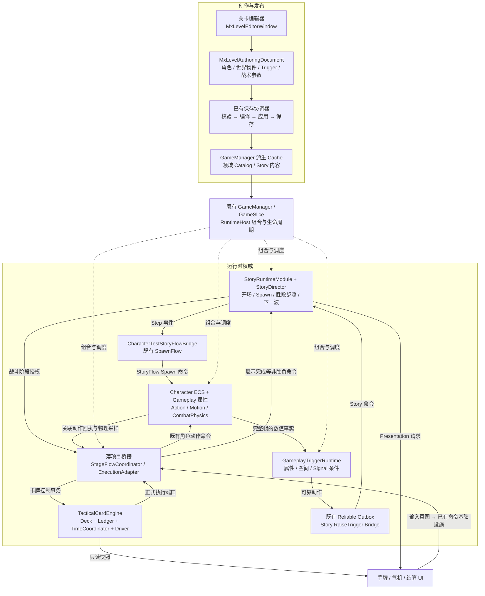
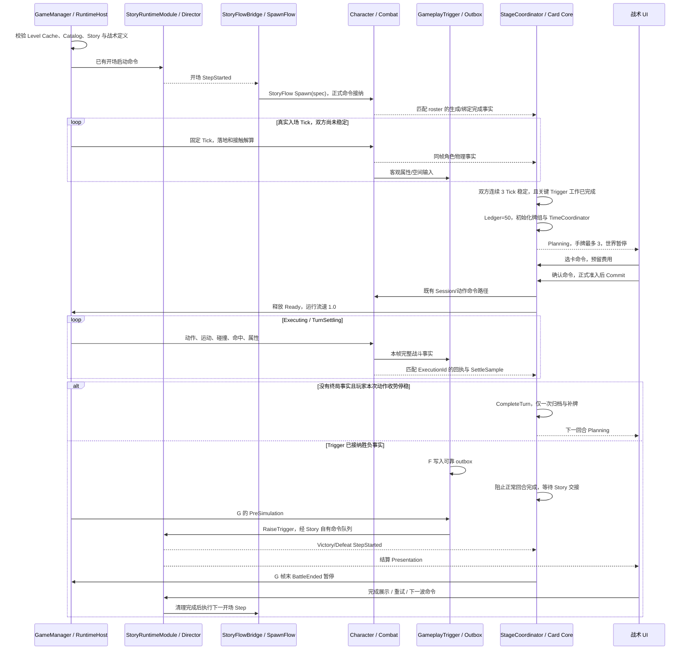
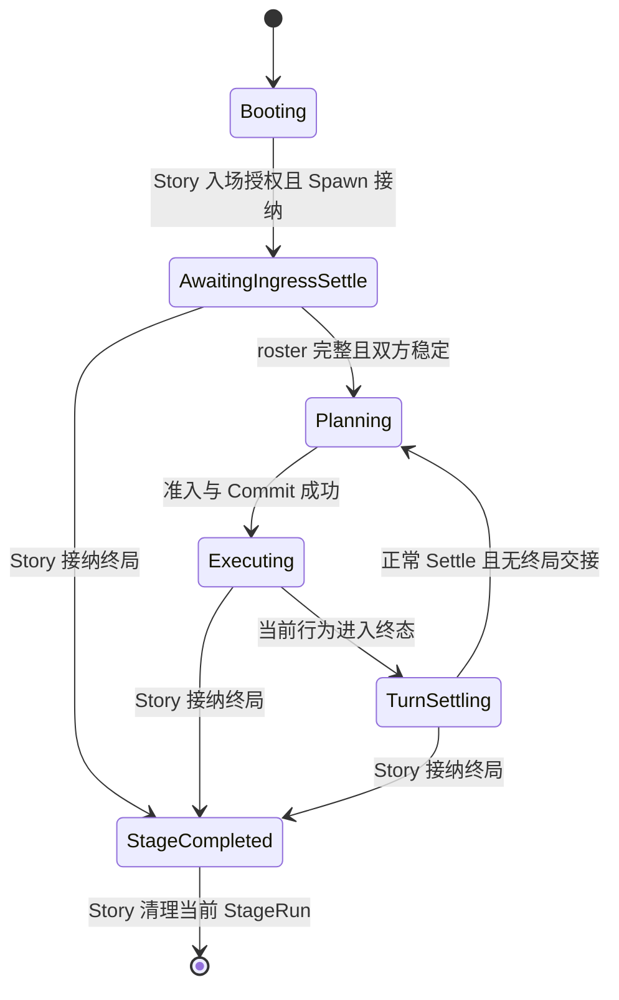

# 半即时物理动作卡牌：关卡、Story、GameplayTrigger 集成技术方案

> 状态：Proposed，工程实施方案；不表示新增能力已经实现或通过 Playable 验收。  
> 日期：2026-09-11。  
> 适用范围：CharacterTest 1v1 半即时动作卡牌 Demo，以及由同一 Story 管理的后续波次。  
> 核查基线：本地工作区，HEAD `399bee686618253fa9a8efe48cccafe25d20a37c`；包含尚未提交的 Task 1–3 源码与接口文档。  
> 本文交付：架构、Authoring 规范、时序、接口草案、实施切片与验收要求；本次不修改 Runtime、Editor 或场景。

**架构决策：关卡编辑器发布战场配置；Story 决定角色何时生成、战斗何时开始及结束后做什么；GameplayTrigger 判断客观战斗条件；已有卡牌核心管理选择、气机事务和动作执行窗口；Character/Combat 保持动作、运动、碰撞、属性的唯一权威。新增代码限于这些设施之间的配置扩展、命令适配、身份关联与帧末协调。**

## 1. 约束、现状与本方案采用的精确定义

### 1.1 不变量

1. 场景只保存舞台、合法世界物件、出生锚点及既有 `GameManager` 入口。角色 Prefab 不作为静态战斗实体烘焙进场景。
2. 本方案不新增以私有 `[SerializeField]` 字段配置玩家角色包、敌人包、血量、牌组或流程的 MonoBehaviour。所有作者数据必须可由关卡文档、领域 Catalog、Story 内容或已有配置管线校验、导出和定位。
3. 所有角色生成继续经过 `CharacterTestStoryFlowBridge → ICharacterTestCharacterSpawnFlow.RequestSpawn(spec) → CharacterTestRuntimeCommandSources.StoryFlow`。
4. HP、破聚、受击、出界事实由已有 Character/Gameplay/Combat 产生；判定条件由 GameplayTrigger 执行。卡牌协调器不得再写一套 `if (enemyHp <= 0) Win()`。
5. 胜利、失败、重试、下一波的宏观步骤由 Story 决定。桥接器只执行当前 Story Step 所要求的领域操作。
6. 时间暂停只能在完整权威 Tick 结束或明确的暂停控制事务边界生效；不得截断正在执行的 Tick。
7. 新增类型首先属于 `MxFramework.Game.CharacterTest`，不把战术卡牌专用词和 CharacterTest 依赖反向加入通用包。

现有 `GameManager` 的角色缓存、Trigger 缓存内部确实使用 Unity 序列化字段。本方案保留这些**由关卡保存管线生成、携带来源与校验信息的派生缓存**。它们不构成允许新增 Inspector 黑盒配置的例外，也不能改成第二份人工配置源。

### 1.2 已核查事实与实施差异

| 事项 | 当前源码事实 | 本方案决策 |
|---|---|---|
| Task 1–3 | 已有卡组、账本、Settle、时间协调器、执行适配器和单卡驱动 | 直接复用；不重新实现 Card Engine |
| 60/60 测试 | 本地 Task 3 XML 记录 60 passed、0 failed；不是本次重新运行 | 作为已有 Runtime Slice 证据，新增集成另行验收 |
| NoAlloc | 已测量的热路径为 0 B；编译、准入、初始化和部分 Story 操作不在该范围内 | 不宣称整个场景、每次出牌或所有 Story 调度均为 0 B |
| 连续稳定帧 | `SettleDetectorConfig` 默认 8 Tick | 本需求的 Demo 明确配置为 3 Tick；保留默认 8 的原有契约与测试 |
| 时间状态 | 已有回合状态和暂停原因；运行流速由 Unity 适配器设置 | Normal/Paused/Dilated 为有效时间模式，不能冒称协调器已有同名枚举 |
| 气机扣费 | Pending 时预留；`CommitTurn` 时提交扣费；`CompleteTurn` 归档并补牌 | 保持已验证事务，停稳时不再扣第二次费用 |
| 初始气机 | `MomentumLedger` 支持注入初值 | 本 Demo 每次新战斗初始化为 50，普通回合不重置 |
| 场景角色文档 | 当前 `characterTest.characters` schema 1 保存 `TransformRef`，位置来自 Scene 锚点 | 为严格满足 JSON 保存出生姿态的要求，在原角色模块升级 schema 2，见第 5 节 |
| 属性阈值接入 | 已有 `CharacterTestGameplayTriggerAttributeThresholdSystem`，当前只接受本地玩家 HP | 扩展现有 CharacterTest Trigger 来源适配，补充双方同帧属性事实；不重建 Trigger Runtime |
| Story Spawn | `RequestSpawn` 返回命令接纳结果，不是角色生成完成回执 | 增加项目内 Spawn 关联与完成屏障；不能在返回 true 时直接发 Ready |
| 独立 Demo 文档 | 当前角色编辑模块的 `DocumentPath` 固定为默认关卡路径 | 在现有模块内注入共享关卡文档上下文，复用唯一保存协调器 |
| 超时 | Driver 默认起手前 240 Tick、总执行 1800 Tick | 本 Demo 总执行预算配置为 300 Tick，即 60 Hz 下 5 秒模拟时间 |

下文所有新增接口、schema 字段、关卡上下文和集成 Hook 均为 **Proposed**。已存在的准确 API 以第 12 节引用源码为准。

## 2. 架构总览与职责边界



| 层 | 唯一拥有的决策 | 对外输入/输出 | 不得承担的职责 |
|---|---|---|---|
| Level Editor | 作者数据、引用、合法性、发布版本 | Document、Catalog、派生缓存 | Runtime 胜负、动作推进、角色实例生命周期 |
| Story | 开场、战斗授权、波次、胜败后的宏观步骤 | Story 命令、Step 事件、展示完成命令 | 每 Tick 读取刚体判断停稳；维护牌堆 |
| GameplayTrigger | 条件归约、触发策略、可靠动作派发 | 完整属性/空间/Signal 输入；RaiseTrigger 动作 | 创建 Unity UI；直接调用卡组完成回合 |
| TacticalCardEngine | 卡牌事务、资源预留/支付、执行关联、暂停请求 | 玩家命令、动作回执、SettleSample、只读快照 | 独立生成角色、改 HP、选择下一关 |
| Character/Combat | 实体、属性、完整动作、权威运动、碰撞与命中 | 正式角色命令；完成帧事实 | 保存牌堆、发胜利面板、解释 Story Graph |

`TacticalStageFlowCoordinator` 是项目组合层的薄协调对象，不是第六套玩法基础设施。它只回答“当前 Story 授权的战斗能否进入 Planning、当前执行能否交回卡牌核心”。

### 2.1 跨层通信规范

**配置发布属于冷路径，运行时写入必须经过领域命令；只读观察使用不可变值快照。** “只传命令与事件”不要求删除已有只读查询接口，而是禁止通过引用偷改另一个模块的状态。

统一遵守以下规则：

- 跨层业务身份使用 `StageRunId`、角色 StableId、`GameplayEntityId` 及其 generation、ExecutionId、卡实例 ID/版本、Story Graph/BeatInstance/Step ID。禁止以 GameObject 名称、Unity InstanceID 或集合枚举顺序作为权威身份。
- 物理事实携带完整模拟帧号；事件、命令携带原始发生帧、执行目标帧及既有 sequence/correlation。桥接时保留原始身份，不用“当前角色”“最新卡牌”替代。
- 事件回调不重入 Director、Driver 或物理世界；同步回调只缓存固定大小的关联记录，后续在既定边界处理。
- Story CommandBuffer 只由 `StoryRuntimeModule` drain；Gameplay CommandBuffer 只由对应 Gameplay 模块 drain；CharacterTest 正式角色命令只由既有命令模块 drain。
- 新战术输入可以拥有一个领域命令消费者，但必须复用 `RuntimeCommandBuffer`、注册/验证和回放基础设施，不能再造通用消息总线。
- 所有容量不足、身份失效、帧号错误和版本不匹配返回明确诊断；关键事实不得被静默丢弃后按“双方存活”处理。
- `GameplayTriggerRuntimeEvent` 的 observer 通道是展示/诊断投影，允许丢弃，不能成为胜负或暂停屏障的唯一依据。

### 2.2 物理与确定性边界

本文的“真实物理”指当前 CharacterTest 的框架 Combat/Motion 权威路径。继续复用现有角色胶囊、运动和动作配置，由 Spawn/Character Runtime 构建运行时实体及 View。不得新增以 `UnityEngine.Rigidbody`、`OnCollisionEnter` 或 `Physics.Raycast` 决定伤害、落地或出界的平行实现。

`CharacterTestTacticalExecutionAdapter` 已有可选 Unity Rigidbody 采样入口，这是源码事实。本 Demo 的权威采样必须选取框架实体/物理事实路径；如果保留 Unity 组件，只能用于 View 或经过明确标注的外部输入适配。

确定性承诺以固定 Tick、相同配置版本、相同初始状态、相同命令流为条件。现有局部 0 B 测量不能证明跨平台物理位级一致；接入回放后必须用当前框架的 hash/回放能力验证。

## 3. 时间、调度与暂停的工程合同

### 3.1 三种时间概念

| 时间 | 用途 | 暂停时 |
|---|---|---|
| 权威模拟 Tick，60 Hz | 动作、位移、碰撞、Buff、AI 执行、Trigger、执行预算 | 停止推进 |
| 暂停控制事务序号 | 选卡、取消、Utility、确认、菜单及恢复请求的确定性排序 | 可继续提交和处理 |
| unscaled 墙钟 | UI 动画、提示、资源超时诊断、Host 无进展监测 | 可继续，但不能直接产生伤害、补牌或胜负 |

运行流速为 1.0 或 0.2；暂停是覆盖其上的门控。恢复时恢复当前授权流速，不能因为关闭菜单就把慢动作强行改回 1.0。

`Time.timeScale = 0` 会停止 Unity 的 FixedUpdate 和依赖 WaitForSeconds 的等待；它不会替项目中所有自定义时钟和命令泵补上门控。因此 UI 与恢复入口必须由仍会执行的组合根 Update 驱动。依据：[Unity Time.timeScale](https://docs.unity3d.com/6000.0/Documentation/ScriptReference/Time-timeScale.html)、[Unity Time.unscaledDeltaTime](https://docs.unity3d.com/6000.0/Documentation/ScriptReference/Time-unscaledDeltaTime.html)。

不伪造微秒级性能数字。60 Hz 的单个**模拟时间步长**是 16,666.667 μs；这是数学步长，不是这一 Tick 必须花费的 CPU 时间。3 个完整稳定 Tick 是 50 ms 模拟时间，8 Tick 约 133.333 ms；CPU 耗时需由 Profiler 实测。

### 3.2 实际可接入的模块顺序

当前源码已有下列关键顺序：

| 调度位置 | 当前所有者 | 本方案接入点 |
|---|---|---|
| Host `PreSimulation/0` | Trigger Reliable Outbox | 派送上一帧及更早的到期可靠动作 |
| Host `Simulation/-100` | `StoryRuntimeModule` | drain Story 命令，产生 Step 事件 |
| Host `Simulation/0` | `CharacterTestRuntimeCommandModule` | 消费 Spawn 和动作等正式命令 |
| Host `Simulation/100` | `CharacterTestCharacterRuntimeModule` | Spawn、动作、Motion、Combat 等角色权威推进 |
| Host `Simulation/110` | CharacterTest 的 Gameplay/Trigger composition | 读取角色侧已更新属性，执行 Trigger pipeline |
| Gameplay 内部 `Simulation/950`、`960`、`1000` | Combat sensor、当前属性 source、Trigger evaluation | 补充的双方属性事实源位于 evaluation 之前 |
| 完整 Host Tick 后 | GameSlice/GameManager 集成边界 | 奖励关联、关键 Trigger 工作检查、物理样本、Driver、暂停生效 |

这里有两个不同的排序空间：Host module priority 与 Gameplay pipeline 内部 priority。不能把内部 `960` 当作 Host module priority。

Session 的 `SetContext/Tick` 必须在它发出的角色命令被本帧消费之前运行。新增 Hook 由项目 composition 放在 Story 输出之后、CharacterTest command drain 之前，并记录确定的优先级；不能另加一个 MonoBehaviour.Update 与 Host 抢执行顺序。

帧末按以下顺序收敛：

```text
完整 Host Tick F 成功
  → 确认本帧动作、命中、属性与物理事实完整
  → 处理 ExecutionId 关联的命中奖励与执行回执
  → 读取 Trigger 权威 intent/outbox 与关键来源提交结果
  → 若终局交接待处理：阻止正常回合完成，保持 Host 可运行
  → 否则提交同帧 SettleSample 给 TacticalSingleCardDriver
  → Driver 完成卡牌归档/补牌，或保持 Executing/TurnSettling
  → 应用暂停门控、丢弃暂停后的待追赶时间
  → 发布只读 UI 快照
```

任何后置伤害或属性结算若发生在 Trigger 采样之后，都必须调整所属调度位置或显式推迟 Ready，直到关键事实覆盖该完整帧。不得一边使用过期 HP，一边宣称帧末判定完整。

### 3.3 两个必须补齐的暂停入口

**暂停期间的战术命令泵。** `GameManager.Update` 先处理战术领域的 bounded 命令，再决定是否调用 FixedTickDriver。设已完成世界帧为 F：暂停中的卡牌命令登记在下一合法世界边界 F+1，按既有 Source/Sequence 排序，并校验 StageRunId、TurnIndex、快照版本。

这些命令只允许修改牌组、账本和执行准入状态。Utility 当前仅启用已经支持的加气机 Payload；任何物理效果必须留给恢复后的正式 Tick。`TryCommit` 成功后才释放 Ready，由既有世界驱动执行 F+1。回放必须在 F+1 的世界 Tick 前重放同一批控制命令；保存暂停现场时同时保存已处理命令序号和未处理命令，不能重复应用。

这是新增的战术领域消费者，不会 drain Story、Gameplay 或 CharacterTest 的命令队列。相同世界边界上的多次选卡/Utility 操作以 sequence 区分，不靠墙钟决定结果。

**FixedTickDriver 每一步之前的暂停检查。** 当前 driver 一次 Update 可执行多个 Tick。仅在调用 `Step` 前检查一次暂停不够：若第一个子步进入 Ready，同一 while 循环不能再执行第二步。需要在原 driver 增加继续推进谓词，或由原 owner 采用等价的逐步准入；暂停命中后结束循环并清理 accumulator。所有手动 Step、回放和自动化入口同样遵守对应时间策略。

正常运行可以使用当前 scaled delta；若改为 `unscaledDelta × effectiveScale`，必须只缩放一次。固定模拟步长始终为 1/60，不因 0.2 倍速改成另一套动作/物理步长。

### 3.4 可靠 Story 交接不得被 Ready 截断

Trigger 在 F 产生的 `RaiseTrigger` 是 `ReliableDeferred`。最早在后续合法帧 G（通常 F+1）的 outbox 阶段提交 Story 命令，由同一个 G 的 StoryRuntimeModule drain。

因此本方案采用**先完成终局交接，再进入结束暂停**：

1. F 帧末发现关键终局 intent 已接纳，或相应 outbox 工作仍在等待，立即锁住战术输入，抑制本次正常 `CompleteTurn`。
2. 保持原 Host 推进到 G；不直接调用 Director，不增加第二个 Story drain，不以丢弃式 observer 判断交接完成。
3. Story 接纳后进入 Victory/Defeat Step，桥接器记录匹配的 Graph/BeatInstance/Step 事件；在 G 的完整帧末应用 `BattleEnded`。
4. 交接期间最多会有有限的尾部模拟 Tick。本 Demo 明确接受这一语义；终局事实在 F 锁存后不得被后续 HP 变化改判。冻结最后一击原始画面需要额外的 View 保留策略，不能用暂停整个 Host 假装已经完成可靠交接。
5. target buffer 满时 outbox 保留并重试；超过配置的交接预算进入明确的故障暂停，保留 outbox 和卡牌现场，展示重试/重置入口。

Stage adapter 在帧末读取现有 `GetIntent`、activation 与 `ReliableOutboxRecordCount/GetReliableOutboxRecord` 等权威数据，并结合 action 接纳结果建立交接屏障。当前 `GameplayTriggerActionIntent` 已是成功激活提交后的记录；Authoring 意图、输入 Signal 或丢弃式展示事件本身不证明可靠入队。准备/提交失败必须阻止正常 Ready 并报告故障。

## 4. 端到端关卡生命周期

### 4.1 完整时序图



### 4.2 Phase 0：Level Boot & Story Start

1. Unity 进入 Play，既有 `GameManager` 初始化资源、运行配置、GameSlice 与 RuntimeHost。资源加载可能跨多个渲染帧；不能承诺 Awake 后第一个 Update 就生成角色。
2. 在 `GameSlice` 启动 Story bootstrap 之前，完成 Tactical 相关桥接订阅与配置注入。当前 GameSlice 构造过程会启动 Story，因此不能构造完成后才订阅并期待补收到开场事件。
3. 验证当前 Scene 与 LevelId、角色来源、Trigger catalog、战术定义、Story Graph 属于同一发布版本；拒绝空缓存、未知角色 ID、无效动作绑定及关键 Trigger 缺失。
4. Story 进入资源准备和角色入场步骤，原 `CharacterTestStoryFlowBridge` 使用明确注入的 startup specs。独立 Demo 必须传入实际数组，禁止 null 触发 legacy 临时角色回退。
5. `RequestSpawn` 只表示 Spawn 命令被接纳。角色资源解析、实体创建、物理组件和动画绑定由原链完成后，才能加入本波 roster 的 Ready 统计。
6. 为每个出生条目建立 `(StageRunId, SpawnStableId) → GameplayEntityId(generation)` 关联。若原完成回执不足，在原 Spawn 消费端增加最小 typed receipt；不要扫描场景里的“玩家”对象猜测加载成功。

开场幂等键至少包含 StageRunId 和 Story BeatInstance/Step。重复回调不得重复 Spawn；部分 Spawn 失败必须进入 Story 的 BootstrapFailed/Recovery 路径，不能拿剩余角色开始战斗。

### 4.3 Phase 1：Ingress & Physical Settle

入场保持世界运行。**此时不调用 `TacticalTimeCoordinator.Initialize()`**：它会立即持有 Ready 暂停，过早调用会让角色停在空中。

入场使用两个既有 `SettleDetector` 实例，分别观察玩家和对手；两者在同一个完整帧末均满足本 Demo 的 3 Tick 要求后，才允许进入战术阶段。

每个角色必须满足：已生成并具有正确 generation、物理与动作上下文已绑定、有稳定支撑、相对支撑点线/角速度进入阈值、无新破坏接触、无待执行冲量、无待落地或受击恢复。速度缺帧、非有限值和实体失效都不能算稳定。

入场期间没有出牌动作，不能伪造 `ActionTimelineCompleted=true`。使用显式的“本阶段无动作请求”事实表达 `NoActionStarted`，其余行为终止/意图释放字段来自该阶段实际无执行、无待消费命令的状态。

若敌人为 `AiControlled`，入场期间由原 Runtime AI Planner 控制层抑制自主发起行为，仍允许物理落地；首次执行开始后放行。配置为 `None` 的敌人是被动物理目标，不会自动具有战斗行为。

### 4.4 Phase 2：Tactical Planning

首次 Ready 在完整帧边界原子完成：

1. 确认 roster 完整，关键事实提交成功，未发生终局或可靠交接阻塞。
2. 创建本战斗 `MomentumLedger(50)`，用固定 seed 初始化 `TacticalDeckManager(handCapacity: 3)`。
3. 使用 `new SettleDetectorConfig(requiredStableTicks: 3)` 构造当前回合检测器；其他阈值沿用已验证默认值。
4. 调用 TimeCoordinator.Initialize 一次，进入 ReadyPaused，执行适配器保持无已起手动作。
5. 发布同一版本 UI 快照：手牌、气机 Current/Reserved/Spendable、PendingAction、TurnIndex、可操作命令。

`InitializeDeck` 已经发初始手牌，不再另写循环摸三次。后续 Ready 由原 `CompleteTurn` 负责补牌，StageCoordinator 不重复 `ReplenishHand`。

选中行为卡执行 `SetPendingAction`；切换时先 Cancel 再 Set。UI 明确显示预留费用。采用即时点击执行的界面时，同一命令仍须遵守“选定/预留 → 执行器准入 → Commit”的事务顺序。

### 4.5 Phase 3：Tactical Execution

确认时执行：

```text
校验 StageRunId / TurnIndex / CardInstanceId / Version / Planning
  → TacticalSingleCardDriver.TryCommit(currentTick)
  → ExecutionPort.TryPrepare / TryAdmit
  → TimeCoordinator.TryCommitTurn
  → Deck.CommitTurn，提交预留费用，卡进入 Resolving
  → 仅释放 Ready 暂停
  → 下一个合法模拟 Tick 才真正推进 Session / Action / Physics
```

费用示例：Current=50、费用=20。Pending 后为 `(Current=50, Reserved=20, Spendable=30)`；Commit 后为 `(30,0,30)`。若本次权威命中按配置奖励 10，则变为 40；停稳后仍为 40，不能再扣 20。

当前执行适配器只承诺已验证的 `AttackPrimary + Enemy` 及其已编译接近策略。Demo 初版只启用这些真实支持的行为卡及已支持的加气机 Utility。`Approach.None` 不等于无目标原地架刀；未绑定正式行为源的保底卡不得展示为可用。

玩家处于 `LocalPlayer` 保持身份和权限含义，但战术模式必须通过原 Input scope/控制归属机制屏蔽绕开卡牌的自由攻击与移动命令。每个实体同一时刻只有一个已授权的执行控制者。

### 4.6 Phase 4：Turn Settle

正常完成条件是“当前执行自然结束 + 玩家进入可规划物理状态”，不是播放时长届满或角色视觉上没动：

- ActionTimelineCompleted 来自匹配动作实例的 `Finished`。
- BehaviorTerminal、OwnedIntentsReleased、CommandsAcknowledged 均成立。
- 玩家没有受击恢复、待落地、待运动请求或待冲量；中立运动语义与稳定支撑成立。
- 相对支撑接触点的线/角速度连续 3 个完整 Tick 满足检测器的滞回规则。
- 本帧关键 Trigger 事实完整，且没有终局交接优先占用边界。

满足后仅通过 `Driver.OnCompletedSimulationTick → TimeCoordinator.EvaluateSettle → Deck.CompleteTurn` 归档卡牌、补到最多三张、增加回合号并暂停。未用手牌保留原实例及顺序语义。

**入场检查双方；普通回合只要求玩家本次承诺动作完成并停稳。** 敌人的自主动作可以停在前摇、挥击或后摇中，世界恢复后接着执行。把普通回合改成“等双方所有动作都结束”会改变半即时读招玩法，且持续出招的 Bot 可能永远不给 Ready。

敌人的作用仍会通过实际碰撞、冲量和玩家受击状态影响玩家 Settle。这里没有忽略敌人对物理结果的影响。

### 4.7 Phase 5：Trigger Victory/Defeat & Story Transition

胜负感知在每个运行 Tick 执行，Phase 5 表示宏观交接阶段，不表示等到卡牌停稳后才第一次看 HP。敌人在动作中途死亡也必须被记录；玩家死亡不等待其回到中立站姿。

当 Trigger 满足终局条件，按第 3.4 节进入 Story 交接。Story 进入 Victory/Defeat 后，当前 StageRun 终态不可回退，拒绝迟到的出牌、动作完成和旧角色回执。

终局发生时仍在 Resolving 的卡保留在战斗结束快照中，记为“战斗终止的执行”。不得假装正常停稳调用 CompleteTurn，也不自动退款或补牌。下一波如何处理牌堆和气机由 Story 引用的战术策略决定；本 Demo 默认新战斗重新初始化为 50 气机和一副初始化牌组。

结算 UI 的确认、重试和下一波命令通过仍工作的控制入口接纳。Story bridge 只针对已授权的宏观请求，按时间所有权释放结束暂停并允许原 Host 继续处理该 Story 命令；战术出牌入口继续关闭。旧动作/意图和角色由原生命周期先清理，清理回执完成后 Story 才发起下一波 Spawn。

不能在 `timeScale=0` 后等待一个永远不会执行的 FixedUpdate 来处理“下一波”。也不能通过 `Initialize()` 重置已有协调器；新 StageRun 使用新战斗会话，旧订阅与关联全部解绑。

## 5. Level Authoring 与 Demo 生成规范

### 5.1 角色配置

入口：`MxFramework → Level Editor → CharacterTest 场景角色`。

| 作者项 | 玩家 | 对手 |
|---|---|---|
| StableId | `tactical.player.spawn` | `tactical.enemy.spawn.01` |
| CharacterId | 从已发现角色包目录中选择的数字 ID | 同样由目录选择，不手填包路径 |
| TeamId | 0 | 1 |
| ControlOwner | `LocalPlayer` | 初期物理闭环可为 `None`；主动交锋使用 `AiControlled` |
| RuntimeAiPlannerProfilePath | 空 | AiControlled 时选择合法已发布配置 |
| Spawn pose | 示例 `(-2, 1.2, 0)`、yaw 90° | 示例 `(2, 1.2, 0)`、yaw -90° |
| TransformRef | 指向编辑器管理的出生锚点 | 指向编辑器管理的出生锚点 |

示例位置只表达相对布局，生成器必须按实际地面、角色胶囊尺度和出生姿态校验初始穿透与支撑路径，不保证任意角色使用示例高度都合法。普通角色 Spawn 只支持当前运行时认可的姿态自由度；不支持的 pitch、roll 或非单位缩放应在 Authoring 报错。

CharacterId、出生条目 StableId、运行时实体 ID、卡牌 ProfileId 是不同身份，禁止混用。目录排序改变不得改变已保存 CharacterId 的含义。

### 5.2 JSON 中出生姿态的严格落地

当前 `MxLevelAuthoringDocument` 是 `mx.level.authoring.v3` envelope；当前角色模块 schema 1 的 `TransformRef` 只有 Path/GlobalObjectId，不能独立重建坐标。

为满足本需求，**升级原 `characterTest.characters` 模块到 schema 2，不新增平行角色配置表**：

- 在原角色条目增加 typed `SpawnPose`，记录位置和当前 Spawn 支持的 yaw；数值序列化、量化使用现有确定性单位能力。
- JSON 中 SpawnPose 为出生姿态权威；Scene 锚点是可编辑投影。拖动锚点由原关卡模块形成一次文档事务，更新 SpawnPose，参与 Undo/Redo 和统一保存。
- TransformRef 保留为编辑器定位引用；不能再在 Runtime 无条件读取锚点 Transform 来覆盖已发布姿态。
- 在既有 `CharacterTestSceneCharacterCache.CharacterInstance` 内增加派生姿态快照及来源版本，由原 compiler/apply 路径写入。`CollectCharacterSpawnSpecs` 对新版本使用编译姿态生成 spec。
- envelope schema 可继续为 3；角色 module schema、角色 payload format/schema 与编译缓存版本同步升级。具体 wire 字段应在实施时写入原接口合同和迁移测试。

以下是 **schema 2 的提案片段，不是当前 schema 1 可直接读取的 JSON**；数值 ID 使用符号占位，生成器从现有目录解析后输出真实值：

```text
characterTest.characters / module schema 2
  character:
    stableId: tactical.player.spawn
    characterId: <目录解析得到的数字 ID>
    teamId: 0
    controlOwner: LocalPlayer
    transformRef: <现有引用解析器生成的锚点引用>
    spawnPose:
      position: (-2, 1.2, 0)  # 通过既有确定性单位格式序列化
      yawDegrees: 90
```

迁移规则：读取 v1 不立即覆盖原文件；编辑器明确进入迁移流程，从可解析锚点捕获姿态，校验后在统一 Save 中发布 v2。缺失锚点、未知 schema 或非法姿态必须阻止发布，不能写零坐标代替。旧关卡可继续走原 v1 reader；战术 Demo 的发布预检要求 v2。

这是一项为落实作者数据要求所需的原模块扩展，不能把它写成 Task 1–3 已实现的能力。

### 5.3 战术参数只保存一份

在同一个 envelope 增加项目专用 `characterTest.tacticalStage` 模块，用于组合参数，不复制角色、HP、动作或 Trigger 定义：

| 参数 | 本 Demo 值/约束 |
|---|---|
| StageDefinitionId / StoryGraphId | 引用已有目录中经校验的数字 ID |
| PlayerSpawnStableId / OpponentSpawnStableId | 引用角色模块条目 |
| InitialMomentum / HandCapacity | 50 / 3 |
| DeckDefinitionKey / ShuffleSeed | 领域定义引用 / 显式 seed |
| RequiredStableTicks | 3 |
| NormalScale / DilatedScale | 1.0 / 0.2；单一有效流速来源 |
| PreActionBudgetTicks / ExecutionBudgetTicks | 初版 240 / 300，且执行预算覆盖卡片合法最长流程 |
| IngressBudgetTicks | 独立配置，Demo 可取 300 |
| StoryTransferBudgetTicks | 独立有界预算，Demo 可取 60 |
| SimultaneousOutcomePolicy | `DefeatWinsSameFrame` |
| StageResetPolicy | 新会话、重新初始化牌组和气机 |
| CriticalTriggerBindings | 引用胜败、边界与需要的状态来源 |

加载/编译仍走既有 Config/Resources/Catalog 路径。组合根通过构造参数注入只读定义；禁止新增 `_deckJsonPath`、`_playerPackageId` 等 MonoBehaviour 字段。术语 TacticalCardEngine 表示现有类型的组合，不要求创建一个同名总控大类。

### 5.4 独立 Demo 的文档上下文

当前角色编辑模块的 DocumentPath 固定到：

`Assets/Config/MxFramework/Levels/CharacterTest/character_test_scene.world_objects.json`

独立 Demo 计划使用：

- Scene：`Assets/Scenes/TacticalCardDemo.unity`。
- Level：`Assets/Config/MxFramework/Levels/TacticalCardDemo/tactical_card_demo.level.json`。
- 历史 Editor 生成器：`Assets/Scripts/WGameFrameworkProject/CharacterTest/Editor/CreateTacticalCardDemoScene.cs`（现已移除；正式场景直接维护）。

实施前在现有 CharacterTest 编辑模块中引入共享 `CharacterTestLevelDocumentContext`，解析当前关卡 Scene、LevelId、Root、DocumentPath；角色、世界物件、Trigger workspace 和战术模块共用这一实例及原 `MxLevelEditorSaveCoordinator`。

这只消除硬编码路径，不增加第二套窗口、Save 按钮、脏状态、Undo 基线或关卡文件。选择旧 CharacterTestScene 时保持默认路径行为。独立 Demo 不得覆盖现有默认关卡文档。

### 5.5 历史生成事务（CreateTacticalCardDemoScene.cs，现已移除）

生成器只在 Editor 程序集中运行，按下列步骤执行：

1. 校验目标路径与已有未保存场景状态；创建或更新该 Demo 的受管对象。
2. 复用原 Scene bootstrap 创建 GameManager、合法地面/世界物件、相机、灯光和必要 UI 承载。
3. 创建两个空出生锚点；不要 Instantiate 角色 Prefab。
4. 从 `CharacterTestCharacterDefinitionRegistry` 读取合法角色定义，验证动作绑定与对手控制配置。
5. 用原角色 Authoring 类型构造条目，写入 schema 2 SpawnPose，并生成 TransformRef。
6. 使用原 envelope merge/upsert 能力写入角色模块；保留世界物件、Trigger 和其他已存在模块。
7. 使用现有 Trigger Authoring/Compiler 构造、校验胜负和空间绑定；再加入战术组合参数及 Story 引用。
8. 在原 SaveParticipant prepare 阶段完成所有模块和交叉引用预检，任何失败都不发布半份配置。
9. 由原统一 Save 执行 JSON 写入、角色 Cache/Trigger Cache 应用、Scene dirty 标记和场景保存；失败恢复该事务的文档及缓存快照。
10. 通过 Unity AssetDatabase 导入，让 Unity 生成 `.meta`；校验重新打开 Scene 后仍能找到同一关卡上下文和来源 hash。

可直接复用的当前 API 形状如下；schema 2 只是扩展原文档/编译器，不更换调用方向：

```csharp
// 当前已有 API。应在原 SaveParticipant 事务中调用。
bool applied = CharacterTestSceneCharacterAuthoringAdapter.ApplyEnvelopeToCache(
    envelope,
    gameManager.CharacterSceneCache,
    gameManager.WorldObjectSceneRoot,
    documentPath,
    out LevelWorldObjectAuthoringValidationReport report);

// 当前已有 API。返回规格集合，不生成角色。
CharacterTestCharacterSpawnSpec[] startupSpecs =
    gameManager.CharacterSceneCache.CollectCharacterSpawnSpecs(
        characterRegistry, out string[] diagnostics);

// 将 startupSpecs 注入原 StoryFlowBridge，生成权仍由 Story Step 触发。
```

生成结果必须验证来源 hash 和已发布出生姿态一致；只验证 JSON hash 而不验证仍可能被手动移动的 Scene 锚点，不能证明出生配置一致。Runtime 对新版本使用缓存的编译姿态，Scene 侧漂移由 Editor 发布预检诊断。

## 6. GameplayTrigger 的胜败、破聚与边界配置

### 6.1 同帧双杀必须使用同一份完整事实

当前 Trigger core 支持 Scalar Threshold 和带数字 Payload 的 Signal；当前条件程序不提供任意跨 source 查询。当前项目 HP source 又只绑定本地玩家，不能把两个独立 HP 阈值直接拼成一个已经存在的双方判定。

本 Demo 在原 CharacterTest Trigger 来源适配层补充 **BattleVitalsSample**：每个完整帧读取已绑定玩家和对手的权威 HP，提交一条 fixed numeric Signal：

```text
SignalId  = 发布目录中的 BattleVitalsSample ID
Source binding Owner = 本波玩家实体；Owner 不属于 Signal 自身字段
Subject   = 本波玩家的 GameplayEntityId
Instigator = 本波对手的 GameplayEntityId
Payload0  = 玩家本帧 HP
Payload1  = 对手本帧 HP
Payload2  = 已发布的 positive Int32 StageDefinitionId，以 long 无损承载
提交 Frame = 当前权威帧；由 source 提交 API 携带，不冒充 Signal 字段
```

该 adapter 只复制数字事实，不计算 Win/Lose，不持有第二份 HP。两个实体均已生成、generation 有效且处于该 StageRun roster 时才提交；缺失实体不能按 HP=0 处理。必要的实体销毁前终态事实须在原 Character lifecycle 中保留到本帧 Trigger 采样完成。

来源采用现有 typed Signal contract、trusted-derived 接入和 bounded 缓冲；需要的 source/provider/template 注册扩展在原 owner 完成。每个本波终局 source 每帧最多提交一条样本，使用 `UnorderedMultiset`、`Sequence=0`，配置匹配的 Signal schema 1 与 source capacity。需要向两个绑定投影时按 SourceBindingId 固定顺序提交，不由 Dictionary 顺序决定。

以下值构造可直接使用当前 API；外围目录、来源注册和本波 roster 校验属于接入增量：

```csharp
var sample = new GameplayTriggerSignal(
    signalId: battleVitalsSignalId,
    subject: playerEntityId,
    instigator: opponentEntityId,
    payload0: playerHp,
    payload1: opponentHp,
    payload2: stageDefinitionId,
    sequence: 0L);
// 放入预分配样本区，再通过当前 TrySubmitSignals 提交 complete batch。
// Hp 来自权威属性读取；这里不计算 Victory/Defeat。
```

已有通用 Signal reducer、condition compiler 和 reliable action sink 全部复用。StageRunId 由本波 source/binding 生命周期关联，不用 Signal payload 中的静态 StageDefinitionId 代替运行实例身份。

| 绑定 | Trigger 条件 | 可靠动作/宏观含义 |
|---|---|---|
| Defeat | `SignalId == BattleVitalsSample && Payload0 <= 0` | `RaiseTrigger(DefeatTriggerId)` |
| Victory | `SignalId == BattleVitalsSample && Payload0 > 0 && Payload1 <= 0` | `RaiseTrigger(VictoryTriggerId)` |
| 破聚观察 | 原 Combat 状态事实对应的 typed Signal/属性条件 | 发 Story 提示或阶段事件；默认不等同死亡 |
| 场外区域 | 原 Combat sensor occupancy/边界事实 | RaiseTrigger 到 Story 的边界处理步骤 |

这样同一帧双杀只满足 Defeat，结果不依赖两个回调的先后顺序。Signal 的重复采样由 Trigger route 的触发次数、阶段启停和终局锁存约束；新波次重新建立本波 binding 实例，不沿用旧波次的一次性激活额度。

若之后需要敌方独立 HP 阈值提示，再扩展现有 scalar source 的角色选择能力；该扩展不应替代上述同帧胜败合同。

### 6.2 激活与终局去重

胜败来源在角色 roster 完整后进入已武装状态，入场与执行期间都观察客观事实。每个终局 route 使用现有 `GameplayTriggerActivationPolicy`，`PerInstance`、`MaxActivations=1`。首个终局 route 成功接纳后，利用已有 Trigger-owned deferred action/启停机制关闭本阶段所有终局绑定；同帧互斥条件保证不会同时发出 Victory 和 Defeat，下一帧的 deferred 关闭必须先于该帧 evaluation 生效，防止尾部模拟产生相反结果。

如果项目 Authoring 尚未开放所需启停动作，补齐原 action/template 投影，并验证“关闭绑定动作”与“Story RaiseTrigger”能够使用现有事务/延迟合同组合。不得在 Tactical 层维护另一套死亡事件计数器来代替 Trigger 策略。

关键来源提交失败、动作 reservation 失败或无法持久保留可靠动作时，进入明确故障流程。展示 observer 的容量不足只影响诊断/UI；不能影响权威结果。

### 6.3 RaiseTrigger 的真实 wire 合同

| 字段 | 当前必须遵守的约束 |
|---|---|
| ActionKind | `GameplayTriggerStoryCommandActionKinds.RaiseTrigger`，数值 1003001 |
| Delivery | `ReliableDeferred` |
| Trigger target ref | domain 2 的 `GameplayTriggerSourceBinding`，positive Int32 Value，Generation=0；不是敌方 EntityId |
| Action Payload0 | positive Int32 Story triggerId |
| Action Payload1 / Payload2 | Int32 param0 / param1；需由 Story 内容合同明确含义 |
| Story command source | 既有 `StoryRuntimeCommandSources.GameplayBridge`，1003102，Derived allowlist |
| Envelope | 既有 TypeId 1002105、schema 1，不另造可靠消息头 |
| 目标队列 | hard-bounded，必须与 StoryRuntimeModule 使用完全相同的 buffer 与 validator 实例 |
| 结果 | 只有目标接纳才转移 outbox 所有权；Story 语义拒绝不是胜利完成 |

StageRunId 不得硬塞进已有 envelope 的保留位。需要动态阶段参数时应使用现有 action payload 绑定能力或在项目映射中建立明确、可验证的关联；未确认可用的动态替换不能在文档中当作现成 API。

最小 Demo 可以通过每次战斗会话独立的 roster、binding 生命周期和已加载唯一 Story Graph 进行关联。波次切换必须等旧可靠动作终态完成，再换入下一轮身份，防止旧胜利送到新波次。

## 7. C# 桥接接口与状态机草案

### 7.1 项目内值类型与协调接口

以下代码为拟新增合同，使用已有 `GameplayEntityId`、`SettleSample` 和卡牌类型；它们不表示源码中已有同名实现。

```csharp
using MxFramework.Gameplay;

namespace MxFramework.Game.CharacterTest.TacticalCard
{
    internal enum TacticalStagePhase
    {
        Booting = 0,
        AwaitingIngressSettle = 1,
        Planning = 2,
        Executing = 3,
        TurnSettling = 4,
        StageCompleted = 5
    }

    // 与 Phase 正交；故障挂起不伪装成 Planning 或 StageCompleted。
    internal enum TacticalStageHealth
    {
        Running = 0,
        AwaitingStoryTransfer = 1,
        SuspendedByFault = 2
    }

    internal enum TacticalStageCommandKind
    {
        SelectAction = 1,
        CancelPending = 2,
        PlayUtility = 3,
        ConfirmExecution = 4,
        RequestRecovery = 5,
        RequestRestart = 6
    }

    internal readonly struct TacticalStageCommand
    {
        public readonly ulong StageRunId;
        public readonly ulong TurnIndex;
        public readonly ulong CardInstanceId;
        public readonly uint CardVersion;
        public readonly ulong SnapshotRevision;
        public readonly TacticalStageCommandKind Kind;

        public TacticalStageCommand(
            ulong stageRunId, ulong turnIndex, ulong cardInstanceId,
            uint cardVersion, ulong snapshotRevision,
            TacticalStageCommandKind kind)
        {
            StageRunId = stageRunId;
            TurnIndex = turnIndex;
            CardInstanceId = cardInstanceId;
            CardVersion = cardVersion;
            SnapshotRevision = snapshotRevision;
            Kind = kind;
        }
    }

    internal readonly struct TacticalStoryStepToken
    {
        public readonly ulong StageRunId;
        public readonly int GraphId;
        public readonly int BeatInstanceId;
        public readonly int StepId;
        public readonly int ActionId;

        public TacticalStoryStepToken(
            ulong stageRunId, int graphId, int beatInstanceId,
            int stepId, int actionId)
        {
            StageRunId = stageRunId;
            GraphId = graphId;
            BeatInstanceId = beatInstanceId;
            StepId = stepId;
            ActionId = actionId;
        }
    }

    internal enum TacticalStageRejection
    {
        None = 0,
        WrongStage = 1,
        WrongPhase = 2,
        StaleSnapshot = 3,
        InvalidCard = 4,
        ExecutionRejected = 5,
        CriticalFlowPending = 6,
        FaultSuspended = 7
    }

    internal interface ITacticalStageFlowCoordinator
    {
        TacticalStagePhase Phase { get; }
        TacticalStageHealth Health { get; }

        // 由战术命令消费者调用，不从 Button 回调直接调用。
        TacticalStageRejection Apply(in TacticalStageCommand command);

        // 由原 Spawn 消费链的关联回执调用；slotIndex 在发布时确定。
        void OnSpawnBound(ulong stageRunId, int slotIndex,
            GameplayEntityId entityId, long completedFrame);

        // 由 Story 桥在预定边界转交，不重入 Director。
        void OnStoryStepStarted(in TacticalStoryStepToken step);

        // 调用前由 composition 完成关键 Trigger 交接/错误屏障检查。
        void OnCompletedSimulationTick(
            long completedFrame,
            in SettleSample player,
            in SettleSample opponent);
    }
}
```

命令 codec 需为 ulong 身份与现有 fixed RuntimeCommand payload 定义明确的无损编码；字段不足时使用现有版本化 envelope/payload 合同扩展，不能截成 Int32，也不能传卡牌对象引用。该 codec 属于项目战术命令适配，不新增通用队列。

### 7.2 订阅现有 Story 与 Trigger 的准确方式

```csharp
// 以下名称与签名来自当前实现。
IDisposable storySubscription =
    storyModule.Director.SubscribeEvents(OnStoryEvent);

void OnStoryEvent(StoryEvent evt)
{
    // 过滤 GraphId、BeatInstanceId、StepId、AuxId。
    // 复制关联记录到预分配的项目缓冲；不在这里 Spawn 或 Tick 世界。
}

// 冷路径创建，并加入现有唯一 Router 的 observer 注册集合。
var triggerObserver = new GameplayTriggerRuntimeEventObserverBuffer(64);
var registration = new GameplayTriggerRuntimeEventObserverRegistration(
    "characterTest.tacticalStage.presentation", triggerObserver);

// 帧末或展示刷新时消费自己的 observer，不 drain 原事件源。
while (triggerObserver.TryDequeue(out GameplayTriggerRuntimeEvent evt))
{
    OnTriggerPresentationEvent(in evt);
}
```

`OnTriggerPresentationEvent(in GameplayTriggerRuntimeEvent evt)` 只更新诊断和表现。终局权威继续通过可靠 Story 命令传递；暂停屏障读取权威提交结果、intent/outbox，而不是通过这个 observer 推断。

`TacticalBattleStoryBridge` 与原 `CharacterTestStoryFlowBridge` 分工如下：原桥仍执行资源准备和角色生成；新桥只识别战术开始、终局、恢复等项目 Story Step，并连接战术会话。若扩展原桥支持波次化 startup specs，则原开场分支与新波次分支必须互斥，避免双方都调用 RequestSpawn。

### 7.3 状态转移约束



Health 为 SuspendedByFault 时保留原 Phase；恢复回原执行现场，不能直接跳到 Planning。AwaitingStoryTransfer 时禁用选卡和 Driver 正常完成；Story 成功后才进入 StageCompleted。

Coordinator 不拥有第二份 Deck、Ledger、Action 状态机或实体表。roster 只是作者 StableId 到已有 generation-safe 实体身份的有限关联。

## 8. 超时、出界与故障保护

### 8.1 “强制平息”的合法含义

无限外力或碰撞卡死下，不能同时保证“角色必定自然停稳”和“固定时间内返回正常 Planning”。因此区分：

- **正常停稳**：原 SettleDetector 确认事实，允许完成回合。
- **保护暂停**：停止继续推演，保留物理状态、已支付费用和 Resolving 卡，不发正常回合奖励/补牌。
- **Story 授权的恢复或重建**：经原 Character/Motion/Spawn 流程执行，成功后按恢复合同重新确认状态。

不得通过把速度强行写零、把角色移到地面或伪造 `IsGrounded` 来骗过 Settle。暂停是调度状态，不是物理事实。

### 8.2 预算和具体行为

| 故障 | 检测所有者 | 确定性预算/处理 | 卡牌事务 |
|---|---|---|---|
| 资源/角色加载失败 | 原 Resources/Spawn 回执 | Boot 失败交 Story；墙钟仅提供无响应诊断 | 尚未初始化战斗牌组 |
| 入场悬空/未接地 | 既有 Settle + Stage 入场协调 | 300 个模拟 Tick 后保护暂停 | 不生成首个 Ready |
| 起手前接近卡住 | 既有 SingleCardDriver | 默认 240 Tick，尝试 `TryAbortPreAction` 并等待正式清理消费 | 已 Commit 的卡不自动退款 |
| 执行或收势始终不稳 | 既有 Driver 总预算 | 本 Demo 配置 300 Tick，`ForceSuspend(RecoveryTimeout)` | 保留 Resolving、回合号和费用 |
| 出界 | 既有 Combat sensor + Trigger | Story 按配置判战败或进入恢复步骤 | 不由卡牌层判输赢 |
| 动作 Cancelled/Interrupted、回执错位 | 正式执行适配器 | `ExecutionFault`，不能冒充 Finished | 不 CompleteTurn |
| 可靠 Story 命令长期受阻 | 原 outbox/目标结果 + Stage 交接屏障 | 独立交接预算，保留可靠记录 | 不补牌，不重新执行已接纳动作 |
| Host 在运行状态长期不前进 | unscaled watchdog | 仅发明确系统故障/恢复请求，不生成正常 Settle | 现场保留 |

5 秒定义为 `ExecutionBudgetTicks / TickRate = 300/60`。0.2 倍速下对应约 25 秒墙钟；玩家菜单暂停不消耗预算。若产品需要“5 秒现实时间保护”，墙钟只能生成已记录的外部故障请求，回放复现该请求，不重新按机器时间判定。

合法动作自身可能超过 5 秒。发布预检必须检查 `接近预算 + 合法动作 + 收势窗口` 是否与总预算相容；不相容则调整配置或排除该卡，不能靠超时截断已起手动作来通过。

### 8.3 恢复流程与时停死锁防护

1. 进入保护暂停，锁定出牌，UI 用 unscaled 通道显示“失衡保护暂停/执行异常”，不能显示“回合完成”。
2. 保存故障码、StageRunId、ExecutionId、最后完整帧、卡 ID/版本、暂停原因和最后权威物理摘要。
3. “继续观察”只释放拥有的故障暂停原因；菜单原因仍有效。继续运行后必须重新积累完整 3 Tick 窗口，原 Driver 的一次性超时保护不得每帧再次挂起。
4. “重试关卡/恢复到出生点”发送正式 Story 请求，由 Story 选择恢复步骤；暂停控制泵按该请求授权原 Host 前进，使 Story 命令和清理命令能被各自 owner 消费。
5. 未起手清理仍经原 Session.Stop/Abort；已起手故障的默认恢复为结束旧战斗会话并按 Story 重建，不把 Cancelled 映射为正常完成。
6. 若要支持原地物理复位，在既有 Character/Motion 命令族内补最小 typed recovery command，校验 generation、合法落点、碰撞穿透和生命周期回执；不能在 Coordinator 直接写 Transform。该能力未确认存在，属于独立增量。
7. 旧角色与意图清理完成后，Story 重用关卡 Cache 的规格重新 Spawn，并生成新 StageRunId；旧回执全部失效。

本方案保证的是**在有限预算内停止无界推演，并且恢复/重试入口在暂停时仍可执行**。它不把物理故障伪装成一次成功回合。若用户从未选择恢复，保护暂停保持等待是显式产品状态，不是不可达的调度死锁。

OnDisable/退出 Play/切换场景的清理必须解除本会话拥有的时间门控、释放订阅，并由统一时间 owner 恢复进入该会话前的有效流速。不能无条件解除别人的菜单暂停，也不能遗留 Time.timeScale=0 污染下一次会话。

## 9. UI、输入与最小可玩表面

正式面向玩家的卡牌 HUD 和结算使用现有 FairyGUI / UI Composer 流程；工程验证面板可用现有 UI Toolkit 能力。C# 只做命令和快照绑定，不在按钮里修改账本、HP 或 Story 状态。

HUD 至少呈现：

- 当前阶段与回合号；Planning、Executing、TurnSettling、终局交接和故障暂停要可区分。
- Current/Reserved/Spendable 气机及每张卡的可用性/拒绝原因。
- 最多 3 个手牌位置、待命卡和确认入口；选卡不重新生成卡实例。
- 执行中关闭出牌；终局交接时不短暂闪出“下一回合可操作”的手牌。
- 保护暂停时提供继续观察/重试入口；结算的下一波按钮通过 Story 命令工作。

第一版优先验证已支持的 AttackPrimary 行为卡与加气机 Utility。正式行为源、目标模式或动作槽尚不支持的卡必须在编译或准入时拒绝，不用延时器模拟动作完成。

## 10. 实施切片与文件归属

| 切片 | 具体交付 | 复用与修改范围 | 完成证据 |
|---|---|---|---|
| T4-A：Authoring 与生成 | 角色模块 v2 姿态、共享关卡上下文、战术组合模块、Demo 生成器 | 原角色/世界/Trigger Editor owner、SaveCoordinator、Config/Resources | 不污染原关卡；统一保存及重新加载一致；Scene 无静态角色 |
| T4-B：开场与时间 | Story bootstrap 前注入桥、Spawn 关联、双方入场检测、暂停控制泵、逐子步门控 | 原 GameManager/GameSlice/FixedTickDriver/StoryFlow/Task 2 | Play 后落地再暂停；Paused 输入有效；无追赶 Tick |
| T4-C：单卡真实执行 | 正式卡牌命令 codec、Session Hook、同帧采样、命中奖励关联 | 原 Task 1–3、角色命令/Combat 回执 | 3 个正常回合、费用和卡版本正确、无伪终态 |
| T4-D：终局与恢复 | 双方属性 Signal、互斥条件、可靠交接屏障、Story 结算/重试 | 原 Trigger 来源/Compiler/Outbox/Story bridge | 胜败及双杀结果唯一；暂停不阻断可靠交接；故障可恢复 |
| T4-E：可玩验收 | 正式 HUD、实际场景、回放/hash、异常矩阵 | 原 UI、Runtime 验证基础设施 | Unity Play Mode 证据，场景入口和操作文档 |

最小增量原则：

- 不修改 Task 1 的费用/卡组事务语义，不复制 SettleDetector。
- 不创建第二套 CharacterSpawnManager、BattleWinMonitor、LevelFlowManager 或 MonoBehaviour 配置容器。
- 双方属性读取、出生关联和暂停控制泵只填补已核实的项目接入缺口。
- 新的公开 schema/API 在实施切片中同步原接口和质量门禁；本方案文件本身不把 Proposed 提升为 Current。

本轮只有方案文档交付，运行时代码交付等级尚不适用；已有 Task 1–3 继续按其记录归类为 Runtime Slice。整个集成通过 T4-E 后，才能声明 Playable。

## 11. 验收标准与反例

以下是后续实现必须执行的验收，不是本次已运行的测试。

| 编号 | 用例 | 必须观察到的结果 |
|---|---|---|
| A01 | 生成 Scene、重新打开、Level Editor Save | 同一文档与缓存来源；原 CharacterTest 默认文档不变 |
| A02 | 手动改出生锚点并 Undo/Redo | JSON 姿态与受管锚点在原事务内一致，v2 Runtime 使用编译姿态 |
| A03 | 角色 ID 不存在、缺 Profile、未知 schema | 发布或 Boot 明确失败，不降级成默认角色/零坐标 |
| B01 | 双方高处出生 | 世界先运行；最后一方稳定满 3 Tick 后才首次暂停 |
| B02 | 只生成一方或返回过期 generation | 不进入 Planning；报告对应 Spawn/绑定故障 |
| B03 | 首次 Ready 或 Story Step 重复送达 | 不重复 Spawn、不重置气机、不重复发牌 |
| C01 | 一次 Update 可追赶多个 Tick | 首个子步进入 Ready 后，同一 Update 不再推进世界 |
| C02 | timeScale=0，连续选卡/取消/Utility/确认 | 命令可消费且排序可重放；确认只提交一次 |
| C03 | 菜单与 Ready/Recovery 暂停叠加 | 只释放所属原因；不意外恢复世界 |
| C04 | 暂停思考 10 秒后确认 | 不追赶 600 个世界 Tick |
| D01 | 当前正式 AttackPrimary 完整执行三回合 | 准入、真实起手、Finished、释放、Settle、补牌形成完整证据链 |
| D02 | 取消窗口开启但时间轴没结束 | 不暂停；受击中断不当作 Finished |
| D03 | 腾空顶点、移动/旋转支撑、缺帧采样 | 不误判；支撑点相对速度正确；缺帧重建稳定窗口 |
| D04 | 敌人处于前摇或挥砍时玩家停稳 | 可进入 Planning；恢复后敌人继续原动作 |
| D05 | 命中事件重复、卡同一实例再次抽到、旧回执迟到 | 奖励不重发，旧版本不完成新执行 |
| E01 | 单独敌死、单独玩家死、同帧双杀 | 分别 Victory、Defeat、Defeat；只有一个终局结果 |
| E02 | 致死帧恰好也是第 3 个稳定 Tick | 终局优先，不正常补牌再转结算 |
| E03 | Story buffer 满、目标关闭、语义拒绝 | outbox 保留或给出终态拒绝；不丢失事件、不假装 StageCompleted |
| E04 | Trigger observer 缓冲溢出 | 权威胜负和交接屏障仍正确 |
| E05 | 已武装后实体在采样前被销毁 | 保留可判定终态，或报完整性故障；不把空实体当作 0 HP |
| F01 | 连续 300 模拟 Tick 未平息 | 一次保护暂停；费用/Resolving/回合号保留，无额外补牌 |
| F02 | 暂停后点击重试、下一波、退出 Play | Story/清理命令可消费；旧事件不影响新会话；不遗留时停 |
| G01 | 相同初始状态、配置 hash、控制命令流 | 卡牌/气机/阶段/Trigger/Story 结果可按现有回放标准比较 |
| G02 | 初始化和预热后测量 | 分别报告纯核心、适配热路径、世界推进、Story 低频操作分配，不混为一个 0 B |

纯文档变更不需要启动 Unity 编译。本方案实施到 C# 切片时遵守根 AGENTS 的 refresh/compile、domain reload、Editor ready、Console error 门禁；进入上述可玩验收切片时，再执行拥有该切片的聚焦测试与 Play Mode 验证。

当前 Card Engine 的完整 SaveState/Replay 尚未接入。本 Demo 初版可声明“仅整场重试，不支持中途持久化恢复”；如果开放中途存档，必须先将牌堆顺序、RNG 状态、预留凭证、Resolving 版本、回合号、暂停原因和已处理控制序号纳入原 Runtime SaveState 合同，不能依赖 UI 快照恢复权威。

## 12. 核查依据与本次验证范围

本次直接读取了当前源码、接口与本地既有测试结果。主要依据：

| 依据 | 支撑内容 |
|---|---|
| [CharacterTest.TacticalCard 接口](Interfaces/CharacterTest.TacticalCard.md) | Task 1–3 当前能力、事务、时停、执行/采样边界、测试记录 |
| [卡牌核心源码](../Assets/Scripts/WGameFrameworkProject/CharacterTest/TacticalCard/TacticalSingleCardDriver.cs) | Prepare/Admit/Commit、真实回执、预算和停稳完成 |
| [时间协调器](../Assets/Scripts/WGameFrameworkProject/CharacterTest/TacticalCard/TacticalTimeCoordinator.cs) | Initialize 即暂停、暂停原因所有权、CompleteTurn、故障挂起 |
| [角色 Authoring 与缓存](../Assets/Scripts/WGameFrameworkProject/CharacterTest/Scene/Characters/CharacterTestSceneCharacterAuthoring.cs) | 当前 schema 1、TransformRef、Cache、Collect/Apply API |
| [角色编辑模块](../Assets/Scripts/WGameFrameworkProject/CharacterTest/Editor/CharacterTestSceneCharacterLevelEditorModule.cs) | 固定 DocumentPath、原保存参与者 |
| [关卡 envelope](../Packages/com.vincent.wgameframework/Config/Levels/MxLevelAuthoring.cs) | mx.level.authoring.v3、原模块机制 |
| [StoryFlowBridge](../Assets/Scripts/WGameFrameworkProject/CharacterTest/Story/CharacterTestStoryFlowBridge.cs) | Step 订阅、startup specs、legacy fallback、Spawn 调用 |
| [SpawnFlow](../Assets/Scripts/WGameFrameworkProject/CharacterTest/Character/CharacterTestCharacterSpawnFlow.cs) | StoryFlow 来源、RequestSpawn 接纳语义 |
| [GameSlice](../Assets/Scripts/WGameFrameworkProject/CharacterTest/Composition/GameSlice.cs)、[FixedTickDriver](../Assets/Scripts/WGameFrameworkProject/CharacterTest/Composition/CharacterTestFixedTickDriver.cs) | bootstrap 时机、完整 Host Tick、自定义累积器 |
| [Trigger composition](../Assets/Scripts/WGameFrameworkProject/CharacterTest/Composition/CharacterTestLevelGameplayTriggerRuntimeComposition.cs)、[现有 HP source](../Assets/Scripts/WGameFrameworkProject/CharacterTest/Scene/LevelTriggers/CharacterTestGameplayTriggerAttributeThresholdSource.cs) | 原属性接入、当前本地玩家限制、110/960 调度位置 |
| [Gameplay.Triggers 合同](Interfaces/Gameplay.Triggers.md)、[Story.Runtime 合同](Interfaces/Story.Runtime.md) | 唯一 drain、reliable wire、失败与重放边界 |
| [Trigger 事件路由](../Packages/com.vincent.wgameframework/Gameplay.Triggers/GameplayTriggerEventRouterSystem.cs) | 唯一 source drain 和展示 observer 的非权威属性 |
| [关卡复用矩阵](LEVEL_EDITOR_CAPABILITY_REUSE_MATRIX.md)、[游戏创建指南](AGENT_GAME_CREATION_GUIDE.md) | 既有能力复用、Combat 权威、配置/资源、UI、可玩验收约束 |
| [原最小 Demo 规划](../StorySource/玩法基石/半即时动作卡牌最小Demo设计与任务规划.md)、[卡牌详细契约](../StorySource/玩法基石/卡牌机制具体逻辑与数据细节_GPT6Astra.md) | 半即时读招、已选行为源、气机与异常暂停的原始设计上下文 |

本地已核实 `Library/MxFramework/TacticalCardTask3/2026-09-11-Task3-60-passed.xml` 的汇总为 **60 passed / 0 failed / 0 skipped**，记录开始于 2026-09-11 10:13:52 UTC；该文件属于本地验证状态，不作为应提交资产。本次没有重跑该测试，没有声称新的 schema、桥接器、Scene 或完整玩法已经验收。

本文要求的新增集成完成后，最终可玩的判据是：**从关卡编辑器发布的一份配置启动，经 Story 动态生成双方，经真实物理入场后进入三张手牌的战术暂停，经现有卡牌与动作链完成推演，再由 GameplayTrigger 的客观事实可靠驱动 Story 结算或下一波；任意正常或异常路径都不存在第二套角色加载、胜负监控、宏观流程或 Inspector 黑盒配置。**
