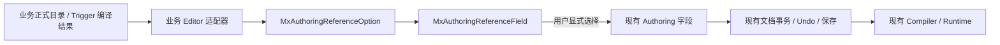

# Mx 关卡编辑器 P3.0：通用创作引用设计

> Status: Current
>
> Implementation state: P3.0 implemented and V4 accepted
>
> Phase: Level Editor P3.0
>
> Scope: Editor-only 目录引用、兼容显示和 Gameplay Trigger 首个接入
>
> Last verified: 2026-07-28

## 1. 设计结论

P3.0 只统一编辑器里“从业务正式目录选择一个值”的体验，不统一 Runtime 数据模型。各业务模块继续拥有自己的目标、来源、定义、编译和执行权威；通用层只接收业务适配器已经解析好的候选，并负责稳定显示、选择和缺失值兼容。

首个消费者是 CharacterTest 关卡编辑器的 Gameplay Trigger。P3.0 独立于 P2.5：它不代表第二阶段 Playable 收口已经完成，也不改变 P2.5 的验收范围。

## 2. 统一术语

| 界面名称 | 含义 | Runtime 权威 |
|---|---|---|
| `作用目标` | 动作最终作用的对象 | `GameplayTriggerTargetSelector` 与显式绑定目标 |
| `触发对象` | Trigger Source 提供的 Subject / Instigator 上下文 | Trigger Source、Source Binding 与运行时事件上下文 |
| `来源机制` | 创作者看到的 Buff 施加来源；底层仍是效果归因上下文 | `GameplayBuffApplicationRequest.SourceId` |
| `命令来源` | Runtime 命令的授权、路由和溯源身份 | Runtime command source contract |

`来源机制`不是 Runtime `命令来源`，不得把命令授权身份放入 Buff `SourceId` 候选。`SourceId`当前记录最近一次施加来源，不改变 Buff 的伤害、持续时间、叠层或移除规则，也不会执行所引用 Aura / Mechanic Source 定义中的其他效果。本文不新增 `MxTarget`、`MxSource`、全局目标模型或全局来源注册中心。

## 3. 权威与数据流

通用控件不查询 Runtime、不扫描程序集、不反射发现 Provider，也不缓存第二份目录。候选的真实值和稳定键必须来自业务正式目录；本地化显示名、摘要与 Tooltip 只是 Editor 展示信息。

P3.0 不修改：

- `mx.level.authoring.v3` 或 Gameplay Trigger JSON Schema；
- Trigger canonical hash、Runtime hash、SaveState、Replay 或 Network 数据；
- `GameplayTriggerTargetSelector`、`GameplayBuffApplicationRequest.SourceId` 或现有 payload 布局；
- Runtime 公共 API 和高频执行路径。

## 4. 通用 Editor 契约

### 4.1 `MxAuthoringReferenceOption<TValue>`

每个候选包含：

- `Key`：稳定选项键，用于诊断和同名消歧；
- `Value`：写回现有业务字段的真实值；
- `DisplayName`：面向用户的名称，缺失时回退到稳定键；
- `Summary`：紧凑补充信息；
- `Tooltip`：技术详情和稳定身份。

### 4.2 `MxAuthoringReferenceField.Create<TValue>(...)`

控件接收当前值、候选列表、比较器和变更回调。它遵循固定的渐进规则：

| 可用候选 | 显示 |
|---|---|
| 0 个 | 只显示诊断，不创建无效输入框 |
| 1 个 | 显示只读文字 |
| 2 个及以上 | 显示紧凑选择框 |
| 当前值未登记 | 保留并显示原值与兼容警告；选择框只列正式候选 |

回调只在用户显式选择不同的有效值后触发。构建、折叠、刷新和重新选择条目不得静默改写未知旧值。

该契约位于 `MxFramework.Editor`，为 Editor-only、低频 `AllocByDesign` API。它不得进入 Runtime、Tick、事件发布或批量实体循环。

## 5. CharacterTest Trigger 适配

### 5.1 作用目标

适配器从当前 Trigger 的 definition route、action、binding、source、source binding、显式目标和编译结果共同解析目标，不维护第二套目标枚举。

- 区域 Buff Trigger 只提供`进入区域的角色`，底层对应 `Subject`。
- Story Trigger 只提供`当前区域`，底层对应当前 `ExplicitBindingTarget`。
- `Owner`、`Instigator`、错误 Domain 或缺少真实绑定的目标不进入候选。
- 本阶段两个场景都只有一个可持久化目标，因此显示只读文字；未来只有在同一动作真正存在两个以上合法目标时才自然升级为选择框。
- Scene `Transform` 不是 Gameplay 实体，不能伪装成 Story 或 Buff 目标。

### 5.2 Buff 定义

Buff 选择器使用同一通用控件，但候选仍只来自 CharacterTest 组合根使用的 `GameplayBuffDefinitionRegistry`。展示名和玩法说明来自现有 `GameplayBuffPresentationDefinitionRegistry`与 CharacterTest 中文展示适配；缺失展示信息时回退到 Buff stable ID。

普通摘要优先显示创作者需要判断的结果：以 CharacterTest 当前 60 Hz 逻辑频率把持续帧换算为秒、把 Stack Policy 翻译为“刷新 / 替换 / 叠层”的实际行为，并显示 Buff 的玩法结果。原始逻辑帧、`GameplayBuffStackPolicy`、每次施加层数、最大层数和技术效果摘要只放在 Tooltip；它们不是关卡 Trigger 的第二套覆盖配置。

### 5.3 来源机制

普通属性区使用创作者语言`来源机制`，底层技术语义仍为效果归因。候选直接聚合现有 Aura 与 Mechanic Source 定义，并按数值 ID 稳定排序、去重和检测冲突：

| 数值 ID | 显示名 | 正式来源 |
|---:|---|---|
| 0 | 未指定 | 显式空值 |
| 501008 | 守护光环 | Guard Aura definition |
| 501010 | 区域禁锢 | Area Confinement mechanic source definition |
| 501012 | 毒瓶池 | Poison Bottle Pool mechanic source definition |

`501013` 地雷和 `501014` 炮台目前没有正式 Buff 来源定义，因此不展示。显示名缺失时回退到 stable ID；相同数值 ID 被多个稳定键占用时显示冲突诊断。

选择来源机制继续写入 Trigger action 的现有 `Payload1`。Runtime Buff bridge 仍按原链路把它映射到 `GameplayBuffApplicationRequest.SourceId`。候选摘要只说明“记录施加来源”，不得显示来源定义自己的 Effect 数量，因为 Trigger 不会执行那些 Effect。正整数历史值未登记时只警告，不自动清零；原始 ID 仅在`高级规则`中作为迁移后备。

## 6. 交互与事务

- 选择 Buff 或来源机制复用现有文档事务、单步 Undo/Redo、脏状态与保存流程。
- Inspector 重建后保留滚动位置和当前输入焦点；正在编辑的其他字段不因目录控件刷新被静默重置。
- 未知值只有在用户显式重选或修改高级迁移字段时才变化。
- 目录不可用时 fail-visible：显示诊断并保留文档原值，不猜测默认值。

## 7. 非目标

P3.0 不做：

- Provider 注册、反射发现、搜索窗口、收藏或全局缓存；
- CharacterAction `TargetPolicy`、Story ID 或 Runtime 命令来源迁移；
- 可编辑 Source Definition 表；
- 全局目标/来源对象模型；
- Schema、存档、回放、网络和 Runtime hash 迁移。

## 8. 验收门禁

- 通用控件覆盖 0、1、多个和未知当前值四种状态。
- Trigger 目标候选与现有 route/binding/compiler 结果一致。
- 来源机制目录精确为 `0/501008/501010/501012`，且普通摘要不展示来源定义的 Effect 数量。
- 未知值在重建、折叠、刷新、Undo/Redo 和保存前保持不变。
- `Payload1 → GameplayBuffApplicationRequest.SourceId` 既有桥接测试继续通过。
- 按公共 Editor API 变更执行 V4：Unity 编译、Console、focused EditMode、轻量检查、代码规范报告和实际窗口视觉检查。
