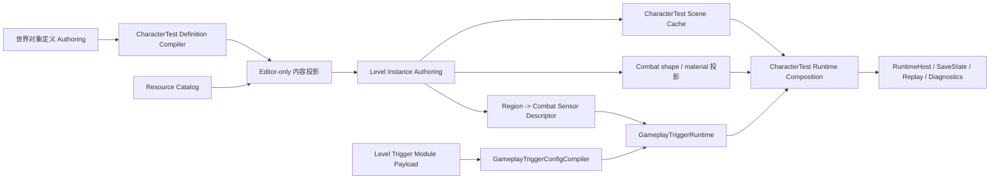

# Mx 关卡编辑器第二阶段：定义驱动玩法闭环设计

> Status: Current
>
> Implementation state: P2.0-P2.5 implemented; P2.5 final Playable boundary V4 validated; P3.0 common authoring references implemented and V4 accepted independently
>
> Phase: Level Editor Stage 2
>
> Scope: 轻量对象定义库、统一内容选择、Combat-backed Trigger Region 与运行验证
>
> Last verified: 2026-07-28

## 1. 设计结论

第二阶段把关卡编辑器从“快速摆放已有测试对象”推进为“无需修改 C# 即可创建内容定义，并让场景区域触发已有玩法模块”。

本阶段的完整用户闭环是：

```text
创建或复制对象定义
  -> 选择实际表现资源
  -> 放置并调整场景实例
  -> 给区域配置事件 / 条件 / 动作
  -> 校验并保存
  -> 由 Combat Physics + Gameplay.Triggers 在 RuntimeHost 中执行
```

关卡编辑器仍然不是新的玩法运行时，也不建立万能对象模型。界面可以统一搜索和展示内容，但世界对象、角色、资源、Combat、Gameplay Trigger、Story 等数据继续由各自领域模块拥有。

## 2. 当前事实基线

以下是本设计开始前已从 Current 文档与源码确认的事实：

| 当前事实 | 证据 | 对第二阶段的影响 |
|---|---|---|
| 世界对象、场景角色已经具备放置、复制、重新放置、删除、Undo/Redo、统一保存和关闭恢复 | `Guides/LEVEL_EDITOR_QUICK_PLACEMENT_GUIDE.md` 与现有 `IMxLevelEditor*` 实现 | 第二阶段不重做快速布置和保存外壳 |
| 世界对象下拉框直接读取 `CharacterTestWorldObjectSceneSource.BuiltInCatalog` | `CharacterTestWorldObjectLevelEditorModule.Toolbar.cs` | 新定义仍需要进入内建 Catalog，尚不能只靠编辑器创作 |
| `CreateCharacterTestSceneCatalog()` 仍在 C# 中构造当前对象定义 | `CharacterTestWorldObjectDefinition.cs` | 需要领域拥有的数据化 Authoring 源和 Compiler，不应把硬编码搬到窗口代码 |
| 当前新建世界对象使用 Cube/Sphere/Capsule primitive，随后移除 Unity Collider | `CharacterTestWorldObjectLevelEditorModule.Placement.Creation.cs` | 需要显式表现绑定，普通定义应能放置真实 Prefab；Unity Collider 仍不能成为玩法权威 |
| 场景角色选择器当前只列出 `IronVanguardCharacterId` | `CharacterTestSceneCharacterLevelEditorModule.Inspector.cs` | 角色入口应改为读取 Character.Application / RuntimeSpawn 的已发布定义，但本阶段不在关卡编辑器里创作角色 |
| `ILevelAuthoringDefinitionProvider` 已提供按定义 ID 查询摘要的基础契约 | `Config/Levels/LevelWorldObjectAuthoring.cs` | 优先复用现有查询边界；列表/搜索先放在 Editor-only projection，不急于扩公共 Runtime API |
| `mx.level.authoring.v3` 是模块化 envelope，当前包含世界对象和场景角色 payload | `Config/Levels/MxLevelAuthoring.cs` | Trigger 作为新模块 payload 接入相同文档、保存事务和关闭恢复 |
| 关卡区域已经有 `TriggerRegion` 类型，但尚未接入 Gameplay Trigger Runtime | `LevelWorldObjectAuthoring.cs` 与当前 CharacterTest 消费路径 | 可直接把现有区域作为 Trigger 的场景 Authoring anchor |
| Gameplay Trigger 已有结构化 Authoring Document、Config Compiler、Combat Sensor、Gameplay/Story bridges、SaveState/Replay/Hash | `Interfaces/Gameplay.Triggers.md` 与对应源码 | 第二阶段只补持久化、关卡适配、界面和 CharacterTest 组合根接入 |
| Combat Sensor 接受固定世界空间 Sphere/Capsule/AABB/Sector query，不接受 OBB | `GameplayTriggerCombatSensorCatalog.TryValidateQuery` | 首版 Trigger Region 只开放 AABB；旋转盒不伪装成已支持能力 |
| `CombatPhysicsWorld` 支持 AABB/Sphere/Capsule collider，但 `CombatLevelDefinition` v1 只持久化 AABB | `Interfaces/Combat.md` 与 `CombatLevelDefinition.cs` | 不用 `CombatLevelDefinition` v1 覆盖或降级现有 Sphere/Capsule 世界对象 |

这些事实不表示现有编辑器有功能错误。它们说明当前能力足以制作 CharacterTest 测试场景，但还没有满足“一个人不改代码即可扩展关卡内容”的新目标。

## 3. 目标与完成定义

### 3.1 产品目标

- 用户无需修改 C#，可以新建和编辑一个 CharacterTest 世界对象定义。
- 用户在现有“放置”弹层中可以搜索定义，并从定义创建真实 Prefab 实例或明确声明的 primitive authoring object。
- 场景实例继续只保存定义引用、Transform、分组、启用状态和必要实例身份，不复制整份定义。
- 用户选择一个 `TriggerRegion` 后，可以用简洁的“事件—条件—动作”表单配置 Trigger。
- Trigger Region 使用从场景区域编译出的 Combat query；Runtime 不查询 Unity Collider、PhysX 或 `OnTriggerEnter`。
- 保存、Undo/Redo、关闭时保存/放弃和引用保护覆盖新定义草稿与 Trigger 模块。
- Play Mode 能显示所选 Trigger 的 Combat Sensor 状态、最近 occurrence、动作结果和编译诊断。

### 3.2 阶段完成定义

第二阶段只有在以下完整路径通过后才算完成：

> 新建一个数据化世界对象定义，绑定有效 `ResourceKey`，将真实 Prefab 放入场景；创建一个区域并配置已有 Gameplay/Story Trigger 动作；保存并重新打开后内容保持一致；Play Mode 中由 Combat Sensor 产生 occurrence，并由现有 Gameplay.Triggers bridge 执行动作；全过程没有以 Unity Physics 作为玩法权威。

只完成定义 JSON、只完成内容选择器、只完成 Trigger 表单或只完成 Runtime 测试，都属于阶段内增量，不代表第二阶段完成。

## 4. 非目标

本阶段不做：

- 通用 Prefab/AssetDatabase 全资源浏览器。
- 最近使用、收藏、标签管理后台、连续盖章和随机散布。
- CharacterStudio、角色模型、武器、CharacterAction 或 Ability 创作。
- 通用可视化脚本、自由节点图、蓝图语言或任意表达式。
- 任意 UnityEvent、反射方法、组件回调或脚本注入动作。
- Unity NavMesh、Unity Physics、Rigidbody 或 Collider 玩法权威。
- 旋转 OBB Trigger、Polygon、Spline、Terrain volume 或动态移动 Trigger。
- 全局 Story、Runtime AI Planner、VFX、Audio、Camera 工作台嵌入。
- 通用跨游戏 Level Package。
- 定义硬删除。首版只允许新建、编辑和停用；删除需等全项目引用索引稳定后另做。
- 运行中热改正式权威配置。保存后通过重建 CharacterTest session 生效。

## 5. 交互原则

### 5.1 场景优先

高频动作继续发生在 Scene：

- 选择对象。
- 放置和调整 Transform。
- 观察实际模型与 Combat shape。
- 右键执行复制、重新放置和删除。

关卡编辑器只展示当前选择需要的定义、能力、校验和运行状态，不把 Scene 缩成编辑器内部的小预览。

### 5.2 渐进展开

日常放置只看到搜索和必要筛选；定义管理、Trigger 高级 ID、Compiler 环境、delivery contract 和 raw payload 默认隐藏。

```text
普通使用
  放置 -> 搜索内容 -> 开始放置

需要创建变体
  放置 -> 管理定义 -> 新建或编辑 -> 保存 -> 返回放置

需要玩法
  选择区域 -> 添加触发器 -> 选择事件和动作

需要排障
  运行时检查 -> Compiler / Sensor / Action 诊断
```

### 5.3 统一界面，不统一权威

统一内容选择器可以同时展示世界对象、角色、点位和区域，但它只是 Editor-only projection：

- 世界对象定义由 CharacterTest World Object Config 拥有。
- 角色定义由 Character.Application / RuntimeSpawn 拥有，关卡编辑器只读消费。
- 表现资源由 Resources 的 `ResourceKey` / Catalog 拥有。
- 物理形状和地表材质编译到 Combat。
- Trigger 语义由 Gameplay.Triggers Config/Runtime 拥有。

不建立 `Dictionary<string, object>`、万能 capability blob 或新的 global content runtime。

## 6. 主界面设计

### 6.1 放置弹层

保留现有“放置”按钮和锚定弹层，把类型与定义两个下拉框升级为一个紧凑内容选择器：

```text
搜索  [名称、ID、分类或标签________________]

[全部] [物体] [角色] [点位] [区域]

▣ 轻型滑动物       可移动 · AABB · 光滑
  滑动方块 Prefab                         ✓

▣ 弹性球体         可移动 · Sphere · 弹性
  弹性球 Prefab                           ✓

──────────────────────────────────────────
[网格] [场景标记]  [管理定义]   [开始放置]
```

交互要求：

- 搜索结果使用虚拟化 `ListView`，不把全库渲染成卡片墙。
- 每行最多显示缩略图、名称、一行摘要和诊断状态。
- `管理定义` 只在当前 provider 可写时出现；角色等只读 provider 不显示创建入口。
- 内容选择器记住最近选中的条目，但本阶段不实现“最近使用”列表。
- 弹层外点击、切换模块、`Esc` 和窗口关闭继续遵守现有关闭规则。

### 6.2 定义管理工作区

定义管理是显式进入的临时工作区，不增加常驻侧栏，也不新开第二个 Unity 窗口：

```text
< 返回关卡        对象定义                              [新建]

搜索 [________________]   类型 [全部 ▾]

定义列表                 选中定义
-------------------      ------------------------
轻型滑动物               基本：名称、分类、状态
粗糙重物                 表现：ResourceKey / primitive
弹性球体                 物理：形状、尺寸、表面材质
...                      玩法：现有 typed facets
                         技术详情 ▸
```

规则：

- 首版只允许编辑 CharacterTest 世界对象定义。
- `新建`从类型安全模板开始，并生成新的 numeric ID 与 stable ID。场景实例复制统一在 Scene 右键菜单执行，定义工作区不提供容易与实例复制混淆的复制按钮。
- 编辑定义不会自动替换已存在场景对象的 Prefab。存在表现差异时显示“场景外观与定义不一致”，用户通过显式、可 Undo 的“更新场景外观”处理。
- 形状、材质和玩法定义变化会重新生成运行时缓存与 Scene Combat gizmo。
- 技术详情显示 schema、numeric ID、stable ID、ResourceKey、hash 和引用数；默认折叠。

### 6.3 对象实例 Inspector

实例属性区保持简洁：

```text
轻型滑动物                        [编辑定义]

实例
  定义          101 轻型滑动物
  分组          TestCourse_20
  场景对象      MovableNaturalObject_01

能力摘要
  物理          AABB · 光滑表面
  可移动        质量 18 kg

[重新放置] [复制并放置] [更多 ▾]
```

定义字段只显示摘要。复杂 physics/potency/movable facets 在定义管理工作区编辑，不重复为每个实例展开。

### 6.4 Trigger Region Inspector

选中 `TriggerRegion` 时，在紧凑对象设置之后显示渐进式编辑区：

```text
玩法触发器  1 个                         [+ 添加触发器]

区域内维持 Buff                    ● 已启用  [启用] [更多 ▾]
进入 + 离开 · 进入区域的角色 · 601012 · Poisoned

触发条件
  触发时机    [进入] [停留] [离开]       （模板语义）
  计数与冷却范围  [每次进入一次 ▾]

作用对象
  进入区域的角色
  可伤害 · 阵营不限

执行动作
  动作        进入施加 Buff，离开移除 Buff
  选择 Buff   [601012 · Poisoned ▾]
              持续时间、叠层和效果摘要
  来源        [无来源（默认） ▾]

[高级规则 ▸]
  冷却        [无冷却 / 自定义 ▾]
  执行次数    [不限 / 1 次 / 自定义 ▾]
  Buff ID     [手动后备]
[技术信息（只读） ▸]
```

首版交互语义：

- 事件：当前三个固定模板分别使用 Entered，或 Entered + Exited；普通视图以只读分段标签显示，不伪装成尚未接入的自由事件编辑。
- 条件：当前模板使用 typed 恒真条件。Combat Sensor 尚不支持的关系筛选不显示占位控件。
- 动作：首批只接入已有 `Story.RaiseTrigger` 与 Gameplay Buff Apply/Remove；动作种类与 target selector 由模板固定，Story 参数和 Buff/source payload 可编辑。新建 Buff Trigger 不猜测效果，初始显示`请选择 Buff`并在保存前要求从现有 Gameplay Buff 目录明确选择。
- 计数与冷却范围：`全区域共用`、`每个对象独立`、`每次进入一次`直接映射 Trigger activation policy，并保持为同一层级的扁平选项。原始 cooldown 和 max activations 不占用普通编辑区；`高级规则`先以`无冷却 / 自定义`和`不限 / 1 次 / 自定义`表达语义，只有选择自定义时才显示正整数输入。
- `高级规则`同时保留目录外旧 Buff ID 的手动迁移后备与固定条件说明；`技术信息（只读）`显示 source/definition/route/binding/source-binding ID、provider、delivery contract、容量和 compiler path。
- 修改 payload 不重建或重置已编辑的 policy；复制 entry 会保留启用状态、policy 和 payload，同时分配新的 typed ID。

不提供自由节点图，也不在首版暴露当前 Runtime 无法消费的自由组合字段。同一区域可添加多条 Trigger entry；每条 entry 用自然语言摘要与分组表单展示。

## 7. 权威与数据流



### 7.1 单一事实源

| 数据 | Authoring 真源 | 派生产物 | Runtime 权威 |
|---|---|---|---|
| 世界对象定义 | 数据化 CharacterTest definition authoring 文件 | Runtime definition catalog、presentation binding、hash | `CharacterTestWorldObjectDefinitionCatalog` |
| 表现资源 | `ResourceKey` 与项目 Resource Catalog | Editor resolved prefab、Player provider entry | `IResourceManager` |
| 场景实例 Transform | Unity Scene | fixed-unit spawn/collider/query cache | Combat/CharacterTest runtime state |
| 关卡实例登记 | `mx.level.authoring.v3` worldObjects/characters module | GameManager scene cache | CharacterTest composition |
| Trigger 语义 | 同一 level envelope 中的 Trigger module payload | compiled Trigger catalog plan/hash | `GameplayTriggerRuntime` |
| Trigger 区域几何 | TriggerRegion 的 Definition + Scene Transform | fixed world-space Combat sensor descriptor/hash | `GameplayTriggerCombatSensorSystem` |
| Trigger 动作 | 已注册的 Gameplay/Story action contract | sink/transfer bootstrap | 对应 Gameplay/Story Runtime |
| 调试信息 | Runtime typed snapshot/event/result | Editor view model | 不进入玩法权威 |

### 7.2 Unity 的允许边界

允许：

- `AssetDatabase` 在 Editor provider 中解析 `ResourceKey` 对应资源。
- `PrefabUtility`/`Object.Instantiate` 创建场景表现实例。
- `HandleUtility`、`Handles`、Renderer bounds 和 SceneView 绘制用于 Authoring。
- Unity Undo、Scene dirty 和 EditorPrefs。

禁止：

- 把 Unity Collider、`Physics.Raycast/Overlap*`、`OnTriggerEnter` 或 Rigidbody 结果写成 Trigger occurrence。
- 用 SceneView gizmo 或 Transform 直接替代 Runtime query。
- 把 AssetDatabase path 写入玩法定义或 Player runtime。

## 8. 世界对象定义 Authoring

### 8.1 Authoring 源

第一消费者仍是 CharacterTest，因此首版不把 CharacterTest facets 提升成通用框架 schema。计划新增项目专用 Authoring 源：

```text
Assets/Config/MxFramework/Levels/CharacterTest/world_object_definitions.json
```

建议 schema identity：

```text
mx.characterTest.worldObjectDefinitions.authoring.v1
```

每个定义保存：

- `definitionId`、`stableId`、`displayName`、enabled/deprecated state。
- `objectKind` 与 `category`。
- 现有 material、shape、potency、movable/static/point/region typed facets。
- Authoring presentation binding：`PrefabResource` 或显式 `PrimitiveAuthoring`。
- `PrefabResource`只保存稳定 `ResourceKey`。
- Editor-only description/tags，可进入搜索但不进入玩法 hash，除非以后明确提升为 runtime contract。

Compiler 产出：

- 与当前 `CharacterTestWorldObjectDefinitionCatalog` 等价的 gameplay definition catalog。
- definition -> presentation binding 投影。
- canonical content hash 与结构化 validation report。
- Player 可读取的 CharacterTest runtime catalog mirror。

现有 `CharacterTestWorldObjectDefinition` 不因表现资源而依赖 Unity 对象。表现绑定保持 sibling projection。

### 8.2 Editor-only 内容投影

关卡编辑器内部允许建立统一只读 view model，例如：

```text
provider identity
content kind
numeric/stable definition identity
display name/category/tags
presentation preview
placement capability
diagnostic summary
writable/deep-link capability
```

该投影不序列化、不进入 Runtime，也不成为新的 Catalog 权威。

首版 provider：

1. 可写的 CharacterTest 世界对象 definition provider。
2. 只读的 Character.Application / RuntimeSpawn 角色 provider。
3. 现有点位和区域 definition provider。

优先通过 adapter 复用 `ILevelAuthoringDefinitionProvider`。只有实际实现证明多个 provider 需要相同列表/搜索 API 时，才提炼新的 Editor-only query contract；不提前扩大 Runtime 公共 API。

### 8.3 表现创建规则

- `PrefabResource`：通过 Resource Catalog 的 Editor provider 解析 Prefab，使用 Unity Prefab API 创建实例并保留 Prefab 关联。
- `PrimitiveAuthoring`：显式选择 Cube/Sphere/Capsule，仅用于本来就以形状为表现的测试/碰撞对象。
- 缺少或无效 `ResourceKey` 时，普通 Prefab 定义阻止新建放置，不静默退化为 primitive。
- 放置后仍移除意外附带且未被明确允许的 Unity Collider，避免误导为玩法碰撞。
- 放置预览使用最终将实例化的 Prefab 或显式 primitive。

## 9. Level Trigger Authoring

### 9.1 模块 payload

Trigger 接入现有 `mx.level.authoring.v3` envelope，计划使用 CharacterTest-owned module：

```text
moduleId: characterTest.gameplayTriggers
format:   mx.characterTest.levelGameplayTriggers.v1
```

payload 包含：

- `GameplayTriggerAuthoringDocument` 的可持久化语义数据。
- Trigger entry 的 Authoring stable ID、显示名、模板来源和备注。
- region source binding：Trigger source-binding ID -> worldObjects region instance stable ID。
- provider、query layer mask、`maxQueryHits`、`maxMappedSubjects`。
- 各 ID domain 的 next-id 与 retired-id 状态。

payload 不保存：

- Scene 坐标、尺寸或旋转副本。
- Unity instance ID、Collider、GameObject 或 Asset path。
- Runtime relation/presence/cooldown/activation 当前状态。
- Action sink、delegate、object reference 或 bridge 实例。

### 9.2 领域持久化

`GameplayTriggerAuthoringDocument` 已存在，但关卡编辑器需要稳定 JSON round-trip。该能力应新增在 `Gameplay.Triggers.Config`，而不是写在 Level Editor 窗口中：

- canonical serializer/parser。
- schema/unknown/duplicate/missing field 诊断。
- 对现有 immutable authoring arrays 的无损 round-trip。
- Editor mutable draft -> immutable document 的显式构建。

Level module wrapper 只负责场景 region binding 和 Authoring UI metadata。

### 9.3 Trigger ID 规则

- 每类 Trigger numeric ID 使用独立递增 allocator。
- 删除或取消绑定后 ID 进入 retired set，不在同一 level 中重用。
- 数组顺序不决定 ID。
- 复制 Trigger 时分配全新的 source definition、condition、definition、route、binding 和 source-binding ID。
- Undo/Redo 恢复完整 allocator/retired state。
- stable ID 用于 Authoring、引用诊断和未来迁移；Runtime 继续使用现有 typed numeric ID。

### 9.4 Region -> Combat query

首版只支持静态 AABB Trigger Region：

- 中心与尺寸来自 Scene Transform 和 region definition。
- 保存/应用时转换成 fixed world-space `CombatAabbQuery`。
- query layer mask、容量和 provider 来自 Trigger binding config。
- Scene Transform 仍是 Authoring 权威；Trigger payload 不复制几何。
- 区域旋转非单位旋转时给出阻塞诊断，不把旋转盒近似为 AABB 后静默运行。
- SceneView 绘制实际编译后的 Combat AABB，并在场景表示与 compiled query 不一致时显示警告。

Sphere/Capsule/Sector 在后续增量中按现有 Combat Sensor 契约增加；OBB 要等 Combat Sensor 正式支持后再开放。

### 9.5 首批动作

首版动作只来自现有 bridge：

| 用户动作 | 现有运行时入口 | 首版编辑方式 |
|---|---|---|
| 触发 Story | `GameplayTriggerStoryCommandActionKinds.RaiseTrigger` | Story trigger ID + 两个可选参数 |
| 添加 Buff | `GameplayTriggerGameplayBuffActionKinds.ApplyComponentBuff` | Buff definition + source/target |
| 移除 Buff | `GameplayTriggerGameplayBuffActionKinds.RemoveComponentBuff` | Buff definition + source/target |

CharacterTest Editor 可以先用项目专用 typed option adapter 描述这三种动作的中文名和参数，不创建通用任意 payload 编辑器。出现第三个领域消费者并形成重复结构后，再评估把 action authoring descriptor 提升到 `Gameplay.Triggers.Config`。

## 10. 保存、Undo 与引用保护

### 10.1 统一保存

定义库草稿作为新的 save participant 加入现有 `MxLevelEditorSaveCoordinator`。一次“保存”按候选内容统一预检：

1. 校验 definition authoring、ResourceKey 和重复/退休 ID。
2. 编译候选 definition catalog 和 presentation binding。
3. 使用候选 definitions 校验世界对象、角色和 Trigger payload。
4. 编译 Trigger catalog 与 region sensor descriptors。
5. 对所有目标文件和 Scene cache 创建恢复快照。
6. 写 definition source、generated/runtime mirror 和 level envelope。
7. 更新 world/character/trigger scene cache。
8. 最后保存一次 Unity Scene。
9. 任一步失败时恢复文件与 Scene cache，并保持未保存状态。

Definition 仅修改且不影响当前 Scene cache 时可以不保存 Scene；只要当前场景中有受影响实例或 Trigger descriptor，就必须更新 cache 并保存 Scene。

### 10.2 Undo/Redo

- Definition 新建、字段编辑、停用和 ResourceKey 修改进入 Editor-only document transaction。
- Trigger 新建、复制、修改、删除和 region rebind 与 level envelope 同步进入一个 Undo group。
- Scene Transform 修改继续由 Unity Undo 负责，并使依赖它的 Trigger descriptor 变脏。
- Undo/Redo 后重建内容投影、列表、选择、diagnostics、compiled preview 和 dirty baseline。

### 10.3 引用保护

- Definition 首版不提供硬删除。
- 停用仍被引用的 definition 时给出 warning；新放置列表不再推荐，但已有实例仍可解析。
- 删除 Trigger entry 不删除 region GameObject 或 worldObjects row。
- 删除/仅移除 region 时，如果 Trigger module 仍引用它，沿用当前外部引用保护并显示 `characterTest.gameplayTriggers` 来源。
- 替换定义表现资源不会自动替换场景对象，必须显式执行“更新场景外观”。

## 11. Runtime 组合与缓存

### 11.1 Definition runtime

Authoring definition compiler 生成 CharacterTest runtime catalog 和 Player mirror。Runtime 只读取已编译/已发布 catalog，不读取 Editor draft。

迁移期间：

- 当前 built-in catalog 保留为兼容 fallback。
- Editor 能在 fallback 模式查看旧定义，但不能把无效/缺失 Authoring 源保存为新权威。
- 生成 catalog 与 built-in catalog 的逐字段等价测试通过后，Authoring 源成为默认 writer authority。

### 11.2 Trigger scene cache

P2.4 已新增 `CharacterTestGameplayTriggerSceneCache` 作为 level envelope 的 Scene 派生缓存，保存：

- Authoring content hash。
- canonical Trigger authoring JSON 或等价可重建 runtime plan。
- fixed region sensor descriptor rows。
- Trigger catalog hash、sensor catalog hash 和 combined hash。
- level/module/cache schema、条目数、编译版本与最后应用信息。

cache 不允许手工编辑。用户点击`保存`时，Authoring 与编译后 cache 在同一协调事务中写入 `GameManager`；CharacterTest offline session bootstrap 从 cache 构建：

- `GameplayTriggerCompiledCatalogPlan`。
- `GameplayTriggerRuntime`。
- `GameplayTriggerCombatSensorCatalog/System`。
- 已使用动作的 sink/transfer/bootstrap。
- Gameplay/Trigger/Story SaveState participant、checkpoint barrier、组合 result hash 和 typed diagnostics。

bootstrap 会重新解析 canonical payload、重新编译 plan 和 sensor catalog，并精确比较 schema、source/content hash、条目数与 Trigger/sensor/combined hash。任何不一致、unknown source binding 或动作 bootstrap 不完整都整份 fail-closed，不回落 Unity Physics，也不保留半套组合。

P2.4 只接入 CharacterTest offline `GameSlice`。P2.5 已在 `CharacterTestScene` 交付正式 `region.start` Presence Buff 示例并完成 Playable 验收。当前仍不支持活动 session 热重载，也不把该 Scene cache 注入网络会话；修改配置后需要重新生成缓存并重建 Play session。

### 11.3 高频路径

Editor 搜索、编译、ResourceKey 解析和 descriptor 生成都是低频 Authoring 路径，可以按现有 `AllocByDesign` 契约工作。

Runtime 高频路径必须保持：

- Trigger/Combat Sensor 初始化时完成数组、排序、容量和 scratch 分配。
- Tick 不扫描 JSON、不读 Scene Transform、不查 AssetDatabase、不做反射。
- 不为每帧 UI 文案、列表或 Scene Gizmo 分配。
- Play Monitor 从 typed snapshot/result 低频构建展示文本。

## 12. 运行验证与诊断

P2.4 已在属性区“运行时检查”新增 Trigger 摘要，并以 5 Hz 低频读取 typed status/result：

- Authoring stable ID 与 typed numeric IDs。
- source-binding 是否已进入 compiled plan 和 Scene cache。
- compiled Trigger/sensor/combined hash。
- Combat query kind、中心、尺寸、layer mask 和容量。
- 最近一次 Sensor status、hit count、mapped subject count 和 rejection reason。
- 最近 occurrence：Entered/Stayed/Exited、frame、subject。
- 最近 action：kind、dispatch、result/reason 与事件丢弃计数。

P2.4/P2.5 不用 Unity Collider、标签或 Scene Transform 反推运行结果。SceneView 仍负责 Authoring 范围、选中区域的 compiled candidate、region 名和 Authoring 错误；Play Mode 中的实际查询与结果统一在属性区查看。P2.5 正式示例的区域对象只有 Transform，Scene cache 使用 64 个 Combat 查询候选与 8 个映射主体；Presence 模板在 Entered/Stayed 刷新 Buff，在 Exited 移除。运行中的 occupancy/occurrence Scene overlay 仍不属于第二阶段。

## 13. 兼容与迁移

### 13.1 现有定义

- 从 `CreateCharacterTestSceneCatalog()` 确定性导出首份 Authoring JSON。
- numeric ID、stable ID、shape、material、potency 和全部 typed facets 保持不变。
- 现有 level instance 无需迁移 definition ID。
- 新旧 catalog 建立逐字段等价测试；不以条目数相同代替等价。

### 13.2 现有场景对象

- 不批量替换当前 GameObject。
- 为每个旧 definition 生成显式 `PrimitiveAuthoring` 或有效 Prefab binding。
- 只有用户执行“更新场景外观”时才替换对象，并保持 parent、Transform、登记 identity 与 Undo。

### 13.3 现有关卡 JSON

- `characterTest.gameplayTriggers` 是可选 module。
- 没有该 module 的 v3 level document 继续正常加载，表示该关卡没有 level-authored Trigger。
- worldObjects/characters payload 不因第二阶段改名或搬迁。
- 添加 Trigger module 不改变其他未知 module 的 payload。

### 13.4 Combat shape

本阶段不把 CharacterTest definition catalog 强制转换成 `CombatLevelDefinition` v1，因为后者当前只覆盖 AABB。Sphere/Capsule 继续通过现有 CharacterTest -> Combat projection；未来 Combat Levels schema 扩展后再评估统一。

## 14. 风险与约束

| 风险 | 设计约束 |
|---|---|
| 统一选择器演变成第二个资源系统 | 只聚合 provider view model；资源身份始终是 `ResourceKey` |
| Definition 与场景实例互相覆盖 | Definition 是共享模板，Transform 是 Scene 权威；表现替换必须显式 |
| Trigger UI 复制 Runtime | 表单只构造 `GameplayTriggerAuthoringDocument`，执行仍由现有 Compiler/Runtime/bridge |
| Trigger 几何与 Runtime 不一致 | SceneView 绘制 compiled Combat query，保存时缓存 hash，Runtime 重建并复验 |
| 数字 ID 因排序/删除变化 | 独立 allocator + retired set，绝不按数组索引派生 |
| 保存一半失败 | 全部 candidate 先预检，文件与 Scene cache 快照后统一提交/回滚 |
| CharacterTest 专用类型污染通用框架 | 首版 schema 和 adapter 保持 CharacterTest-owned；出现第二游戏消费者后再提炼 |
| Editor 变复杂 | 高频操作仍在放置弹层与选中对象 Inspector；定义管理是显式临时工作区 |

## 15. API 复用计划

| 需求点 | 优先复用 | 本设计 |
|---|---|---|
| Level Editor shell | `IMxLevelEditorModule`、structured/placement/scene/save contracts | 复用；只增加领域 participant/module |
| Level document | `MxLevelAuthoringDocument` 模块 envelope | 复用；新增 CharacterTest Trigger payload |
| 定义查询 | `ILevelAuthoringDefinitionProvider` | 复用；列表搜索先做 Editor-only adapter |
| 资源身份与校验 | `ResourceKey`、Resource Catalog、`IResourceManager`、Editor validator | 复用；不保存 Asset path |
| 世界对象玩法定义 | `CharacterTestWorldObjectDefinitionCatalog` | 复用 runtime model；新增 CharacterTest Authoring/Compiler |
| 角色 | Character.Application / RuntimeSpawn | 只读引用，不在 Level Editor 创作角色 |
| 物理 | `CombatPhysicsWorld`、Combat shapes/material/query | 复用；不使用 Unity Physics 权威 |
| Trigger Authoring | `GameplayTriggerAuthoringDocument`、`GameplayTriggerConfigCompiler` | 复用；补 domain JSON round-trip 与 level wrapper |
| Trigger 感知 | `GameplayTriggerCombatSensorCatalog/System` | 复用；Region 编译为 AABB descriptor |
| Trigger 动作 | Gameplay Buff bridge、Story bridge | 复用现有 action kinds/sinks/transfers |
| 生命周期 | `RuntimeHost`、Gameplay system ordering | 复用 CharacterTest 组合根 |
| SaveState/Replay/Hash | Trigger 与 Runtime 现有 participant/contracts | 复用，不建立 Editor snapshot runtime |
| 诊断 | Trigger/Combat typed results、Diagnostics/DebugUI | 复用 typed snapshot，Editor 低频展示 |
| Unity 能力 | SceneView、Prefab/AssetDatabase、Undo | 仅 Authoring/view adapter |

## 16. 文档维护规则

第二阶段实施时，每个增量必须同步：

- [开发实施指南](Guides/LEVEL_EDITOR_DEFINITION_DRIVEN_GAMEPLAY_DEVELOPMENT.md) 的状态、提交和验证证据。
- [能力复用矩阵](LEVEL_EDITOR_CAPABILITY_REUSE_MATRIX.md) 中对应能力的“待接入/已接入”状态。
- 公共 API 或 schema 所属 `Interfaces/*.md`。
- 已实际交付的用户操作进入 `USAGE.md` 与快速布置指南。
- 未实现的目标只保留在本 Design 与开发指南，不能提前写进 Current 使用说明。

详细文件职责、增量顺序、测试矩阵和完成门禁见开发实施指南。

## 17. 独立后续：P3.0 通用创作引用

P3.0 独立于 P2.5，统一 Editor 侧目录引用、显示名和未知值兼容，首个接入方为关卡 Gameplay Trigger。它复用现有 `GameplayTriggerTargetSelector`、Trigger binding、Gameplay Buff Registry、Aura 和 Mechanic Source 目录，不新增 Runtime 目标/来源模型，也不改变 Trigger schema、hash、SaveState、Replay 或 Network。

术语、权威映射、控件规则和非目标见 [P3.0 通用创作引用设计](LEVEL_EDITOR_COMMON_AUTHORING_REFERENCES_DESIGN.md)，实现与验收入口见 [P3.0 通用创作引用开发指南](Guides/LEVEL_EDITOR_COMMON_AUTHORING_REFERENCES_DEVELOPMENT.md)。P3.0 与 P2.5 保持独立提交和验收边界；两者当前均已完成各自范围。

## 18. 界面演进：P3.3 统一触发器工作区

第二阶段首版将 Trigger 卡片放在 Region Inspector，是为了先验证区域到 Combat Sensor、Gameplay Trigger 与目标领域动作的完整闭环。随着 Threshold、Signal 和其他领域事件需要共享同一套创作体验，该内嵌布局不再作为长期界面边界。

P3.3 计划建立顶层`玩法触发器`工作区，以统一的事件、条件、动作和一句话效果说明投影现有 Authoring；Region Inspector 缩为关联入口。Runtime 权威、Compiler、Source Provider、动作目录、保存事务与场景缓存继续复用现有能力。完整范围、数据映射、渐进切片和验收门禁见 [P3.3 统一触发器工作区设计](LEVEL_EDITOR_UNIFIED_TRIGGER_WORKSPACE_DESIGN.md)。
