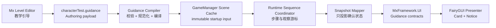

# Mx 关卡编辑器 P3.4：教学引导可视化 Authoring 设计

> Status: Design
>
> Decision status: Accepted
>
> Implementation status: Current — P3.4a～P3.4e 已实现并通过正式数据链、Unity 与视觉门禁
>
> Design version: v1.1
>
> Date: 2026-08-13
>
> Scope: CharacterTest 当前六步线性教学、独立关卡 Authoring 模块、Level Editor 语义预览、Scene-owned Runtime cache 与显式切换

本文冻结 Level Editor P3.4 的产品、数据权威、编辑器交互、Runtime 消费与迁移边界。
当前源码已经完成 P3.4：正式模块数据、Scene cache、三栏编辑器、typed completion
observer、sequence coordinator、snapshot mapper 与生产 Host cache 消费链均已接入。实施记录和
验收矩阵见
[P3.4 开发指南](Guides/LEVEL_EDITOR_GUIDANCE_AUTHORING_DEVELOPMENT.md)。

玩家可见的 Guidance Card、Notice Banner、FairyGUI package、Presenter 和视觉表现继续由
[正式玩家引导提示 UI 设计](PLAYER_GUIDANCE_PROMPT_UI_DESIGN.md)负责。本文只拥有“教学序列
如何创作、保存、编译和推进”，不重新定义 UI contract，也不把 Level Editor 或 FairyGUI
变成 Gameplay、Combat、Story 或 Trigger 权威。

---

## 0. 冻结结论

P3.4 首版采用以下不可拆分的边界：

1. `教学引导`是 Mx Level Editor 中独立的顶层模块，不放进`玩法触发器`、`世界对象`或
   `创世验证`工作区。
2. Authoring 单一事实源是现有 `mx.level.authoring.v3` envelope 中的
   `characterTest.guidance` 模块，不建立第二份关卡主文档。
3. 首版只有一条有序线性序列；数组顺序就是播放顺序，不保存第二个 `sortOrder`。
4. 编辑器只开放五类已注册、可安全切换的 typed completion condition；新建入口提供空白步骤和
   六个玩家意图预设，不开放任意事件、字段路径、
   反射、表达式或节点图。
5. Runtime 只读取 scene-owned `CharacterTestGuidanceSceneCache`，不在 Player 中读取
   `Assets/Config` 路径。
6. 完成事实仍由 CharacterTest、Camera、Target Lock 和 Combat 的既有 Runtime authority
   产生；Guidance 只观察已确认结果。
7. 现有六步必须和新 Authoring、Scene cache、Runtime 消费链一起原子切换；缺失、非法或
   stale 数据显式禁用 Guidance，不保留静默硬编码回退。
8. Level Editor 只提供 UI Toolkit 语义预览；正式外观仍由 FairyGUI PlayMode 与实际 Game
   帧验证。
9. 首版教学状态可从启动输入重建，不进入 SaveState、Replay、网络快照或 Gameplay hash。
10. P3.4 全部类型保持 CharacterTest 项目私有，不在没有第二消费者时提升公共 API。

### 0.1 当前实现快照（2026-08-13）

| 范围 | 当前事实 |
|---|---|
| Authoring | `characterTest.guidance` schema v1、空文档/空白步骤、六个创作预设、五类可切换 typed completion condition、normalize、validator、compiler 与稳定 hash 已实现；当前六步只作为正式数据和 reference fixture |
| Level Editor | 独立`教学引导`模块、`空白步骤 / 从预设新建`、三栏自由步骤编辑、条件切换、作者只编辑简中源文案、系统维护 Key、简中/English 等待/完成/拒绝语义预览、Undo、dirty、校验与统一保存已实现 |
| 正式数据 | 当前六步 payload 已写入共享 envelope；匹配 cache 已序列化到 CharacterTest Scene 的 GameManager |
| Runtime | 生产 UI 组合从 Scene cache 编译 plan；Sequence Coordinator 唯一拥有步骤状态，五类 typed observer 读取领域事实，Snapshot Mapper 只投影既有 Guidance DTO；缺失/非法 cache typed diagnostic 后 fail closed |
| 保存与发布门禁 | Guidance upsert 保留 sibling payload；JSON/cache 的 pre-commit 回滚、磁盘-vs-cache Play/build freshness、未知 schema 只读保护均已有 focused tests |
| 验收 | Unity C# compilation error 0；自由步骤 Authoring/Editor focused 29/29、sequence 9/9、正式 Scene 1/1、发布 FairyGUI package PlayMode 1/1、Guidance noEngine 与正式 Game 运行帧通过；1280×748 标准窗口和 980×720 窄窗口已实际检查，六预设、五条件、空白草稿诊断与无溢出均符合设计；全局 Console 仍有一条无关的既有 VFX stale-evidence error |

本文继续保持 `Status: Design`，因为它仍是产品与架构设计权威；独立的
`Implementation status: Current` 表示 P3.4 已按本设计交付，不把 CharacterTest 私有类型误报成
框架公共 API。

## 1. 背景与问题

当前 CharacterTest 已有六项可顺序验证的玩家指引：

1. 基础移动与停步；
2. 跳跃与落地；
3. 相机模式切换；
4. 目标锁定；
5. 取消锁定；
6. 普通攻击命中。

P3.4 实施前，这些步骤集中在
`Assets/Scripts/WGameFrameworkProject/CharacterTest/UI/FairyGui/CharacterTestFairyGuiGuidanceHost.cs`
中的 `CharacterTestTargetLockGuidanceMapper`：步骤枚举、顺序、文案、输入动作、完成判定、
观察游标和自动前进都由同一实现硬编码。这已经能运行，但存在三个明确的创作问题：

- 关卡作者无法在 Level Editor 中查看或调整教学序列；
- UI 投影类同时承担编排与领域结果判定，职责继续增长会难以维护；
- Player build 需要正式、可验证的启动数据，不能直接读取 Editor 侧 JSON 路径。

P3.4 解决这三个问题，但不把首版扩大成通用 Tutorial Graph、任务系统或跨场景教程库。

## 2. 目标与非目标

### 2.1 目标

- 在 Mx Level Editor 中从空白或六个玩家意图预设创作任意线性教学步骤；当前六步不构成编辑限制；
- 允许新增、复制、删除、启停和排序步骤，并在五类白名单完成条件间安全切换；
- 编辑 Stable ID、步骤简中源文案、输入 Action ID、自动前进时间和条件开放参数；本地化 key 由系统托管；
- 对等待、完成和目标锁定拒绝状态提供即时语义预览；
- 使用独立 `characterTest.guidance` payload 参与现有 envelope、Undo 和统一保存；
- 编译为 scene-owned immutable startup cache，并由 CharacterTest Runtime 正式消费；
- 把当前 Mapper 拆为序列协调、typed observer 和 snapshot projection 三种职责；
- 对 schema、模板和 cache 失配使用 typed diagnostic 并 fail closed。

### 2.2 非目标

P3.4 首版不包含：

- 自由节点图、分支、循环、条件树或脚本表达式；
- 任意 Runtime event 名称、任意字段路径、反射方法或委托；
- Story、Gameplay Trigger、Quest、AppFlow 或 Gameplay command 的反向推进；
- 区域触发、世界空间箭头、路径、目标点、轮廓或导航；
- 跨关卡 Tutorial Catalog、用户长期教程进度或跨存档完成记录；
- SaveState、Replay、rollback、网络快照或 authority hash 接入；
- 在 Level Editor 中加载或模拟正式 FairyGUI package；
- 活动 Runtime Session 热重载；
- 通用框架 Guidance Authoring API；
- 作者自定义动态文案格式化语言。

## 3. 权威与数据流

### 3.1 单向链路



反向箭头一律禁止：

- FairyGUI Presenter 不推进教学步骤；
- Snapshot Mapper 不写 Gameplay、Combat、Camera、Story 或 Trigger 状态；
- Runtime coordinator 不回写 Authoring；
- Scene cache 不反向覆盖 canonical JSON；
- Level Editor 语义预览不产生 Runtime 事实。

### 3.2 完成事实归属

| 教学需求 | 正式事实来源 | Guidance 可做 | Guidance 不可做 |
|---|---|---|---|
| 移动、速度、Grounded | CharacterTest 确定性角色状态 | 记录步骤开始位置并观察后续状态 | 移动角色、改速度或改 Grounded |
| 相机模式切换 | `CameraModeChanged` | 消费步骤开始后的新事件 | 直接切换相机模式 |
| 目标锁定 / 取消 | `TargetLockChanged` | 匹配 `expectedLocked` | 设置或清除锁定目标 |
| 锁定拒绝反馈 | `TargetLockRejected` | 投影 Warning Card / Notice | 把拒绝当完成或修改候选目标 |
| 普通攻击命中 | Combat `DamageTelemetryRow` | 校验来源、动作、伤害和 HP 变化 | 造成伤害、改 HP 或发攻击命令 |

Guidance Runtime 只拥有以下可重建的项目级教学状态：

- 当前启用步骤索引；
- 当前步骤的观察游标和模板局部观察状态；
- 当前步骤是否完成；
- 自动前进剩余时间；
- Card revision 与最后一次已投影结果。

CharacterTest Session 重新建立时从第一条启用步骤开始；上述状态不进入 SaveState、Replay、
网络快照或 Gameplay hash。未来若要持久化教程进度，必须单独设计用户级 Tutorial authority，
不能直接把本序列协调器加入现有 authority snapshot。

## 4. Authoring 单一事实源

### 4.1 模块身份

```text
level envelope format: mx.level.authoring.v3
moduleId: characterTest.guidance
moduleSchemaVersion: 1
displayName: CharacterTest Guidance
```

模块继续存放在当前 CharacterTest 关卡主文档
`Assets/Config/MxFramework/Levels/CharacterTest/character_test_scene.world_objects.json` 中。
文件名是历史命名，不改变 envelope 已经承载多个模块的事实；P3.4 不创建平行 JSON 主入口。

### 4.2 模块载荷

规范 JSON 形状固定为：

```json
{
  "enabled": true,
  "steps": [
    {
      "stableId": "basic-movement",
      "enabled": true,
      "inputActionId": "Gameplay/Move",
      "autoAdvanceSeconds": 2.0,
      "content": {
        "title": {
          "key": "ui.character_test.guidance.basic_movement.title",
          "fallback": "基础移动与停步"
        },
        "actionInstruction": {
          "key": "ui.character_test.guidance.basic_movement.action",
          "fallback": "使用移动键前进后停下"
        },
        "focus": {
          "key": "ui.character_test.guidance.basic_movement.focus",
          "fallback": "达到目标距离，随后速度归零并保持落地"
        },
        "waitingStatus": {
          "key": "ui.character_test.guidance.basic_movement.waiting",
          "fallback": "等待达到目标距离并停下"
        },
        "completedStatus": {
          "key": "ui.character_test.guidance.basic_movement.completed",
          "fallback": "已完成：移动与停步已确认，即将继续"
        },
        "successNotice": {
          "key": "ui.character_test.guidance.basic_movement.success",
          "fallback": "移动距离与停步状态均已确认"
        }
      },
      "completion": {
        "typeId": "MoveDistanceAndStop",
        "schemaVersion": 1,
        "payload": {
          "minimumDistanceMillimeters": 2000,
          "maximumStopSpeedMillimetersPerSecond": 150,
          "requireGrounded": true
        }
      }
    }
  ]
}
```

数组顺序就是正式播放顺序。数据中不增加 `sortOrder`、`nextStepId` 或由 UI 派生的
`displayIndex`，避免第二个顺序权威。

### 4.3 字段规则

| 字段 | 规则 |
|---|---|
| 根 `enabled` | `false` 表示作者明确关闭本关教学，可保存零条启用步骤；`true` 时必须至少有一条启用步骤 |
| `steps` | 必须存在；允许空数组，但只有根禁用时合法；Editor 会话可持有未完成草稿，正式保存前必须补全或删除 |
| `stableId` | trim 后非空，仅使用小写字母、数字和连字符，在模块内按 ordinal 唯一；复制或改名时同步生成新的系统 Key |
| 步骤 `enabled` | 禁用步骤保留数据但不参与 Runtime 序列；不改变其数组位置 |
| `inputActionId` | 必须使用 `Map/Action`；Editor 从正式 `MxFrameworkInputActions.inputactions` 的 `Gameplay` map 动态生成候选，不用五步菜单反推动作；不保存设备、键名、binding index 或显示字符串 |
| `autoAdvanceSeconds` | 有限且非负；`0` 表示完成后立即前进；没有下一条启用步骤时保持完成，不循环 |
| `content` | 六个字段全部必需；`fallback` 是作者可编辑的简中源文案；`key` 必须等于由 `stableId` 和固定字段后缀生成的系统 Key |
| `completion.typeId` | 必须命中当前 completion registry；空值作为 `MissingCompletionType` 明确阻断保存，未知值保持原样供作者选择正式条件修复 |
| `completion.schemaVersion` | 必须与完成条件目录精确匹配；未知版本阻止保存和编译 |
| `completion.payload` | 必须是对象；由对应条件规范化和校验，不保留未知字段 |

`content` 的六项文字直接投影为现有 `MxUiLocalizedTextRequest`。Level Editor 日常界面只编辑
`fallback`，标签显示为`简中源文案`；Key 收进只读`本地化 / 高级`区，作者不手填。正式
`character_test.tsv` 的 `zh-CN` 列保存翻译所对应的源文案快照，`en-US` 保存英文译文：当前
Authoring 与 `zh-CN` 快照不一致时报告“翻译待复核”，缺少 `en-US` 时报告“缺少翻译”。运行时
在简中 locale 直接使用当前 Authoring fallback，在其他 locale 通过 Key 查表，因此作者改文案
不会被旧简中快照覆盖，也不会把陈旧英文静默当作最新翻译。

`步骤：`、`观察：`、`状态：`等公共标签，以及 glyph、tone、scope 和 message identity 继续由
现有 UI 语义与完成条件语义决定，不写入关卡数据。

Runtime 使用共享本地化格式、当前步骤索引、启用步骤总数、`inputActionId`、
`Gameplay/GuidancePrevious` 和 `Gameplay/GuidanceNext` 动态组合标题和当前按键提示。序号、
完成条件参数、binding 显示值与自动前进秒数不得重复写进作者正文。P3.4 保持现有
`InputBindingDisplayService` 的兼容边界：显示解析仍显式使用
binding index 0，并在 binding revision 改变时刷新；Authoring 不保存 index 0，也不宣称已经
实现 active-device-aware binding 选择。

## 5. 完成条件与创作预设

### 5.1 首批完成条件白名单

| Type ID | Schema | Payload | 默认值 | 完成事实 |
|---|---:|---|---|---|
| `MoveDistanceAndStop` | 1 | `minimumDistanceMillimeters:int`、`maximumStopSpeedMillimetersPerSecond:int`、`requireGrounded:bool` | `2000`、`150`、`true` | 从步骤开始位置移动足够距离，随后实际速度不高于阈值，并满足可选 Grounded |
| `JumpAndLand` | 1 | 空对象 | `{}` | 步骤开始后先观察到离地，再观察到 Grounded |
| `CameraModeChanged` | 1 | 空对象 | `{}` | 步骤开始后出现新的 `CameraModeChanged` 事件 |
| `TargetLockState` | 1 | `expectedLocked:bool` | `true` | 步骤开始后出现新的 `TargetLockChanged`，且状态匹配期望值 |
| `BasicAttackDamage` | 1 | `actionId:int`、`minimumFinalDamage:int` | `301`、`1` | 本地玩家对其他实体造成匹配动作伤害，最终伤害达标且目标 HP 实际下降 |

参数门禁：

- 距离必须大于 0；停步速度必须大于或等于 0；
- `actionId` 必须是有效的全局正整数 `CharacterActionId`；`minimumFinalDamage` 必须大于 0；
- 空 payload 模板只接受空对象，未知属性是错误；
- 所有数值使用整数领域单位，不在编译时做文化相关的字符串解析；
- 正式条件注册同时拥有 Editor 字段、validator、compiler 和 observer factory；任何一环缺失时
  该条件不得出现在完成条件下拉框，也不得被创作预设引用。

### 5.2 固定执行边界

完成条件不提供以下扩展点：

- 任意 Runtime event 名称；
- 任意对象或字段路径；
- 反射方法、UnityEvent 或委托；
- 任意逻辑表达式、布尔树或脚本；
- 任意 Gameplay command；
- Story、Trigger、Quest 或 AppFlow 的反向推进；
- 作者可编写的动态文案格式化字符串。

`BasicAttackDamage` 完成后的实际伤害、HP 前后值由该条件的 typed outcome formatter 生成。
Authoring 中的 `successNotice` 是静态 fallback，不建立 `{damage}`、`{hp}` 一类自由占位符
语言。

### 5.3 六个创作预设与当前正式六步

新建预设按下表提供六个玩家意图；当前 CharacterTest 正式 payload 恰好使用同一组内容。预设只
创建新步骤，不覆盖当前步骤，也不意味着新关卡默认拥有六步；缺失模块打开后是根关闭、零步骤。
表中 Stable ID 是六个预设的 ID seed；如果当前文档已有同名步骤，Editor 会生成 `-2`、`-3`
等唯一后缀，绝不会让预设覆盖已有步骤。正式 reference fixture 不能依赖旧 enum 的数值顺序：

| 顺序 | Stable ID | Input Action | Completion | 关键参数 | Auto advance |
|---:|---|---|---|---|---:|
| 1 | `basic-movement` | `Gameplay/Move` | `MoveDistanceAndStop` | `2000 mm`、`150 mm/s`、Grounded | `2.0 s` |
| 2 | `jump-and-land` | `Gameplay/Jump` | `JumpAndLand` | 无 | `2.0 s` |
| 3 | `camera-mode-switch` | `Gameplay/CameraModeNext` | `CameraModeChanged` | 无 | `2.0 s` |
| 4 | `target-lock` | `Gameplay/TargetLock` | `TargetLockState` | `expectedLocked=true` | `2.0 s` |
| 5 | `target-unlock` | `Gameplay/TargetLock` | `TargetLockState` | `expectedLocked=false` | `2.0 s` |
| 6 | `basic-attack-hit` | `Gameplay/AttackPrimary` | `BasicAttackDamage` | `actionId=301`、`1` | `0.0 s` |

预设文案语义必须与当前六步一致；Key 使用
`ui.character_test.guidance.<stable_id>.<slot>` 的确定性形式（连字符转下划线）。正文只描述
玩家意图，不重复步骤序号、typed 参数或自动前进秒数，避免参数与文案形成第二权威。迁移
不能改变完成条件、步骤顺序或玩家可执行目标。最后一条完成后保持完成 Card，不自动循环或
清空。`TargetLockState` 通过 `expectedLocked=true/false` 分别形成“锁定目标”和“取消锁定”两个
创作预设，但 Inspector 中仍是同一个可切换的完成条件。

## 6. Level Editor 产品设计

### 6.1 模块身份

`教学引导`实现为独立 `IMxLevelEditorModule` 的默认顶层工作区。它不另外注册
`IMxLevelEditorWorkspace`，因此文档 owner、脏状态 owner、Undo baseline 和保存参与者始终是
同一个 `CharacterTestGuidanceLevelEditorModule`。

模块与其他 CharacterTest 模块共享：

- 同一份 `mx.level.authoring.v3` 文件；
- 同一个 `MxLevelEditorSaveCoordinator`；
- 同一个受管 CharacterTest Scene；
- 相同的窗口保存、放弃和关闭确认语义。

它不拥有 Scene GameObject 或 Transform。为了满足统一保存的受管场景约束，
`ManagedSceneRoot` 返回当前 `GameManager.WorldObjectSceneRoot`；变换收集为空，Scene 变换变化
不会把 Guidance 文档标脏。

### 6.2 布局

```text
┌ 教学引导 ──────────────── 本关启用 ● ─────── [校验] [保存] ┐
│ 步骤列表           │ 步骤编辑                    │ 语义预览 / 诊断       │
│ [＋ 空白步骤]      │ Stable ID / 启用 / Action │ [等待] [完成] [拒绝] │
│ [从预设新建 ▾]    │ 完成条件（可切换）         │ Guidance Card         │
│ 1 基础移动         │ 文案                        │ Guidance Card         │
│ 2 跳跃与落地       │ 条件参数                    │ Notice                │
│ 3 切换相机         │                             │ Error / Warning       │
│ 4 锁定目标         │                             │                       │
│ 5 取消锁定         │                             │                       │
│ 6 普通攻击         │                             │                       │
└────────────────────┴─────────────────────────────┴───────────────────────┘
```

实现复用现有 Level Editor 的顶栏、模块导航、Undo、dirty、校验和统一保存 contract，不另建
独立 Editor window。为了匹配已接受的三栏布局，首版模块内容采用项目私有 UI Toolkit 投影，
而不是把步骤和预览硬塞进通用 structured tree/list/inspector；这不引入第二个 workspace owner
或第二套保存入口。标准宽度同时展示步骤列表、步骤编辑和预览，窄窗口由各栏独立滚动。

### 6.3 编辑操作

首版支持：

- 新建真正未配置的空白步骤，或从六个玩家意图预设创建完整步骤；
- 复制、删除、启用、禁用、上移和下移；
- 编辑 Stable ID、六项简中源文案、正式 Input Action、自动前进时间和完成条件开放参数；
- 在五类正式完成条件间切换；切换只替换 type/schema/payload，并用新条件默认 payload；
- 在只读高级区查看系统 Key、英文译文与翻译状态；
- 在高级信息中查看 Type ID 和 schema；
- 切换语义预览状态；
- 从诊断定位到具体步骤和字段。

条件切换保留 Stable ID、启停、文案、Input Action、自动前进、系统 Key 和数组位置；旧 payload
被完整丢弃，新 payload 从条件目录的完整默认值建立，预览复位为`等待`。整个转换只形成一个
Undo，Undo/Redo 必须精确恢复原 type 和 payload。合法 module schema 中的未知 type 不在加载或
Normalize 时被替换，作者可从同一下拉框切换到正式条件修复。

空白步骤默认启用、等待 `2.0 s`，Input Action、六项源文案和完成条件为空；Stable ID 从
`guidance-step`、`guidance-step-2` 递增并立即生成六个系统 Key。列表的`未命名步骤`和
`未选择完成条件`只是 Editor 占位，不写入 JSON。添加步骤不自动打开根开关。只要文档中存在
未完成草稿，无论根或步骤是否启用，prepare 都必须阻止正式保存，且不写 envelope、cache 或 Scene。

每项文案、参数、启停、增删、复制或排序各形成一个完整文档 Undo。以下纯 Editor 状态不得
修改 Authoring、产生 Undo 或标脏：

- 步骤选择；
- 搜索或列表滚动；
- Inspector foldout；
- 预览状态；
- diagnostics 展开；
- 窄窗口列表开关。

### 6.4 语义预览

预览使用 UI Toolkit 重现 Guidance Card 的信息结构，而不是加载正式 FairyGUI package：

- 所有模板至少支持`等待`和`完成`；
- `TargetLockState` 额外支持`拒绝` Warning；
- 可在`简中源文案`与`English`间切换，简中使用当前 Authoring fallback，英文使用正式 TSV；
- 标题序号、Action binding 与上一项 / 下一项按当前预览语言动态组合；
- glyph 和 tone 来自正式条件语义，不可任意编辑；
- Input Action 显示语义 ID；若当前 Input asset 可解析 index 0，可附带只读 binding 提示；
- 动态伤害与 HP 只显示明确标注的示例值，不伪装成 Runtime 采样。

语义预览只能验证内容结构、字段预算和状态映射。它不能作为 FairyGUI package、布局、字体、
atlas、binder、动画或实际 Game 帧的视觉验收证据。

## 7. 校验与诊断

### 7.1 保存阻断错误

以下问题阻止保存与 cache 编译：

- 模块 schema 不受支持；
- 根启用但没有启用步骤；
- `stableId` 缺失或重复；
- Input Action ID 缺失、格式非法或未命中正式 action catalog；
- 任一简中源文案缺失，或 Key 不等于该 stable ID 对应的系统 Key；
- completion type 或 schema 未登记；
- payload 缺失、字段未知、字段类型错误或参数越界；
- 编译后的启用步骤数量与规范化 Authoring 不一致；
- 当前受管场景中缺少 `GameManager` 或 Scene root；
- 无法构建一致的 Scene cache。

### 7.2 Warning

以下问题允许保存，但必须显示稳定 warning：

- `TargetLockState(expectedLocked=false)` 出现在任何锁定步骤之前；
- 相邻启用步骤连续要求相同的锁定状态；
- 相邻步骤使用完全相同 completion 和 payload；
- fallback 超过现有 Player Guidance 的文字预算；
- 自动前进时间异常偏长；
- 缺少 `en-US` 正式翻译，或 TSV 的 `zh-CN` 源快照与当前 Authoring fallback 不一致。

这些 warning 不替作者重排步骤，也不自动修改文案。

### 7.3 Typed diagnostic code

项目级 Guidance loader、Editor Playable 与 build preflight 至少区分以下固定语义；源码枚举使用
对应的 `CharacterTestGuidanceRuntimeDiagnosticCode` 成员名，Editor freshness preflight 另使用
稳定的 `GUIDANCE_CACHE_SOURCE_STALE` 外部 code：

| Code | 含义 |
|---|---|
| `AuthorDisabled` | 作者明确设置根 `enabled=false`，正常关闭，不是错误 |
| `ModuleMissing` / `CacheMissing` | Authoring module 或 Scene cache 没有正式 Guidance 输入 |
| `ModuleSchemaUnsupported` | module schema 不受支持 |
| `ModuleInvalid` | completion type/schema、payload 或编译后的 plan 不受支持或无效 |
| `CacheSchemaUnsupported` | Scene cache 版本不受支持 |
| `CacheSourceHashMismatch` | cache canonical module JSON 与 Guidance source hash 不一致 |
| `GUIDANCE_CACHE_SOURCE_STALE` | Editor / build preflight 发现磁盘 Guidance module 与 Scene cache 的 source hash 不一致 |
| `CompletionCatalogHashMismatch` | cache 与当前完成条件目录不一致 |

除作者显式关闭外，以上失败都禁用 Guidance，并把 code、module/schema identity 和稳定 hash
写入项目诊断；不得改为旧硬编码六步。

## 8. Scene Cache 与保存事务

### 8.1 Cache 形状

新增 project-private、scene-owned `CharacterTestGuidanceSceneCache`，由 `GameManager` 持有
私有 `[SerializeField]` 字段并暴露只读访问。cache v1 至少保存：

```text
enabled
moduleSchemaVersion
cacheVersion
stepCount
guidanceModuleSourceHash
completionCatalogHash
canonicalGuidanceModuleJson
```

其中：

- `canonicalGuidanceModuleJson` 只包含规范化后的 `characterTest.guidance` module identity、
  schema 和 payload，不复制整个 level envelope；
- `stepCount` 是规范化 `steps` 的总数，包含禁用步骤；Runtime plan 的启用步骤数由 compiler
  另行推导并校验；
- `guidanceModuleSourceHash` 只对该 canonical module 输入计算；
- `completionCatalogHash` 对 type ID、schema、参数合同与 Runtime observer identity 的稳定序列
  计算；
- cache 不保存生成时间、Editor 布局、个人状态或绝对路径；
- 无关 world-object、character、trigger 或 Genesis payload 改动不令 Guidance cache stale。

source freshness 有两个不同证据边界：

- Editor 保存、进入正式 Playable 和 Player build preflight 会重新读取最新 level envelope，
  只计算 `characterTest.guidance` module hash，并与 Scene cache 比较；不同即报告
  `GUIDANCE_CACHE_SOURCE_STALE` 并阻断，不允许把旧 cache 发布进 Player；
- Player Runtime 不读取 Editor 文件，只能对 cache 内 canonical JSON 重新计算 hash，并用
  `CacheSourceHashMismatch` 拒绝内部不一致或损坏的 cache。

一个“canonical JSON 与自身 hash 一致、但比 Editor 磁盘文件旧”的 cache 无法由 Player 单独
推断；声称 Runtime 能发现它会与“不读取 `Assets/Config`”矛盾。因此这类 freshness 必须由
保存与 build preflight 保证，而不是在 Runtime 伪造第二份文件权威。

### 8.2 统一保存

`CharacterTestGuidanceLevelEditorModule`参加现有 `MxLevelEditorSaveCoordinator`：

1. `TryPrepareSave` 规范化 Authoring、运行 validator、编译 cache candidate，确认受管
   `GameManager`，并捕获原 cache 快照；此阶段不写文件、不修改 Scene cache。
2. coordinator 在所有参与者 prepare 成功后捕获共享文档快照。
3. `SavePreparedChanges` 重新读取磁盘最新 envelope，只 upsert
   `characterTest.guidance`，写回同一文件；随后先保留 GameManager 原 cache 快照，再把已准备的
   candidate 写入 `GameManager.GuidanceSceneCache`。
4. 所有参与者成功后 coordinator 最后保存受管 Scene。
5. pre-commit 失败时 coordinator 恢复共享 JSON 快照，Guidance participant 恢复 GameManager
   原 cache，并让 Scene 保持未提交状态；post-commit tail failure 遵守现有 coordinator 的真实
   边界，不虚构已经回滚的 JSON 或 Scene。
6. 成功完成后建立新的 Guidance Undo baseline 并清除本模块文档脏状态。

重新读取最新 envelope 是强制要求：多个 module participant 共享同一路径时，Guidance 不得
从打开窗口时缓存的旧 envelope 覆盖前一个参与者刚写入的 payload。

## 9. Runtime 编排

### 9.1 启动

CharacterTest Runtime 组合阶段按以下顺序处理：

1. 读取 `GameManager.GuidanceSceneCache`；
2. 校验 cache schema、module schema、source hash 和 completion catalog hash；
3. 从 canonical module JSON 构建不可变 `CharacterTestGuidancePlan`；
4. 根禁用时正常跳过 Guidance Host；
5. 缺失或非法时记录 typed diagnostic 并跳过 Host；
6. 成功时从第一条启用步骤创建 `CharacterTestGuidanceSequenceCoordinator`；
7. Host 把 coordinator snapshot 投影到现有 `IMxUiGuidanceSink`。

Runtime 不从 `Assets/Config`、`AssetDatabase`、Editor singleton 或 Level Editor 临时状态读取
教学数据。

### 9.2 观察游标

每次进入步骤都创建独立 observer，并在开始观察前 prime 对应事实游标：

- movement 捕获当前确定性位置；
- jump 清除 airborne 标志；
- camera 与 target lock 记录当前最新匹配事件 key；
- attack 记录当前最新匹配 damage key。

这样手动上一项、下一项、重新选择或自动前进都不会把旧事件、旧伤害或前一次步骤的局部
状态当成新完成。离开步骤必须释放旧 observer；同一 template 重复出现时也使用新的实例和
游标。

### 9.3 推进规则

- coordinator 只遍历启用步骤；
- 手动上一项 / 下一项在启用序列边界返回 false，不循环；
- 手动选择会重置目标步骤完成状态、自动前进计时和观察游标；
- 第一次确认完成时冻结 completed state，并只发送一次 Success Notice；
- `autoAdvanceSeconds > 0` 时从完成时刻开始倒计时；
- `autoAdvanceSeconds == 0` 且仍有下一条启用步骤时在下一次 coordinator tick 前进，避免在
  observer 回调中重入；
- 最后一条启用步骤无论配置何值都保持完成 Card；
- `TargetLockRejected` 只投影 Warning，不完成或重置目标锁定步骤；
- binding revision 或 locale revision 只重建当前 Card 文案，不重建 observer 或改变步骤状态。

## 10. 迁移与切换

P3.4 不采用长期双读。最终原子切换必须同时包含：

- 正式关卡 envelope 中的当前六步 `characterTest.guidance` payload；
- CharacterTest Scene 中与该 payload 匹配的 `CharacterTestGuidanceSceneCache`；
- Runtime 对 cache、plan、coordinator、observer 和 mapper 的消费链；
- 删除 `CharacterTestTargetLockGuidanceMapper` 中的硬编码六步、顺序、文案和完成判定；
- 更新后的 focused EditMode、PlayMode 和实际 Game 帧证据。

该原子切换已经完成：正式 payload 与 Scene cache 同步存在，生产 Host 只走 cache 输入，旧
`CharacterTestGuidanceTestId` 与 `CharacterTestTargetLockGuidanceMapper` 已删除，五类 observer、
Coordinator 与 Snapshot Mapper 已成为独立项目私有职责。缺失、非法或 stale 数据不会静默调用
旧序列；Editor 还会把未知 schema / 损坏 payload 置为只读，防止 reference 六步覆盖未来数据。

## 11. 风险与防护

| 风险 | 防护 |
|---|---|
| Level Editor 变成第二个 gameplay runtime | Editor 只写 typed Authoring；完成结果由领域 observer 读取 |
| UI 自己推进教学 | coordinator 是唯一步骤 owner；Mapper / Presenter 只投影 |
| 共享 envelope 丢失其他模块 | 保存时重新读取最新文件并只 upsert 自己的 module |
| Player 依赖 Editor 路径 | 只消费 GameManager scene cache |
| Authoring 与 Scene cache 漂移 | module source hash + catalog hash + schema fail closed |
| 完成条件目录与 Runtime observer 不一致 | condition 注册必须同时具备 Editor、validator、compiler、observer factory；创作预设只能引用已注册条件 |
| 编辑器预览被误当正式 UI | 预览明确标记语义级；视觉验收仍走 FairyGUI 与 Game 帧 |
| 迁移产生双权威 | payload、cache、Runtime 消费和旧硬编码删除原子提交 |
| 设计文档状态被误当实现状态 | 文件保持 Design 权威，另用 `Implementation status: Current` 和 Current 能力文档声明已交付事实 |

## 12. 验收边界

以下完成条件已经同时满足，P3.4 实现状态为 Current：

- 当前六步 Authoring 已写入正式 envelope，且其 source hash / Scene cache 在自由步骤收口后保持不变；
- 空白步骤、六预设、五类可切换条件、独立 Level Editor 模块、Undo、统一保存与放弃恢复已验收；
- Scene cache 与 module/catalog hash 门禁已验收；
- Runtime 从正式 cache 运行全部六步；
- 旧硬编码序列和回退已删除；
- EditMode、PlayMode、Unity compile 以及实际 Game 帧证据均通过；全局 Console 的既有 VFX
  stale-evidence error 作为独立阻断保留，不误报为零红项；
- `PLAYER_GUIDANCE_PROMPT_UI_DESIGN.md`、项目索引、接口事实和质量门禁按实际实现重新校准。

2026-08-13 自由步骤收口证据：Authoring / Editor focused EditMode 29/29，覆盖空文档、空白草稿、
六预设、插入顺序、条件切换 Undo/Redo、未知 type 修复、三种启停组合保存阻断和正式 golden hash；
typed sequence 9/9、正式 Scene cache
消费与中英 locale revision 重投影 1/1、发布 FairyGUI package PlayMode 1/1、Guidance noEngine
tests 通过；正式 CharacterTest Scene cache 能编译六步 plan，生产 Host 从 authored 数组第一步
启动，并直接验证 authored 顺序的前后导航、binding revision 与 locale revision 后的当前 Card
重投影不会改变步骤选择 / 完成状态；实际 Game 渲染帧也已采集。Level Editor 已在 1280×748
标准窗口和 980×720 窄窗口实际检查：六个创作预设、五类正式条件、空白草稿占位与诊断均可见，
两处新建按钮无溢出；所有视觉试建已 Undo 且未保存。Unity 脚本刷新、编译、domain reload 与
Editor ready 完成，C# compilation error 为 0；全局 Console 仍报告与 P3.4 无关的既有
`Published VFX consumer contract evidence is stale: vfx.magic.fireball_burst.charge`，本设计不把
该外部错误隐去，也不越权修改 VFX 发布权威。

详细测试矩阵和逐阶段完成定义见
[P3.4 开发指南](Guides/LEVEL_EDITOR_GUIDANCE_AUTHORING_DEVELOPMENT.md)。

## 13. 相关权威

- [正式玩家引导提示 UI 设计](PLAYER_GUIDANCE_PROMPT_UI_DESIGN.md)
- [P3.4 开发指南](Guides/LEVEL_EDITOR_GUIDANCE_AUTHORING_DEVELOPMENT.md)
- [关卡编辑器能力复用矩阵](LEVEL_EDITOR_CAPABILITY_REUSE_MATRIX.md)
- [P3.3 统一触发器工作区设计](LEVEL_EDITOR_UNIFIED_TRIGGER_WORKSPACE_DESIGN.md)
- [Editor 接口](Interfaces/Editor.md)
- [UI 接口](Interfaces/UI.md)
- [FairyGUI 接口](Interfaces/UI.FairyGUI.md)
- [Input 接口](Interfaces/Input.md)
- [Combat 接口](Interfaces/Combat.md)
- [质量门禁](QUALITY_GATE.md)

当前源码事实入口：

- `Packages/com.vincent.wgameframework/Config/Levels/MxLevelAuthoring.cs`
- `Packages/com.vincent.wgameframework/Editor/Levels/MxLevelEditorContracts.cs`
- `Packages/com.vincent.wgameframework/Editor/Levels/MxLevelEditorSaveCoordinator.cs`
- `Assets/Scripts/WGameFrameworkProject/CharacterTest/Composition/GameManager.cs`
- `Assets/Scripts/WGameFrameworkProject/CharacterTest/UI/FairyGui/CharacterTestFairyGuiGuidanceHost.cs`
- `Assets/Scripts/WGameFrameworkProject/CharacterTest/Scene/LevelTriggers/CharacterTestGameplayTriggerSceneCache.cs`
- `Assets/Scripts/WGameFrameworkProject/CharacterTest/Editor/GenesisValidation/CharacterTestGenesisValidationLevelEditorModule.cs`
