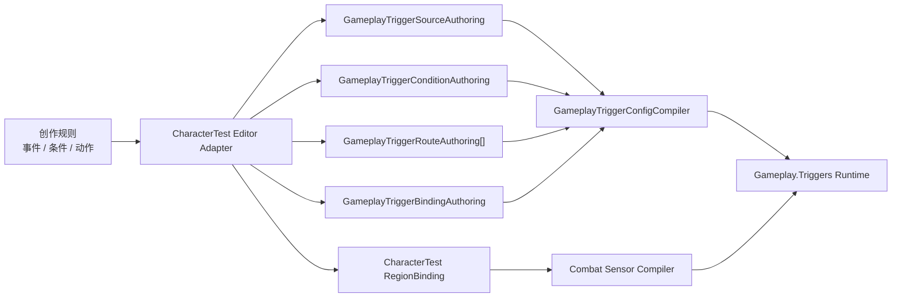

# Mx 关卡编辑器 P3.3：统一触发器工作区设计

> Status: Current
>
> Implementation state: P3.3a Complete；P3.3b Complete；P3.3c Complete；P3.3d Partial；P3.3e Partial
>
> Last reviewed: 2026-07-29
>
> Phase: Level Editor P3.3
>
> Parents: [第二阶段定义驱动玩法闭环](LEVEL_EDITOR_DEFINITION_DRIVEN_GAMEPLAY_DESIGN.md)、[P3.0 通用创作引用](LEVEL_EDITOR_COMMON_AUTHORING_REFERENCES_DESIGN.md)、[P3.1 目标语义](LEVEL_EDITOR_TARGET_SEMANTICS_DESIGN.md)、[P3.2 目标筛选创作](LEVEL_EDITOR_TARGET_FILTER_AUTHORING_DESIGN.md)
>
> Runtime authority: [ADR-008](Decisions/ADR-008-gameplay-trigger-runtime-authority.md)、[Gameplay Trigger 接口](Interfaces/Gameplay.Triggers.md)

## 1. 设计结论

P3.3 将当前嵌在“世界对象 / 区域属性”中的 Trigger 配置，升级为关卡编辑器顶层的`玩法触发器`工作区。

工作区统一使用创作者熟悉的三段式结构：

```text
事件：什么时候发生
条件：哪些对象、哪些状态可以触发
动作：发生后依次做什么
```

底部始终生成一句可读的结果说明，让使用者不必理解 Route、Source Binding、Payload、Delivery Contract 等 Runtime 术语，也能确认触发器最终会做什么。

本阶段统一的是创作界面和编辑流程，不是重新发明 Trigger Runtime：

- `Gameplay.Triggers` 继续拥有 Source、Condition、Route、Action、Binding、Compiler、Runtime、SaveState、Replay 和 Hash。
- Combat 空间事实继续由 `CombatPhysicsWorld` 与 `GameplayTriggerCombatSensorSystem` 提供。
- Buff、Story、Attribute、Ability、Items、AppFlow 等动作参数继续读取各自正式目录。
- Unity Scene 只提供 Transform、场景锚点、选择与可视化，不成为玩法判断权威。
- 工作区只显示当前项目已经提供正式目录、编译契约和 Runtime 消费链路的选项；不存在的能力不显示灰色占位项。

当前工作区已经接入 CharacterTest 的区域来源和三个现有模板：进入时施加 Buff、区域内维持 Buff、进入时触发 Story。P3.3a 的只读等价投影已完成验收，证明浏览工作区不会改变 canonical JSON、编译 hash 或 Scene 运行时缓存；复杂但未开放编辑的 Trigger condition tree 也会以只读兼容摘要显示并原样保留。P3.3b 已完成现有区域能力的编辑、Undo / Redo、保存恢复、缓存发布、Scene 入口、Runtime 检查和 PlayMode 收口。旧 Region Inspector 的大块编辑卡已经移除，只保留`关联触发器`入口。P3.3c 已完成唯一增量`当前玩家生命值低于阈值`：正式 Threshold sampler / binding / diagnostics 与统一创作界面均已贯通。P3.3 当前只声明支持区域来源和这一项非区域来源；Signal、时间、交互、任务和任意属性来源仍不显示。

2026-07-29 的实际窗口复核发现，前述功能闭环虽然成立，但主编辑区仍把事件、条件、目标和动作实现成纵向属性表；此前“标准 / 窄窗口布局通过”只证明没有几何溢出，不能证明效果图中的紧凑条款设计已经落地。该视觉与交互缺口由 P3.3d 独立收口；在 P3.3d 完成前，P3.3 总状态保持`Partial`。

与初始设计相比，当前实现刻意保留了模板拥有的 Route/Action 拓扑：使用者可以编辑模板已经开放的事件策略、目标筛选、Buff/Story 参数、效果归因与高级规则，但不能把一个固定模板任意拆成动作列表。原因是 CharacterTest 目前只有三份正式模板，还没有独立的 Action Authoring Adapter、逐动作参数契约和对应 validator。直接开放添加、删除和排序会绕过现有模板校验，属于平行创作模型。该能力只有在正式 Action Adapter 落地后才进入后续增量，不以通用 JSON 操作伪造。

概念效果图如下：


效果图中的`时间`、`属性`和`交互`条目用于说明统一布局可以承载不同来源；它们只有在项目模块提供正式 Source Adapter 与目录后才会出现在实际新建菜单中。P3.3 首批实现不伪造这些数据。

## 2. 为什么需要独立工作区

### 2.1 已验证事实

| 当前事实 | 设计影响 |
|---|---|
| `GameplayTriggerSourceKind` 已有 `Occupancy`、`Threshold`、`Signal` 三类 reducer | UI 不应继续被“区域”这一种来源绑死 |
| Route 已分别拥有 occurrence mask、condition、activation policy、arbitration 和有序 actions | 事件、条件、动作应在界面上分开表达，不能压成一块说明文字 |
| CharacterTest 当前只接入三个区域模板 | 第一批编辑能力必须先做到现有功能等价，不能把 Runtime 能力误报成项目已可创作能力 |
| P3.0～P3.2 已建立目录引用、目标语义和区域 Subject Filter | 新工作区应直接复用，不再创建目标、来源、队伍或 Buff 的第二套选择器 |
| 当前 Trigger 编辑、运行时检查和区域几何都堆在 Region Inspector | 功能入口不明显，且每增加一种来源都会继续扩大对象属性面板 |
| 当前保存事务、Undo、关闭恢复和运行时缓存已经可用 | 新工作区必须复用同一文档会话，不能出现两份内存文档或两次保存 |

### 2.2 产品判断

当前内嵌式 Region Inspector 对“三个固定区域模板”足够，但不适合继续承载：

- 非空间 Signal；
- 属性阈值；
- 交互模块产生的事件；
- 多条件；
- 同一事件下的多动作；
- 跨来源搜索与统一诊断。

因此 P3.3 改变先前“只在 Region Inspector 增加模板”的边界。独立工作区是现在出现真实跨来源需求后的渐进升级，不是提前建设通用节点编辑器。

## 3. 目标与非目标

### 3.1 目标

1. 所有 Gameplay Trigger 使用同一套`事件—条件—动作`创作界面。
2. 保持日常操作简洁：选择触发器后直接看到可编辑句子，不显示 Runtime 原始字段。
3. 现有区域 Buff、区域 Presence Buff 和 Story Trigger 无损迁入。
4. 每一次编辑都能生成可读效果句，并立即指出缺失引用或不成立的规则。
5. Scene 与工作区双向定位，不牺牲区域在 Scene 中的直接拖拽和面显示。
6. 未来接入 Threshold、Signal 或其他模块事件时，只增加薄适配，不修改工作区布局。
7. 保存、Undo/Redo、关闭放弃修改、校验和运行时缓存继续保持单一事务。

### 3.2 非目标

P3.3 不做：

- 自由节点图、蓝图语言、脚本编辑器或任意表达式；
- UnityEvent、反射方法、任意委托或组件回调动作；
- 新的 Trigger Runtime、第二套条件执行器或第二套动作调度器；
- 用 Unity Physics、Collider callback 或 `OnTriggerEnter` 作为新关卡玩法权威；
- 全局“万能目标”“万能来源”或 `Dictionary<string, object>` 数据模型；
- 未接入正式目录的时间、交互、任务、物品或属性占位选项；
- 在普通界面暴露 numeric Route ID、Payload、Provider ID、Delivery Contract 或容量参数；
- 活动 Runtime Session 热重载；
- 第一版的自由嵌套布尔树、随机目标、目标数量或任意二次目标查询；
- 第一版的自定义文件夹、拖拽排序、收藏、最近使用或跨关卡 Trigger 资源库。

## 4. 创作模型

### 4.1 一个“触发器”是 Editor 投影，不是新的 Runtime 对象

工作区中的一条触发器称为`创作规则`。它对应现有 CharacterTest Trigger entry，以及它关联的 Source、Condition、Definition、Routes、Binding 和 Source Binding。



`创作规则`只负责把分散的领域事实组织成人能读懂的视图。保存时仍修改现有 Authoring 行，不把整条自然语言句子或 UI ViewModel 写入 Runtime JSON。

### 4.2 一条规则可以投影多个 Route

现有“区域内维持 Buff”模板包含至少两个行为分支：

- Entered / Stayed：施加或刷新 Buff；
- Exited：移除 Buff。

因此 UI 不能假设一个触发器只有一个事件或一个动作。统一投影规则如下：

- 每个`事件行`对应一个 Route 的 occurrence scope，或多个语义完全相同的 Route 合并显示。
- 每个`动作行`明确带有事件范围，例如`进入 / 停留`、`离开`。
- 多个 Route 的条件完全相同时，条件只显示一次并标记`所有事件`。
- 条件不同时，每行显示其作用范围，不暗中复制或合并。
- 动作顺序保持 Runtime Route 中的语义顺序，拖动顺序会形成一次文档 Undo。

### 4.3 来源筛选与 Route 条件仍是两种权威

界面把它们统一放在`条件`区以便阅读，但内部继续区分：

| UI 内容 | 实际权威 | 执行时机 |
|---|---|---|
| 身份、能力、存活、阵营关系 | 当前 Source Provider，例如 CharacterTest RegionBinding 的 Subject Filter | 产生完整 occupancy 之前 |
| Signal ID、标量比较、Payload 比较、是否有 Subject / Instigator | `GameplayTriggerConditionAuthoring` | 每个 occurrence 进入 Route 时 |
| 冷却、次数、Presence、Stay Interval | Route activation policy | 条件通过后的激活裁决 |

普通用户只看到自然语言规则。悬浮说明和`高级规则`会标明其真实归属，避免把两类条件错误保存到同一个 Runtime 结构。

## 5. 信息架构

### 5.1 顶部

顶部沿用关卡编辑器现有全局操作，只调整当前工作区名称：

```text
[玩法触发器 ▾] [当前场景 ▾]  ● 已保存       [校验] [保存]
```

- `保存`仍保存所有脏的关卡 Authoring 与受管 Scene。
- `保存`是唯一提交动作：先完成完整编译，再写 Authoring、Scene-owned Runtime cache 与受管 Scene；不保留“仅保存”或独立同步状态。
- 缓存过期时按钮显示提示点和具体原因，不新增常驻说明区域。
- 工作区没有自己的第二个保存按钮。

### 5.2 左侧触发器树

默认宽度约 280 px，可在 240～360 px 之间拖动。

内容从上到下为：

1. 标题`触发器`；
2. 搜索框与`新建触发器`；
3. 自动分类树；
4. 每条触发器的名称、来源类型标签和状态点。

第一版分类由 Editor Adapter 根据正式语义自动生成，例如：

- `区域玩法`：Combat occupancy 区域；
- `关卡流程`：已接入的 Story / AppFlow 类动作；
- `战斗事件`：正式 Threshold 或 Combat Signal 来源；
- `交互机关`：正式 Interaction Signal 来源。

只显示实际存在的分类。分类不是持久化权威，也不能改名或拖动，因此 P3.3a / P3.3b 不需要新增 JSON Schema。

搜索匹配：

- 显示名；
- stable ID；
- 来源显示名；
- 动作显示名；
- 已登记的定义显示名，例如 Buff 或 Story Trigger。

搜索不会改变当前选择；清空后恢复原分类与滚动位置。

### 5.3 主编辑区

主区不再保留右侧属性栏，最大宽度用于编辑规则。

```text
触发器名称                     [启用]        [复制] [更多 ▾]
分类 / stable ID                           状态
────────────────────────────────────────────
事件
  当 [对象] [发生什么] [在哪个来源]
  + 添加事件
────────────────────────────────────────────
条件
  [对象] [字段/身份/关系] [值]
  + 添加条件
────────────────────────────────────────────
动作
  [事件范围] [目标] [动作] [参数]
  + 添加动作
────────────────────────────────────────────
效果：生成的一句话
高级规则 >
```

主区只在条款边界换行，不把单个选择框切成两行。窗口小于约 920 px 时，左侧树变为可收起抽屉；主编辑区保持至少 640 px。

### 5.4 不占空间的辅助入口

- 编译错误显示在对应行下方。
- 顶部状态点可打开完整诊断弹层。
- Play Mode 时，`更多 > 运行时检查`打开临时底部抽屉，复用 P2.4 的 Sensor、Occurrence 和 Action 结果。
- Scene 定位使用标题左侧的定位图标。
- 不保留常驻诊断面板、空白 Inspector 或重复的说明卡。

## 6. 核心交互

### 6.1 新建

点击`新建触发器`打开轻量弹层。候选按当前项目正式适配分组：

```text
区域
  进入时施加 Buff
  区域内维持 Buff
  进入时触发 Story

Signal                         仅在存在正式 Signal 目录时显示
数值阈值                       仅在存在正式 Scalar Binding 目录时显示
```

规则：

- 0 个可用模板：显示诊断，不显示空输入框。
- 1 个模板：直接显示说明和创建按钮。
- 2 个及以上：显示紧凑选择器。
- 创建时分配现有六类新 ID，沿用单调分配与 retired ID 规则。
- 创建成功后选中新规则；取消不修改文档。

### 6.2 编辑

所有可编辑词组表现为紧凑选择框或数值字段。只读事实表现为普通文字，不伪装成禁用输入框。

一次显式提交形成一个 Undo step：

- 下拉选择在选中后提交；
- 文本和数字在 Enter、失焦或显式确认时提交；
- `Esc`恢复该控件编辑前的值；
- 刷新只重建受影响行，保持输入焦点、光标位置和滚动位置。

### 6.3 复制与删除

- `复制`创建完整的新 Authoring 规则与新 ID，不复用源 Binding 或 Route ID。
- 左侧条目右键菜单也提供`复制`、`定位场景来源`和`删除`。
- 删除 Trigger 只删除 Trigger 登记并退休其 ID，不删除 Region 或其他场景对象。
- 删除仍被外部规则引用的 Trigger 时阻止并显示引用来源。
- 删除 Region 时继续由现有引用保护阻止，除非先删除或改绑关联 Trigger。

### 6.4 Scene 双向定位

- 从触发器点定位：选中并聚焦区域、点位或其他正式场景锚点。
- 从 Scene 选中 TriggerRegion：世界对象 Inspector 仅显示`关联触发器 N`、`打开玩法触发器`和`新建关联触发器`。
- Scene 右键菜单增加`编辑关联触发器`，直接切换到工作区并选中对应条目。
- 多个 Trigger 共用同一 Region 时，先打开过滤后的列表，不擅自选择第一条。
- 非空间 Signal / Threshold 没有 Scene 锚点时不显示定位按钮。

## 7. 事件设计

### 7.1 UI 使用创作者术语

Runtime reducer 与 UI 术语映射如下：

| Runtime Source Kind | UI 来源类别 | 可用事件 |
|---|---|---|
| `Occupancy` | 区域、范围、接近关系 | 进入、停留、离开 |
| `Threshold` | 属性或数值阈值 | 进入阈值、保持阈值、离开阈值 |
| `Signal` | 信号、交互、流程事件 | 发生 |

`时间到达`不是第四种 Trigger Source Kind。只有正式时间模块把计时结果作为 catalog-backed Signal 或 Threshold 提交时，UI 才显示“时间”来源。

同理，`点击机关`、`任务完成`和`角色死亡`只是领域模块可能提供的 Signal，不在关卡编辑器中硬编码新的 Runtime 事件枚举。

### 7.2 事件句式

区域示例：

```text
当 [任意角色] [进入或停留] [毒雾区域]
当 [该角色]   [离开]       [毒雾区域]
```

Threshold 示例：

```text
当 [首领生命值] [首次低于] [30%]
```

Signal 示例：

```text
当 [关卡流程] 发出 [关卡完成]
```

Subject、Instigator 和显式绑定目标继续使用 P3.0 / P3.1 术语。当前来源只提供一个有效对象时显示只读文字；存在两个以上真实候选时才出现选择框。

## 8. 条件设计

### 8.1 普通模式

普通模式使用线性`并且`条件列表，覆盖大多数关卡规则：

```text
触发角色 必须是 角色
触发角色 必须具备 可伤害
触发角色 与 队伍 1 的关系为 敌对
```

- 模板锁定的最低身份、能力和存活要求使用文字与锁图标。
- P3.2 已开放的阵营关系和参照队伍继续可编辑。
- Tag、Status、属性或其他引用只有正式目录存在时才出现。
- 不提供手填未知 ID 作为普通入口。

### 8.2 布尔条件组合

P3.3e 直接复用 Runtime 已支持的 `All`、`Any`和`Not`，在普通模式提供
`全部满足（且） / 任一满足（或）`根组和逐条`非`。第一版使用可展平列表：

- 0 条写为`PushTrue`；
- 1 条写为叶子或`Not(叶子)`；
- 2 条以上按根组选项写为确定性的左结合二叉树；
- 同类历史树可无损展平后编辑；
- 混合嵌套、未知叶子和无法无损显示的 RawValue 继续原样保留并警告。

这不是节点图，也不开放技术 ID。候选必须来自当前 Source Adapter 可解释的正式
Runtime 语义；当前区域来源只开放`触发对象存在`，玩家生命阈值来源额外开放
`触发前生命值 / 当前生命值`比较。

### 8.3 高级规则

Route activation policy 放入折叠的`高级规则`：

- 触发范围：每个对象 / 区域共享；
- 重复方式：每次进入 / 每次事件 / 每段 Presence；
- 触发间隔：以秒为主要显示，帧为 Tooltip 或高级精确值；
- 最多触发次数：`不限`或明确数字；
- Stay 间隔；
- 执行顺序和互斥优先级。

普通界面不再显示“360 帧”“每次 1 / 上限 1”这类缺少语义的摘要。

## 9. 动作设计

### 9.1 动作目录

动作候选来自当前项目显式接入的 Trigger Action Adapter，不从程序集反射发现，也不允许直接输入 ActionKind ID。

CharacterTest 首批候选保持：

- Gameplay Buff：施加 Component Buff；
- Gameplay Buff：移除 Component Buff；
- Story：Raise Trigger。

框架中虽然已有其他 Gameplay command action kind，但在它们具备：

1. 正式参数目录；
2. 明确 target 约束；
3. 当前组合根中的 sink / transfer；
4. Authoring validator；
5. 可读摘要 formatter；

之前，不进入关卡编辑器候选。

### 9.2 动作行

动作行先显示其事件范围，再显示目标与动作：

```text
[进入 / 停留] 为 [触发角色] 施加 [601012 · 中毒]，归因于 [501012 · 毒瓶池]
[离开]        从 [触发角色] 移除 [601012 · 中毒]
```

规则：

- 目标候选继续由现有 `GameplayTriggerTargetSelector`、Source Binding、显式目标与编译环境共同决定。
- 当前只有一个合法目标时显示只读文字。
- Owner、Instigator 或不兼容 Domain 不进入下拉框。
- `效果归因`只在动作实际消费该字段时显示。
- Runtime `命令来源`不作为效果归因候选。
- 动作可按 Route 内语义顺序重排；跨事件范围拖动等价于迁移 Route，第一版不支持，避免隐式改变事件语义。

### 9.3 Buff 摘要

Buff 行下方直接读取 Buff Registry 和效果定义，显示创作者真正关心的信息：

```text
持续 6 秒 · 重复施加刷新持续时间 · 不可叠加 · 每 1 秒造成 2 点毒素伤害
```

约束：

- Buff 持续时间、叠加策略、叠加上限和效果列表是 Buff Definition 权威，Trigger 不能随意覆盖。
- Trigger 的冷却和次数属于 Route，不与 Buff 叠加上限混在同一行。
- 帧数只有在项目提供正式固定帧率换算时才显示为秒；无法换算时保留`360 帧`，不猜测秒数。
- “2 个效果”不再作为主摘要。能够解析时展开为实际效果；不能解析时显示`包含 2 项效果`并提供详情 Tooltip。
- 历史未知 Buff 或效果来源保留原 ID，并显示兼容警告，不自动清零。

## 10. 一句话效果说明

### 10.1 目的

效果句是整条规则的最终可读校验：

```text
效果：当敌对队伍 1 的角色进入或停留在“毒雾区域”时，为其施加“中毒”；离开时移除。
```

它解决四个问题：

- 使用者能快速确认条件与目标有没有配反；
- 多 Route / 多动作能被合并成一个整体结果；
- 审阅者不必阅读原始 ID 和 Payload；
- 缺失引用会直接出现在句子中，而不是藏在诊断页。

### 10.2 生成规则

效果句由 Editor-only、确定性的 formatter 生成，不使用 LLM，也不作为 Authoring 权威保存。

格式化顺序固定为：

```text
对象范围 + 事件来源 + 条件 + 按事件分组的有序动作 + 重复限制
```

- 显示名取 P3.0 的正式引用候选。
- 缺失显示名回退 stable ID，再回退 numeric ID。
- 未登记值显示`[缺失：原值]`并将状态设为警告或错误。
- 同一结果在重新打开、Undo/Redo 和不同列表排序下必须完全一致。
- 句子右侧提供复制按钮；复制不修改文档。

### 10.3 句子不是编译器

formatter 只读取已经类型化的 Authoring 投影：

- 不从中文句子反向解析配置；
- 不决定 target；
- 不替代领域 validator；
- 不影响 Runtime hash、SaveState、Replay 或 Network。

## 11. Editor Adapter 边界

### 11.1 最小 ViewModel

P3.3 增加低频、Editor-only 的 Trigger Workspace ViewModel，用于承载：

- stable key；
- 显示名与状态；
- 事件 clause；
- 条件 clause；
- 动作 clause；
- 目录候选；
- Tooltip 与诊断；
- 修改命令回调。

它标记为 `AllocByDesign`，只在窗口打开、选择变化或用户提交编辑时构建，不进入 Runtime 或每帧路径。

### 11.2 CharacterTest 直接适配

首个实现是显式的 `CharacterTestGameplayTriggerWorkspaceAdapter`：

- 从当前 level envelope 读取 Trigger module 与 RegionBinding；
- 从 World Object 文档读取 Region；
- 从 Character 文档读取 Team 候选；
- 从 Buff、Mechanic Source、Story 等正式目录读取引用；
- 调用现有模板 mutation、Compiler、文档事务与诊断；
- 把结果投影为统一工作区 ViewModel。

不增加 Provider 注册中心、反射发现、全局缓存或“万能字段描述器”。第二个真实项目适配出现重复代码后，再提炼公共契约。

### 11.3 Source Adapter 门禁

一个新事件来源只有同时满足下列条件才可出现在 UI：

- 有稳定 source / binding 身份；
- 有正式候选目录和显示名；
- 能构建 trusted `GameplayTriggerSourceBindingContractDescriptor`；
- 有明确 Subject / Instigator capability；
- 有确定性 Runtime 提交流程；
- 有 Authoring validator 与编译测试；
- 有可读事件 formatter；
- 有保存、迁移和运行时缓存策略。

时间、交互、任务、属性等只是可能的领域标签，不因效果图中出现就绕过该门禁。

## 12. 顶层工作区与保存所有权

### 12.1 问题

现有 `IMxLevelEditorModule` 同时承担：

- 顶部导航；
- 内容创建；
- 文档加载与脏状态；
- 保存参与者。

如果直接再注册一个读取同一 level JSON 的 Trigger module，会产生两份内存文档、重复保存参与者和关闭恢复竞争。

### 12.2 最小 Shell 扩展

P3.3 只增加一个 Editor-only 的`工作区导航`概念：

```text
IMxLevelEditorWorkspace
  WorkspaceId
  DisplayName
  OwnerModuleId
  OnEnable
  CreateContent
```

规则：

- `IMxLevelEditorModule`继续是文档、脏状态和保存所有者。
- `IMxLevelEditorWorkspace`只负责顶部入口和内容投影，不拥有`Save()`。
- 现有 module 自动获得一个默认 workspace，不要求批量迁移。
- 顶部下拉框显示 workspace；统一保存仍遍历 module registry。
- Scene selection、SceneView overlay 和上下文菜单可以由当前 workspace 复用现有可选接口。

CharacterTest 注册时使用同一个 World Object module 实例作为 owner：

```text
世界对象 workspace ─┐
                    ├─ CharacterTest World Object module / level document session
玩法触发器 workspace ┘
```

这样可以得到效果图中的顶层`玩法触发器`入口，同时保持唯一文档实例、唯一 Undo Session 和唯一保存参与者。

该 Shell 扩展属于 Editor 公共 API，实施时按 V4 公共 API 变更验证；它不修改 Runtime 公共 API。

## 13. 数据、Schema 与 Runtime 缓存

### 13.1 P3.3a / P3.3b 不迁移数据

前两个增量只重组界面和编辑入口：

- `GameplayTriggerAuthoringDocument`保持 v1；
- CharacterTest Trigger module / document 保持当前 v2；
- CharacterTest Trigger scene cache 保持当前 v2；
- Runtime action payload、hash、SaveState、Replay 和 Network 不变；
- Trigger stable ID 与所有 numeric ID 原样保留；
- 左侧分类由现有语义派生，不持久化。

因此打开旧关卡不会因为 P3.3 自动变脏。

### 13.2 单一事实源

| 信息 | 权威 |
|---|---|
| Source reducer、Condition tree、Route、Action、Binding | `GameplayTriggerAuthoringDocument` |
| Region source 与 Subject Filter | CharacterTest Trigger RegionBinding |
| Region 几何 | Unity Scene Transform + World Object Definition |
| Buff 内容 | Gameplay Buff Registry |
| 效果归因 | 现有动作 payload 与正式来源目录 |
| Team 候选 | 当前 Scene Character Authoring |
| 显示分类 | Editor-only 派生 |
| 效果句 | Editor-only 派生 |
| Runtime Sensor / Catalog | 保存后显式构建的 Scene Cache |

### 13.3 未来自定义文件夹

只有自动分类被实际使用证明不足后，才设计可重命名文件夹与手工排序。届时必须独立评审：

- Editor metadata 存放位置；
- schema 迁移；
- 是否影响 source hash / cache stale；
- 多人合并冲突；
- 删除文件夹后的稳定回退。

P3.3 不提前加入这些字段。

## 14. Undo、保存与关闭

- 所有修改通过现有 CharacterTest 文档事务服务执行。
- 一次用户意图对应一个 Unity Undo Group 和一个文档快照。
- Undo/Redo 后刷新当前规则、效果句、分类、诊断和缓存过期状态。
- 保存前执行 wrapper 校验、引用校验、Trigger Compiler 与 Sensor Compiler。
- 编译失败不得写 JSON、Scene Cache 或 Unity Scene。
- 保存成功后更新基线；只浏览、搜索、切换分类和展开高级规则不产生脏状态。
- 关闭窗口时沿用`保存 / 放弃 / 取消`。
- 选择`放弃`时恢复文档与受管 Scene；新建、复制或删除的触发器与现有关闭恢复保持一致。
- 显式`保存`即使当前 Authoring 未变脏也会重新编译 Scene-owned Runtime cache，用于收敛历史 stale cache；编译失败时整次保存失败。

## 15. 运行时检查

P2.4 已有运行时信息继续保留，但改为按需抽屉：

- Source Binding 与当前 enabled；
- Combat query / mapped / accepted / filtered；
- 最近 Entered / Stayed / Exited 或 Signal / Threshold occurrence；
- 最近 Route 激活结果；
- 最近 Action dispatch / result；
- cache、catalog 与 combined hash；
- typed failure reason。

运行时检查只读，不允许直接修改 Runtime authority。未进入 Play Mode 或没有有效 Session 时，只显示一行状态，不渲染空表。

## 16. 渐进开发切片

P3.3 必须按以下任务顺序执行和标记：

| 顺序 | 任务文档 | 当前状态 |
|---|---|---|
| 1 | [P3.3a 只读投影合同](Guides/LEVEL_EDITOR_UNIFIED_TRIGGER_WORKSPACE_DEVELOPMENT.md#41-只读投影与不变性) | Complete |
| 2 | [P3.3b 编辑与 ID 生命周期合同](Guides/LEVEL_EDITOR_UNIFIED_TRIGGER_WORKSPACE_DEVELOPMENT.md#61-所属-id-与保存基线) | Complete |
| 3 | [当前玩家生命阈值合同](Guides/LEVEL_EDITOR_UNIFIED_TRIGGER_WORKSPACE_DEVELOPMENT.md#31-当前玩家生命阈值来源) | Complete |
| 4 | [P3.3d 紧凑条款 UI 收口](Tasks/LEVEL_EDITOR_P3_3D_COMPACT_CLAUSE_UI_CLOSEOUT.md) | Partial |
| 5 | [P3.3e 布尔条件组合](Tasks/LEVEL_EDITOR_P3_3E_BOOLEAN_CONDITION_AUTHORING.md) | Partial |

任务文档将“实现存在”和“阶段验收”分开记录。只有任务内全部完成门禁都有当前证据，并填写完成记录后，才能把该任务标记为 `Complete`。已有后续代码不允许替代前序任务验收，也不要求为了重现历史中间态而回退已存在代码。

### P3.3a：工作区外壳与只读等价投影

状态：**Complete**。2026-07-29 已完成三模板 golden、Presence Route / Action 顺序、未知条件与引用保真、canonical JSON / hash / live cache 不变、导航状态和标准 / 窄窗口验收；完整证据见任务文档。

目标：证明新的顶层入口能够无损读取当前 Trigger，而不改变任何 Authoring。

- 增加最小 workspace navigation seam；
- 注册`玩法触发器`工作区；
- 左侧搜索、自动分类、选择与状态；
- 读取当前三个 CharacterTest 模板并投影事件、条件、动作；
- 生成确定性效果句；
- Trigger ↔ Region 双向定位；
- 旧 Region Inspector 保持原编辑能力；
- 对比新旧投影与 Compiler 结果。

完成标准：所有当前 Trigger 在新工作区可读，stable ID、Route、Action、编译 hash 和缓存内容完全不变。

### P3.3b：现有能力编辑闭环

状态：**Complete**。2026-07-29 已完成现有区域模板的逐项事务、输入与兼容值、保存恢复、缓存发布、Scene 入口、typed Runtime 检查、Presence Buff / Story PlayMode smoke，以及标准 / 窄窗口实际布局验收。模板拥有的 Route/Action 拓扑保持只读；通用逐动作增删和排序等待正式 Action Adapter。

目标：让新工作区完整取代当前 Region Trigger 大卡片。

- 编辑名称、启用状态；
- 编辑 P3.2 身份/能力/阵营筛选；
- 编辑当前模板的事件策略、高级冷却/次数；
- 编辑 Buff、效果归因和 Story 引用；
- 编辑当前三类模板已有 action 的领域参数；逐动作添加、移除与同 Route 排序在正式 Action Adapter 接入后开放；
- 新建、复制、删除；
- Undo/Redo、保存、关闭放弃和缓存过期；
- Runtime 检查抽屉；
- Region Inspector 缩为`关联触发器`入口。

完成标准：现有 P2.3～P3.2 功能全部可在新工作区完成，旧大卡片移除后没有功能损失。

### P3.3c：第一个非区域来源

状态：**Complete**。2026-07-29 已接入 CharacterTest 当前玩家 HP Low Threshold：稳定来源键、Provider、validator、compiler/cache、complete scalar sampler、typed diagnostics、统一工作区与 Story action 均已通过验收。完整边界和证据见任务文档。

目标：验证统一工作区真的可复用，而不是把 Region UI 换皮。

优先顺序不预设为“时间”或“交互”。实施前从项目已有模块中选择第一个满足 Source Adapter 门禁的真实消费者：

1. 若已有正式 Signal 目录和提交链，优先接 Signal；
2. 若已有属性采样与 trusted Threshold binding，接 Threshold；
3. 两者都没有时，先补正确领域模块，不在 Editor 伪造。

本增量一次只接一个来源，并补齐新建、条件、动作、运行时诊断和 Playable 验收。

### P3.3d：紧凑条款 UI 收口

状态：**Partial**。

目标：兑现已经批准的主编辑区效果图，不再用纵向属性表近似事件、条件和动作。

- 只读事实使用普通文字条款，不显示成禁用输入框；
- 条件与作用目标不重复展示同一身份和阵营规则；
- 目标直接进入动作句，不保留独立目标大卡；
- Buff、来源机制和 Story 选择器嵌入动作句；
- Presence 的进入 / 停留与离开动作分行显示；
- 结构测试不能替代标准与窄窗口实际视觉检查。

### P3.3e：布尔条件组合

状态：**Partial**。代码、测试覆盖和程序集构建已补齐；Unity Test Runner、Console 与实际窗口验收尚待当前 Editor 工具入口恢复后执行。

- 条件主区提供`全部满足（且） / 任一满足（或）`；
- 每个叶子可单独取反；
- 列表稳定映射到现有二叉 Condition Tree；
- 只开放当前正式 Source Adapter 能解释的条件；
- 复杂历史树只读保真，不因其他字段编辑被改写。

### 后续增量

以下能力不属于 P3.3 完成条件：

- 自定义文件夹；
- 任意混合嵌套条件树或节点图；
- 跨关卡 Trigger 模板资源；
- 连线或节点视图；
- 多对象批量修改；
- Runtime Session 热重载。

它们必须由真实使用问题触发独立设计，不随统一工作区一起打包。

## 17. 验收计划

### 17.1 工作区与视觉

- 顶部出现一个`玩法触发器`入口，不重复创建 World Object 保存模块。
- 左侧树只显示有内容的分类，搜索和清空保持选择与滚动。
- 标准宽度下主区无右侧空面板；窄窗口下左栏可收起，条款不被裁切。
- 事件、条件、动作的可编辑字段明显，锁定事实使用文字而非灰色输入框。
- 效果句只有一处，不加入步骤编号、统计卡或重复摘要。

### 17.2 投影正确性

- 当前三个模板都能无损投影。
- Presence Buff 的 Entered / Stayed Apply 与 Exited Remove 不丢 Route。
- 条件相同与不同时的 scope 显示正确。
- Action 顺序与原 Authoring 数组一致。
- 复杂未知 condition tree、未知 Buff 和未知来源保持原值。

### 17.3 编辑与事务

- 新建、复制、删除、启用、改名、筛选、Buff、归因和高级规则各验证一次 Undo/Redo。
- 切换选项不跳到顶部、不抢走文本输入焦点。
- 保存后不再显示未保存；Undo 到不同基线后重新显示未保存。
- 关闭选择放弃时恢复 JSON 和 Scene。
- 搜索、展开和分类选择不产生脏状态。

### 17.4 编译与 Runtime

- P3.3a / P3.3b 前后 `GameplayTriggerAuthoringDocument` canonical JSON、Trigger catalog hash、Sensor hash 与 combined hash 在等价配置下不变。
- 当前 CharacterTest Presence Buff 与 Story Playable 行为无回归。
- 不使用 Unity Physics 作为正式区域来源。
- 运行时抽屉读取现有 typed diagnostics，不从 Scene 反推 Runtime 状态。
- 未保存或编译失败时阻止更新缓存；保存并更新后 bootstrap 继续完整复验。

### 17.5 效果句

- 为当前模板建立中文 golden tests。
- 候选顺序、重新打开和 Undo/Redo 不改变句子。
- 秒 / 帧换算只有在正式帧率已知时发生。
- Buff 叠加上限、Route 次数和 Trigger 冷却不会混为同一概念。
- 未知引用以兼容警告显示，不被 formatter 修改。

### 17.6 验证等级

- P3.3a / P3.3b 修改 Editor 公共 workspace seam，按 V4 验证。
- 至少执行 Unity refresh / compile、Console error check、focused EditMode、现有 Trigger Editor tests、轻量检查、代码规范 report-only 与实际窗口视觉检查。
- P3.3c 增加真实 Runtime 来源后升级为 V3/V4 跨模块验证，并增加一个 focused PlayMode smoke。

## 18. 风险与控制

| 风险 | 控制 |
|---|---|
| 新工作区与旧 Inspector 同时修改两份状态 | 两者必须引用同一个 module owner 与文档 Undo Session；P3.3b 后删除旧编辑卡 |
| UI 统一后误把不同领域条件保存到 Trigger tree | Adapter 明确标记 Source Filter 与 Route Condition，mutation 分别写回原权威 |
| 为了填满新建菜单而硬编码假来源 | Source Adapter 门禁；0 个正式候选时不显示类别 |
| 一句话看起来正确但配置实际错误 | 句子只做投影；保存仍以正式 Compiler 和 Validator 为准 |
| 工作区成为第二个玩法框架 | Action / Source / Reference 全部来自现有领域目录，窗口不执行玩法 |
| 大规模 UI 重写造成现有功能回归 | 先只读等价投影，再迁移编辑闭环，最后才接非区域来源 |
| 自动分类不能满足大型关卡 | 先验证真实规模；自定义文件夹作为独立后续，不污染当前 Schema |

## 19. 采用前提

- `玩法触发器`作为关卡编辑器顶层工作区，而不是世界对象属性中的常驻大卡片。
- UI 采用事件、条件、动作三段式，不采用节点图。
- 效果句是确定性 Editor 投影，不是可执行脚本。
- 第一批只迁移当前已工作的 CharacterTest 区域 Trigger。
- 左侧首版使用自动分类，不增加文件夹持久化。
- 非区域来源按正式项目适配逐个接入，不同时建设时间、交互、属性和任务系统。
- Scene 继续是空间编辑主入口，工作区负责规则、引用、校验与运行结果。

## 20. P3.3 完成定义

当前状态：**Partial**。

P3.3a / P3.3b / P3.3c 可以独立验收和提交，但 P3.3 总阶段仍须 P3.3a、P3.3b、P3.3c、P3.3d 和 P3.3e 五项全部完成。P3.3a/b 的现行合同由开发指南 §4.1 / §6.1 维护；当前 P3.3d/e 仍为 `Partial`。

区域来源闭环必须满足：

> 使用者在`玩法触发器`工作区中找到或新建一个区域规则，以可读的事件、条件和动作行完成配置，底部效果句准确描述结果；Scene 中可直接定位和调整区域；一次保存同步提交 Authoring、运行时缓存与受管 Scene，重新打开、Undo/Redo 和放弃修改保持一致；Play Mode 中由 Combat Sensor 与现有 Gameplay Trigger Runtime 执行，且旧 Region Trigger 大卡片已缩为关联入口。

P3.3 已完成区域来源与`当前玩家生命值低于阈值`这一项非区域来源的数据、事务和 Runtime 闭环；紧凑条款 UI 正在由 P3.3d 收口。该结论只覆盖实际接入的来源集合，不泛化为所有 Trigger 来源都已可创作。
