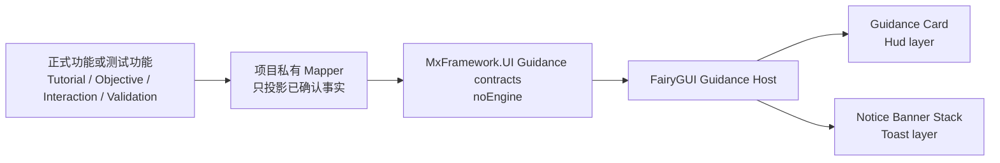

# 正式玩家引导提示 UI 设计

> Status: Design
>
> Decision status: Current
>
> Design version: v1.1
>
> Date: 2026-08-02
>
> Visual direction: 采用已认可的“深色半透明引导卡 + 彩色短提示条”方向
>
> Implementation snapshot (2026-08-02): 已完成 noEngine contract、固定容量状态、Composer-owned FairyGUI package、通用 Presenter、CharacterTest 接入、真实目标锁定生产者和当时的 PlayMode 视觉证据
>
> Last documentation calibration: 2026-08-13；P3.4 Authoring/cache/Coordinator/Observer/Mapper 生产链已收口，并新增正式 CharacterTest Game 运行帧；2026-08-02 的 package variants 证据仍由同一 PlayMode 测试维护
>
> Current API authority: `Docs/Interfaces/UI.md`、`Docs/Interfaces/UI.FairyGUI.md`、`Docs/Interfaces/Input.md`、源码与测试
>
> Scope: 一个正式 player-facing、可被教学、目标、交互和 CharacterTest 验证复用的文字提示基础；首期只包含常驻引导卡和短时提示条

> Related authoring authority: [Level Editor P3.4 教学引导 Authoring 设计](LEVEL_EDITOR_GUIDANCE_AUTHORING_DESIGN.md)与[开发指南](Guides/LEVEL_EDITOR_GUIDANCE_AUTHORING_DEVELOPMENT.md)；二者只拥有教学序列的创作、保存、编译与推进，当前 Implementation status 为 Current

本文取代此前过大的 CharacterTest Validation Guidance 草案。此前草案中的 typed
观察抽屉、世界路径、观察区、底部状态条、运行控制、能力诊断和报告导出均不进入
本设计首期。

---

## 0. 冻结结论

首期只交付两个非交互组件：

1. **Guidance Card**：左侧常驻卡片，回答“当前是什么、要做什么、要观察什么、现在怎么样”。
2. **Notice Banner Stack**：短时提示条，回答“刚刚发生了什么”或“当前需要注意什么”。

实现路线冻结为：

- 正式玩家表现使用 **FairyGUI**，不使用 UI Toolkit；
- surface-neutral 的最小语义类型放在 `MxFramework.UI` noEngine Core；
- FairyGUI 表现放在新的 Composer-owned package `MxPlayerGuidanceUi`；
- Guidance Card 注册到 `MxUiLayer.Hud`；
- Notice Banner Stack 注册到 `MxUiLayer.Toast`；
- 两个界面都不接收点击、不抢 cursor、不暂停 gameplay；
- 同一时刻最多一个 Card、两条 Banner；
- Card 没有队列和优先级仲裁，多功能竞争时由项目组合根选择唯一 owner；
- Banner 只使用固定两槽，不建立无限队列；
- UI 只展示调用方已经确认的事实，不推进 Story、Trigger、Quest、Tutorial 或 Validation 状态。

附件中的绿色和黄色提示条首先视为**两种状态样式示例**。同一任务、同一时刻不能
同时显示“已完成”和“尚未进入”这类互相矛盾的消息；只有来自不同 scope 的消息
才允许并存。

### 0.1 当前实现权威与源码入口

本文保存已接受的产品语义、边界和设计理由，不取代 Current 接口文档、源码或测试。
阅读当前目标锁定 Guidance 链路时，从下表进入，避免把设计示例或历史验证快照当成
实时实现事实：

| 链路阶段 | 当前入口 |
| --- | --- |
| 默认动作与 binding 顺序 | `Packages/com.vincent.wgameframework/Input/DefaultInputBindingCatalog.cs` |
| 输入采样 | `Packages/com.vincent.wgameframework/Input/InputActionCache.cs`、`Packages/com.vincent.wgameframework/Input/InputSnapshot.cs` |
| Unity 请求桥 | `Assets/Scripts/WGameFrameworkProject/CharacterTest/Runtime/View/CharacterTestThirdPersonCameraRigBridge.cs` |
| Runtime 权威与确认事件 | `Assets/Scripts/WGameFrameworkProject/CharacterTest/Runtime/Commands/CharacterTestRuntimeCommandModule.TargetLock.cs` |
| CharacterTest Mapper / Host | `Assets/Scripts/WGameFrameworkProject/CharacterTest/UI/FairyGui/CharacterTestFairyGuiGuidanceHost.cs` |
| noEngine contract / 固定容量状态 | `Packages/com.vincent.wgameframework/UI/Guidance/MxUiGuidanceContracts.cs`、`Packages/com.vincent.wgameframework/UI/Guidance/MxUiGuidanceState.cs` |
| FairyGUI Presenter | `Packages/com.vincent.wgameframework/UI/FairyGUI/Guidance/MxFairyGuiGuidancePresenter.cs` |
| Composer package authority | `ArtSource/UIKits/MxUiFoundation/screens/player_guidance_package.ui-screen.json` |
| Core contract tests | `Tools/MxFramework.NoEngineTests/UI.Guidance.Tests/` |
| CharacterTest mapper tests | `Assets/Scripts/WGameFrameworkProject/CharacterTest/Tests/EditMode/Game/CharacterTest/CharacterTestIntegrationContractTests.UiFairyGuiHud.cs` |
| 发布包 PlayMode | `Assets/Scripts/WGameFrameworkProject/CharacterTest/Tests/PlayMode/PlayerGuidancePresentationPlayModeTests.cs` |

---

## 1. 为什么要从 Validation UI 改成正式 Guidance UI

参考图中的内容并不只属于测试：

- 教学会显示当前操作、观察目标和完成状态；
- 任务或挑战会显示当前目标、进度和阶段结果；
- 场景交互会显示距离不足、条件不足或交互成功；
- CharacterTest 验证也需要显示步骤、观察点和采集结果。

如果把它实现成 CharacterTest 私有 UI Toolkit 面板，正式功能将来仍要重新实现一套
FairyGUI 界面和一套状态模型。正确边界是：



这仍然不是任务系统或教学系统。它只是所有这些功能都能使用的一种正式表现语言。

---

## 2. 首期范围

### 2.1 包含

- 一个固定结构的常驻 Card；
- Card 的标题和三行内容；
- 每行的语义图标、标签、正文和 tone；
- 最多两条短时 Banner；
- `Info / Success / Warning / Error` 四种 Banner tone；
- 重复消息合并、固定时长、两槽溢出策略；
- 简单淡入、横移和淡出；
- 默认布局和“顶角已被 HUD 占用”布局两个静态预设；
- 中文与英文的固定文字预算；
- FairyGUI Composer 的正式生产、发布和 generated binding 流程；
- CharacterTest 作为第一个可见消费者。

### 2.2 明确不包含

- typed 观察值面板；
- capability、hash、generation、authority 等技术诊断；
- 世界空间路径、箭头、目标点、观察区或轮廓；
- 任务列表、任务追踪、教程编排、步骤状态机；
- Story 对话、选项、打字机效果或头像；
- Gameplay Trigger 条件判断；
- 自动通过、自动失败或自动评分；
- 按钮、确认、跳过、重试等输入；
- 声音、语音、震动或其他反馈策略；
- 任意数量的 Toast、复杂优先级队列或跨场景消息存储；
- 自动探测 HUD 遮挡和动态碰撞布局；
- UI Toolkit 的第二套 player-facing 实现；
- SaveState、Replay、Network 或 deterministic hash 接入。

这些能力如果未来确有真实需求，应作为独立设计进入，而不是继续扩大本基础组件。

已接受的 CharacterTest P3.4 正是其中一个独立项目私有设计：它可以在 Level Editor
创作线性教学序列，并由项目 Runtime coordinator 观察正式完成事实；这不会把教程编排、
步骤状态机或完成判断加入 `MxFramework.UI`、FairyGUI Presenter 或本设计的 UI 权威。

---

## 3. API 与现有模块复用计划

| 需求 | 复用能力 | 决定 | 不做的事 |
| --- | --- | --- | --- |
| UI 语义 | `MxFramework.UI` noEngine Core、`MxUiLocalizedTextRequest` | 新增小型 Guidance contracts | 不让 Core 引用 Unity 或 FairyGUI |
| 正式表现 | `MxFramework.UI.FairyGUI`、generated manifest / binder、`MxFairyGuiNavigator` | 新建 FairyGUI Host | 不写另一套 UI Toolkit player view |
| 层级 | `MxUiLayer.Hud`、`MxUiLayer.Toast` | Card 在 Hud，Banner 在 Toast | 不新建 render layer |
| Surface policy | CharacterTest 现有 player UI surface policy | 两个 view 都声明为非模态 `LightOverlay` | 不进入 modal stack、不自己抢输入或 cursor |
| 游戏主循环 | 现有 `RuntimeHost` 与 CharacterTest 组合根 | 领域事实继续由既有 Runtime 模块推进；Guidance 只挂组合根的 presentation Tick | Banner 动画不是权威规则，不为它新增 `IRuntimeModule` |
| 输入 / 命令 | `InputSnapshot`、`RuntimeCommandBuffer`、`MxUiCommand` | 首期不使用 | 两个组件完全不可交互，不读取设备也不发命令 |
| Save / Replay / Hash | 现有 Runtime SaveState、Replay 和 hash contracts | 不使用 | Guidance 是可重建的低频表现，不进入权威状态 |
| AppFlow / SceneFlow | 现有 AppFlow / SceneFlow | 不使用 | 本基础不打开场景、不切换游戏状态 |
| Gameplay / Combat / Physics | 各领域现有 Runtime authority | 只由项目 Mapper 读取正式结果 | UI 不判定目标、距离、碰撞或完成 |
| UI 创作 | UI Art Resource Library、Component Recipe、Screen Blueprint、binding contract v2 | 走 Composer allowlist、preflight、Apply、Publish | 不手写 Composer-owned XML、atlas 或 `_fui.bytes` |
| 资源 | `MxFramework.Resources`、现有 FairyGUI package bytes / atlas 注册路径 | 与 generated manifest 一起注册 | 不直接读取磁盘路径作为 Runtime 资源 |
| 本地化 | `IMxUiTextProvider`、`MxUiLocalizedTextRequest` | chrome 与正式文案使用 key + fallback；CharacterTest Authoring fallback 是简中源文案，其他 locale 查正式 TSV | 不把本地化表塞进 Screen Blueprint，不让关卡作者手填系统 Key |
| Runtime 生命周期 | 项目现有组合根和 owner-thread Update | Host 由组合根创建、Tick、Dispose | 不创建第二个 gameplay loop |
| 诊断 | UI Core 的固定 snapshot / reason-code 模式 | 只保留 overflow、invalid request、missing resource 计数 | 不把诊断文字显示给正式玩家 |
| Config | 现有本地化 Config bridge | 通用 UI 基础只复用 text provider，不拥有教学序列 schema；CharacterTest P3.4 项目私有 Authoring 属于独立边界 | 不在 UI / FairyGUI 层新增第二份 Guidance JSON 或 ScriptableObject schema |
| CharacterTest | 现有 FairyGUI layer roots、localization runtime | 作为第一个接入和可玩验证入口 | 不让框架 Core 依赖 CharacterTest |
| Story / Trigger | 各自现有 Runtime authority | 未来只能经项目 Mapper 提供已确认文案 | 不建立 Guidance -> Story / Trigger 反向依赖 |
| Combat HUD | 现有 `feedbackPanel / feedbackText` | 保留其他 Combat feedback；目标锁定反馈已原子迁移到 Guidance | 不让同一目标锁定事件同时进入两个 UI 出口 |

同一个 Runtime event 只能选择旧 Combat HUD feedback 或新 Banner 其中一个出口。当前
CharacterTest 提供 6 项可顺序验证的玩家指引：基础移动与停步、跳跃与落地、相机模式切换、
目标锁定、取消锁定、普通攻击命中。`[` / `]` 可在完整序列中切换上一步 / 下一步；完成项
2 秒后自动进入下一项（最后一项除外）。完成判定来自正式结果：确定性位移与速度、Grounded
状态、`CameraModeChanged`、目标锁定事件，以及普通攻击 DamageTelemetry 的来源、动作、伤害和
HP 前后值。Combat HUD 只继续保留其他战斗反馈与目标板可见性，不重复显示目标锁定文案。

### 3.1 高频路径声明

当前实现有一个高频入口：FairyGUI Guidance Host 的 owner-thread `Tick`。

要求：

- 初始化后 Tick 为 `NoAlloc`；
- Tick 只更新两个固定 Banner slot 的剩余时间和简单插值；
- 不使用 LINQ、临时集合、反射、异常流程或字符串拼接；
- 不每帧重做本地化、不每帧重设文本、不每帧查找 FairyGUI child；
- 所有 child 在初始化时缓存；
- Card 只在其 revision 或 locale revision 改变时重绑；
- Banner 只在 push、替换、过期时重绑。

`PresentCard(...)`、`TryPushNotice(...)` 和 locale 变化允许发生低频字符串解析或
FairyGUI 文本赋值，因此按 `LowFreqAlloc` 设计；不能把它们当作每帧 API 使用。

---

## 4. 产品语义

### 4.1 Guidance Card

Card 表示一个持续中的上下文，而不是一条事件消息。首期固定为四个区域：

1. 标题：`当前验证：边界接近舱`；
2. Action 行：`步骤：从 ApproachStart 接近边界`；
3. Focus 行：`观察：接触、停步、滑动与离地反馈`；
4. Status 行：`已完成：Typed 读数已采集`。

`Action` 表示“现在做什么”，`Focus` 表示“注意什么或达成什么”，`Status` 表示
“权威系统已经确认到什么状态”。界面显示的中文标签可按内容使用“步骤 / 操作”、
“观察 / 目标”和“状态 / 进度 / 已完成”，API 不硬编码这些中文词。

三行结构固定，不提供任意列表。某个正式功能如果没有这三类信息，应使用 Banner，
或由自己的专用 HUD 承担，而不是把 Card 扩成通用内容容器。

Card 的语义规则：

- 只有一个 active Card；
- 同一 `ScopeId` 的较新 revision 原位更新，不重复播放入场；
- 新 `ScopeId` 替换旧 Card，并进行一次短交叉淡化；
- 调用方显式隐藏后才消失；
- Card 不根据文案推断完成、不自动切换行 tone；
- Card 不保存 gameplay 状态；重建 UI 时由当前 owner 重新提交完整 snapshot。

### 4.2 Notice Banner Stack

Banner 表示短时反馈：

- `Info`：状态变化或轻提示；
- `Success`：动作或阶段成功；
- `Warning`：当前操作需要注意或条件暂不满足；
- `Error`：正式请求失败，且玩家需要知道原因。

`Neutral` 只用于 Card 行，不是合法的 Banner tone；提交 Neutral Banner 必须被拒绝，
不能静默转换成 Info。

首期只保留两个固定 slot：

- 最多同时显示两条；
- 新消息从第一槽进入，旧消息下移；
- 相同 `MessageId + ScopeId` 再次提交时原位更新并刷新时长；
- 没有第三个可见槽，也没有无限等待队列；
- 两槽已满时，较高严重度消息可以替换较低严重度的最旧消息；
- 新消息严重度不高于已有消息时直接丢弃，并只增加诊断计数；
- 严重度顺序为 `Error > Warning > Success > Info`；
- `Success / Info` 默认 2.8 秒；`Warning / Error` 默认 4 秒；
- 调用方可在 1 至 8 秒之间覆盖时长；首期不支持永久 Banner。

同一 scope 进入完成态时，项目 Mapper 必须先清理该 scope 的旧 Warning，再提交
Success。Core 不读取中文文案猜测两条消息是否冲突。

### 4.3 Card 与 Banner 的职责分界

| 内容 | 应放 Card | 应放 Banner |
| --- | --- | --- |
| 当前任务或验证名称 | 是 | 否 |
| 持续操作步骤 | 是 | 否 |
| 持续观察目标 | 是 | 否 |
| 稳定进度或完成状态 | 是 | 可额外发一次完成 Banner |
| “目标已锁定” | 否 | 是 |
| “距离太远” | 否 | 是 |
| “采集完成” | Status 行更新 | 是，一次性确认 |
| hash / generation / capability | 否 | 否，属于 Debug surface |

---

## 5. 视觉设计

### 5.1 参考分辨率与布局

创作分辨率固定为 1920x1080，沿用当前 UI Composer 约束。

#### 默认预设

用于没有占据左右顶角的大型 HUD：

- Card：`x=36, y=36, width=520, height=320`；
- Banner：`width=520, height=60`；
- Banner stack：右侧安全边距 48、顶部 48、槽间距 14；
- Card 与 Banner 都使用 Top anchor；Banner 使用 Right anchor。

该预设最接近参考图。

#### 顶角已占用预设

用于 CharacterTest Combat HUD 等左右顶角已有 520x164 状态板的界面：

- Card：保持 `x=36, width=520, height=320`，整体下移到 `y=244`；
- Banner stack：改为顶部居中，第一槽 `x=700, y=82`；
- 不覆盖中心准星，且避开当前顶部网络状态条；
- 预设由项目组合根在 Host 初始化时选择，不做运行时遮挡扫描。

支持目标为 16:9、最低 1280x720。首期不承诺移动端刘海、竖屏或任意 breakpoint。

### 5.2 Card 结构规格

| 区域 | 规格 |
| --- | --- |
| 背板 | 深色半透明 NineSlice，8px 圆角，1px 冷灰蓝描边 |
| 内边距 | 左右 24，上 20，下 18 |
| Header icon | 40x40，语义为“当前聚焦上下文” |
| Header text | 24px，Semibold，cyan，单行 |
| Divider | header 下 16px；细 cyan 分隔线，右侧小圆点 |
| Row | 高 62；icon 32x32；label 与正文同一基线 |
| Row label | 18px，Semibold |
| Row body | 18px，Regular，近白色 |
| Status row | tone 可以覆盖 icon、label 与正文颜色 |

Card 内部以左上角为局部原点：

- header icon：`x=24, y=20, width=40, height=40`；
- title：`x=84, y=23, width=408, height=34`；
- divider：`x=24, y=78, width=472, height=16`；
- Action row：`y=108`；Focus row：`y=170`；Status row：`y=232`；
- 每行 icon：`x=28, width=32, height=32`；
- 每行 label：`x=82, width=78, height=30`；
- 每行 body：`x=160, width=336, height=30`。

Card 不做真实背景模糊。首期使用约 88% 不透明度的深色背景、细描边和轻阴影保证
复杂 3D 场景中的可读性，避免为一个提示组件引入新的 URP fullscreen pass。

### 5.3 Banner 结构规格

| 区域 | 规格 |
| --- | --- |
| 背板 | 520x60，深色 NineSlice，tone 色描边与轻微内发光 |
| Icon | 30x30，左边距 56 |
| Text | 20px，Semibold，单行，居中偏左 |
| Success | 绿色 icon / text / edge |
| Warning | 琥珀色 icon / text / edge |
| Error | 红色 icon / text / edge |
| Info | cyan icon / text / edge |

Banner 内部 icon 使用 `x=48, y=15, width=30, height=30`；正文使用
`x=96, y=13, width=388, height=34`，单行居中。右侧保留 36px 空白，使文字在有
发光描边时仍保持视觉居中。

不使用仅靠颜色区分状态：四种 tone 都必须同时使用不同图标或符号。

### 5.4 色彩 token

| Token | 建议值 | 用途 |
| --- | --- | --- |
| `guidance.panel` | `#101820E6` | Card / Banner 主背景 |
| `guidance.border` | `#385264FF` | 中性描边 |
| `guidance.info` | `#63D9E8FF` | Header / Info |
| `guidance.text` | `#EAF2F3FF` | 正文 |
| `guidance.muted` | `#AFC1C6FF` | 次级内容 |
| `guidance.success` | `#79D765FF` | Success |
| `guidance.warning` | `#F2BC24FF` | Warning |
| `guidance.error` | `#EB6268FF` | Error |

最终颜色应在 CharacterTest 的昼间灰盒、夜间场景和高亮 VFX 背景下分别验收；本文
数值是冻结方向，不替代实际可读性检查。

### 5.5 文字预算

| 字段 | 中文建议上限 | 英文建议上限 | 超出处理 |
| --- | ---: | ---: | --- |
| Card title | 18 字 | 36 字符 | 单行省略 |
| Row label | 4 字 | 10 字符 | 预检警告 |
| Row body | 24 字 | 52 字符 | 单行省略 |
| Banner text | 26 字 | 56 字符 | 单行省略 |

禁止自动缩小字号、滚动字幕和多层富文本。需要更长说明时，应进入专用面板、Story
Dialog 或 Debug surface。

### 5.6 动效

- Card 首次显示：向右 12px + 淡入，180ms；
- Card scope 替换：旧内容淡出 80ms，新内容淡入 120ms；
- Card 同 scope 更新：不移动，只对变化字段做 100ms 淡化；
- Banner 进入：从右侧 24px 滑入并淡入，160ms；
- Banner 退出：向上 8px 并淡出，140ms；
- 所有动画由固定状态和手写插值驱动，不依赖 Composer transition；
- 动画只改变 presentation，不延迟、不确认任何业务结果。

---

## 6. 最小语义合同

以下 API 已落地在 `Packages/com.vincent.wgameframework/UI/Guidance/`。合同本身保持
`noEngineReferences=true`，不引用 Unity、FairyGUI 或 CharacterTest；固定容量行为由
`MxUiGuidanceState` 实现，渲染适配由 FairyGUI Presenter 完成。

### 6.1 Stable ID 与枚举

`MxUiGuidanceScopeId` 和 `MxUiGuidanceMessageId` 都采用与现有 `MxUiViewId` 相同的
readonly value-struct 形态：ordinal 比较、`IsValid`、无隐式 string conversion。
Scope 表示一段持续上下文；Message 表示该 scope 内可重复合并的一类短消息。

```csharp
public readonly struct MxUiGuidanceScopeId : IEquatable<MxUiGuidanceScopeId> { /* ... */ }
public readonly struct MxUiGuidanceMessageId : IEquatable<MxUiGuidanceMessageId> { /* ... */ }

public enum MxUiGuidanceTone : byte
{
    Neutral = 0,
    Info = 1,
    Success = 2,
    Warning = 3,
    Error = 4
}

public enum MxUiGuidanceGlyph : byte
{
    Context = 0,
    Action = 1,
    Move = 2,
    Focus = 3,
    Progress = 4,
    Success = 5,
    Warning = 6,
    Error = 7
}
```

Glyph 是封闭语义集合，不允许业务方传入 FairyGUI URL、PNG path 或任意资源 key。
这样才能保证不同正式功能仍使用同一套视觉语言。

### 6.2 固定行

```csharp
public readonly struct MxUiGuidanceLine
{
    public MxUiGuidanceGlyph Glyph { get; }
    public MxUiGuidanceTone Tone { get; }
    public MxUiLocalizedTextRequest Label { get; }
    public MxUiLocalizedTextRequest Body { get; }
}
```

### 6.3 Card snapshot

```csharp
public readonly struct MxUiGuidanceCardSnapshot
{
    public MxUiGuidanceScopeId ScopeId { get; }
    public long Revision { get; }
    public bool Visible { get; }
    public MxUiLocalizedTextRequest Title { get; }
    public MxUiGuidanceLine ActionLine { get; }
    public MxUiGuidanceLine FocusLine { get; }
    public MxUiGuidanceLine StatusLine { get; }
}
```

首期结构是三个必填 slot，不接受数组、`IReadOnlyList`、隐藏单行或可变 children。
调用方暂时没有状态时也要给出中性 Status，例如“等待开始”；这是一项刻意的简化，
不做动态内容重排。

### 6.4 Notice request

```csharp
public readonly struct MxUiGuidanceNotice
{
    public MxUiGuidanceScopeId ScopeId { get; }
    public MxUiGuidanceMessageId MessageId { get; }
    public MxUiGuidanceTone Tone { get; }
    public MxUiGuidanceGlyph Glyph { get; }
    public MxUiLocalizedTextRequest Text { get; }
    public float DurationSeconds { get; }
}
```

`ScopeId + MessageId` 用于重复合并；消息显示顺序就是 owner thread 的提交顺序。
`0` 秒表示使用 tone 默认时长，其他值在进入 Host 时 clamp 到 1 至 8 秒。

### 6.5 Sink

```csharp
public interface IMxUiGuidanceSink
{
    void PresentCard(in MxUiGuidanceCardSnapshot snapshot);
    bool TryPushNotice(in MxUiGuidanceNotice notice);
    void ClearScope(MxUiGuidanceScopeId scopeId);
}
```

合同规则：

- main-thread-only；
- `PresentCard` 与 `TryPushNotice` 为 `LowFreqAlloc`；
- `ClearScope` 在初始化后为 `NoAlloc`；
- `ClearScope` 只清理相同 scope 的 Card 和 Banner；
- 失败或 overflow 不能抛出到 gameplay loop；`TryPushNotice` 返回 `false`；
- 非 owner thread、无效 tone、空 scope 或倒序 revision 属于编程错误，应记录固定
  reason code；是否 fail-fast 按现有 UI Core owner-thread 规范实现；
- 不提供 `ShowMessage(string)` 全局静态入口；
- 不提供 Card priority 或多 Card queue。

这些公共 API 已同步 `Docs/Interfaces/UI.md`，公共类型已补齐 XML 注释与分配分类，
本次按 public API + Unity 资产 + Runtime composition 风险执行 V4 验证。

---

## 7. 权威与所有权

| 层 | 拥有 | 不拥有 |
| --- | --- | --- |
| Tutorial / Objective / Interaction / Validation | 当前正式状态、完成条件、原始内容 | FairyGUI child、动画时间 |
| 项目 Mapper | 把正式状态转成 title / lines / notice；清理矛盾消息 | 修改领域状态、猜测完成 |
| `MxFramework.UI` contracts | tone、glyph、固定容量语义、调用边界 | Quest、Story、Trigger 或 Validation 类型 |
| FairyGUI Host | 两槽时长、淡入淡出、布局预设、可见性 | 业务状态、SaveState、Replay |
| Composer blueprint | 视觉节点、尺寸、默认资源、binding slot | Runtime 文案、本地化表、流程规则 |

Card 的 owner 唯一性由项目组合根负责。例如 Story 教学与 Quest 同时想占用 Card 时，
项目应决定当前谁是前台指导源；框架首期不引入跨系统优先级协议。

### 7.1 与 Story 的关系

- Story Dialog 继续负责叙事、选择和需要等待的内容；
- Guidance 不读取 beat、blackboard 或 choice；
- Story 如需显示“前往目标”之类非模态提示，应由项目 Story-to-Guidance Mapper 提交；
- Guidance 不能完成 Story step，也不能回调推进 Story；
- Story modal 打开时是否暂时隐藏 Card，由项目组合根决定，不进入 Core 仲裁。

### 7.2 与 Gameplay Trigger 的关系

- Trigger 可以作为项目 Mapper 的输入事实；
- Trigger 不直接持有 FairyGUI Host；
- UI 不订阅并解释任意 Trigger ID；
- Banner 显示成功不能反向代表 Trigger 已处理成功。

### 7.3 与 CharacterTest Validation 的关系

- CharacterTest P3.4 的线性教学已通过项目私有 typed observer 产生正式 Card / Notice；
- 独立的 Genesis Validation runner 仍未映射到本组件，不能借 P3.4 的完成状态宣称 Validation station 已通过；
- `ShowDevelopmentPreview()` 继续只提供显式标记为“开发预览 / 效果预览”的人工入口，不宣称任何 observer 通过；
- 若未来接入其他 Validation adapter，只能映射 runner / observer 已确认的标题、步骤、观察和采集状态；
- typed 原始读数、capability、hash、generation、runner reason code 留在 Debug surface；
- 在正式 runner / observer 没有产生结果前，不允许提交绿色“已完成”。

### 7.4 与 Level Editor P3.4 教学引导 Authoring 的关系

- [P3.4 设计](LEVEL_EDITOR_GUIDANCE_AUTHORING_DESIGN.md)拥有
  `characterTest.guidance` 的自由线性步骤、六个创作预设、五类可切换 typed completion
  condition、Scene cache 与迁移规则；
- [P3.4 开发指南](Guides/LEVEL_EDITOR_GUIDANCE_AUTHORING_DEVELOPMENT.md)拥有项目私有
  Coordinator、Observer 与 Snapshot Mapper 的实现切片和验收计划；
- Level Editor 只创作、校验和编译，Runtime Coordinator 只推进项目级教学状态，
  FairyGUI Host / Presenter 仍只消费现有 Guidance DTO 并渲染；
- 移动、Grounded、相机、目标锁定与伤害完成事实继续来自原领域；任何一层都不得通过
  Guidance 反向修改 Gameplay、Combat、Story 或 Trigger；
- P3.4 设计文档保持 `Status: Design`，其独立 `Implementation status: Current`：可视化编辑、
  Scene cache、Coordinator / Observer / Snapshot Mapper、plan 驱动生产 Host、fail-closed
  preflight、发布 package 回归和实际 Game 帧均已收口。

---

## 8. FairyGUI Composer 生产设计

### 8.1 Allowlist 判断

该界面属于正式 player-facing UI，结构由 Graph、Text、Image 和受控 Component
Recipe 组成，没有 List、Loader、任意 controller、脚本或复杂 transition，因此适合
进入 UI Composer allowlist。

`MxPlayerGuidanceUi` 已加入 helper 的 Composer-owned allowlist，并已同步
`ADR-007-fairygui-semantic-ui-composer-authority.md`。源包只由 Composer/helper
物化；Development Agent 仍不得直接创建或手修
`FGUIProject/assets/MxPlayerGuidanceUi/package.xml`、component XML、atlas 或发布 bytes。

### 8.2 Package、authority screen 与 Runtime View

| 项目 | Card | Banner Stack |
| --- | --- | --- |
| Package | `MxPlayerGuidanceUi` | `MxPlayerGuidanceUi` |
| Exported component | `GuidanceCardPanel` | `GuidanceNoticeStackPanel` |
| Runtime View ID | `ui.guidance.card` | `ui.guidance.notices` |
| Layer | `MxUiLayer.Hud` | `MxUiLayer.Toast` |
| Touchable | `false` | `false` |

Composer authority 不是两个互相漂移的 Screen，而是一个
`ui.screen.player_guidance.package` Screen Blueprint，目标 component 为
`GuidancePackageAuthorityPanel`。它引用 Card 与 Notice Stack 两个受控 Composite
recipe，统一保存 package 资源与 component id 映射。Runtime generated manifest 再把
两个 exported component 注册成独立 view，使 Card 与 Notice 可以分别进入 `Hud` 和
`Toast` layer。

authority、Card 和 Notice Stack 都采用 1920x1080 全屏透明根；局部视觉节点才可见，
Presenter 初始化时把根和 children 设为 non-touchable，因此不会形成隐形输入挡板。

### 8.3 语义资源复用

首版优先复用当前 UI Art Resource Library：

| 用途 | 资源 |
| --- | --- |
| Card frame | `ui.panel.section.frame` |
| Divider | `ui.divider.section.horizontal` |
| Banner frame | `ui.hud.feedback.frame` |
| Focus icon | `ui.icon.minimal.view` |
| Success icon | `ui.icon.minimal.valid` |
| Error / blocked icon | `ui.icon.minimal.blocked` |
| Generic action icon | `ui.icon.minimal.continue` |

Header 直接复用 `ui.hud.crosshair.lock`，Action / Focus / Success / Error 分别复用
`ui.icon.minimal.continue`、`ui.icon.minimal.view`、`ui.icon.minimal.valid`、
`ui.icon.minimal.blocked`。只新增一个通用语义资源
`ui.icon.minimal.warning`，文件为
`images/icons/minimal/state_warning_64x64.png`；它从既有同风格图形复用像素内容，但
不再让正式 Guidance 依赖 Runtime AI Planner 专用 semantic ID。

Error 图形通过受控隐藏 preload 节点随包发布，Runtime binder 在 Error tone 时切换到
`state_blocked_32x32`；Warning 使用三角形，Error 使用禁止符号，两者不只靠颜色区分。

### 8.4 Component Recipe

当前有四个受控 recipe：

- `ui.component.guidance.card.chrome`：Card frame、divider 与顶部强调线；
- `ui.component.guidance.notice.chrome`：Banner frame、tone edge 与内发光；
- `ui.component.guidance.card.panel`：全屏 Card component，包含固定三行 binding child；
- `ui.component.guidance.notice_stack.panel`：全屏两槽 Notice component。

两个 chrome recipe 不包含业务数据；两个 panel recipe 通过 binding contract v2 的
`componentBindings` 暴露 named child。这样既不在 authority Screen 中复制大量节点，
也不会把 Runtime binding 藏成无合同的任意 FairyGUI child。

### 8.5 固定 binding 节点

Card 至少包含：

- `cardChrome`；
- `headerIcon`、`title`；分隔线与端点属于 `cardChrome`；
- `actionIcon`、`actionLabel`、`actionBody`；
- `focusIcon`、`focusLabel`、`focusBody`；
- `statusIcon`、`statusLabel`、`statusBody`。

Banner Stack 每个 slot 包含：

- `notice{n}Chrome`；
- `notice{n}ToneOverlay`；
- `notice{n}Icon`；
- `notice{n}Text`。

所有动态节点名都进入 binding contract v2 的 `componentBindings`。没有 Button，
因此不声明 command；没有运行时数据的 chrome slot 保持空 `bindPath`。authority
Screen 自身只声明 `cardPanel` 与 `noticeStackPanel` 两个 required slot。

### 8.6 受控物化与发布

正式流程固定为：

1. 在 `ui-art-resources.json` 复核或注册语义 PNG；
2. 在 `ui-component-recipes.json` 定义四个受控 recipe；
3. 创建一个 `screens/player_guidance_package.ui-screen.json`；
4. 创建一个 `player_guidance_package.ui-composer-binding-contract.json`；
5. 运行统一 preflight，清除 blocking diagnostic；
6. 保存 Screen Blueprint；
7. 由 FairyGUI helper 执行 Apply，物化 package / component XML；
8. 由 helper / FairyGUI Editor Publish `_fui.bytes` 与 atlas；
9. 生成 manifest、ids、binder 和 partial extension seam；
10. 注册 package bytes / atlas 资源并在 Unity 中验证真实 Runtime view。

Development Agent 不直接写 `package.xml`、component XML、atlas 或 `_fui.bytes`。

本次最终受控操作证据：Apply operation
`d150fbbabb984db28249e0d4b1408bc8` 成功物化，Publish operation
`e228ff55515a444e90306839e73045ea` 成功发布，preflight 为 0 error / 0 warning。
Runtime 资源键为 `ui.fairygui.player_guidance.fui` 与
`ui.fairygui.player_guidance.atlas0`，bundle rule 为
`ui.fairygui.player_guidance`。

---

## 9. FairyGUI Runtime Host

Runtime 分成可复用 Presenter 和项目组合壳：

- `MxFairyGuiGuidancePresenter` 位于 `MxFramework.UI.FairyGUI`，实现
  `IMxUiGuidanceSink`，拥有两个 view 的绑定、两槽时长、动效和 locale refresh；
- `CharacterTestFairyGuiGuidanceHost` 位于 CharacterTest，只负责把 local catalog、
  resource runtime、layer host、text provider、surface policy 和 Presenter 装配起来；
- 两者都是普通 owner-thread lifecycle object，首期不新增 `MonoBehaviour`；
- `MxFairyGuiRuntimeCatalog` 仍由当前场景的组合根显式注册，不增加全局 UI manager、
  自动发现或跨场景 singleton。

Presenter 初始化时：

- 注册 generated manifest；
- 打开 Card 与 Banner 两个 view；
- 缓存全部 named child；
- 把两个 root 和 child 设为 non-touchable；
- 预分配两个 Banner slot state；
- 解析 `Info / Success / Warning / Error` 对应的 icon、颜色和默认时长；
- 读取一次静态布局预设并应用节点偏移；
- 记录当前 locale revision。

Presenter Tick 时：

- 更新 active Banner 的剩余时长；
- 执行固定淡入、保持、淡出插值；
- slot 过期时原位回收；
- locale revision 未变化时不重建文字；
- Card revision 未变化时不触碰 Card child。

Presenter Dispose 时：

- 清理 Card 和 Banner slot；
- 关闭两个 view；
- 释放 navigation handles；
- 不向 gameplay 或 producer 回送“取消”事件。

CharacterTest Host 还需要把 Card 与 Banner 声明为现有 surface policy 下的
`LightOverlay`。大型 player panel 接管屏幕时，沿用当前 policy 暂停 / 清理 gameplay
presentation；Guidance Core 本身不复制这套 surface 仲裁。

### 9.1 目标文件所有权

| 路径 | 所有权 |
| --- | --- |
| `Packages/com.vincent.wgameframework/UI/Guidance/` | noEngine ids、enums、DTO、sink contract |
| `Packages/com.vincent.wgameframework/UI/FairyGUI/Guidance/` | 通用 Presenter、ids、partial binder seam |
| `Packages/com.vincent.wgameframework/UI/FairyGUI/Guidance/Generated/` | generator-owned manifest / binder |
| `Assets/Scripts/WGameFrameworkProject/CharacterTest/UI/FairyGui/` | CharacterTest composition Host；序列与投影职责位于项目 Guidance 目录 |
| `ArtSource/UIKits/MxUiFoundation/` | 语义资源、recipes、一个 package authority blueprint 与 contract |
| `FGUIProject/assets/MxPlayerGuidanceUi/` | helper / FairyGUI Editor 物化源，Development Agent 不直写 |
| `Assets/Bundles/FGUI/MxPlayerGuidanceUi/` | FairyGUI publish output |

若实现时发现通用 Presenter 必须读取 CharacterTest 类型，说明边界设计失败，应把该
依赖留在项目 Host / Mapper，而不是加入 framework assembly reference。

---

## 10. 内容映射示例

### 10.1 CharacterTest Validation（未来映射示例，尚未接入）

| 字段 | 内容 |
| --- | --- |
| `ScopeId` | `validation.boundary_approach` |
| Title | `当前验证：边界接近舱` |
| Action | `步骤` / `从 ApproachStart 接近边界` / `Move` / `Info` |
| Focus | `观察` / `接触、停步、滑动与离地反馈` / `Focus` / `Info` |
| Status | `已完成` / `Typed 读数已采集` / `Success` / `Success` |
| Banner | `采集完成：Typed 读数已记录` / `Success` |

如果 observer 尚未确认采集，则 Status 应显示中性“等待采集”或 Warning“尚未进入观察
区”，不能因为玩家看起来接近边界就显示 Success。

### 10.2 正式教学

| 字段 | 内容 |
| --- | --- |
| `ScopeId` | `tutorial.precision_dodge` |
| Title | `当前教学：精准闪避` |
| Action | `操作` / `在闪光时按下闪避` / `Action` / `Info` |
| Focus | `目标` / `无伤避开一次攻击` / `Focus` / `Info` |
| Status | `进度` / `0 / 1` / `Progress` / `Neutral` |
| Banner | `闪避成功` / `Success` |

Guidance 只显示 Tutorial authority 给出的进度；不监听输入并自行把 `0 / 1` 改成
`1 / 1`。

### 10.3 当前正式目标锁定反馈

CharacterTest 已把目标锁定做成第一条可完成的手测 Card，并把确认后的 Runtime event
同步映射为 Banner。Card 启动时显示操作和观察重点，只有真实事件才能改变完成状态：

Action 行使用语义 Action ID `Gameplay/TargetLock`，但当前 Host 显式请求
`InputBindingDisplayService.TryGetDisplayString(actionId, 0, ...)`。因此当前能力是解析并在
binding revision 变化时刷新 **binding index 0**；默认 catalog 的 index 0 是键盘 `L`。
这不等于根据最近活动设备自动选择鼠标中键或手柄右摇杆按下，active-device-aware
binding 选择仍不在当前实现内。

| Card 状态 | Status Tone / Glyph | 玩家文案 |
| --- | --- | --- |
| 初始等待 | `Neutral / Progress` | `等待锁定目标` |
| 锁定成功 | `Success / Success` | `已完成：目标锁定已确认` |
| 锁定拒绝 | `Warning / Warning` | `未完成：当前目标不可锁定，请更换目标重试` |
| 取消锁定 | `Info / Progress` | `目标锁定已取消，请再次执行上方操作` |

对应瞬时 Banner 继续复用同一个 scope：

| Runtime 事实 | Message ID | Tone / Glyph | 玩家文案 |
| --- | --- | --- | --- |
| `TargetLockChanged` 且 entity id 有效 | `target.locked` | `Success / Success` | `目标已锁定` |
| `TargetLockChanged` 且 entity id 为空 | `target.cleared` | `Info / Context` | `目标锁定已取消` |
| `TargetLockRejected` | `target.rejected` | `Warning / Warning` | `当前无法锁定目标` |

Mapper 在 Host 配置时先 prime 历史事件，只消费配置之后的新确认事件；每次推送前清理
`character_test.target_lock` scope，再以单调 revision 重建 Card 并推送 Banner，保证同一
scope 不残留互相矛盾的旧消息。Host 初建时则根据当前锁定权威显示等待或已完成状态。
如果启动阶段的 Main Menu 或其他大型玩家面板按 surface policy 清除了 Card，面板关闭后
Host 会在没有新事件的情况下按当前锁定权威重建 Card；模态界面仍然保持隐藏 HUD 和
Light Overlay 的既有规则。
这证明
同一个正式组件可以服务非 Validation 场景，同时不需要变成 Combat 或 Interaction
authority。

---

## 11. 失败与降级

| 情况 | 行为 |
| --- | --- |
| FairyGUI package / atlas 未加载 | Host 初始化失败并记录固定 reason code；gameplay 继续 |
| Card snapshot 无效 | 拒绝本次更新，保留上一有效 Card |
| Notice 无效 | `TryPushNotice` 返回 `false`，不显示空框 |
| 两槽满且新消息优先级不足 | 丢弃新消息，增加 overflow counter |
| 本地化 key 缺失 | 显示 fallback；key 与 fallback 都为空则拒绝该字段 |
| glyph 不支持 | 使用 tone 对应 fallback glyph，不读取任意资源路径 |
| locale 运行时切换 | 下一次 locale revision 检查时重绑当前 Card 和 active Banner |
| UI Host 重建 | producer 重新提交当前 Card；过期 Banner 不重播 |
| Story / Menu 打开 | 由项目组合根决定 suppress 或保留；Core 不猜测 |

诊断只保存固定 reason code、累计数和最后一次 scope/message identity，不在每帧拼接
诊断字符串，也不把技术诊断显示给正式玩家。

---

## 12. 实施阶段（当前状态）

### P0：设计与公共边界 — Completed

- 评审本文；
- 确认 package 名和两个 View ID；
- 更新 `Docs/Interfaces/UI.md` 的 Planned / Current 状态；
- 更新 ADR-007 allowlist；
- 冻结公共 API 的分配标记和 owner-thread 规则。

### P1：noEngine Guidance contracts — Completed

- 新增 enums、DTO、sink；
- 添加 noEngine tests：stable ID equality / validity、DTO validity、tone / glyph 边界和
  默认 duration 规则；
- Card revision、两槽 timing / duplicate / overflow / clear scope 由 noEngine state tests 验证；
- 不接 FairyGUI，不接 CharacterTest。

### P2：FairyGUI 视觉与发布 — Completed

- 复用 / 注册语义资源；
- 增加四个受控 chrome / panel recipes；
- 创建一个 package authority Screen Blueprint 和 binding contract v2；
- preflight、Apply、Publish；
- 生成 manifest / binder；
- 验证默认和顶角占用两个静态布局预设。

### P3：CharacterTest 首个 Runtime 入口 — Completed

- 实现通用 `MxFairyGuiGuidancePresenter` 和固定两槽 state；
- 创建 FairyGUI Host；
- 添加 catalog / mapper / surface focused tests，并用真实发布包 PlayMode 覆盖 binder 与图形；
- 接入 CharacterTest 组合根和 localization；
- 提供明确标识的 Development Preview 数据；
- 接入一个真实低频生产者；
- Validation 结果未就绪时不伪造 Success。

### P4：真实复用证明 — Completed（目标锁定）

- 已接入第一个非 Validation 消费者：CharacterTest 正式目标锁定反馈；
- 已形成第一条可操作手测：当前 `Gameplay/TargetLock` binding index 0 显示文案 -> Runtime event -> Card 完成态 + Success Banner；binding revision
  可刷新该索引的重绑定结果，但尚不自动跟随最近活动设备切换 binding；
- CharacterTest 允许在 Card 可见时用 `[` / `]` 切换上一条 / 下一条测试指引；该项目级输入只改变当前展示步骤，不改变 Gameplay authority，也不让通用 Guidance Presenter 读取设备；
- 目标锁定成功 / 取消 / 拒绝共用同一 package、sink 和视觉语义；
- 已从 Combat HUD 的旧 `feedbackPanel` 原子移除目标锁定文案，避免双出口；
- 不在没有第二个真实需求前扩充 Card 行数或 Banner 容量。

---

## 13. 验证与验收

真正实现属于 public API + FairyGUI 资产 + Runtime composition 的 V4 变更，最低验证：

### 13.1 noEngine / EditMode

- 公共 API 和固定容量行为测试；
- 同 scope revision 单调性；
- 不同 scope 替换；
- duplicate notice 合并；
- 两槽 overflow；
- clear scope；
- locale revision 重绑；
- `Gameplay/TargetLock` 使用语义 Action ID、显式 binding index、revision 刷新和保守
  fallback；不得把固定 index 0 的实现验收为 active-device-aware；
- `zh-CN` 与 `en-US` 覆盖当前 TargetLock / TargetUnlock 可见的 Title、Action、Focus、
  Status 和 Notice key；fallback 只验证降级可用，不能代替正式 locale 的 key 完整性；
- wrong-thread 规则；
- manifest、binding contract 和 resource key 一致性。

### 13.2 Unity / FairyGUI

- Unity refresh / compile；
- Console error check；
- focused FairyGUI manifest / binder EditMode tests；
- package bytes 与 atlas 真正加载；
- Card 在 Hud layer；
- Banner 在 Toast layer；
- 两个全屏 root 均不拦截 gameplay 输入；
- 默认布局与当前 CharacterTest Combat HUD 均无关键遮挡；
- 中文和英文最大预算文本无越界；
- 16:9 的 1920x1080、1600x900、1280x720 smoke；
- PlayMode 中真实提交 Card、Success、Warning、重复消息和 overflow。

### 13.3 性能

- 稳态 Tick 无托管分配；
- Card revision 不变时不重复设置文本；
- 无每帧 FairyGUI child lookup；
- 两个 Banner 同时动画时无临时集合；
- 连续重复同一 `MessageId` 不产生新的可见实例。

### 13.4 视觉验收

- 复杂明暗背景中正文清楚；
- 视觉接近附件中的深色透明卡、cyan 层级和绿色 / 黄色 Banner；
- 没有真实背景模糊也能保持层次；
- Success、Warning、Error 不只依赖颜色；
- 同一 scope 不出现“已完成”和“尚未进入”的矛盾组合；
- UI 不抢 cursor、不暂停角色、不改变任何正式规则。

### 13.5 2026-08-02 实现证据快照

下表记录的是 2026-08-02 实施竖切时的结果，不是当前工作树已重新执行的实时证明；
原记录未绑定 Git commit。修改命中对应触发条件时，必须重新运行并按实际证据更新日期，
不能因本文仍为 Current decision 就沿用旧的“通过”结论。

| 验证 | 2026-08-02 记录 | 证据边界与复验触发 |
| --- | --- | --- |
| noEngine Guidance contracts / fixed state | `Tools/MxFramework.NoEngineTests/UI.Guidance.Tests/` 通过 | 测试源码版本化；修改 contract、容量、合并、时长或 scope 规则后重跑 |
| generated manifest / package registration | `FairyGUI.Manifest.Tests -- --check-generated` 通过 | 修改 generation spec、binder、package 或 view registration 后重跑 |
| Composer player-guidance focused test | authority / recipe / contract / allowlist 一致 | 修改 blueprint、recipe、binding contract 或 allowlist 后重跑 |
| Resource Mapping focused test | package bytes / atlas keys 与 bundle rule 一致 | 修改资源键、bundle rule 或发布产物后重跑 |
| Unity compile / Console | 当时 Unity 6.5 refresh 与 domain reload 完成；无新增 error | Editor 会话证据不版本化；任何 C#、Unity 资产或发布产物变化后重新验证 |
| CharacterTest focused EditMode | catalog layer、target-lock mapper、surface policy、Combat HUD 单出口通过 | 修改 Host、Mapper、事件映射、布局策略或 Combat HUD 出口后重跑 |
| 真实发布包 PlayMode | `PublishedPackage_RendersGuidanceVariantsAndCapturesEvidence` 通过 | 测试源码版本化、截图不版本化；修改 package、binder、Presenter、样式或本地化后重跑 |

PlayMode 证据由实际发布的 `MxPlayerGuidanceUi_fui.bytes` 与 atlas 加载并通过正式 binder
渲染，不是静态设计稿：

- `Temp/PlayerGuidanceEvidence/player_guidance_full_preview.png`；
- `Temp/PlayerGuidanceEvidence/player_guidance_target_locked.png`；
- `Temp/PlayerGuidanceEvidence/player_guidance_target_rejected.png`；
- `Temp/PlayerGuidanceEvidence/player_guidance_error.png`。

这些 PNG 是当时本机的临时验收证据，按仓库规则不提交，也不能用文件路径是否仍存在
判断当前分支是否通过。多分辨率、夜间 / 高亮 VFX 背景和 Profiler 的稳态 0 B/frame
属于后续实际场景视觉 / 性能验收，不因该基础竖切曾通过而虚构为当前已完成。

### 13.6 2026-08-13 本地化收口与剩余边界

P3.4 已把当前正式六步 Title、Action、Focus、Waiting、Completed、Success 以及目标锁定上下文文案
补入正式 `character_test.tsv`，并增加精确覆盖测试。Level Editor 日常界面只编辑简中源文案；
Key 由 stable ID 确定生成，只在高级折叠区只读显示。TSV 的 `zh-CN` 列作为翻译源快照，
`en-US` 作为正式英文：缺译或源快照过期会在编辑器显示 warning。Host 在 locale revision 后动态
重组步骤序号、动作 binding 与上一项 / 下一项提示，同时保持当前步骤、observer 和完成状态。

仍保留一个明确边界：当前按键显示固定选择每个 Action 的 binding index `0`。它支持该索引的
重绑定刷新，但仍不是 active-device-aware 选择；文档和验收不得把两种能力等同。该边界不改变
目标锁定 Runtime authority，也不影响本轮简中 / 英文本地化闭环。

---

## 14. 最终冻结项

1. 名称：**Player Guidance Prompt**，不是 Validation Guidance。
2. 正式表现技术：**FairyGUI**。
3. 首期组件：一个 Guidance Card、一个最多两槽的 Notice Banner Stack。
4. Card 固定标题 + Action / Focus / Status 三行，不做任意列表。
5. Banner 固定容量 2、短时显示、不支持永久消息。
6. Core 只提供 noEngine 语义和 sink，不依赖任何业务模块。
7. 项目组合根选择唯一 Card owner，不做全局优先级仲裁。
8. package：`MxPlayerGuidanceUi`；View：`ui.guidance.card` 与 `ui.guidance.notices`。
9. 默认布局还原参考图；顶角占用预设解决现有 Combat HUD 冲突。
10. 复用现有 frame 和 icon；首期只补一个通用 Warning 语义 PNG。
11. Story、Trigger、Tutorial、Validation 只能作为内容生产者；Guidance 不拥有它们的状态。
12. typed 面板、世界标记、任务系统、按钮、声音和复杂诊断全部延期，且不作为本组件“后续默认功能”。
13. CharacterTest P3.4 教学序列 Authoring 是已实现的项目私有边界；它不改变本组件只负责 Guidance Card、Notice Banner 与 FairyGUI 表现的结论，当前 Implementation status 为 Current。
