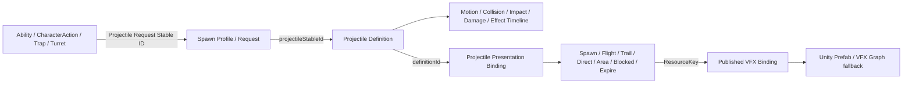
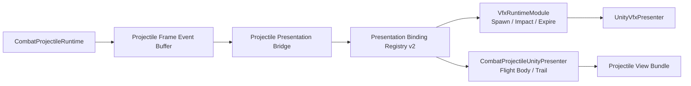

# Projectile Authoring Editor 完整开发设计

> Status: Design
>
> Implementation status: 已实现合同见现行使用指南；统一发布门禁、完整consumer切换及整体性能目标仍未完成。
>
> 本文是目标设计，不能将里程碑验收要求解释为已实现保证。现行操作统一读使用指南；性能、发布和兼容切换的未完成部分为 Target。
>
> 当前入口：[Projectile Authoring使用指南](Guides/PROJECTILE_AUTHORING_GUIDE.md)。阶段任务与验收报告已清理，历史恢复以Git为准，不再保留为并行权威。

本文是 Projectile Authoring Editor 的长期设计事实源。当前运行时事实仍以
[`Interfaces/Combat.md`](Interfaces/Combat.md)、
[`Interfaces/Vfx.md`](Interfaces/Vfx.md)、
[`Interfaces/CharacterAction.md`](Interfaces/CharacterAction.md)、源码和测试为准。
只有已有实现与验证证据的能力可写入 `CAPABILITIES.md` 或 Current 接口文档；本文中仍标为 Target 的后续扩展不得提前写成 Current。

目标界面方向如下。效果图用于固定信息架构和交互密度，不要求逐像素照搬；独立窗口最终应显示 Package / Projectile 上下文，不继续携带无关的角色、装备和 ActionSet 上下文。


## 1. 决策摘要

本设计固定以下决策：

1. 新增独立入口 `MxFramework/Combat/Projectile Authoring`，它是 Projectile Definition 和 Projectile Presentation Binding 的唯一 Unity 可写入口。
2. 用户看到的“投射物资源”是一个聚合视图，不是一个扁平 Runtime 对象。底层必须继续区分 Definition、Spawn Profile 和 Presentation Binding。
3. 技能、动作、陷阱、炮台等消费者保存 `Projectile Request Stable ID`；Request 通过 Spawn Profile 解析到 `Projectile Definition Stable ID`。不得把两种 Stable ID 混称为同一个字段。
4. Motion、Collision、Impact、Damage、`effectTimelineId` 属于确定性 Projectile Definition；Origin、Socket、Aim 属于 Spawn Profile；生命周期 VFX 属于 view-only Presentation Binding。
5. 生命周期 VFX 槽位固定为 `spawn`、`flightBody`、`trail`、`directImpact`、`areaImpact`、`blockedImpact`、`expire`。`Complete` / `Dissipate` 是 Flight/Trail 的退出策略和 Published Effect 内部阶段，不默认成为额外 Prefab 槽。
6. Projectile Editor 只选择稳定 `ResourceKey`。VFX 的制作、Recipe、Candidate、人工 Ready 审批、正式 Prefab 绑定继续归 VFX Authoring；Projectile JSON 不保存 Prefab 路径或 Candidate 路径。
7. Presentation Binding 不进入 Combat Projectile authority、Combat hash、Projectile SaveState、Damage、Cooldown、HitResolve 或网络权威。通过 `VfxRuntimeModule` 播放的一次性效果仍可合法进入独立 `domain.vfx` 状态。
8. Pre-M1 的 CharacterAction 内嵌 Store 不能作为新编辑器的保存基础；M1 已建立无损、package-aware 的 Projectile Authoring Core 编译/导入事务，独立 UI 基于该边界实现。
9. CharacterAction 迁移完成后只保留 Request ID 选择、摘要、引用状态和“在投射物编辑器中打开”；不得保留第二个可写 Definition 面板。
10. 首版是 Unity Editor 开发者工作台，不是外部 Tauri 主创工具。数据和校验服务仍必须保持 noEngine，以便未来外部工具复用。

## 2. Pre-M1 / Implemented M1-M7 状态

| 能力 | Pre-M1 audit baseline | Implemented M1-M7 baseline（2026-07-18） |
| --- | --- | --- |
| 编辑入口 | CharacterAction“共享资源 → 投射物”内嵌页 | 独立 `Projectile Authoring` 工作台 |
| Authoring source | `config/projectiles/<requestId>.json` | 沿用同一 per-ID source，升级为可无损 round-trip 的 v2 合同 |
| 数据身份 | UI 容易把 Request、Definition、Binding 混成一条记录 | Definition 主资源 + 可展开 Request Variants + Definition Presentation |
| 保存 | UI 自己拼 source 和三份 generated JSON | Authoring Core 在同一事务内统一生成 JSON、`.bytes`，并同步 Unity Generated 与 Player mirror；任一目标失败则整体回滚 |
| Runtime artifact | JSON + binary，Player binary-first | 同一事务生成、同一 stable hash 校验、禁止 stale binary |
| 飞行表现 | Definition ID → 单个 flight Prefab ResourceKey | `flightBody` + 可选 `trail` bundle |
| 命中表现 | Ability/Damage presentation profile、trigger map、stableEvent 特化映射和项目特判混合 | Projectile frame event → presentation bridge → lifecycle slot |
| 过期/格挡/范围表现 | 无统一生命周期绑定合同 | 统一 `blockedImpact`、`areaImpact`、`expire` 触发基数 |
| 预览 | CharacterAction 预览内自实现部分轨迹公式 | 隔离 preview sandbox 运行真实 fixed-frame projectile runtime |
| VFX 选择 | flight ResourceKey 有候选；impact 不在同一 Projectile 生命周期界面 | 全生命周期资源卡、共享选择器、正式/Candidate 状态一致 |
| CharacterAction 关系 | 同一窗口可写 Projectile | 只引用 Request Stable ID，并深链接独立编辑器 |

## 3. Pre-M1 审计基线与已解决的 P0

本节保留实施前的风险证据；其中“现有/当前”均指 Pre-M1 状态，不是 M1-M7 完成后的 Current 事实。

### 3.1 现有数据不是“一文件一完整投射物”

当前 `config/projectiles/` 有 29 个文件，但聚合后只有 23 个 Definition、28 个 Spawn Profile 和 23 个 Presentation Binding。

- `character_test.fireball_burst.projectile.json` 同时保存 Definition、Spawn Profile 和 Presentation Binding。
- `character_test.meteor_barrage.projectile.json` 保存 canonical Definition 和 Presentation Binding，但不保存 Spawn Profile。
- `character_test.meteor_barrage.projectile.0` ～ `.5` 六个文件只保存 Spawn Profile，并共享 canonical Definition。
- `character_test.arc_mine.deploy` 的 Request ID 与 `character_test.arc_mine.projectile` Definition Stable ID 不相同。

因此，编辑器不得假设：

- 根 `stableId` 总等于 `definition.stableId`；
- 一个 source 文件总包含三类数据；
- 修改一个列表项只影响一个消费者；
- 删除一个 Request 可以顺带删除其 Definition。

### 3.2 现有保存链路没有更新 Runtime binary

Pre-M1 CharacterAction Store 直接写：

- per-ID source JSON；
- `projectile_definitions.json`；
- `projectile_spawn_profiles.json`；
- `projectile_presentation_bindings.json`。

它不写对应 `.bytes`。CharacterTest Player / runtime 是 binary-first，成功读取 binary 后不会再读取新 JSON，因此 Editor 显示“已保存”时，运行时仍可能消费旧数据。

目标保存链路必须是：

```text
Draft
  -> noEngine normalize + validate
  -> expected source hash check
  -> write source transaction
  -> Authoring compiler
  -> generated JSON + bytes
  -> import verification
  -> atomically update Unity Generated + Player mirror
  -> verify all runtime artifact hashes
  -> stable hash / artifact parity check
  -> Editor refresh
```

UI 不得继续实现自己的 generated JSON projector。

### 3.3 现有 Store 不是无损 round-trip

当前 draft/projection 至少会漏掉：

- `impact.effectTimelineId`；
- `impact.presentationProfileId`；
- `areaHitEvent` 的独立 damage payload；
- 与权威 compiler 不一致的 generated schemaVersion。

其中 `effectTimelineId` 属于确定性 Definition 并进入 stable hash。保存 Fireball Burst 等配置时丢失该字段会改变二次效果链和权威 catalog，不是普通 UI 元数据问题。

实现独立窗口前必须有以下门禁：

- load → normalize → save 不修改未编辑字段；
- source semantic diff 只包含用户实际操作；
- compile 前后 Definition stable hash 不变；
- v1/v2 source 均有 golden round-trip 测试；
- 未理解的字段必须保留或 fail closed，不能静默删除。

### 3.4 当前 generated schema 被内嵌 Store 降级

Pre-M1 权威 Ability compiler 输出 projectile definitions schema `3`，当时的 CharacterAction JSON projector 却固定写 schema `1`。JSON importer 未严格检查根 schema，导致问题可能在 Editor 内被掩盖，直到 binary header/schema gate 才暴露；M1-M7 已通过单一 Core/CLI writer 消除此分叉。

独立编辑器必须调用同一个 Authoring Core compiler 和 binary writer；禁止在 UI assembly 复制 schema 常量、排序、hash 或二进制格式。

### 3.5 命中特效仍有项目特化硬编码

当前 `CombatProjectileImpactConfig.PresentationProfileId` 会进入 Definition hash，但 CharacterTest 样例的 projectile source 多数为空；项目侧又通过 `stableEventId` 映射到 `presentationProfileId`，再由 Combat hit trigger map 解析 VFX。

这造成：

- Ability profile、Damage payload、Projectile stable event 和 VFX trigger map 权威混杂；
- 同一个 Projectile Definition 无法完整描述自己的 source impact VFX；
- 纯表现选择可能污染 Combat Definition hash；
- 新增 Projectile 仍可能需要修改 CharacterTest 常量或 switch。

目标必须移除“stableEvent → projectile impact profile”的项目特化映射。非投射物 Combat Hit、目标反应和材质反应仍可保留原 HitPresentation 链路。

### 3.6 当前 VFX Catalog 存在角色不匹配债务

现有多个 projectile flight binding 使用 `vfx.magic.fireball`，但该条目当前语义是 `Impact + HitPoint + OneShot`；`vfx.magic.fireball_burst.flight` 才符合 `Flight + Persistent`。

迁移时：

- 先生成全量 role / anchor / lifecycle 兼容报告；
- Legacy 记录可暂以 warning + badge 打开；
- role/anchor/lifecycle不匹配仅为语义建议；Production检查实际Key、槽参数、解析与发布就绪，不以语义角色作阻断；
- 不得为了让旧数据通过而全局放宽槽位兼容规则。

## 4. 范围

### 4.1 本设计包含

- 独立 Unity UI Toolkit Projectile Authoring 窗口；
- package-aware workspace、Definition/Request/Binding 聚合模型；
- Projectile CRUD、Request Variant CRUD、共享引用影响分析；
- Motion、Collision、Impact、Damage、Effect Timeline、Spawn、Aim 的结构化编辑；
- 生命周期 VFX 槽位、退出策略、资源卡和 VFX 选择器；
- 隔离 fixed-frame 预览、播放、暂停、逐帧、scrub；
- SceneView 轨迹/半径/弧高等 Handles；
- noEngine load/normalize/validate/compile/import 服务；
- JSON/binary 一致性与独立 Player mirror publish gate；
- CharacterAction 深链接迁移；
- 现有 CharacterTest projectile 表现特判盘点与归属迁移；
- 性能、诊断、测试、兼容、回滚和文档收口。

### 4.2 本设计不包含

- 在 Projectile Editor 内制作或修改 VFX Prefab、Recipe、Primitive、材质、纹理或 `.vfx`；
- 自动把 Candidate 设置为 Ready；
- 把 Cast、Charge、Muzzle、角色动作前摇 VFX 移入 Projectile；
- 把目标受击、材质碎屑、护盾反馈等 Reaction VFX 移入 Projectile；
- 把 Trap、Zone、Pool、Turret 部署后的完整生命周期移入 Projectile；
- 用 Unity Physics 取代 `CombatPhysicsWorld`；
- 在外部编辑器中复制一套近似 projectile runtime；
- 把 Definition、Spawn Profile 和 Presentation Binding 合并成新的 monolithic Runtime schema；
- 首版支持多人协同编辑或远程锁；
- 让 VFX 缺失阻断 Gameplay runtime。

## 5. 身份模型

### 5.1 四个必须区分的身份

| 名称 | 示例 | 用途 | 所有者 |
| --- | --- | --- | --- |
| Projectile Request Stable ID | `character_test.meteor_barrage.projectile.0` | 技能/动作实际保存的 `requestId` | Spawn Profile |
| Spawn Profile Stable ID | 通常等于 Request ID | Origin、Socket、Aim、fallback，并引用 Definition | Projectile authoring |
| Projectile Definition Stable ID / DefinitionId | `character_test.meteor_barrage.projectile` / `91017` | Motion、Collision、Impact、Damage、Effect Timeline | Combat Projectile |
| VFX ResourceKey | `vfx.magic.fireball_burst.impact` | 稳定表现资源引用 | VFX Published Effect |

编辑器用户可见命名固定为：

- “引用 ID” = Projectile Request Stable ID；
- “定义 Stable ID” = Projectile Definition Stable ID；
- “Definition ID” = 紧凑数值 ID；
- “VFX ResourceKey” = 表现资源稳定键。

禁止只显示一个含糊的“Projectile Stable ID”字段。

### 5.2 聚合关系



### 5.3 左栏聚合规则

左栏以 Definition 为一级资源，Request Variants 为二级项：

```text
Fireball Burst
  Definition: character_test.fireball_burst.projectile / 91002
  Presentation: 6/7 slots
  Requests
    character_test.fireball_burst.projectile

Meteor Barrage
  Definition: character_test.meteor_barrage.projectile / 91017
  Presentation: 3/7 slots
  Requests
    ...projectile.0
    ...projectile.1
    ...
    ...projectile.5
```

选择 Definition 时编辑共享规则和表现；选择 Request Variant 时只编辑 Spawn Profile。共享 Definition 被修改、重命名或删除前必须展示所有 Request 和上层消费者。

## 6. 权威来源

| 事实 | 权威来源 | 是否进入 Combat Projectile authority |
| --- | --- | --- |
| Motion、Collision、Impact Policy、Damage、Effect Timeline | Projectile Definition source | 是 |
| Origin、Socket、Aim、fallback | Spawn Profile source | 发射解析结果进入 Gameplay |
| 生命周期 VFX ResourceKey、orientation、offset、exit policy | Projectile Presentation Binding source | 否 |
| `ResourceKey -> 正式 Prefab` | `vfx_published_bindings.json` | 否 |
| Editor Candidate 试玩替换 | `Library/MxFramework/VfxPlaytestOverrides.json` | 否 |
| VFX Recipe、Primitive、语义、Review/Ready | VFX Authoring Catalog | 否 |
| Definition/Request/consumer 引用图 | 派生 Reference Index | 否 |
| generated JSON / `.bytes` | Authoring compiler projection | Definition 部分按 Runtime 合同 |
| Unity Preview 对象 | Preview sandbox | 否 |
| 目标/材质/护盾反应 | Reaction / Material Presentation | 否 |

规则：

- Source 可写，generated 只读。
- Editor 不能直接写 generated artifact。
- Candidate 路径不能写入 source。
- Presentation Binding 的改变不能改变 Projectile Definition stable hash。
- Published Prefab 在同一 ResourceKey 下替换时，不修改任何 Projectile source。
- Dedicated Server 可以完全不加载 Presentation Binding、VFX Catalog 或 Unity Prefab。

## 7. 生命周期表现归属

### 7.1 归属矩阵

| 表现 | 归属 | 说明 |
| --- | --- | --- |
| Cast / Charge / Windup | CharacterAction / Ability timeline | Projectile 尚未成功生成 |
| Muzzle flash / weapon socket cue | CharacterAction / Weapon presentation | 角色或武器表现 |
| Spawn | Projectile Presentation | 只在 `SpawnEvent` 成功后播放；Rejected 不播 |
| Flight Body | Projectile Presentation | 跟随 active projectile |
| Trail | Projectile Presentation | 跟随 active projectile，可独立于 body |
| Direct Impact source overlay | Projectile Presentation | 每次 accepted direct impact |
| Area Impact source overlay | Projectile Presentation | 每个 area pulse 一次，不按目标数 |
| Blocked Impact source overlay | Projectile Presentation | 每个 blocked contact |
| Expire source overlay | Projectile Presentation | 自然到期一次 |
| Complete / Dissipate | Flight/Trail exit policy | 驱动已选 Published Effect 内部阶段 |
| Target hit reaction | Reaction Presentation | 目标、部位、材质、护盾决定 |
| Trap/Zone/Turret deploy 后表现 | 对应 mechanic | Projectile 只拥有转换瞬间 |

### 7.2 Effect Timeline 边界

`impact.effectTimelineId` 仍属于确定性 Gameplay/Effect 规则，不能当成命中特效资源字段。

- 它可以触发二次爆炸、延迟 Gameplay event 或其它 effect timeline 行为。
- 生命周期 VFX 槽只描述 source visual。
- 同一事件若同时有 Gameplay effect timeline 和 VFX slot，二者必须由同一 frame correlation 观察，但不能互相驱动。
- 编辑器可以在同一右侧 Inspector 显示“相关规则”，但必须用 `规则` / `表现` 标签区分权威。

## 8. 目标 source schema

### 8.1 per-ID 文件继续作为 Authoring source

目标继续使用：

```text
Tools/MxFramework.Authoring/samples/<package>/config/projectiles/<requestId>.json
```

根文件允许包含：

- `definition`：可选；
- `spawnProfile`：可选；
- `presentationBinding`：可选。

共享 canonical 文件和 spawn-only alias 继续合法。新 UI 不改变这条多对一关系。

### 8.2 Presentation Binding v2

目标 source 示例：

```json
{
  "schemaVersion": "2",
  "stableId": "character_test.fireball_burst.projectile",
  "definition": {
    "definitionId": 91002,
    "stableId": "character_test.fireball_burst.projectile",
    "motion": {},
    "collision": {},
    "impact": {
      "policyKind": "AreaPulseOnImpact",
      "effectTimelineId": "character_test.double_explosion",
      "hitEvent": {},
      "areaHitEvent": {}
    }
  },
  "spawnProfile": {
    "stableId": "character_test.fireball_burst.projectile",
    "projectileStableId": "character_test.fireball_burst.projectile",
    "origin": {},
    "aim": {}
  },
  "presentationBinding": {
    "projectileDefinitionId": 91002,
    "viewNamePrefix": "ProjectileVFX",
    "slots": {
      "spawn": {
        "resource": {
          "id": "vfx.magic.fireball_burst.spawn",
          "typeId": "GameObject",
          "variant": "",
          "packageId": "mxframework.samples"
        },
        "orientation": "ProjectileForward",
        "lifetimeFramesOverride": 0
      },
      "flightBody": {
        "resource": {
          "id": "vfx.magic.fireball_burst.flight",
          "typeId": "GameObject",
          "variant": "",
          "packageId": "mxframework.samples"
        }
      },
      "trail": {
        "resource": {
          "id": "vfx.magic.fireball_burst.trail",
          "typeId": "GameObject",
          "variant": "",
          "packageId": "mxframework.samples"
        }
      },
      "directImpact": {
        "resource": {
          "id": "vfx.magic.fireball_burst.direct_hit",
          "typeId": "GameObject",
          "variant": "",
          "packageId": "mxframework.samples"
        },
        "orientation": "SurfaceNormal",
        "lifetimeFramesOverride": 30
      },
      "areaImpact": {
        "resource": {
          "id": "vfx.magic.fireball_burst.impact",
          "typeId": "GameObject",
          "variant": "",
          "packageId": "mxframework.samples"
        },
        "orientation": "ImpactNormalOrWorldUp",
        "lifetimeFramesOverride": 30
      },
      "blockedImpact": {
        "resource": {
          "id": "vfx.magic.fireball_burst.blocked",
          "typeId": "GameObject",
          "variant": "",
          "packageId": "mxframework.samples"
        },
        "orientation": "SurfaceNormal",
        "lifetimeFramesOverride": 20
      },
      "expire": {
        "resource": {
          "id": "vfx.magic.fireball_burst.expire",
          "typeId": "GameObject",
          "variant": "",
          "packageId": "mxframework.samples"
        },
        "orientation": "ProjectileForward",
        "lifetimeFramesOverride": 20
      }
    },
    "exitPolicy": {
      "acceptedImpact": "Complete",
      "blockedImpact": "Dissipate",
      "expiration": "Complete",
      "externalRemoval": "Dissipate",
      "runtimeReset": "Immediate"
    }
  }
}
```

### 8.3 槽位通用规则

- 槽位缺失即未配置，不再额外保存 `enabled=false`。
- Source 保存 `ResourceKey`，不保存 Prefab path。
- `lifetimeFramesOverride=0` 表示使用 `VfxDefinition` 默认值；只对 one-shot 槽有效。
- 只允许受限 `orientation` 和 local offset；不开放任意 Anchor。
- `flightBody` / `trail` 可引用 catalog-only Published Effect。
- `spawn` / `directImpact` / `areaImpact` / `blockedImpact` / `expire` 必须能在编译期解析到 `VfxDefinitionId`，否则为阻断错误。
- 同一 ResourceKey 被选择到可能同帧触发的多个槽时给出重复播放 warning。
- Presentation v2 不保存 `presentationProfileId`。旧字段只用于迁移读取。

### 8.4 Anchor / Orientation 合同

| 槽位 | 固定 Anchor | 允许 Orientation |
| --- | --- | --- |
| spawn | Projectile Origin | ProjectileForward、WorldUp |
| flightBody | Projectile Transform | ProjectileForward |
| trail | Projectile Transform | ProjectileForward |
| directImpact | HitPoint | SurfaceNormal、ProjectileForward |
| areaImpact | AreaPulse Center | ImpactNormalOrWorldUp、WorldUp |
| blockedImpact | HitPoint | SurfaceNormal |
| expire | Final Position | ProjectileForward、WorldUp |

UI 可以显示 Anchor，但固定部分为只读说明。不得让 Direct Impact 改挂到 Caster，也不得让 Flight 使用 HitPoint。

### 8.5 Exit Policy

`Complete` / `Dissipate` 映射到 Flight/Trail Prefab 内 `UnityVfxLifecycleController` 的退出阶段：

- `Complete`：播放自然完成尾迹；
- `Dissipate`：播放快速消散；
- `Immediate`：无尾迹，立即清理，仅限 runtime reset / scene shutdown 等安全路径。

退出策略只在 projectile 真正 consumed、expired、external removed 或 runtime reset 时应用。穿透 projectile 的中间 direct impact 不退出 Flight/Trail。

## 9. Generated artifact 与版本

### 9.1 保留三份 Runtime catalog

```text
projectile_definitions.json / .bytes
projectile_spawn_profiles.json / .bytes
projectile_presentation_bindings.json / .bytes
```

- Definition 和 Spawn Profile 继续按当前 Runtime 合同生成。
- Presentation Binding 从 schema v1 升级到 v2。
- v1 binding 的单个 `prefabResource` 只读映射为 `slots.flightBody.resource`。
- v2 writer 必须使用稳定槽位顺序和稳定 hash。
- generated JSON 保留 ResourceKey 和诊断信息。
- binary 对 one-shot slot 写入紧凑 `VfxDefinitionId`；Flight/Trail 保留 presenter 所需 ResourceKey。

### 9.2 一致性门禁

每次 Save / Import 必须验证：

- source hash 与打开文档时的 expected hash 一致；
- generated JSON 和 `.bytes` schema 版本一致；
- JSON/binary entry count 一致；
- Definition stable hash 与 noEngine compiler 报告一致；
- Runtime binary importer 可读取；
- 普通编辑保存必须在同一事务中改写 package generated、Unity Generated 与 StreamingAssets Player mirror；
- 三处 runtime artifact 的 JSON/bytes content hash 必须逐项一致；
- 所有成功写入路径都在报告中列出；
- 任一步失败时不得显示“已保存并可运行”。

### 9.3 Presentation 与 authority

目标 v2 中，生命周期 VFX 不写入 `CombatProjectileDefinition`，不参与其 equality/hash。旧 `CombatProjectileImpactConfig.PresentationProfileId` 按以下顺序退役：

1. v1 reader 继续读取并生成迁移诊断；
2. migration planner 尝试解析为 `directImpact` / `areaImpact` / `blockedImpact`；
3. 歧义阻断并要求人工选择；
4. v2 Definition writer 不再写该字段；
5. Runtime schema/hash version 显式升级；
6. 删除 CharacterTest stableEvent → profile 特化映射；
7. 非 projectile HitPresentation 继续保留。

旧 SaveState / Replay 若绑定旧 Definition hash，必须按项目现有 schema 规则明确拒绝或提供版本化迁移，不能静默接受 hash 不匹配。

## 10. Runtime Presentation Contract

### 10.1 目标链路



依赖方向：

- `MxFramework.Combat.Projectiles` 不依赖 VFX 或 Unity。
- Presentation bridge 放在 VFX/Projectile presentation adapter assembly，不进入 Combat Core。
- Flight/Trail presenter 只读 `CombatProjectileActiveView` 和 frame events。
- Gameplay runtime 不读取 Prefab、ParticleSystem、VFX Catalog 或 AssetDatabase。
- 缺少 Presentation Binding 时 fail-soft，只记录诊断。

### 10.2 事件基数

| Runtime 事实 | 生命周期动作 | 基数 | Flight/Trail 退出 |
| --- | --- | --- | --- |
| Spawn accepted | `spawn` + Flight/Trail Build | 每 projectile 一次 | 否 |
| Spawn rejected | 无表现 | 0 | 不创建 |
| DirectSweep accepted impact | `directImpact` | 每个 accepted direct impact 一次 | 仅 projectile consumed 时 |
| DirectSweep blocked contact | `blockedImpact` | 每个 blocked contact 一次 | 仅 configured consume 时 |
| AreaPulseTriggerEvent | `areaImpact` | 每个 pulse 一次 | 由 projectile consume/expire 决定 |
| AreaPulse target impact | 目标 reaction，可选 | 每目标 | 不驱动 source `areaImpact` |
| ExpiredEvent | `expire` | 每次自然到期一次 | 是 |
| AreaPulseOnExpire | `areaImpact` + `expire` 可同帧合成 | 各一次 | 是 |
| late attach / SaveState restore | Flight/Trail Rebuild | 每个 active projectile 一次 | 否 |
| external removal | 无 one-shot，按 exit policy | 每次 removal | 是 |
| runtime reset / scene shutdown | Immediate cleanup | 每个 active view 一次 | 是 |

必须保证 Area Impact 使用 `CombatProjectileAreaPulseTriggerEvent`，不能使用范围内每个 `CombatProjectileImpactEvent`，否则 N 个目标会重复生成 N 份爆炸。

### 10.3 Event identity 与去重

一次性表现使用稳定数值 correlation：

```text
(projectileId, combatFrame, lifecycleEventKind, eventSequence)
```

- late attach / restore 不补播 Spawn、Impact、Blocked 或 Expire；
- 同一 frame 重复投递相同 correlation 必须去重；
- 不在 Tick 里拼接动态 trace string；
- diagnostics 可在低频快照时格式化可读文本；
- presentation 去重状态不允许反向改变 Gameplay 事件。

### 10.4 Flight/Trail View Bundle

`CombatProjectileUnityPresenter` 从“每 projectile 一个 Prefab view”扩展为：

```text
ProjectileViewBundle
  projectileId
  flightBody view
  trail view
  cached lifecycle controllers
  cached ParticleSystem / backend handles
  current exit state
```

要求：

- 初始化期解析 ResourceKey、加载 handle、预热 pool、缓存组件；
- active 同步只更新已缓存 Transform/Backend；
- 穿透命中时 bundle 保持；
- consumed/expired 时只触发一次 exit；
- pool exhausted 只降级表现并记录结构化诊断；
- custom presenter 可通过扩展点处理 Laser path、LineRenderer 或其它特殊 view，不得为了统一槽位每帧重建 VFX。

### 10.5 VFX Runtime Source Domain

新增独立 `VfxSourceDomains.CombatProjectile`，用于区分：

- Action presentation cue；
- generic CombatHit reaction；
- Projectile source lifecycle visual。

one-shot slot 编译后使用紧凑 `VfxDefinitionId` 创建请求，热路径不按字符串扫描。ResourceKey 仍保留在 generated JSON/diagnostics 中，便于 Editor 显示和排障。

## 11. Authoring Core 与保存事务

### 11.1 服务边界

当前 Unity `MxFramework.Editor` 不直接引用 Tools 下 `MxFramework.Authoring.Core`。首版不在 Unity assembly 里复制 Loader/Compiler，而定义：

```text
IProjectileAuthoringService
  OpenWorkspace(...)
  ValidateDraft(...)
  CompilePreview(...)
  ApplyDraft(...)
  BuildReferenceImpact(...)
  RegenerateArtifacts(...)
```

默认实现 `ProjectileAuthoringCliService` 通过结构化 CLI bridge 调用同一 Authoring Core。UI 只依赖服务接口；以后可替换为 in-process adapter，但 schema、normalizer、validator、compiler 和 binary writer 始终只有一份权威实现。

### 11.2 专用 CLI

新增 scoped commands：

```text
mx-authoring projectile validate
  --package <AbilityPackage>
  [--draft-bundle <tempDraft>]
  [--report <report.json>]

mx-authoring projectile compile
  --package <AbilityPackage>
  --out <tempOutput>
  [--draft-bundle <tempDraft>]

mx-authoring projectile apply
  --package <AbilityPackage>
  --draft-bundle <tempDraft>
  --expected-source-hash <sha256:...>
  --project-root <repoRoot>
  [--report <report.json>]

mx-authoring projectile import-unity
  --package <AbilityPackage>
  --project-root <repoRoot>
```

这些命令内部可复用 Ability package loader/compiler，但写入范围必须限制为：

- 变化的 per-ID projectile source；
- 三份 projectile generated JSON；
- 三份 projectile generated binary；
- 结构化 validation/import report。

不得因为保存一个 Projectile 而重写 Ability、VFX、Buff 或其它无关 artifact。

### 11.3 Draft Bundle

Editor 不先写真实 source。它将内存 draft 输出到临时 bundle：

```text
Temp/MxFramework/ProjectileAuthoring/<sessionId>/
  manifest.json
  source-overrides/
  deletes.json
  renames.json
  expected-hashes.json
```

Temp bundle 不进入 Git。CLI 从“磁盘当前 package + draft override”构建完整视图，完成 normalize、validation、reference impact、compile 和 staged write。

### 11.4 Atomic apply

`apply` 必须：

1. 校验所有 expected source hash；
2. 在临时目录生成全部目标文件；
3. 用新文件重新加载并运行 importer；
4. 校验 source/generated JSON/binary parity，并把 Unity Generated 与 Player mirror 纳入同一 write plan；
5. 生成 write plan；
6. 对 source、package generated、Unity Generated 和 Player mirror 做 atomic replace；
7. 任一 replace 失败时回滚已替换文件；
8. 反向读取所有目标并校验最终 hash，一致后才输出 committed，否则整体回滚；
9. 成功后由 Unity 统一 `AssetDatabase.Refresh` 一次。

禁止按“source → generated A → generated B”顺序直接写真实文件而没有回滚。

### 11.5 CRUD 命令语义

必须提供四个明确操作：

| 命令 | 结果 |
| --- | --- |
| Create Definition | 新 Definition + 默认 Presentation；可选创建默认 Request |
| Create Request for Existing Definition | 新 Spawn Profile，复用现有 Definition/Presentation |
| Duplicate Definition | 新 DefinitionId/Stable ID，可选择复制 Presentation，并创建新 Request |
| Duplicate Request | 只复制 Spawn Profile，继续引用同一 Definition |

Rename/Delete 必须先生成 Reference Impact：

- Rename Request：更新所有明确授权的 consumer 引用；
- Rename Definition：更新所有 Spawn Profile 的 `projectileStableId` 和 canonical source；
- Delete Request：不默认删除共享 Definition；
- Delete Definition：存在任何 Request 或 consumer 时阻断；
- DefinitionId 分配必须 package-aware、检测项目/依赖包冲突，不使用“当前列表 max + 1”作为唯一全局策略。

## 12. 独立编辑器架构

### 12.1 入口和窗口

```text
Menu: MxFramework/Combat/Projectile Authoring
Window title: Projectile Authoring
Minimum size: 1280 × 720
```

窗口由以下层组成：

```text
ProjectileAuthoringWindow
  ProjectileAuthoringWorkspaceController
  IProjectileAuthoringService
  ProjectileDocumentSession
  ProjectileReferenceIndex
  ProjectilePreviewSandbox
  ProjectileVfxSelectionAdapter
  ProjectileProblemsModel
```

窗口不得依赖一个已经打开的 CharacterAction 窗口。

### 12.2 顶部上下文与工具栏

独立窗口顶部只保留相关上下文：

- Package；
- Source root；
- 当前 Definition；
- Validate；
- Save；
- Undo / Redo；
- dirty document count；
- Open CharacterAction consumers；
- Scene Edit。

不显示无关的 ActionSet、角色和装备下拉。需要 Socket 预览角色时，在 Preview Settings 中单独选择 Character Resource Package。

### 12.3 左侧资源区

左侧提供：

- Definition 搜索；
- Motion / Impact Policy / 状态 / 使用状态过滤；
- Definition 列表；
- 可展开 Request Variants；
- create / duplicate / rename / delete；
- shared consumer count；
- source / generated-only / legacy / dirty / conflict badge。

列表状态：

| Badge | 含义 |
| --- | --- |
| Source | 有 authoring source |
| Generated-only | 只有 generated artifact，只读，需 Adopt |
| Shared ×N | N 个 Request 引用 Definition |
| Dirty | 当前 session 有未保存改动 |
| External Changed | 打开后磁盘 hash 已变化 |
| Legacy V1 | 只读兼容映射，尚未迁移 |
| Invalid | 有阻断诊断 |

### 12.4 中央区域

中央分两层：

1. 上部“完整生命周期预览”；
2. 下部“规则时间轴 / 生命周期表现”。

生命周期表现卡：

- 出生；
- 飞行主体；
- 拖尾；
- 直接命中；
- 范围命中；
- 格挡命中；
- 过期；
- 退出策略。

卡片显示：

- 缩略图；
- ResourceKey；
- role / anchor / lifecycle；
- Published / Candidate / Review status；
- 缺失、stale、incompatible 状态；
- 当前触发帧/条件摘要。

### 12.5 右侧上下文 Inspector

右侧根据选择显示：

- Definition；
- Request Variant；
- Motion；
- Collision；
- Impact；
- Damage；
- Effect Timeline reference；
- Spawn / Aim；
- Lifecycle VFX slot；
- Exit Policy；
- Reference Impact。

选中 VFX 槽时，顶部固定显示：

- VFX 资源卡；
- “选择 VFX…”；
- “打开 VFX 工作台”；
- “定位正式 Prefab”；
- Published / Candidate / Review 状态；
- 固定 Anchor 与允许 orientation；
- lifetime override；
- local offset；
- 相关 Gameplay 规则只读/深链接摘要。

Area Impact 卡可以在同一 Inspector 展示 `areaRadius`、targets、`triggerOnExpire`，但必须标记为“来自 Impact 规则”，编辑时写 Definition，而不是复制到 Presentation Binding。

### 12.6 Problems 抽屉

底部 Problems 统一显示：

- Error / Warning / Info 数量；
- stable diagnostic code；
- source path；
- object path；
- field path；
- 建议修复；
- “定位”操作；
- “重新验证”；
- “复制报告”。

过滤和搜索不允许改变诊断基数或保存门禁。

### 12.7 与 CharacterAction 工作台的一致性

两者保持同一套编辑语言：

- 同样的播放、暂停、重播、逐帧和 scrub；
- 同样的 frame ruler、选中态、hover、缩放和快捷键；
- 同样的内嵌 Preview 视口交互；
- 同样的左侧资源导航、中央时间轴/预览、右侧上下文 Inspector；
- 同样的 Problems 抽屉和定位行为；
- 同样的 VFX 资源卡、选择器和实际 Prefab 解析结果；
- 同样的 Scene Edit 进入/退出生命周期。

一致性不等于复用错误的数据模型。CharacterAction 时间轴编辑 Action events；Projectile 时间轴显示真实 Projectile Runtime lifecycle 和 frame events。可以抽取公共播放控制器、时间尺、selection、Problems 和 viewport 组件，但不得把 Projectile lifecycle 强行序列化成 CharacterAction event。

## 13. 编辑合同

### 13.1 Definition

可编辑：

- `definitionId`：创建后默认锁定，高级迁移才可改；
- `stableId`：guarded rename；
- `physicalEventsEnabled`；
- Motion；
- Collision；
- Impact；
- HitEvent / AreaHitEvent；
- Damage；
- OnHitBuffs；
- `effectTimelineId`。

不可把 Presentation ResourceKey 写入 Definition。

### 13.2 Motion

覆盖当前全部 motion：

- Linear；
- ArcToTarget；
- BallisticArcToTarget；
- BoomerangReturn；
- SwayForward；
- HomingToTarget；
- BezierToTarget。

以及 speed profile：

- Constant；
- EaseInQuadratic；
- EaseOutQuadratic；
- EaseInOutSmoothstep。

条件字段必须按 kind 显示，不适用字段保存为规范化默认值。Ballistic 的 range 来自求解，不把 `speed * lifetime` 误标为射程。

### 13.3 Collision / Impact

- Radius；
- Stop On First Accepted Impact；
- Stop On Blocked Impact；
- Max Accepted Impacts；
- Same Target Policy；
- DirectHit / AreaPulseOnImpact；
- Area Radius；
- Trigger On Expire；
- Direct/Area target toggles；
- Environment Hit Policy；
- Damage、impactPower、launchPower、tags；
- OnHitBuffs；
- Effect Timeline。

LayerMask 只显示推导结果，不开放 raw integer 输入。角色、敌友、自身、第三方、可破坏物、墙面、地面、静态场景使用受控 toggles。

### 13.4 Spawn Profile

- Request Stable ID；
- Projectile Definition reference；
- Origin kind；
- Socket；
- local offset；
- fallback root offset；
- Aim kind；
- target height offset；
- fallback kind；
- max range。

Socket 选择顺序：

1. 当前 Preview Character Resource Package 的 `geometry/sockets.json`；
2. generated character geometry binding；
3. package `knownSocketIds` fallback；
4. 原始文本只放在高级诊断区。

### 13.5 Presentation

- 槽位选择只保存 ResourceKey；
- VFX Candidate 只写 Editor 本机 playtest override；
- 选择正式资源会清除该槽的 Candidate override；
- 修改 Published Prefab 不使 Projectile 文档 dirty；
- ResourceKey 变化使 Presentation 文档 dirty，但不使 Definition dirty；
- VFX role/anchor/lifecycle 不匹配时只给出语义建议，不标记为不兼容，也不阻断选择、保存或 Production 校验。

## 14. 会话、Dirty、Undo 和冲突

### 14.1 Document Session

一个窗口 session 保存：

- workspace/package identity；
- source snapshot hash；
- Definition drafts；
- Request drafts；
- Presentation drafts；
- undo/redo history；
- selected item；
- preview state；
- external change status。

### 14.2 Dirty 粒度

Dirty 必须按 source document 跟踪，不只按窗口布尔值：

```text
Definition canonical document: dirty
Request variant .2: clean
Presentation canonical document: dirty
```

聚合 UI 可以显示总 dirty 数，但 Save report 必须列出实际 source paths。

### 14.3 Undo / Redo

- 字段编辑、槽位替换、增删 Request、rename plan 都进入 command history；
- VFX Candidate 本机 override 是独立 Editor 状态，不进入 Projectile source undo；
- Preview 播放、相机和 selection 不进入内容 undo；
- Save 后保留可撤销历史时，撤销会重新变 dirty；
- 外部文件变化后禁止继续无提示覆盖。

### 14.4 外部修改

检测到 expected hash 变化时提供：

- Reload Disk；
- Compare；
- Reapply Draft；
- Cancel。

自动 merge 只允许稳定、字段级、无冲突变更；同一字段冲突必须人工选择。Generated-only source 不允许直接保存，必须先执行 Adopt，生成明确的 authoring source 和 receipt。

## 15. Preview 与 SceneView

### 15.1 Preview 原则

Preview 必须运行真实 fixed-frame projectile runtime、spawn profile resolver、frame event buffer 和 presentation bridge。不得继续维护一套近似运动公式作为最终预览权威。

Preview 输入：

- selected Request/Definition；
- start pose；
- target pose；
- locked target state；
- representative collision scenario；
- frame rate / total frames；
- selected Preview Character / socket；
- current in-memory compiled draft catalogs。

### 15.2 播放控制

- Play；
- Pause；
- Restart；
- Step Back / Step Forward；
- scrub；
- speed；
- scenario：Miss、Direct Hit、Blocked、Area Hit、Expire、Pierce、Late Attach。

Timeline 显示：

- spawn frame；
- active flight span；
- impact frames；
- area pulse；
- expire；
- Effect Timeline markers；
- VFX lifecycle markers。

### 15.3 隔离和清理

- 使用 `PreviewRenderUtility` 或独立 preview scene；
- 不向用户 active Scene 创建临时对象；
- 不修改 Scene dirty state；
- 关闭窗口、domain reload、assembly reload、playmode change 时完整清理；
- late attach 只 Rebuild Flight/Trail，不补播 one-shot；
- Preview Candidate 与正式 binding 使用同一 binding source。

### 15.4 SceneView Handles

Scene Edit 支持：

- origin/socket offset；
- target point；
- collision radius；
- area radius；
- Arc height；
- Bezier control points；
- Sway amplitude；
- ballistic target/range diagnostic。

进入 Scene Edit：

- 暂停内嵌 preview；
- 释放或冻结 preview runtime object；
- 记录当前 frame/selection；
- 退出时清理 SceneView 临时对象；
- 回到同一 frame，不自动恢复播放。

Handles 必须写回结构化 draft 字段，不写 Unity Scene 资产。

## 16. Validation

### 16.1 分层

| 层 | 负责内容 |
| --- | --- |
| Schema | 必填字段、类型、版本、未知 enum |
| Identity | Request/Definition/DefinitionId 唯一性与 package 冲突 |
| Reference | Request→Definition、Effect Timeline、Buff、Socket、VFX ResourceKey |
| Gameplay | motion/collision/impact/damage 合法组合 |
| Presentation | slot orientation/lifetime、ResourceKey 与 VfxDefinition 可解析性；role/anchor/lifecycle 仅作语义建议 |
| Artifact | JSON/binary/schema/hash/parity |
| Migration | legacy field、硬编码 consumer、歧义映射 |
| Runtime Preview | 事件基数、pool、missing binding、late attach |

### 16.2 建议诊断码

| Code | Severity | 含义 |
| --- | --- | --- |
| `PROJAUTH001` | Error | Request Stable ID 缺失或重复 |
| `PROJAUTH002` | Error | Definition Stable ID / DefinitionId 冲突 |
| `PROJAUTH003` | Error | Spawn Profile 引用未知 Definition |
| `PROJAUTH004` | Error | canonical/shared source 结构冲突 |
| `PROJAUTH005` | Error | 保存会丢失未知或未建模字段 |
| `PROJAUTH006` | Error | expected source hash 已变化 |
| `PROJAUTH007` | Error | generated JSON/binary schema 不一致 |
| `PROJAUTH008` | Error | generated JSON/binary stable hash 不一致 |
| `PROJAUTH009` | Error | Impact 组合非法 |
| `PROJAUTH010` | Error | Ballistic 参数或目标不可达 |
| `PROJAUTH011` | Error | one-shot slot 无法解析 VfxDefinitionId |
| `PROJAUTH012` | Error | Presentation Binding 结构、槽位、朝向或生命周期覆盖参数非法 |
| `PROJAUTH013` | Warning | legacy Presentation Binding v1 |
| `PROJAUTH014` | Warning | legacy `presentationProfileId` 待迁移 |
| `PROJAUTH015` | Warning | 多槽同帧选择相同 VFX，可能叠加 |
| `PROJAUTH016` | Warning | ResourceKey 仅有本机 Candidate |
| `PROJAUTH017` | Warning | Published Binding / receipt stale |
| `PROJAUTH018` | Warning | generated-only 记录，只读 |
| `PROJAUTH019` | Warning | Definition 被多个 Request/consumer 共享 |
| `PROJAUTH020` | Error | rename/delete 存在未授权引用 |
| `PROJAUTH021` | Warning | Player mirror 落后于 generated artifact |
| `PROJAUTH022` | Error | lifecycle event 基数验证失败 |
| `PROJAUTH023` | Error | Preview 与 Runtime motion golden 不一致 |
| `PROJAUTH024` | Warning | custom presenter 尚未分类迁移 |

诊断必须包含：

```text
code
severity
message
sourcePath
objectPath
fieldPath
relatedStableIds[]
suggestedFix
```

### 16.3 保存门禁

Error 阻断整个 Apply；Warning 允许保存，但以下 warning 在 Production/Player publish gate 升级为 Error：

- Legacy role/anchor/lifecycle 不兼容；
- unresolved Candidate-only binding；
- stale Published Binding；
- Player mirror 不一致；
- 未分类的 CharacterTest projectile presentation 特判。

## 17. VFX Authoring 集成

### 17.1 职责不变

VFX Authoring 继续拥有：

- Primitive；
- Recipe；
- Composition Draft；
- Candidate bake；
- review / Ready；
- Published Effect；
- ResourceKey；
- Published Binding Manifest；
- 正式 Prefab 和依赖。

Projectile Editor 只拥有：

- consumer slot；
- ResourceKey 选择；
- slot-specific orientation/offset/lifetime override；
- 当前解析结果的预览；
- 对 VFX 工作台的深链接。

### 17.2 共享选择器

复用 CharacterAction 已有 VFX 资源卡、Catalog 选择器和 `IVfxUnityPrefabBindingSource` 解析语义：

- 搜索 role/theme/anchor/review；
- Published 和有效 Candidate 动态预览；
- Candidate stale 时不可选；
- 正式资源选择清除本机 override；
- UI 显示的实际 Prefab与 Preview 使用同一 binding source；
- 默认显示全部有效 VFX，并把与当前槽位语义相符的条目排在前面；
- role/theme 可由用户主动筛选；role/anchor/lifecycle 不匹配仅显示建议，不进入 Production gate。

### 17.3 Consumer Recommendation

每个槽在选择器中提供只读语义推荐：

```text
slotKind
requiredRole
requiredAnchor
requiredLifecycle
requiredSpace
oneShotOrPersistent
supportsLifecycleController
```

VFX Catalog 只提供资源能力和语义元数据；Projectile Editor 用槽位信息进行排序与提示，不把 role/anchor/lifecycle 当作运行时兼容契约。ResourceKey 类型、固定槽位朝向、生命周期覆盖参数、Prefab/Published Binding/receipt 有效性仍属于真实校验。任何一方都不反向写另一方的 authoring source。

## 18. CharacterAction / Ability 集成

### 18.1 CharacterAction 最终保留

- Projectile Request Stable ID picker；
- Definition / Spawn / Presentation 摘要；
- validation badge；
- consumer reference；
- “在 Projectile Authoring 打开”；
- 当前技能时间轴中的 SpawnProjectile 触发帧；
- 只读生命周期预览投影。

### 18.2 CharacterAction 最终移除

- Definition Motion/Collision/Impact 可写表单；
- Spawn Profile 完整可写表单；
- Flight VFX 可写字段；
- 自己的 Projectile JSON projector；
- 自己的 generated catalog writer；
- Projectile dirty/save ownership；
- “共享资源 → 投射物”第二套可写工作区。

过渡期最多保留只读浏览和深链接。两个窗口同时打开时，只有 Projectile Authoring 可持有 write session。

### 18.3 Ability 引用

Ability / CharacterAction 保存的是 Request Stable ID，不直接保存：

- DefinitionId；
- motion；
- collision；
- impact VFX ResourceKey；
- Prefab path；
- projectile-specific presentationProfileId。

技能间若需要不同的视觉或规则：

- Spawn/Aim 不同但 Definition 相同：新增 Request Variant；
- Definition/Presentation 不同：复制 Definition；
- 只替换同一个 ResourceKey 背后的 Prefab：在 VFX Published Binding 更新，不改技能和 Projectile。

## 19. 特殊消费者与迁移覆盖矩阵

生命周期统一前必须扫描所有 Projectile presentation consumer，并将每项分类为：

1. 迁入 lifecycle slot；
2. 保留 custom presenter；
3. 归属目标 mechanic；
4. 保留 reaction system。

初始矩阵：

| 样例 | Current 来源 | Target 归属 | 必须验证 |
| --- | --- | --- | --- |
| Fireball Burst | flight binding + ability/profile trigger + effect timeline | Flight/Direct/Area slot；Effect Timeline 留 Definition | direct、area、double explosion 不重播 |
| Meteor Barrage | 6 个 Request alias 共享 canonical Definition；area pulse 特判 | 共享 Definition/Presentation + 6 Spawn Profiles | 共享不被扁平化，area VFX 每 pulse 一次 |
| Tornado | flight + expiration 特判 | Flight/Trail/Expire 或 custom persistent presenter | expire 一次、tick reaction 不混入 |
| Laser / Beam / Channel | path/impact/expire 特判 | custom presenter + 标准 impact/expire cue | 不每帧重建，不退化 LineRenderer |
| Arc Mine | projectile carrier → trap deploy/fuse/trigger | Flight + deploy transition；后续归 Trap | 转换边界无双播 |
| Poison Bottle | projectile → pool/zone | Flight + shatter/deploy transition；pool 归 Zone/Pool | shatter 与 pool 持续表现分离 |
| Rune Turret | deploy projectile → turret | Flight + deploy transition；后续归 Turret | deploy 后 projectile view 清理 |
| Piercing projectile | 多次 direct accepted | DirectImpact 每 accepted；Flight 仅 consume 时退出 | 多目标基数、same-target policy |
| Blocked + AreaPulse | blocked contact 可触发 area | BlockedImpact + AreaImpact 可合成 | 同帧各一次，重复资源 warning |
| Target/material/shield reaction | generic HitPresentation | 保留 Reaction system | 与 source overlay 可叠加、不互相去重 |

任何未分类 consumer 都阻断 legacy path 的删除。

## 20. 性能与生命周期（Target，完整路径尚未验收）

### 20.1 分配分类

| 路径 | 分类 |
| --- | --- |
| Workspace load / JSON parse | LowFreqAlloc |
| Validate / Compile / Apply / Report | LowFreqAlloc |
| VFX picker search / thumbnail | LowFreqAlloc |
| Presentation registry lookup | NoAlloc |
| Projectile frame bridge | NoAlloc after initialization |
| Flight/Trail presenter sync | NoAlloc after initialization |
| Pool spawn/stop | NoAlloc after initialization |
| Preview fixed update/repaint | NoAlloc after initialization |
| Diagnostics text formatting | LowFreqAlloc snapshot |

### 20.2 热路径禁止

- LINQ；
- 每帧临时 List/Dictionary；
- 字符串拼接和动态 trace id；
- 反射；
- `GetComponentsInChildren`；
- `ResourceManager.Load`；
- `AssetDatabase`；
- Unity object find；
- exception control flow；
- 每帧 ResourceKey 字符串查找。

### 20.3 预热

Presentation registry 初始化时完成：

- DefinitionId → binding index；
- slot → VfxDefinitionId / ResourceKey handle；
- prefab handle；
- pool capacity；
- lifecycle controller；
- ParticleSystem / VFX backend；
- Shader Property ID（如需）。

Pool overflow、missing binding 或 backend unavailable 只能影响表现并写诊断，不能改变 Projectile Runtime、Damage 或 Frame Event。

## 21. 推荐代码边界

### 21.1 Authoring Core / CLI

```text
Tools/MxFramework.Authoring/src/MxFramework.Authoring.Core/ProjectileAuthoring/
  ProjectileAuthoringDtos.cs
  ProjectileAuthoringPackageLoader.cs
  ProjectileAuthoringNormalizer.cs
  ProjectileAuthoringValidator.cs
  ProjectileAuthoringCompiler.cs
  ProjectileAuthoringReferenceIndex.cs
  ProjectileAuthoringMigration.cs
  ProjectileAuthoringTransaction.cs

Tools/MxFramework.Authoring/src/MxFramework.Authoring.Cli/
  ProjectilePackageCommands.cs
  RuntimeCatalogBinaryArtifacts.Projectiles.cs
```

现有 Ability loader/compiler 可调用新服务；新服务不得反向依赖 Unity。

### 21.2 Unity Editor

```text
Packages/com.vincent.wgameframework/Editor/ProjectileAuthoring/
  ProjectileAuthoringWindow.cs
  ProjectileAuthoringWorkspaceController.cs
  ProjectileAuthoringCliService.cs
  ProjectileDocumentSession.cs
  ProjectileDefinitionListView.cs
  ProjectileRequestListView.cs
  ProjectileInspectorView.cs
  ProjectileLifecycleVfxView.cs
  ProjectilePreviewSandbox.cs
  ProjectileSceneViewEdit.cs
  ProjectileProblemsView.cs
  ProjectileAuthoringWindow.uxml
  ProjectileAuthoringWindow.uss
```

可以抽取并复用：

- CharacterAction VFX 资源卡/选择器；
- Preview binding source；
- gizmo overlay；
- timeline visuals；
- Problems model。

不得复制：

- projectile loader/projector/compiler；
- motion solver；
- binary writer；
- VFX Published Binding resolver。

### 21.3 Runtime / Presentation

```text
Packages/com.vincent.wgameframework/Combat.Projectiles.Unity/
  CombatProjectileUnityPresentationBindingV2.cs
  CombatProjectileUnityPresentationImporterV2.cs
  CombatProjectileUnityPresenter.Bundle.cs

Packages/com.vincent.wgameframework/Vfx.CombatBridge/
  CombatProjectileVfxBridge.cs
  CombatProjectilePresentationEventDedupe.cs
```

最终文件名可按现有代码组织调整，但 assembly 依赖边界不得改变。

## 22. 里程碑

### M0：设计与审计冻结

交付：

- 本文；
- 当前 source/generated/runtime/consumer inventory；
- 29 个 source 的 schema/identity 报告；
- VFX role/anchor/lifecycle 兼容报告；
- CharacterTest presentation special-case inventory；
- Issue 拆分。

验收：

- Definition/Request/Presentation 三身份无歧义；
- 生命周期槽和基数已冻结；
- 不再把 Target 写成 Current。

### M1：P0 无损 Authoring Core

交付：

- Projectile 专用 loader/normalizer/validator/compiler；
- v1 source 无损 round-trip；
- Definition v3、Spawn v1、Presentation v1 权威生成；
- JSON + bytes 同次输出；
- package-aware identity/reference index；
- CLI validate/compile/apply/import-unity；
- atomic transaction / rollback。

验收：

- 29 个现有 source load/save/reload 语义不变；
- Fireball Burst/Explosion `effectTimelineId` 不丢；
- area damage 显式值不丢；
- compiled stable hash 不变；
- 任一步失败无部分写入；
- 不修改 CharacterAction UI。

### M2：独立工作台外壳

交付：

- 菜单和窗口；
- Definition + Request Variant 两层列表；
- search/filter/status；
- complete CRUD commands；
- dirty/undo/redo/external conflict；
- Validate/Save/Problems；
- generated-only Adopt。

验收：

- 不依赖 CharacterAction window；
- 不污染 active Scene；
- 不直接写 generated；
- shared Definition 影响可见。

### M3：完整规则 Inspector

交付：

- 7 类 Motion；
- 4 类 Speed Profile；
- Collision / Impact / Direct/Area Damage；
- Physical Events；
- Spawn / Aim / Socket；
- Effect Timeline reference；
- target toggles；
- reference impact。

验收：

- 所有当前 source 字段可编辑或明确只读；
- 条件字段规范化稳定；
- raw LayerMask 不暴露；
- current samples 不发生语义漂移。

### M4：Presentation Binding v2

交付：

- lifecycle slot source schema；
- v1→v2 migration；
- JSON/binary importer/writer；
- ResourceKey picker / Candidate override；
- role/anchor/lifecycle recommendation；
- Flight/Trail view bundle；
- exit policy。

验收：

- v1 single flight 映射正确；
- VFX-only 修改不改变 Combat Definition hash；
- Candidate 不进入 source；
- missing binding fail-soft；
- role/anchor/lifecycle不匹配仅提示，不阻断选择、保存或Production检查。

### M5：Projectile presentation bridge

交付：

- `CombatProjectileVfxBridge`；
- lifecycle event dedupe；
- Direct/Area/Blocked/Expire；
- compact VfxDefinitionId lookup；
- custom presenter extension；
- legacy CharacterTest mapping migration。

验收：

- 事件基数矩阵全部通过；
- Area VFX 不按目标重复；
- Pierce 不提前结束 Flight；
- late attach 不补 one-shot；
- stableEvent → profile 特化代码可删除；
- legacy 和 v2 不双播。

### M6：确定性完整预览

交付：

- fixed-frame preview sandbox；
- playback/scrub/scenarios；
- lifecycle timeline；
- VFX composite preview；
- SceneView Handles；
- cleanup/zero-scene-dirty；
- motion parity golden。

验收：

- 7 类 Motion 关键帧与 Runtime 一致；
- Direct/Blocked/Area/Expire/Pierce/LateAttach 可观察；
- Preview 更新预热后 0 B steady-state managed allocation；
- 关闭窗口后无临时对象。

### M7：CharacterAction 迁移与收口

交付：

- CharacterAction 只读摘要 / Request picker / deep link；
- 移除第二套写入口和 JSON projector；
- Fireball Burst、Meteor、Tornado、Laser、Arc Mine、Poison Bottle、Rune Turret 迁移；
- Player artifact refresh；
- Current 文档更新。

验收：

- end-to-end Save → Validate → Compile → Import → Preview → CharacterTest；
- Player binary/mirror 一致；
- Console 0 error；
- focused EditMode / PlayMode / noEngine tests 全部通过；
- 本文 Target 项按实现状态回写 Current 文档。

## 23. 测试矩阵

### 23.1 Authoring Core

- v1/v2 parse；
- normalization 稳定性；
- unknown field preservation/fail-closed；
- 29 个 source golden round-trip；
- canonical + spawn-only alias；
- Create Definition；
- Create Request for Existing Definition；
- Duplicate Definition；
- Duplicate Request；
- rename/delete impact；
- package/ID conflict；
- effectTimelineId；
- direct/area independent damage；
- VFX slot compatibility；
- v1→v2 migration ambiguity；
- atomic rollback；
- JSON/binary parity。

### 23.2 Runtime / Presentation

- Spawn accepted/rejected；
- Direct accepted；
- Pierce multiple accepted；
- Blocked consumed/not consumed；
- Area pulse zero/one/many targets；
- AreaPulseOnExpire；
- natural expire；
- external removal；
- late attach；
- SaveState restore；
- duplicate event correlation；
- missing binding；
- pool exhausted；
- Flight/Trail Complete/Dissipate；
- custom Laser path presenter。

### 23.3 Editor

- two-level list；
- filter/search；
- shared consumers；
- CRUD；
- dirty per document；
- Undo/Redo；
- expected hash conflict；
- generated-only Adopt；
- VFX picker；
- Candidate local override；
- Problems navigation；
- deep link from CharacterAction；
- scene cleanup；
- domain reload cleanup。

### 23.4 代表性 end-to-end

| Case | 覆盖 |
| --- | --- |
| Fireball Burst | Linear、AreaPulse、Effect Timeline、Flight + Area VFX |
| Fireball Lob / Ballistic sample | Designed Arc / Ballistic solver |
| Homing | tracking target |
| Meteor | shared canonical Definition + six Requests |
| Piercing beam/projectile | multiple direct impacts |
| Blocked projectile | blocked overlay + exit policy |
| Tornado | persistent Flight/Trail + expire |
| Laser | custom path presenter |
| Arc Mine | projectile→trap ownership |
| Poison Bottle | projectile→pool ownership |
| Rune Turret | projectile→turret ownership |

### 23.5 验证等级

- M1 Core：V2/V4，dotnet focused tests + stable artifacts；
- M2/M3 Editor：V2/V3，Unity compile + focused EditMode；
- M4/M5 schema/runtime：V4，Core + EditMode + focused PlayMode + standards；
- M6 preview：V3/V4，Unity Console + visual/manual + perf allocation；
- M7 delivery：V4，`git diff --check`、focused tests、lightweight checks、相关 standards report。

不要默认跑无关全仓 suite；但 schema/hash/save/replay/public API 变化必须按 V4 验证。

## 24. 兼容、迁移与回滚

### 24.1 兼容

- v1 Presentation Binding importer 至少保留一个迁移周期；
- v1 只读映射到 `flightBody`；
- v2 source 不再写 legacy `prefabResource`；
- legacy `presentationProfileId` 只用于 migration；
- non-projectile HitPresentation 不迁移；
- Dedicated Server 不加载 v2 presentation；
- old Player binary 在 schema 不兼容时明确拒绝。

### 24.2 通用切换目标（Target，当前仅有特定profile规则）

同一个 Definition 必须有单一 presentation authority：

```text
if v2 binding exists:
  use v2 lifecycle bridge
  suppress legacy projectile impact presentation path
else:
  use v1 flight + legacy impact compatibility
```

不得同时播放 v2 slot 和 legacy ability/profile projectile impact。

### 24.3 Dry-run migration

Migration report 输出：

- old flight binding → `flightBody`；
- ability / damage / definition presentation profile；
- trigger map / VfxDefinition / ResourceKey；
- stableEvent hardcoded mapping；
- custom CharacterTest consumer；
- proposed slot；
- confidence；
- conflict/ambiguity；
- files to change；
- expected Definition hash change。

只有无歧义条目可自动迁移；歧义项必须人工选择。

### 24.4 回滚

- source/apply transaction 自带 rollback receipt；
- v2 Runtime 启用前保留 v1 importer；
- migration commit 必须包含完整 generated rebuild；
- 不通过 end-to-end gate 时可切回 v1 binding + legacy impact path；
- 不允许用回滚恢复 Candidate 本机 override 作为正式 source；
- 不使用 `git reset --hard` 等方式代替数据迁移回滚。

## 25. 风险

| 风险 | 影响 | 缓解 |
| --- | --- | --- |
| 扁平化三身份 | 共享 Definition 被复制或误删 | Definition/Request 两层 UI + impact report |
| UI 自写 generated | schema/hash 漂移 | 唯一 Core compiler/CLI |
| JSON 更新但 bytes stale | Editor/Player 行为不同 | JSON+bytes 同次生成，publish gate 检查 mirror |
| 生命周期 VFX 双播 | 视觉/性能翻倍 | v1/v2 单一 authority switch |
| Area 按目标重复 | N 倍爆炸 VFX | 消费 AreaPulseTriggerEvent |
| VFX role/anchor/lifecycle 语义不匹配 | 推荐结果不理想 | 选择器排序 + 非阻断提示 |
| Presentation 污染 Combat hash | 纯表现破坏兼容 | v2 binding 与 Definition 分离 |
| Preview 公式漂移 | 编辑结果与 runtime 不一致 | 真实 runtime preview + golden parity |
| 两个可写窗口 | dirty/overwrite 冲突 | 独立窗口唯一 writer |
| 特殊 mechanic 被错误收编 | Trap/Zone/Turret 生命周期混乱 | consumer inventory + ownership matrix |
| pool/加载失败影响玩法 | 表现故障升级为逻辑故障 | fail-soft + diagnostics |
| 多 package ID 冲突 | 导入后覆盖或无法加载 | package-aware registry/allocator |

## 26. 文档同步

本文创建时立即更新：

- `Docs/README.md`；
- `Docs/PROJECT_INDEX.md`。

实现里程碑完成后再同步：

| 变化 | 文档 |
| --- | --- |
| Current Projectile runtime/schema | `Docs/Interfaces/Combat.md` |
| Current VFX bridge/binding | `Docs/Interfaces/Vfx.md` |
| CharacterAction 只读引用/深链接 | `Docs/Interfaces/CharacterAction.md` |
| Authoring CLI 和消费边界 | `Docs/AUTHORING_WORKFLOW.md` |
| Editor 操作指南 | 新增 `Docs/Guides/PROJECTILE_AUTHORING_EDITOR_GUIDE.md` |
| 当前能力 | `Docs/CAPABILITIES.md` |
| 最小接入示例 | `Docs/USAGE.md` |
| raw LayerMask 旧说明 | 修正 `Docs/USAGE.md` |
| 公共 API / allocation | `Docs/API_STANDARDS.md` 或相应 XML/interface |
| 架构边界若正式冻结 | 必要时新增短 ADR |

## 27. 全局完成定义

Projectile Authoring Editor 只有在以下全部成立时才可标记完成：

- 独立窗口是 Definition/Presentation 唯一可写 Unity 入口；
- CharacterAction 只保存 Request Stable ID 并可深链接；
- Definition、Spawn Profile、Presentation Binding 三身份清晰且支持 many-to-one；
- 29 个既有 source 无损 round-trip，compiled stable hash 符合迁移预期；
- `effectTimelineId`、area damage 和所有现有字段不丢失；
- source、generated JSON、`.bytes` 由同一 Core compiler 生成；
- Save/Create/Delete/Rename 原子化，失败无部分写入；
- lifecycle slot v2、exit policy 和 v1 compatibility 可用；
- projectile source VFX 不再由 Ability profile 或 stableEvent 硬编码决定；
- Direct、Area、Blocked、Expire、Pierce、LateAttach 的事件基数正确；
- Flight/Trail 和 one-shot 均 fail-soft；
- VFX Candidate 不进入 source，Published Binding 仍是 Prefab 权威；
- Preview 使用真实 fixed-frame runtime，不污染用户 Scene；
- 热路径和 preview steady state 满足 NoAlloc 合同；
- 特殊 consumer inventory 全部分类并通过代表性验收；
- Player artifact publish 后 binary/mirror 一致；
- Current 接口、能力、Authoring Workflow 和用户指南已同步；
- Unity Console 0 error，相关 Core/EditMode/PlayMode/性能验证有可复查结果。

## 28. 首批 Issue 拆分建议

1. P0：Projectile Authoring Core 无损 round-trip 与 artifact transaction。
2. P0：现有 29 个 source / consumer / VFX compatibility audit。
3. P1：独立 Projectile Authoring window shell 与两层 identity UI。
4. P1：完整规则 Inspector 与 guarded CRUD。
5. P1：Presentation Binding v2 schema、compiler、binary/importer。
6. P1：Flight/Trail bundle 与 exit policy。
7. P1：Projectile VFX bridge 与 event cardinality。
8. P1：deterministic preview sandbox 与 SceneView edit。
9. P1：CharacterTest legacy presentation migration。
10. P1：CharacterAction read-only reference/deep-link migration。
11. P1：Player artifact refresh、end-to-end tests 和 Current docs 收口。

每个 Issue 必须单独列出允许修改范围、public API/schema 风险、focused tests 和 rollback 条件；不得把 M1～M7 合并成一个不可审查的大提交。
