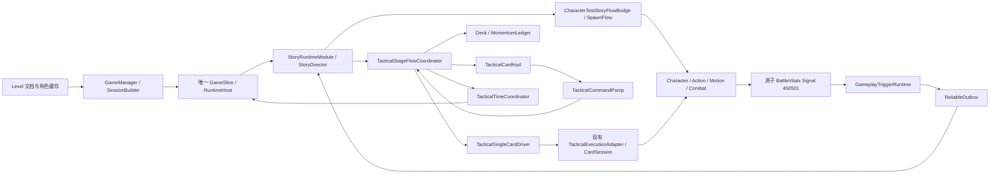

# Tactical Card Demo 端到端走查与验收

> Status: Draft
> 工单：T4-E · 表现呈现与端到端 Play Mode 验收  
> 当前源码流程核对：2026-10-10；原 T4-E 验收日期：2026-09-12
> 状态：现行流程已接入主树；2026-10-09 Unity 编译和相关 EditMode 回归结果见[作者源指南](../Guides/CHARACTER_TEST_TACTICAL_CARD_AUTHORING.md)，未重跑完整自然游玩验收。旧 T4-E 测试及0 B断言保留原范围，完整 Playable 签署仍需实际证据。

## 入口与操作

打开 `Assets/Scenes/TacticalCardDemoScene.unity`，当前 Build Settings 仅启用该正式入口。基地资产维护见[基地场景组装](../Guides/ENVIRONMENT_BASE_SCENE_ASSEMBLY.md)；不要把下文2026-09-12的1v1 Story测试夹具当作当前混合部署。

1. 进入 Play Mode 后从首页新建进度或 Continue。新建保留其他进度；Continue 回到最近保存的整备。整备的进度选择入口可切换其他已保存进度，失败保留当前有效服务。
2. 在整备配置 A/B 队、角色、位置、朝向及卡组，明确且仅有一名玩家控制实体。卡库只用当前进度已持有的卡与动作；可重复加入同一定义，每个实例独立装配动作。需要地点输入的卡只能交给玩家。确认出战前校验精确发布版本/内容 hash，冻结 deployment 并等待 checkpoint 保存，再装配混合 runtime。
3. 当前显式 `tactical_new_game.json` 为五个角色各授予六张卡，共30个引用；六张为常规移动接敌出招r2、撤步还击、选点换位、引敌入锋、就近取背、背后牵制。它们都是当前牌堆的 Action 卡，不能将旧测试用【猛击】【蓄劲】【调息】当作默认手牌。当前正式目录revision37为23张，不等于每个角色全部持有；发布或刷新卡库不授予新卡。三张机制卡通过下节显式试用领取。
4. Planning 暂停世界，当前关卡补齐目标为3，Stage仍有等于3的历史硬检查；这是实现差距，不能当作设计上的三张限制。玩家存活、自由、无受控原因、无阻塞动作/待消费命令，且相关装配动作冷却完成时才可选牌；自由攻击收招可保留并冻结，选牌不强行终止后摇。当前初始动势配置为50；费用使用角色同一动势账本，动作冷却跨卡共享。
5. 底层选卡预留费用，取消释放；更换选择先校验新牌可用性及费用，失败保留旧选择。当前正式FairyGUI手牌通过拖放投放发起直出；地点卡显示实际范围/落点预览，投放后经原选择、地点与确认命令处理，非地点卡仍走原自动目标。无效拖放不算出牌成功，旧卡实例/回合或阻断状态变化会拒绝。普通目标自动保持当前存活敌人，否则选最近存活敌人，没有正式手动点击敌人的选择入口。地点卡另收集地点；UI点击不当作地点，确认仍校验该牌、回合、范围和导航，取消选点也取消本次牌选择。
6. 确认执行后世界恢复，玩家、双方 AI、动作冷却沿共同正式帧推进。普通回合在行为执行结束、玩家可自由行动时结算并请求暂停；不再等待落地、低速度或连续三帧物理停稳。保留未用牌，再补至3张，世界完成1秒减速后进入 Planning。菜单暂停独立持有原因，关闭菜单不绕过 Planning 的 Ready 暂停。
7. 全世界仅剩一个存活队伍时胜利，无存活队伍时平局；玩家死亡后其他 AI 队伍可继续，破聚不等于死亡。终局冻结世界，同一 BattleId 只提交一次结算，保存成功后才允许重试或返回；失败保留待提交记录并允许重试保存。重试用相同冻结部署创建新的 BattleId 与战斗状态；返回恢复战前工作整备。
8. 正常 Executing/Settling 不允许任意退出，故障保护返回与显式恢复遵循 Coordinator 授权；不可恢复的 ExecutionFault 不能由按钮伪造继续。菜单保存入口等待战斗外 checkpoint，强制关闭不保证尚未提交的变更。

Continue 保存与恢复的是玩家清单、整备及结算记录，不含战斗 HP、动作、手牌、冷却或世界帧，也未据此发放奖励。正式敌 AI 消费冻结发布卡，当前战斗 HUD 未发现敌方下一步意图预告链路；当前行为标签不能解释为未来预告。持久化合同见[战术内容指南](../Guides/CHARACTER_TACTICAL_CONTENT.md#存档)，单卡 `CaptureState` 不等于该继续游戏功能。

以上为2026-10-08源码与既有回执核对；本次文档同步没有执行Unity、Play Mode或真实按钮游玩验收。当前流程已进主树，仍不能由历史测试记录推定完整自然游玩通过。

### 整备中的机制试用卡

在整备选中玩家控制角色，展开顶部工具栏，经「更多 → 领取机制试用卡」逐张领取D417/40定点牵引、41记录回返点、42返回记录点r1，点完成，再点出战卡组旁＋打开卡库，点卡面＋加入出战。这是现有混合Demo整备的真实入口，不是AI Lab临时行为测试，也无需旧左右两栏卡组编辑器。零动作槽无需额外动作绑定；领取不自动装配、发布不自动授予。

身份/存档/失败重试合同以[战术内容指南](../Guides/CHARACTER_TACTICAL_CONTENT.md#整备中的机制试用卡领取与装配)为准，领取及当前卡库装配3项原生用例的范围见[任务07](../../StorySource/玩法基石/任务/任务07_定点牵引试用切片.md)与[任务08](../../StorySource/玩法基石/任务/任务08_位置回返试用切片.md)。这些用例不等于机制长时间自然试玩通过。

共用落点/停止重定位前置31项测试范围见[任务09](../../StorySource/玩法基石/任务/任务09_替身准备与体型切换基础.md)；替身与完整体型尚未交付。最新设计以[主基石](../../StorySource/玩法基石/行动卡与交互效果卡设计基石.md)为准，AI Lab真实出牌第一步已批准但尚未实施。

## 历史 T4-E 架构与时序（2026-09-12）

下图及首次消费者接线记录描述当时1v1 Story适配路径。当前混合入口与终局按上节执行，旧步骤不作为首页、部署或多队胜负的当前合同。

`TacticalCardStageRuntime` 是本次补充的 GameSlice 组合接线：创建与销毁战术对象、绑定原 Story 生命周期、使用完成 Spawn 与完整世界 Tick 后的实体身份、连接原执行适配器与 Trigger。它不替代卡牌事务、伤害计算或胜负条件。

原代码中存在战术协作对象与独立测试，但没有正式场景创建并连接这些对象的消费者。因此 T4-E 除 HUD/场景生成器外，还补充了 SessionBuilder、Slice 的组合调用。普通场景仅在配置了战术 HUD 和有效 tacticalStage 文档时进入这条路径。自由输入模块在战术场景中不注册，玩家身份仍为 LocalPlayer。

执行顺序：

- unscaled Update：设置适配器的下一合法世界帧，消费战术命令和回执；随后决定是否推进世界。
- Host PreSimulation：可靠 outbox 交接；战术执行器发射正式行为输入。入场期间暂缓敌方 Planner 决策。
- 原 Host Simulation：Story、正式命令队列、角色动作/运动/战斗等完成当前帧。
- 完整 Host Tick 后：消费复制的 Story 事件；绑定实际角色；通过既有 GameplaySystemPipeline 采样双方同帧 HP、原子裁决并投递可靠动作；最后交给 Stage/Driver 采样平息。
- 当胜败 Step 和直接 Story 成功回执匹配，Stage 才进入 StageCompleted，并取得 BattleEnded 暂停原因。
- 重试通过原 Story 命令和 Step 确认后，在下一次 GameManager Update 的安全边界重建 Session。旧 StageRun 与旧回执不会进入新会话。

双方伤害与移动使用 CharacterTest 已有的 Combat Physics / Character 权威。生成器为地面配置既有 Combat Physics bridge 与 AABB marker；不能把展示 Transform 或动画事件作为伤害、落地、Finished 的权威。

## HUD 布局与接口

当前正式战斗由 FairyGUI `CharacterTestFairyGuiTacticalBattleView` 消费 `TacticalCardHud`，使用三张玩家牌的固定数组；整备和战斗描述共用同一投影及参数浮窗。Composer 发布的 `TacticalBattleHud` 必须包含 `parameterWindows`，缺失会显式拒绝，不由运行时拼装替代界面。

| 区域 | 当前展示与交互 |
| --- | --- |
| 动势区 | 当前、预留、可用动势和暂停状态 |
| 三张玩家手牌 | 真实卡名、费用、短句、选择/执行状态；Tooltip保留详细规则，卡旁浮窗展示参数 |
| 操作区 | 当前正式FairyGUI隐藏独立确认/取消按钮，手牌拖放经原命令链直出；返回整备、设置及故障恢复仍消费真实可用状态 |
| 结算与故障反馈 | 胜负/平局、重试或返回整备、恢复及不可执行原因 |

旧 `Assets/Resources/TacticalCard/TacticalCardHud.uxml` / `.uss`、临时 PanelSettings 及 UI Toolkit 渲染测量属于2026-09-12历史 HUD，不作为当前 FairyGUI 的发布入口或验收依据。当前也没有敌方下一步意图预告组件。

Pending/Resolving 卡从 Deck.Hand 移出时，显示槽位仍保留同一个卡实例。HUD 用固定三槽数组投影状态，不修改卡牌区域或顺序。卡牌可用性调用 Coordinator 的只读权威查询，包含已选 Action 的替换规则。

程序化接口：

- `Bind(coordinator, commands, storyBridge = null)`
- `TrySelectHandSlot(index)`、`TryPlayUtility(index)`
- `TryConfirmExecution()`、`TryCancelPending()`
- `TryRequestRestart()`、`TryRequestRecovery()`
- `GetHandSlot(index)`、`RefreshIfChanged()`
- HandCount、CurrentMomentum、ReservedMomentum、SpendableMomentum、Phase、TurnIndex、Health、HasOutcome、IsVictory、OutcomeMessage、FaultMessage、各操作的可用状态。

这些接口属于 CharacterTest 内部验证组件，测试通过既有 friend assembly 访问；不扩大通用 package 的公共 API。

命令包含 StageRunId、TurnIndex、CardInstanceId、CardVersion、SnapshotRevision；source 固定为 0，序号从 1 单调递增，绑定同一命令泵时不会归零。所有命令由 Coordinator 再次校验；HUD 不消费世界 Tick 或直接调用 Apply。

## 历史分配边界（2026-09-12）

本节0 B断言属于当时核心与历史 HUD 夹具，不覆盖当前 FairyGUI、参数浮窗、profile/checkpoint、混合世界及其冷路径。本次未重新测量。

Update 首先比较快照版本与阶段、气机、暂停、结局、故障变化。无变化直接返回；固定槽数组和已缓存数字字符串避免每帧集合与字符串构造。卡牌名称/描述复用只读定义字符串。初始化、首次 UI 构建、极大回合号格式化和故障诊断文本属于低频分配路径。

G02 分开测量纯核心循环、核心加 HUD 同步刷新、无变化 HUD 轮询。UI Toolkit 的渲染/布局、真实世界推进、正式执行准入以及 Story/重试的冷路径不包含在这些 0 B 断言里，必须单独报告；不得据此宣称整场景或整帧 0 B。

## 历史自动化验收矩阵（2026-09-12）

测试入口：`MxFramework.Tests.PlayMode.CharacterTest.TacticalCardPlayModeAcceptanceTests`。

| 用例 | 验证内容 | 本次结果 |
| --- | --- | --- |
| G01_PlayMode_CompleteThreeTurnsToVictoryLifecycle | 实际 Demo 场景入场、手牌/气机、HUD 选卡确认、真实攻击、三回合、Trigger/Story 胜利、重试 | Passed；专用开局耐久条件见下文 |
| G01_PlayMode_DefeatOnPlayerDeath | 原属性权威注入玩家死亡，实际 Trigger/Story 裁决 Defeat | Passed |
| G01_PlayMode_SimultaneousDeathsChooseDefeatOnce | 同帧双方死亡只裁决 Defeat | Passed |
| G02_PlayMode_SteadyStateCoreLoop_ZeroGCAlloc | 预热后纯核心与 HUD 分层线程分配 | Passed；两组 200 回合均 0 B，无变化轮询 10,000 次 0 B |
| F01_PlayMode_ExecutionTimeoutTriggersFaultSuspended | 299 Tick 保持执行，第 300 Tick 单次保护；保留 Resolving/支付/回合并恢复 | Passed |
| 既有 TacticalCard EditMode 回归 | Card Engine、Time、Execution、Stage Flow、Stage End、Authoring | 163 passed / 0 failed / 0 skipped |

F01 使用明确的受控执行端口保持不终结，以确定性触达 300 Tick 边界；它不冒充真实攻击自然超时。G02 的纯核心端口也为受控端口。G01 才覆盖正式场景、现有动作和战斗路径。

## 历史实际验证记录（2026-09-12）

Unity 版本为 **6000.5.0f1**。原 Editor 的统一校验作业 `3f0fe0e90ce84e76a27edf9b4cc81921` 完成 refresh、compilation started/finished、domain reload、Editor ready，Console error count 为 0。随后 Editor 主线程请求持续超时，Windows 窗口连接也不可用；最终源码改为在 `.agent/t4-e-validation` 的隔离副本中由同版本 Unity 编译和执行测试。

副本复制当前工作区源码、正式 Assets/Packages/ProjectSettings、FMOD bank 与 StorySource，并复用后重新导入 Unity 缓存。复制缓存曾导致场景 MonoScript 映射缺失，已通过 Unity 强制重新导入并运行同一生成器解决。副本只用于验证，不替换原工作区的用户修改。最终报告保存在原工作区的 `Library/MxFramework/TacticalCardT4E/`，不作为版本化资产。

| 测试组 | 通过/失败/跳过 | 耗时 |
| --- | --- | --- |
| TacticalCardEngineTests | 11 / 0 / 0 | 包含于下列总耗时 |
| TacticalTimeCoordinatorTests | 35 / 0 / 0 | 同上 |
| TacticalExecutionAdapterTests | 14 / 0 / 0 | 同上 |
| TacticalStageFlowCoordinatorTests | 43 / 0 / 0 | 同上 |
| TacticalStageFlowTests | 24 / 0 / 0 | 同上 |
| TacticalStageEndTriggerTests | 25 / 0 / 0 | 同上 |
| TacticalCardDemoAuthoringTests | 11 / 0 / 0 | 同上 |
| EditMode 合计 | **163 / 0 / 0** | **34.78 s** |
| PlayMode 最终运行 | **5 / 0 / 0** | **12.76 s** |

PlayMode 最终运行启用了 D3D11 / NVIDIA GeForce RTX 4080。Unity 完成编译并正常结束；日志中的编译 warning 来自既有 Dragon14 测试的过时查找 API，本次新增代码未产生编译 warning。批处理未产出可审查的 Game View 截图，不能把显卡初始化或测试绿色解释为视觉验收。

既有执行适配器回归也包含 Unity 暂停/恢复、Tick/Observe/SettleSample 的预热分配断言。本次 G02 的纯核心与核心加 HUD 同步刷新分别为 **0 B / 0 B**。F01 使用 10 气机的 Action，确认实际支付到 40 后触发第 300 Tick 保护，费用、Resolving 与回合号保持，恢复后正常平息。真实世界完整 Tick、UI renderer 和 Story 低频操作没有单独给出分配数值，不声明这些范围为 0 B。

## 历史 G01 初始条件与闭环证据（2026-09-12）

G01 在真实场景第一次 Planning 后、首条出牌命令之前，通过现有 Gameplay 属性 API 一次性设置验收耐久：**玩家 HP 当前值 1000、对手 HP 当前值 140**。不修改默认关卡文档、角色包或运行时卡牌规则；不在回合之间加血、注入伤害或伪造 Finished。此做法延续既有 T4-C 长回合测试的初始耐久设置。CombatState.Health 有默认最大值裁剪，所以新增验收直接读取 BattleVitals 同源的 Gameplay HP，避免把显示值当权威值。

| 回合 | 对手权威 HP | 完成证据 |
| --- | --- | --- |
| 1 | 140 → 87 | 真实起手与命中；Finished；Planning；补到三张 |
| 2 | 87 → 34 | 第二次真实起手与命中；Finished；Planning；补到三张 |
| 3 | 34 → 0 | 第三次真实起手与致死命中；原子 Signal 450501；可靠 Story 成功回执；outbox 清空；StageCompleted + BattleEnded |

第三次动作不会为了凑齐 Finished 而继续推进已结束的世界；终局优先于普通收势/补牌，符合 T4-D 的交接屏障。HUD 胜利状态和重试按钮通过验证，重试产生新 StageRun，重新入场并恢复 50 气机；旧 outcome 清除。重试初始化已改为优先复用有效动作摘要，避免重复替换共享缓存文件。

## 历史 T4-E 未关闭项与当前验收边界

下列三项是2026-09-12回执的未关闭项，保留其夹具与数字，不代表此后现行默认卡组仍相同，也不覆盖后续UI聚焦回执。当前67项回归中的19项原生UI检查是子集，不能另行相加；它们亦不能替代当前完整自然游玩和中途存档功能的证据。

1. **默认场景的三回合胜利平衡尚未成立。** 未改变耐久的基线运行在第一回合进入 Defeat，当时对手 HP 为 47。上述三回合通过证明固定初始条件下的端到端链路，不证明默认角色配置无需调整就能三回合获胜。正式平衡应由角色/关卡所属配置确定，不在 HUD 或 MonoBehaviour 中隐藏 HP 配置。
2. **Game View 的可见性、中文字体、实际按钮点击与结算画面仍需图形 Editor 验收。** 场景已由原 Unity Editor 生成保存，结构与程序化输入通过测试；当前自动化连接未恢复，批处理截图请求没有生成可审查图片。
3. **回归范围为本工单相关的 163 个既有 EditMode 和 5 个 PlayMode。** 没有运行全仓库所有测试，因此不把 168/168 表述为全仓库测试全部绿色；也不宣称仓库既有 warning 为零。

当前源码已具首页、混合整备/战斗与战斗外 checkpoint 链路。本次只核对文档，未重新验证现行默认部署的自然游玩、故障恢复、结算与存档交互；完整 Playable 签署应据现行基线的实测回执，不能复用旧夹具通过次数或推定全部图形操作已验收。

## 固定奖励领取走查（2026-10-11，原生验收范围）

固定领奖实现已进入当前工作树，Composer已发布，8个新增meta已由Unity导入。以下步骤区分预期玩家行为与逐项验收；原生EditMode Runner 33/33已经通过，完整自然游玩、GUI故障重试、冷组合根重开与尺寸视觉按实际证据记录，不能仅据fixture宣称全部通过。

1. 使用独立验收存档根启动正式切片，确认玩家控制实体引用真实角色物品实例。
2. 自然战胜后，内存结算冻结但不代表已保存；首次保存中显示“正在保存结算…”，失败显示“结算尚未保存”与保存重试。Pending保存完成后看到固定奖励「常规移动接敌出招×1」及本场控制角色名称/实例号，状态才为“奖励待领取”，主按钮为“确认领取奖励”。败北/平局同样先保存结算，但没有奖励领取。
3. 点击确认后显示「正在领取并保存…」，主操作/重赛/退出在处理中禁用。重复回调或点击不能创建第二批实例。
4. 成功显示已整批领取并保存，主按钮变为「返回整备」。新主卡进入该角色的真实卡持有，不自动绑定动作或替换出战卡组。
5. 用验收fixture注入保存失败：原库存/allocator/ledger与Pending不变，界面提供「重试领取奖励」。修复写盘后重试一次完成，不多发。
6. Pending可保存并退出；重开直接回到原待领奖结算，清单/归属/请求不重新生成。已领取再重开不重发，继续进入战斗外整备。
7. 原生专用发布组合根probe已通过Runner，只写独立根、不启停Play/改Scene/发布静态服务；自然胜负、恢复与界面尺寸另行验收，保留各自证据级别。

不要用真实用户存档自动发测试奖励。当前不推进下一关、不提供随机奖励。成功保存的Pending保证领奖期间重开可恢复；首次终局Pending写入尚未完成时，系统强制终止没有可恢复的持久终局证据。

追加验收（2026-10-11）：保存回读统一解析序列化 JSON，修复 ISO 时间 Date/String token 差异导致的伪写入冲突；同服务失败重试与物理写盘后回执丢失回归覆盖。Unity完整refresh/compile/domain reload/ready与Console0通过，原生EditMode Runner现35/35。受控已持久化Pending夹具通过发布FairyGUI绑定回调验证重复点击仅一次保存、处理中不发布库存、保存失败完整回滚、同服务重试整批Claimed、返回整备，以及全新物理store/服务组合根冷重开后AlreadyClaimed不写盘；角色实例1卡6→7、新卡未绑定、其他角色未变。实际GameView的1920×1080/1280×720待领取、处理中、成功清单与归属完整可读；失败长诊断尾部有裁切。实际自然战斗仍未观察到玩家胜利（剑角色456/457与法师测试装配败北，458开放上界及461缺前摇拒绝原因另记）；不把该受控Pending夹具、Runner或冷组合根作为自然胜利、OS输入或Unity Player进程重开。保存结算重试成功后旧失败文案残留和长失败文案显示修复仍待办。证据级别与回执保留于本地 .agent/tactical-rewards-20261011/native/resume2-acceptance-receipt.json，真实玩家存档未修改。

阶段追加验收（2026-10-11）：确定性弱敌夹具已走通真实HUD出牌、命中死亡、阵营1胜利判定→正式固定奖励页→确认领取及整批保存→返回整备。隔离rwd1011-ui03角色实例1/owner1使用合法正式action:457；敌方HP1仅在Deploying且行为未安装时初始化，玩家HP100，终局HP为敌0/玩家51；无战斗中改血或结算注入，正式平衡与真实存档未改。显示层修正经同服务真实保存失败→正式回调重试成功确认旧提示清除；领奖失败后重试期间仍显示处理中，重复回调只一笔保存，成功主卡6→7且原绑定不变。1920×1080、1280×720下失败短提示、完整固定奖励和归属均可读，完整内部故障原因保留。Unity默认compile全证据通过/Console0。本地证据：.agent/tactical-rewards-20261011/native/resume3-acceptance-receipt.json。验收是Editor内正式GUI绑定回调、确定性初始弱敌及GameView截图，不是OS鼠标点击或Unity Player进程重启；前一阶段35/35 Runner与组合根冷恢复证据保持原边界，本阶段未重复Runner。保存层独审通过后的两份源码未改。
